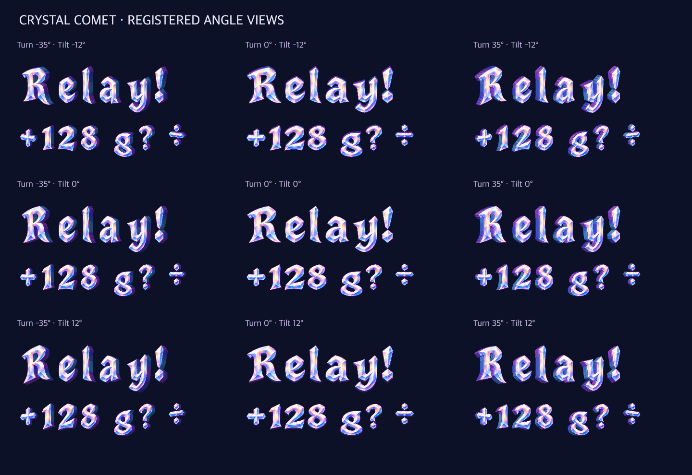

# Use crystal depth in normal celebrations

**Status:** Implemented; native development checks pass · **Owner:** current implementer · **Date:** October 18, 2026

The user approved the sprite pack for use in Starfall. Compose celebration titles, exact relay counts and score awards from its glyphs in the normal Debug/Release app. Keep native UI text for navigation and the authoritative score/accessibility label.

**Decision:** derive a bounded native profile from the same masters: all 106 characters, fifteen horizontal views at zero pitch, 96-pixel cap height. Keep the full 45-view, 160-pixel source pack for future animation authoring. One fixed prewarmed cache owns decoding; the existing receipt timeline selects frames and settles at the front. Calm effects, VoiceOver and Reduce Motion use the front frame throughout. Preserve original opalescent faces; the existing contributor-colored glow supplies family context.

**Approved exported assets, not native evidence.** Native acceptance must inspect readability at actual callout sizes and verify changing frames in normal motion.

## Acceptance before completion

- Compose current catalogue titles and exact positive awards with stable spacing, baselines and individual glyph pivots. Repeated letters/digits retain position identity; unsupported characters or malformed resources use complete native text.
- Package all fifteen bounded atlases and metadata in the existing target. Prewarm and cache success/failure once; no loading, cropping, scanning or geometry generation during animation ticks. Record actual compressed and decoded texture budgets.
- Use receipt age for a finite turn/settle, with a slight per-letter delay. It must own no gameplay completion, score, save, task or clock. Quiet modes are static; settings/background/restart/replacement retain the existing receipt cancellation contract.
- Run focused glyph/layout/resource/motion/failure tests, receipt sibling tests, native normal play, rapid taps, recipe/relay, interruption, endings/restart, largest text and system Reduce Motion checks. Inspect native stills and changing normal-motion frames.
- Run core tests, Debug/Release simulator builds, repository hygiene and whitespace checks. Record source and limitations. Actual VoiceOver is deferred to RC; physical installation, if delivered, uses only the canonical current-main updater.

Native packaging belongs to `build/native.cjs`; its source roster and output hashes remain outside the sealed full sprite pack. [Native evidence](../../docs/evidence/crystal-depth-native-2026-10-18/README.md) records 165 core, 20 hosted and seven interaction passes, Debug/Release builds, inspected frames and remaining physical/RC limits. The final profile contains 20,974,327 PNG bytes and a 54,263,808-byte atlas pixel roster under a 64 MiB raster ceiling. This roster is not a measured process/GPU memory peak.
