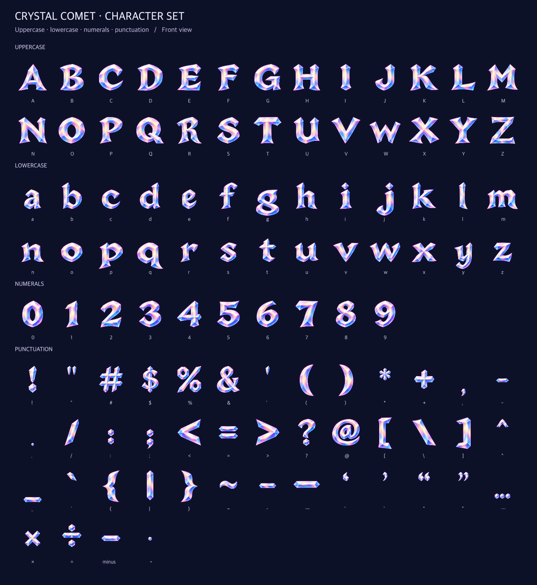

# Crystal Comet letter sprites

**Status:** Ready for review — asset pack verified · **Owner:** current implementer · **Updated:** October 18, 2026

The user selected the crystal-depth treatment in the [Relay! / +128 specimen](../../docs/design/celebration-lettering/motion-specimen-01/README.md). The resulting package contains **106 characters and 4,725 sprites**, with stable layout metadata and an offline angle viewer. Start with the [preview](pack/preview.html), [usage notes](pack/README.md) and [verification record](../../docs/evidence/crystal-comet-sprites-2026-10-18/README.md). The user subsequently approved [native integration](NATIVE.md), which derives a smaller turn profile for the normal game. The full pack below remains the authoring master.

**Exported asset contact sheet — not native evidence.** Every visible character is shown in the front view. The [angle sheet](pack/previews/angle-views.png) shows the registered shallow edges; the original comparison retains its own historical source.

## Package contract

- All 95 printable ASCII characters (uppercase, lowercase, digits, 32 punctuation marks and space), plus `– — ‘ ’ “ ” … × ÷ − •`: 106 characters, 105 visible glyphs.
- Each visible glyph has 45 views: yaw −35° through +35° in 5° increments; pitch −12°, 0° and +12°. Rotation uses the specimen's orthographic projection and shallow geometric edges, with painted front facets.
- Transparent PNG atlases, per-frame bounds and offsets, stable pivots, baseline/advance metrics, named angle lookup, checksums and source provenance. Space has an advance and no image.
- Cap height 160 source pixels; x-height 118; descender allowance 40. Atlas edges at most 2048 pixels. Atlas frames include gutters; layout metrics do not change with camera angle.
- Existing `Relay!+128` specimen glyphs remain the reference masters. New characters extend their opalescent material and broad crystal silhouettes.

## Acceptance

- Inspect every source glyph for its exact character, legibility, separation and counters; repair malformed/missing glyphs before export.
- Verify 105 × 45 nonempty rendered sprites, all 106 character mappings, transparent margins, valid atlas bounds, stable pivots/baselines/advances, and deterministic package hashes.
- Inspect the complete front alphabet/digits/punctuation contact sheet and representative extreme/neutral views, including narrow letters, descenders, disconnected dots and counters.
- Preview actual packed frames in motion, including reduced-motion static behavior. Distinguish browser evidence from native runtime performance/accessibility; app integration and physical phone checks remain separate work.
- Run package validation, repository hygiene and whitespace checks. Core/native builds are inapplicable while app inputs remain unchanged.

The linked verification record reports these outcomes, source fingerprints, repaired glyphs, checks and remaining native acceptance limits. The separate [native contract](NATIVE.md) and its linked evidence own app import, animation and native acceptance.

## Ownership and reuse

`sources/` holds generated input images and their provenance; [build/](build/README.md) owns the offline extraction, projection and packing code. `pack/` is a generated payload owned by this README and its manifest, not a collection of ordinary project folders. Do not edit generated frames by hand. The archived ten-glyph specimen remains historical comparison evidence; this package owns future alphabet production.

The built-in ImageGen workflow supplies original front artwork. No third-party font, purchased asset, provider SDK or runtime network feature is added. Package provenance does not assert exclusive copyright in generated imagery or assign an external license.
