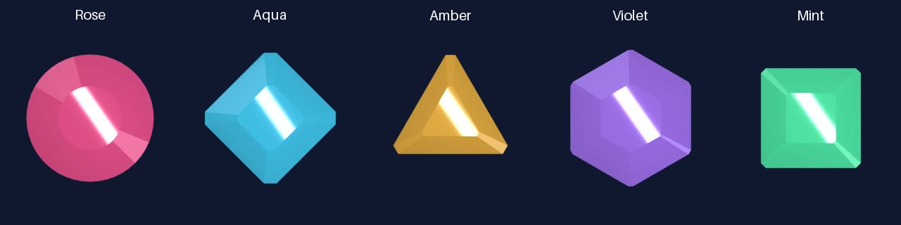

# Starfall crystal family v2

New editable Blender geometry, materials, lighting, and animation for the five Starfall jewels. This family recreates the visual direction from references; it does not reproduce the missing original source or promise identical silhouettes. No external model, texture, paid generation, or network dependency is used.



## Files

- `source/generate_crystals.py` and `source/scene_settings.json`: the complete procedural source.
- `renders/scenes/*.blend`: one self-contained editable scene per jewel, saved at neutral frame 4.
- `renders/frames/<kind>/frame_00.png` through `frame_08.png`: original Blender RGBA outputs.
- `renders/metadata/*.json`: source, settings, scene, and output hashes plus rendering configuration.
- `assets/*.imageset`: five packed runtime-compatible atlases with Xcode metadata.
- `manifest.json`: SHA-256 and byte counts for every package file except the manifest itself.
- `package.py`, `validate_package.py`, and `test_validate_package.py`: lossless packing, sealing, and structural checks.
- `verify_scenes.py` and `review/`: native Blender reproduction checks, visual sheets, sampling control, and recorded geometry deltas.

## Frame contract

Each atlas is 2304 × 256 pixels: nine 256 × 256 transparent frames, left to right, neutral at index 4. The authored pivot is fixed at (128, 128). Frames retain their full canvas; neither packing nor review should recenter cropped alpha bounds. The five silhouettes are rose circle, aqua diamond, amber upward triangle, violet point-up hexagon, and mint square.

## Reproduce

Use Blender 5.2.2 LTS with Cycles CPU and Python 3 with Pillow for packing. Run from the repository root. The generator defaults to a two-frame aqua pilot; request the whole family explicitly:

```sh
/Applications/Blender.app/Contents/MacOS/Blender --background --factory-startup --threads 4 --python-exit-code 1 \
  --python Artwork/Crystals/v2/source/generate_crystals.py -- \
  --kinds all --frames 0,1,2,3,4,5,6,7,8 --samples 512 \
  --output-dir /tmp/starfall-crystal-reproduction/renders
```

For a new complete package, copy this directory to a versioned destination, remove that copy's generated `renders/`, `assets/`, and manifest, and point `--output-dir` at its `renders/`. Then run:

```sh
python3 -B Artwork/Crystals/v2/package.py pack --root /path/to/new-package
python3 -B Artwork/Crystals/v2/package.py seal --root /path/to/new-package
python3 -B Artwork/Crystals/v2/validate_package.py /path/to/new-package
python3 -B -m unittest discover -s Artwork/Crystals/v2 -p 'test_*.py'
```

The generator refuses existing output files unless `--overwrite` is supplied. Keep originals and approved versions intact. Render settings use a fixed seed, 512 samples, OpenImageDenoise, and transparent film. Hardware or Blender version changes can affect pixels; render receipts record the actual build and hashes.

To reopen the delivered scenes, check all nine poses, and re-render each neutral frame without changing the scenes:

```sh
/Applications/Blender.app/Contents/MacOS/Blender --background --disable-autoexec --threads 4 --python-exit-code 1 \
  --python Artwork/Crystals/v2/verify_scenes.py -- \
  --package Artwork/Crystals/v2 --output-dir /tmp/starfall-new-scene-check
```

Use a new output directory and require exit code 0 plus `report.json` with `passed: true`. The check compares decoded pixels; Blender's PNG date, source path, and render-time metadata can differ between runs. SHA-256 in the manifest protects the exact delivered file bytes.

## Adoption boundary

This directory is an artwork handoff. It does not replace `App/Assets.xcassets` or enable any runtime feature. Native game acceptance, including actual phone sizing, motion, accessibility, and runtime loading, belongs to the separate integration workstream. The old alpha-equality comparator intentionally rejects new geometry; use its reported deltas for review rather than claiming a drop-in geometric match.

For adoption, review the complete family and copy the five `assets/*.imageset` directories together in the runtime owner's integration change. Preserve the existing loader's frame order and pivot. The old approved-aqua checksum in the runtime catalog preflight must only change as part of that reviewed adoption; this package does not change that baseline or validator.

## Verification

All 45 frames were rendered at 512 samples with denoising. Every frame is nonempty, padded, and pixel-identical to its atlas slice. All five delivered scenes were reopened in Blender, their nine poses checked, and their neutral frames reproduced with exact RGBA8 equality, independently confirmed with Pillow. A separate directory containing only the generator and settings also rebuilt the aqua neutral pixels exactly. Eleven focused synthetic validator tests pass, including the observed Blender 5.2.2 header and malformed-header rejection.

[Review notes and limitations](review/REVIEW.md) link the actual visual evidence, source reproduction receipts, and same-geometry sampling control. All 45 alpha channels differ from the old family; the strict old-alpha comparison therefore remains a failure, explicitly recorded rather than waived. The package passes its separate recreation contract. Validation stdout is retained beside the package in `../v2-validation.json` to avoid a manifest self-hash cycle.
