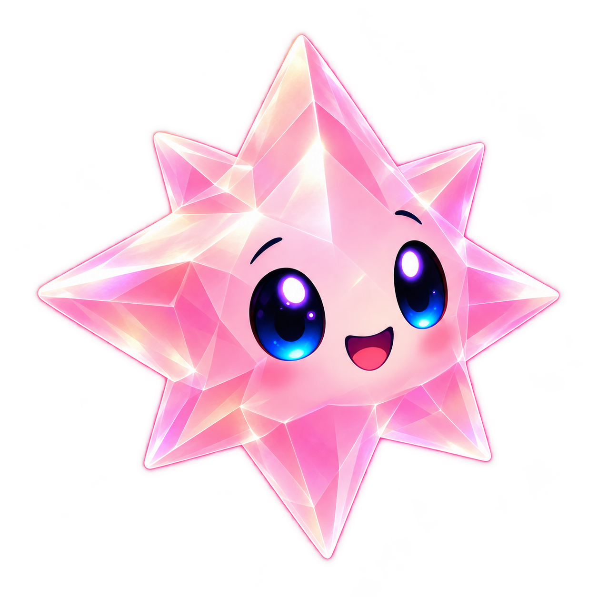
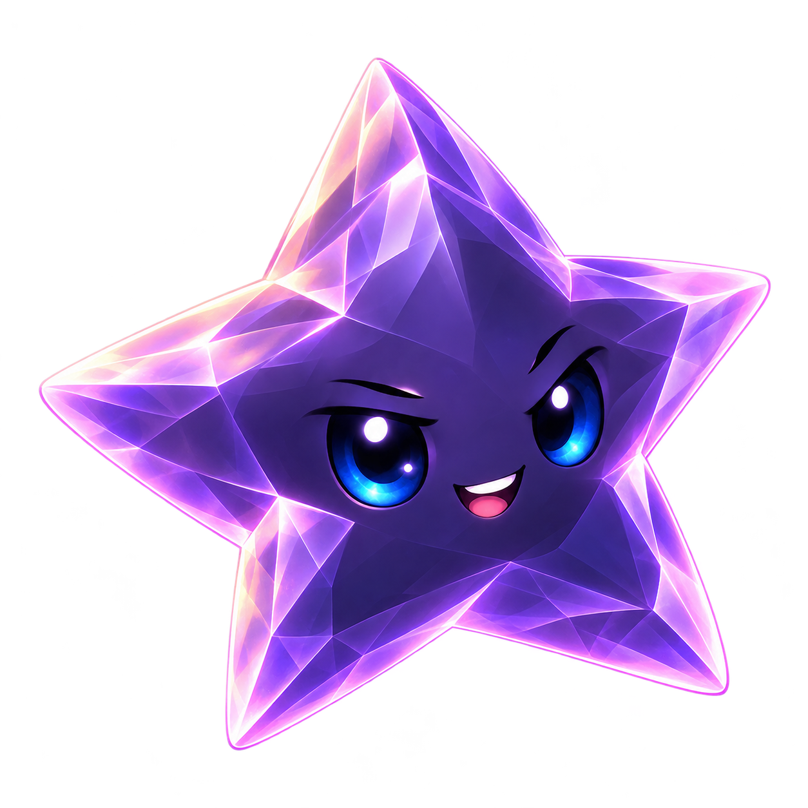

# Conversation portraits

Six dedicated Crystal Glow portraits for the approved character chat. Original transparent outputs are retained here; [generation prompts](prompts.md) record the built-in image tool and reference sources. These preserve the established six character identities while making faces more expressive at conversation size. Board artwork and rules are unchanged.

| Sunny | Spark | Pip |
| --- | --- | --- |
|  |  |  |
| Twinkle | Nova | Dusk |
|  |  |  |

**Generated production artwork, not native acceptance evidence.** Outputs were visually inspected for identity and distinct silhouettes. Native asset sets `Dialogue<Name>.imageset` contain 256×256 exports made with `sips --resampleHeightWidth 256 256`, preserving alpha. The shared native medallion supplies the frame; art has no bubble, text or scenery baked in. Do not load these source masters in a per-frame path or replace board materials with them. Each speaker has one portrait expression in this delivery.

For a revision, generate a transparent sibling from the relevant approved character master and selected chat concept, inspect it at actual size, then export to the existing asset ID. Preserve silhouettes, full tips, dark-star contrast, eye scale and upper-left lighting. Keep all six portraits consistent; avoid clipping wide Nova or tall Spark to force identical body bounds. Run the packaging test and inspect the actual bubble at ordinary/largest text sizes. Source art alone does not verify native layout, animation, accessibility or device behavior.

Start authoring conversations at [DialogueScripts](../../App/DialogueScripts/README.md); [the design](../../docs/design/CHARACTER_CHAT_AND_TRAIL.md) owns behavior and acceptance.
