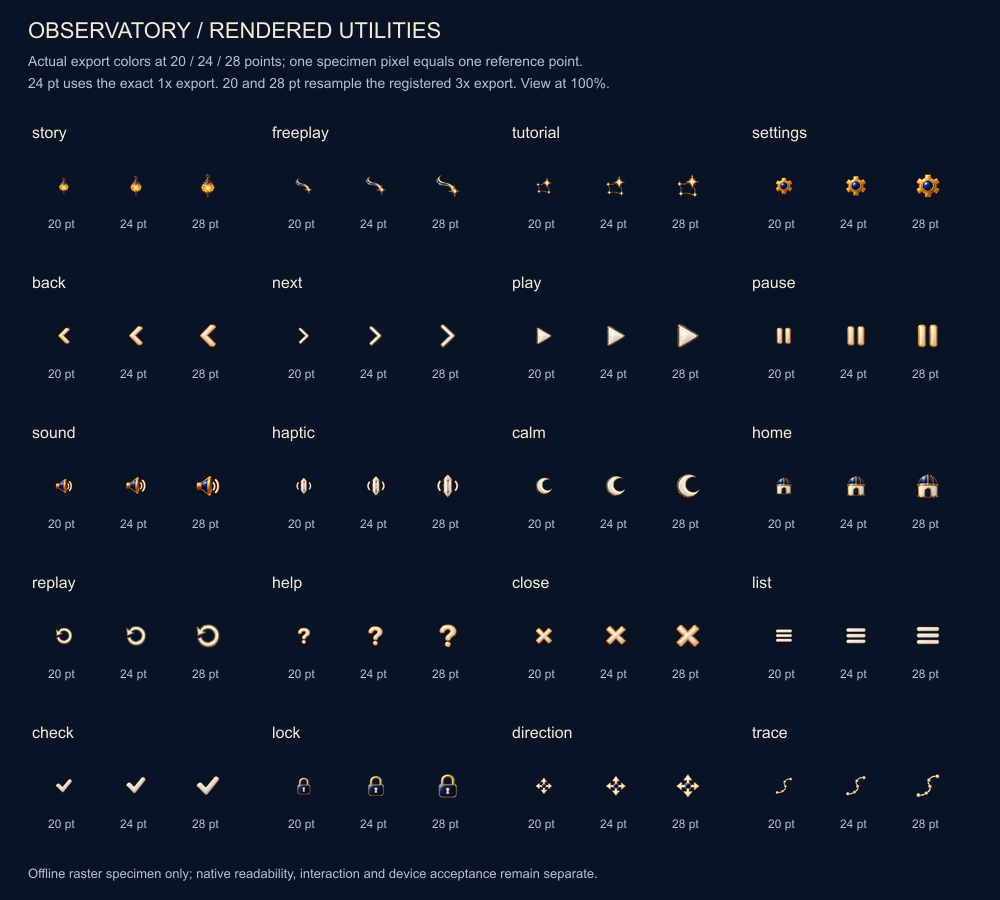
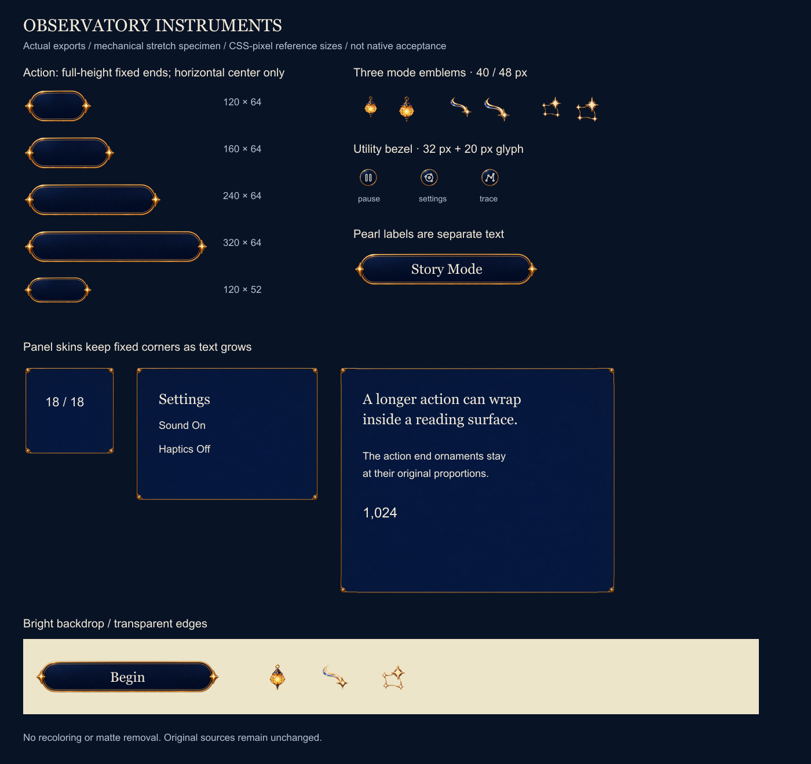
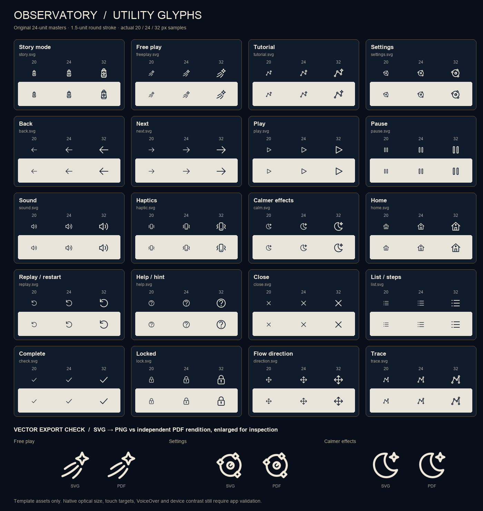

# Observatory Instruments UI kit

**Status:** Native family adopted for development; rendered utility exports and offline specimens verified · **Original kit:** `cfd6ab7` · **Updated:** October 23, 2026

A reusable Starfall interface family: three illustrated mode emblems, shared enamel/brass skins, and twenty full-color rendered utility icons. The source kit supports the accepted [game UI direction](../../docs/design/GAME_UI_SYSTEM.md). The [screen atlas](../../docs/design/interface/atlas-2026-10-19/README.md) remains the proposed composition reference.

The user authorized asset production, native integration and the replacement of flat utility glyphs with rendered artwork. [StarfallTheme](../../App/StarfallTheme.swift) and [ObservatoryArtwork](../../App/ObservatoryArtwork.swift) use the family across scenic home, gameplay controls, reading surfaces and settings. [Rendered utility provenance and review](RENDERED_UTILITIES.md) records the new sources, export checks and native review limits. The [earlier native evidence](../../docs/evidence/observatory-ui-native-2026-10-19/README.md) and [capture index](../../docs/evidence/observatory-ui-native-2026-10-19/captures.json) retain the original integration’s coverage and delivery status; they do not certify the new PNG family. Rules, saves and progression retain their existing owners.

## Review the actual assets

[Open the original asset specimen](review.html) to inspect the retained skin stretch examples and historical vector glyphs. This is a local browser specimen, not an iOS build. The current utility family is shown below; specimen labels are not a newly produced game font.



*Current utility exports, shown at one image pixel per reference point. Separate [source-canvas preview](previews/rendered-utilities-raw-sources.png); neither specimen establishes native acceptance.*



*Export review sheet, not an app screenshot. The button keeps fixed ornamental ends; tall surfaces use the panel skin.*



*Historical SVG/PDF utility family, retained for provenance. These template glyphs are no longer the normal app’s utility assets.*

## Contents

| Entry | Purpose |
| --- | --- |
| [Integration contract](INTEGRATION.md) | Native ownership, measured geometry, state composition, scalable labels and adoption gates |
| [Native resource catalog](../../App/Assets.xcassets/ObservatoryUI) | Twenty rendered utility sets and six emblem/skin sets: 78 original-color density PNGs |
| [Original generation record](PROMPTS.json) / [utility generation record](masters/utilities-v2/PROMPTS.json) | Exact built-in ImageGen prompts, original paths and source hashes |
| `masters/illustrations/` | Unchanged transparent Story lantern, Free Play comet and Tutorial constellation sources |
| `masters/skins/` | Unchanged blank action, reading-panel and utility-bezel sources |
| `masters/utilities-v2/` | Twenty unchanged transparent PNG sources and their generation records |
| `masters/glyphs/` | Twenty historical, editable 24-unit SVG masters |
| `exports/` | 60 current utility PNGs and 18 emblem/skin PNGs; historical 60 template PNGs and 20 PDFs retained separately |
| [Rendered utility manifest](rendered-utility-manifest.json) / [raster manifest](raster-manifest.json) / [historical glyph manifest](glyph-manifest.json) | Exact hashes, dimensions, alpha bounds, registration, budgets, caps and checks |
| [Utility exporters](build/README.md) / [raster exporter](build_rasters.mjs) | Deterministic offline regeneration with existing local dependencies |
| `previews/` | Review sheets; never runtime textures |

Source generation and deterministic export are separate steps. Never derive runtime assets by slicing a screenshot or the atlas boards. Keep originals unchanged and produce a new source version for an art revision.

## Use the family consistently

- **Mode emblems:** Home and major destinations, normally 40 points and at most 48. Their utility variants reuse the same illustrated masters at 24-point registration. Do not stretch an emblem or bake its label into it.
- **Action surfaces:** Primary and mode actions use fixed-height ornamental ends with a flexible middle. Compact and secondary actions use the shared native `ObservatoryCompactActionSurface` enamel/brass face, distinct from the passive compact reading raster. Tall primary labels still reflow into the reading-panel skin so side ornaments do not distort.
- **Reading panel:** Fixed corners, stretchable edge strips and center. Header, divider, portrait, controls and text remain independent.
- **Utilities:** The rendered icon is the visible control in a clear 48-point target; the shared utility style adds no circular bezel. The original bezel asset remains retained and is not the default control wrapper. Text-bearing gameplay controls retain their 45-point minimum.
- **States:** Apply registered material overlays, separate native ink and stable focus/selection marks. Do not generate a different silhouette for every button state. Disabled state must preserve labels and the selected value while preventing activation.

The native control remains the semantic and input owner. Decorative layers ignore hit testing and accessibility. Existing preferences govern sound, haptics and calm effects; system accessibility adaptations do not add new game preferences.

## Native ownership and import

`ObservatoryIcon` renders utility PNGs in original color; `ObservatoryEmblem` and `ObservatoryModeLabel` compose the three home destinations with native text. `StarfallButtonStyle` retains semantic roles and measured action geometry; tall primary labels reflow into the reading-panel skin. Compact/secondary actions use the shared rounded native enamel/brass face with immediate press shading; `starfallPanel` retains the passive compact authored reading surface, and full reading panels use the registered 32-point fittings. Native label sizing, padding, full hit targets, selection and enabled/focus semantics are unchanged. `StarfallUtilityButtonStyle` keeps clear 48-point targets and `StarfallGameButtonStyle` keeps 45-point text-action targets. `ObservatoryToggleStyle` provides visible position/check cues with a native switch accessibility representation.

The compact action face reuses theme colors and contact shadow without new raster assets or export changes. The [compact-action record](../../docs/evidence/cohesion-goal-04-compact-actions-2026-10-23/README.md) owns its source-bound native coverage and remaining visual, VoiceOver and physical acceptance; source state treatment alone does not establish disabled-state visual acceptance.

Display and action labels use scalable native serif roles in `StarfallTheme`; body copy uses native functional text. No new font or font registration is included. Pearl ink is separate from artwork, and exact HUD digits remain native. Crystal Comet retains its existing celebration-only renderer and fallback contract.

The app imports sixty rendered utility PNGs and eighteen emblem/skin PNGs as original-color images. The 26 image sets contain 1,023,964 encoded payload bytes; twenty-six 3× selections represent 2,359,296 decoded RGBA bytes before renderer copies or GPU storage. The historical SVG/PDF/template PNG family remains outside the app. These are roster measurements, not a process-memory profile.

Source/export manifests describe retained artwork and export verification. Native `Contents.json` files describe stable app names, density and original rendering intent; `ObservatorySkin` owns native point sizes and cap insets. No runtime importer, SVG parser or image generator is added. [Hosted resource checks](../../AppTests/ObservatoryArtworkTests.swift) exercise the compiled catalog and large-text action layout; native results belong to integration evidence, not export manifests.

## Provenance and boundaries

The original six illustrated sources and seventeen new utility sources were created with built-in ImageGen for this project. The three mode utilities reuse the existing illustrated masters. Exact prompts, original source paths and hashes remain recorded. Utility export uses alpha ≥16 subject bounds plus four source pixels of bleed, retains pixel colors/alpha inside that crop, and records any discarded faint fringe before proportional resampling. The historical SVG family was authored for Starfall. No third-party asset pack, icon library, purchased artwork or runtime dependency was added. This record identifies sources; it does not make a separate legal ownership or exclusivity claim.

Small-size review found the retained mode emblems and Trace finer than solid controls, and Back heavier than Next. These are native visual-review limits, not export blockers; see the [review note](RENDERED_UTILITIES.md). Native appearance, motion, accessibility and physical-device acceptance remain separate.

The optional `game-dev` CLI was unavailable. The host image generator and available local export tools produced this 2D source kit. This is not a `game-dev` canonical-package receipt. App asset-catalog membership is implemented. The [native integration record](../../docs/evidence/observatory-ui-native-2026-10-19/README.md) reports loading, interaction, inspected appearance and sampled motion independently; physical-device reading, performance and full VoiceOver retain their release-candidate acceptance boundaries.

Final measurements, reproducible export commands and verification results are recorded by the manifests and the linked integration handoff. Review sheets demonstrate the asset composition; they do not establish native game quality or performance.

## Rebuild and verification

Run from the repository root, using already installed Python/Node dependencies:

```sh
python3 Artwork/ObservatoryUI/build/rendered_utilities.py --node /path/to/node --node-modules /path/to/node_modules --check-only
python3 Artwork/ObservatoryUI/build/rendered_utilities.py --node /path/to/node --node-modules /path/to/node_modules --catalog-root App/Assets.xcassets/ObservatoryUI
node Artwork/ObservatoryUI/build_rasters.mjs --node-modules /path/to/node_modules
```

The exporters accept only the registered 1×/2×/3× set and validate inputs before publishing output. The [utility exporter guide](build/README.md) includes fixture tests and historical SVG regeneration. [Rendered utility review](RENDERED_UTILITIES.md) records this export’s environment and limits; the [original verification record](../../docs/evidence/observatory-ui-kit-2026-10-19/README.md) retains historical source-kit acceptance.
