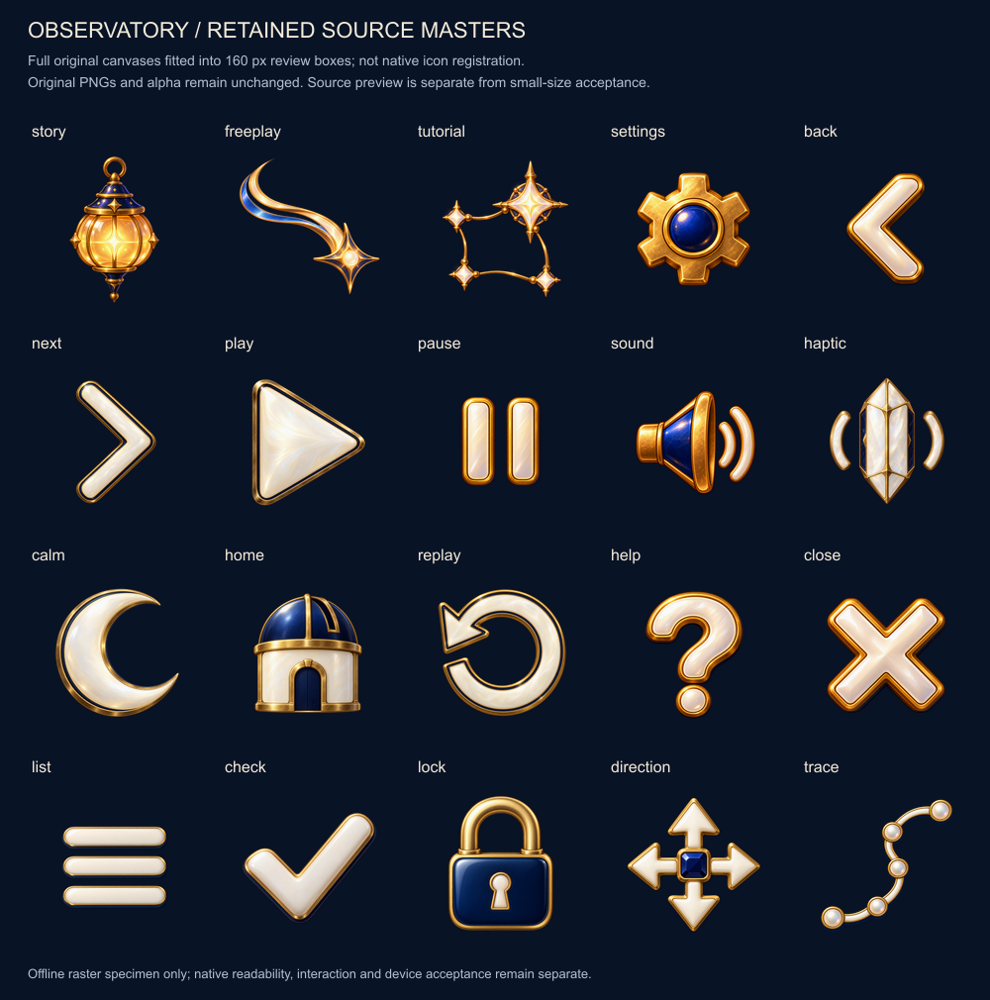

# Rendered Observatory utilities

**Status: export and offline small-size review verified; native acceptance remains separate.** The twenty utility image sets now contain full-color pearl-enamel, brass and midnight-blue artwork at the existing 24-point registration. The prior SVG masters and PDF exports remain historical source. Native controls continue to own labels, state and touch targets.

*Offline specimen, not an app screenshot. View at 100% for one image pixel per reference point. The 24-point column uses the exact 1× exports; the other sizes resample the registered 3× files. Specimen labels use a local Arial font and are not part of the artwork or game typography.*

## Original sources and registration

[PROMPTS.json](masters/utilities-v2/PROMPTS.json) records the twenty exact prompts, original ImageGen paths and SHA-256 hashes. Seventeen utility icons were generated individually with built-in ImageGen. Story, Free Play and Tutorial reuse the unchanged illustrated mode masters from the [original kit record](PROMPTS.json). No source was sliced from a concept board. The three generation records beside the masters preserve the individual generation batches.

The [export manifest](rendered-utility-manifest.json) binds the provenance document, exporter and every source/export payload by hash. Each master stays byte-identical to its recorded original. The offline exporter crops around alpha ≥16 bounds plus four source pixels of bleed, preserves every pixel within that crop before normal resampling, and fits proportionally into a 20-point content region on a transparent 24-point canvas. It reports source bounds at alpha ≥1/16/128, crop coordinates, padding, and discarded low-alpha pixel counts and maxima. This run’s maximum discarded alpha was 5/255.

The threshold prevents nearly invisible canvas-edge pixels from shrinking the visible icon. For example, Pause’s nonzero-alpha bounds were 1207×1201 pixels, while its visible alpha ≥16 bounds were 623×705. Fitting the entire nonzero-alpha extent would have reduced the visible height to about 12 points.

| Export property | Verified value |
| --- | --- |
| Native names | Existing twenty `ObservatoryGlyph…` names |
| Registration | 24×24 pt; 24×24, 48×48 and 72×72 px density files |
| Rendering intent | Original color |
| Encoded runtime PNG payload | 241,089 bytes |
| Decoded RGBA roster, all densities | 645,120 bytes |
| Decoded RGBA roster, twenty 3× selections | 414,720 bytes |

Decoded roster sizes are pixel arithmetic, not a process-memory measurement. Source masters total 17,615,451 encoded bytes and are not bundled into the app.

## Source-canvas review is separate

*Source review only. Every original canvas is fitted into a 160-pixel box without the export crop. This larger view shows material and silhouette; it cannot establish small-size or native quality.*

The small-size specimen was inspected at original resolution. Solid controls retain their silhouettes and negative-space gaps at 24 points, with no visible matte or clipping. Back has a heavier pearl face and brass rim than Next; the retained mode emblems and five-node Trace are finer than the solid controls. Those are source-art differences, preserved for native review rather than altered by the exporter.

## Verification and reproduction

This is a working-tree export based on `d0dfcc1062eb8c109ceded861d9d80110ebf7824`, with the new exporter, twenty masters/provenance, generated exports/previews/manifest and twenty native image-set replacements. Concurrent gameplay UI edits are outside the exporter’s inputs. The manifest identifies the exact source bytes and toolchain: Node 24.19.0, Sharp 0.35.5 and libvips 8.18.7; the launcher used Python 3.9.6.

Commands and input contract are in the [exporter README](build/README.md). Production validation and catalog replacement passed. Eight fixture-based tooling tests passed, including byte-identical repeated output, preserved originals, alpha threshold boundary cases, provenance rejection and safe catalog replacement. Hygiene and diff checks passed for the batch.

[Hosted artwork checks](../../AppTests/ObservatoryArtworkTests.swift) now require original rendering and verify point/density registration for all twenty glyphs. Native builds, compiled-catalog tests, in-game screenshots, motion, VoiceOver and physical-device acceptance are owned by the integration pass; this export record does not claim those results.
