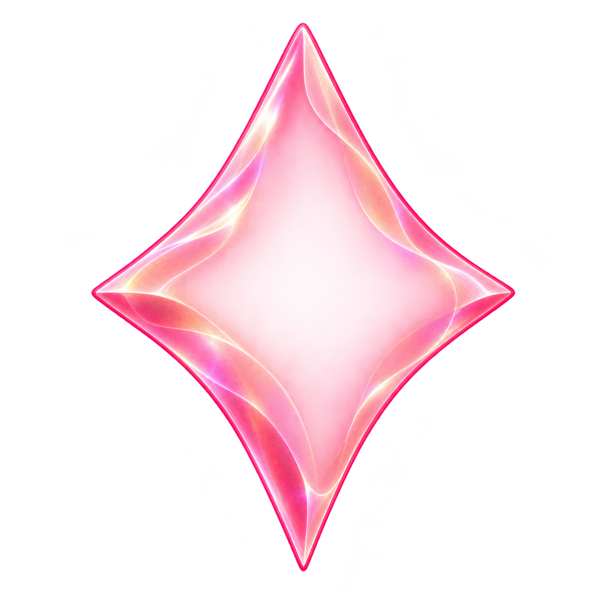

# Gameplay shell and character body sources

## Living starlight shells

The seven `SkyPiece{Name}` catalog bodies are now translucent shell layers for the approved living-light direction. They retain the faceless family outlines while leaving a broad open interior for one responsive light. The existing image-set names are reused; the opaque faceted bodies remain in the historical source plate below. These source/export checks do not establish native animation, gameplay or phone acceptance.

**Generated shell layer — incomplete without renderer-owned light.** No core, face, paired highlights, particles or ground shadow is baked into the asset. The source viewer may make transparent central colors look opaque; the packaged center alphas range from 3 to 71 out of 255.

Spark, Sunny, Dusk and Opal reuse the four [approved study](../../docs/design/star-cast/living-starlight-2026-10-20/README.md) exports byte-for-byte. Their [unaltered source plate](living-shells-study-source-v1.png) and [exact prompt](living-shells-study-prompt-v1.txt) are preserved here. Pip, Twinkle and Nova were generated individually with the built-in image tool, using the original silhouettes and approved membrane materials as references:

| Family | Accepted source | Exact prompt |
| --- | --- | --- |
| Pip | [Mint wedge](living-shell-pip-source-v2.png) | [Material and proportion correction](living-shell-pip-prompt-v2.txt) |
| Twinkle | [Tall rose diamond](living-shell-twinkle-source-v1.png) | [Shell prompt](living-shell-twinkle-prompt-v1.txt) |
| Nova | [Low violet lens](living-shell-nova-source-v2.png) | [Material and proportion correction](living-shell-nova-prompt-v2.txt) |

The [packaging receipt](living-shells-packaging.json) binds every source, prompt, original generation path, crop, fit and output hash, including the two unselected width trials. New sources use alpha ≥8 only to find bounds, four source pixels of crop padding, proportional Lanczos fitting to a maximum 208-pixel span and a centered 256×256 transparent canvas. Partial alpha is preserved without normalization, repainting, resculpting or lighting composites. The four study exports reproduce from their recorded regions/crops with optimized PNG encoding; new individual exports use ordinary PNG encoding. Existing `Contents.json` files are unchanged.

All seven exports have transparent padding, bounded dimensions and closed rims at the renderer's alpha-8 exterior flood-fill threshold. Source and packaged images were inspected; actual movement and contrast against native scenery belong to the integrated app checks. The existing faceted-export command below is historical and must not overwrite these canonical shell exports.

## Historical faceted gameplay pieces

`shards-bodies-v1.png` is the seven-piece transparent production source generated with the built-in OpenAI image tool from the [approved character/piece board](../../docs/design/star-cast/characters-and-shards-2026-10-20/pairing-v2-opal.png). Its [exact prompt](shards-prompt-v1.txt) preserves the selected silhouettes and colors while removing all faces, labels and surrounding light. Original generated file: `exec-2ff72747-057f-4380-b27c-60ab2cf300f0.png`; the source is copied byte-for-byte.

The historical command `python3 tools/art-quality/package_star_cast.py --shards` reproduces the original faceted exports; run it only in an archival checkout because it writes the same catalog names now occupied by shells. The [historical packaging receipt](shards-packaging.json) records source/prompt/output hashes, explicit crop regions, 256-pixel canvas, centered pivot and 208-pixel maximum body span. Fixed equal grid slicing would clip Nova's right tip, so extraction regions follow the actual source spacing. The shared packager isolates the connected body and fits it without repainting. All seven assets are faceless; Opal is a round pearl. See the [motion contract](../../docs/design/star-cast/characters-and-shards-2026-10-20/MOTION.md).

The original `StarCast` assets below remain the face-bearing character sources for story and ceremony. Gameplay has a separate material role; historical gravity objects retain their existing cutouts.

## Original character bodies

`crystal-glow-bodies.png` is a transparent, faceless production plate generated with the built-in OpenAI image tool from the [approved cast study](../../docs/design/star-cast/crystal-glow/refinement.png). The [exact prompt](prompt.txt) removes faces intentionally: `StarCast` owns expressions and shallow yaw, so every expression retains one body silhouette and pivot. The six packaged 256-pixel bodies live in `App/Assets.xcassets/StarCast*.imageset`; sheets remain design references, not runtime atlases.

Run `tools/art-quality/package_star_cast.py` with Python/Pillow to repeat grid slicing, alpha-range normalization and centered aspect-preserving fitting. `packaging.json` records source and packaged hashes. This is offline asset packaging, never runtime artwork generation. No SDK, service or dependency is added to the app. Floating cast and pieces have no ground shadows; light effects remain separate from the cutouts.

## Magnetic crystal and gravity hole

**Historical magnetic-crystal direction:** superseded by the open attraction field below. The hole remains current.

`magnet-body-v1.png` and `hole-body-v1.png` are original cutouts generated with the built-in OpenAI image tool for the production gravity mechanic. [Exact prompts](gravity-prompts-v1.json) and [source/package hashes](gravity-packaging.json) record provenance. These are faceless objects: the magnetic crystal has opposed gold tips and a teal waist; the hole has an opaque dark center and a blue-gold accretion ribbon.

Run `python3 tools/art-quality/package_star_cast.py --gravity` in a Python environment with Pillow to reproduce the two 256×256 catalog assets. This reuses the cast's alpha-island/padding/aspect normalization. No new image synthesis occurs in packaging; no creative edits were made after generation. The assets are `StarCastMagnet` and `StarCastHole`; one cached material per object serves board, flight and forecast. Source images remain unmodified. Art review is distinct from native visual/motion acceptance.

## Attraction field revision

The user rejected the solid magnetic star silhouette. Current `StarCastField` replaces `StarCastMagnet` with an open aura: [generated source](field-body-v1.png), [exact built-in imagegen prompt](attraction-field-prompt-v1.txt), and the current [gravity packaging receipt](gravity-packaging.json). `package_star_cast.py --gravity` now packages Field and Hole. Field preserves both wisps and disconnected motes without largest-island pruning, fits alpha ≥16 to the same padded 256-pixel canvas, and requires a transparent center; Hole retains its opaque-center and island rules. The original magnetic crystal source and prompt remain historical provenance, but its runtime image set is removed.
