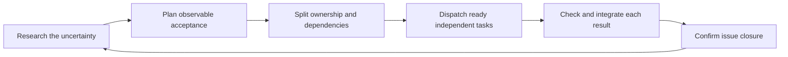

# A lightweight agent factory for Starfall

**Status:** Live GitHub tracking; first workstream audit complete; throughput trial pending · **Owner:** Current coordinator · **Updated:** October 22, 2026

Use one coordinator to research, plan, split work by ownership, dispatch independent slices, integrate each ready result and repeat. GitHub leaf issues are the durable task record; merging their closing PRs completes them. Start with at most three workers and reduce concurrency when review or native checks become the bottleneck. These are Starfall operating defaults, not research-proven optimal numbers.

**Start:** Ask “Use `$starfall-factory` to deliver [bounded outcome].” The [repo skill](../.agents/skills/starfall-factory/SKILL.md) runs inside the existing agent session. It does not start a daemon. For a small fix, keep one agent and one PR.

**Autonomy default:** Within the authorized outcome, the coordinator selects priorities, researches, creates or updates issues, decomposes, dispatches, verifies, repairs, merges complete slices and refills without asking for routine human approval. Plans and specialist reviews are working artifacts, not sign-off stages. Ask only for information or authority actually missing from the existing request. An unavailable device, player observation or external permission blocks only the acceptance that requires it; continue independent work and preserve honest evidence. Repository scope, actual failing checks and delivery authorization still apply.

The [workstream/label contract](GAME_WORKSTREAMS.md) and [full role catalogue](GAME_ROLE_CATALOG.md) help find missing ownership, expertise and evidence before decomposition. iPhone and iPad are primary; Mac is deferred. Catalogue breadth does not increase the active worker budget or create new feature commitments.

## The loop



Implemented guidance; this diagram is not evidence of a completed autonomous run. Exit when the requested acceptance is met. A new finding changes only the affected tasks; it does not restart all research or hold unrelated ready work.

1. **Research a decision.** Inspect current owners, constraints and relevant evidence. Search primary sources for external or unstable facts. A typical first pass is ten minutes or one focused exploration pass; stop when a concrete implementation decision is supported. Extend for a named unresolved question, preserving known facts and explicit unknowns.
2. **Plan the smallest useful batch.** Record the outcome, acceptance, important exclusions and the most consequential uncertainty in the issue or existing plan. Do not require a separate research document, design approval and planning approval. Continue within the user's existing authorization.
3. **Split into independent ownership.** Each task names its prerequisites, literal write paths, observable acceptance, checks and return artifact. Reads can overlap. Shared contracts, saves, project membership, root indexes and final integration each have one owner. Publish a shared interface first if parallel work depends on it; disjoint files alone do not establish semantic independence.
4. **Dispatch only ready work.** Delegate independent research and implementation to subagents when this workflow is requested. Keep dependent steps local or wait for their prerequisite to integrate. Use the client's available concurrency; the initial budget is one coordinator plus up to three workers, with no recursive fan-out. Reserve exclusive resources such as an actual simulator or the Xcode project explicitly.
5. **Integrate continuously.** Review a result as soon as it returns, run the [existing checks](ENGINEERING.md#verification-by-change), and merge a complete verified slice under the existing integration policy. Confirm current source and recheck affected interactions when another slice changes its assumptions. A worker's self-report alone is insufficient evidence. Do not wait for a whole wave or add an all-swarm approval barrier.
6. **Reconcile and refill.** Confirm merge, issue closure and the project's Done state. Release resources and dispatch newly ready tasks. Carry forward a compact handoff at a context boundary. Stop on achieved acceptance or an actual external blocker; ordinary rework stays within the authorized goal.

## Keep useful work discoverable

During an authorized continuing run, count **actionable independent ready leaves**, excluding running work, returned work awaiting integration, device/player/external blockers and unresolved dependencies. When fewer than three remain, do one bounded discovery pass alongside independent execution. Three is a low-watermark trigger, not a quota or permission to increase WIP. A healthy queue may have fewer tasks when no valuable ready work exists.

Inspect current failures and representative sibling paths, active ENGINEERING triggers, incomplete accepted outcomes, missing verification and the applicable workstream/role map. Search issues and open/recent PRs before creating anything; check whether newer evidence already resolved the apparent gap. Keep the pass to one focused uncertainty or about ten minutes, then return to delivery. Do not repeatedly re-audit the same blocked hardware or manufacture speculative features, cleanup or one-ticket-per-role queues.

Create at most three evidenced follow-ups in one pass. Each needs its source/observation, expected player or engineering impact, one independently mergeable outcome, priority, primary stream/kind, required expertise, real prerequisites, write/resource ownership and relevant acceptance/checks. Label a source contradiction or untested concern as such; a bug needs a reproduction, while a bounded research task can establish whether a defect exists. Preparation can be its own leaf when independently useful; it must not close its parent's unperformed device/player acceptance. Continue selected work within existing authorization. If discovery produces only external dependencies, record the concrete next actions and do not pretend the queue is executable.

## Capture discoveries without changing the assignment

An active worker is a source of follow-up work. When it finds something worthwhile outside its reservation, **keep the current task bounded** and send a compact discovery packet to the coordinator. Report immediately if another worker could be affected; otherwise include it in the normal return. Never wait for a response unless the finding invalidates the current task's correctness or safety. Do not silently edit the new area, add a prerequisite or start another agent.

| Discovery field | Minimum useful content |
| --- | --- |
| Origin | Current issue/task and inspected commit or dirty-input snapshot |
| Finding | File/line, failing command or other source-bound observation; reproduction versus hypothesis |
| Impact | The violated contract or concrete uncertainty and why resolving it matters |
| Follow-up | Smallest suggested outcome, likely stream/roles, dependency and relevant check |
| Current-task effect | Independent, or the precise reason this changes current acceptance |

The coordinator is the single writer for shared GitHub task metadata. During the next return/refill reconciliation, preserve the packet in a **comment on the originating issue/PR**, then link an existing leaf, create a bounded deduplicated follow-up, or record a reason and revisit trigger for deferral. An urgent finding is triaged immediately. If tools are unavailable, retain it in the existing task handoff until it can be persisted. A chat message alone is not the durable inbox. Do not create another spreadsheet, central status file, mandatory review queue or human sign-off.

Workers return a **Discoveries: none / linked packets** line even when no follow-up is warranted. The coordinator drains these packets before starting a broad discovery sweep. Useful discoveries feed the existing GitHub backlog; low-value or disproved ideas do not need permanent issues.

The coordinator owns shared document indexes and final acceptance. Workers report necessary updates rather than all editing README, ROADMAP and ENGINEERING concurrently. A buildable vertical slice is preferable to separate implementation/test/documentation tickets that leave every issue half-complete.

## Bound work in progress

Count running tasks **and returned tasks awaiting integration** against the worker budget. When two results await integration, stop dispatching and drain that queue. A blocked native check occupies its resource, not every unrelated workstream. Do not start duplicate reviews merely because an earlier one is slow.

Use one targeted review pass per slice. An independent evaluator is useful for ambiguous behavior, save compatibility or difficult native/UI acceptance; it is optional for routine low-risk work. After two unsuccessful repair passes, inspect the contract, scope or reproduction and replan that task. Preserve failures and continue useful independent work; this is a replan trigger, not permission to abandon required acceptance.

Merge readiness consists of the repository's existing acceptance and verification. Research, planning, decomposition and task metadata are working aids, not additional human sign-offs. Branch protection and actual failing relevant checks still apply. Physical-device, actual VoiceOver and RC evidence retain their existing stage boundaries. This workflow does not authorize delivery or broaden paid CI.

## A task packet and a handoff

Use the [leaf issue template](../.github/ISSUE_TEMPLATE/task.md) when a durable implementation task is needed. One issue should have one independently mergeable outcome and one responsible worker. Tiny edits can share the same leaf issue/PR; do not open an issue for every thought or research call.

| Task packet | Return artifact |
| --- | --- |
| Outcome and acceptance | What changed and which criteria are met; discoveries or explicit none |
| Prerequisites and frozen interface | Assumptions changed; dependencies still missing |
| Exclusive write paths and reserved resources | Actual changed paths and source commit/tree |
| Relevant checks and scope exclusions | Commands/results, failed or missing acceptance |
| Issue, branch/worktree and expected deliverable | Commit/PR, concrete residual risks, next action |

Give workers only the relevant source context and links, not a transcript dump. Same-directory workers share files: enforce disjoint writes and leave staging, commits and branch operations to the coordinator. Use isolated worktrees for independent branch/PR writers; do not assume subagents receive isolation automatically. Use distinct build output paths and simulator ownership. Changes outside a task's reservation return to the coordinator for reassignment before editing.

## Completion follows GitHub

The live [Starfall — iPhone & iPad Project](https://github.com/users/lbeezr/projects/1) uses **Todo → In Progress → Done**. Verification/rework happens within In Progress; there is no mandatory human-review column. Blocked work records a cause and next action in its issue. The issue's native open/closed state is authoritative. A Markdown plan or JSON graph stores scope and dependencies, never a second persistent task-status database.

- Put a real `Closes #123` in the **PR description** for each fully resolved leaf issue. The number in a title, comment, branch name or a `Refs` line is insufficient for this contract. Use each closing keyword with its own issue number. Do not close a parent outcome from one partial child PR.
- Target the repository's actual **default branch**. Closing keywords on PRs into feature/integration branches are ignored by GitHub. If stacking is unavoidable, put all fully resolved leaf closing references on the final default-branch PR and keep the issues open until then.
- For a Project, inspect Workflows and enable **Item closed → Status: Done** and **Pull request merged → Status: Done**. GitHub documents these as defaults for new Projects; existing settings still need inspection. Use real issue cards; draft cards have no issue closure event. Make parent outcomes real issues too, and close them explicitly only after all acceptance is met.
- The live Project automatically adds open Starfall issues, sets new/reopened cards to Todo and moves issues linked to a PR to In Progress. Its reverse **Auto-close issue** workflow is disabled: moving a card must not substitute for verified acceptance and default-branch merge closure. The board displays labels and sorts by Priority. Only Status and Priority need routine maintenance; other metadata can stay in the packet until a measured need justifies another field.
- After merge, check the expected issues are **closed as completed**. A closed-unmerged PR, “not planned” issue or draft completion does not prove delivery. If closure is missing, verify the merged diff fulfills the issue and explicitly close that specific issue as completed with the merge evidence through the authorized GitHub tools. Do not bulk-close everything mentioned in a PR.
- If the issue closed but its Project card stayed open, repair the Item closed workflow and reconcile that card once. Do not reopen/reclose an issue merely to generate events. Project edits and manual issue reconciliation still follow the user's authorized scope and available permissions.

This uses GitHub's native closure and Project automation. There is no privileged `pull_request_target` workflow, periodic bot, status-label synchronization or new required Actions check. The coordinator performs reconciliation during the active run; this scaffold does not promise unattended progress after that session ends.

## Optional offline helper

`scripts/agent_factory.py` uses only Python's standard library and makes no network requests or mutations. It is an on-demand diagnostic, not a mandatory CI gate or a scheduler.

For a graph that is hard to inspect in a short table, copy [AGENT_PLAN.json](templates/AGENT_PLAN.json) beside the existing plan and replace its illustrative tasks. Each task has `id`, `depends_on`, literal `writes` paths (files or entire subtrees), `acceptance`, `checks`, optional exclusive `resources` and an optional unique same-repo leaf `issue`. Empty writes means read-only. Dependencies must represent real ordering. Do not add a dependency merely to hide overlapping ownership that should be redesigned.

```sh
python3 scripts/agent_factory.py plan docs/templates/AGENT_PLAN.json
python3 scripts/agent_factory.py plan docs/templates/AGENT_PLAN.json --integrated contract
python3 scripts/agent_factory.py plan docs/templates/AGENT_PLAN.json --integrated contract --active tooling --limit 3
python3 scripts/test_agent_factory.py
```

The helper rejects dependency cycles, missing prerequisites, unsafe/ambiguous path syntax, duplicate leaf issues and overlapping unordered writers. It suggests ready tasks while respecting active reservations and exclusive resources. `--active` includes returned-but-unintegrated tasks. Supply `--integrated` only after verifying that task's required integration; it is caller-supplied evidence, not a GitHub query or a proof of merge. The helper cannot establish semantic independence, discover undeclared writes or resolve symlink aliases; inspect the actual diff too. Plan files do not persist run state.

For closure, use the connected GitHub tools first. When they do not expose native closing references, this read-only GitHub CLI query produces the exact snapshot accepted by the helper. Replace the example PR number; retain snapshots only in ignored artifacts or temporary storage.

```sh
mkdir -p artifacts
gh api graphql -F owner=lbeezr -F name=starfall -F number=123 -f query='
query($owner: String!, $name: String!, $number: Int!) {
  repository(owner: $owner, name: $name) {
    nameWithOwner
    defaultBranchRef { name }
    pullRequest(number: $number) {
      number state mergedAt baseRefName
      closingIssuesReferences(first: 100) {
        nodes { number state stateReason url }
        pageInfo { hasNextPage }
      }
    }
  }
}' > artifacts/task-closure.json
python3 scripts/agent_factory.py closure artifacts/task-closure.json --issue 124
```

Pass every expected leaf issue with another `--issue`. Exit 0 means native links are present before merge or expected linked issues are completed after merge; the JSON distinguishes those phases. Exit 1 identifies a completion problem; exit 2 means invalid/unknown input, including truncated or failed GraphQL responses. Refresh after merge; a saved snapshot is not live state. The helper deliberately reports Project status as uninspected. A missing link after an already completed merge requires acceptance-based manual reconciliation; editing the old PR is not a substitute.

## Why this design

Primary sources checked October 22, 2026. These findings inform the design; none establish Starfall's throughput.

| Source | Finding and Starfall adaptation |
| --- | --- |
| [OpenAI: Subagents](https://learn.chatgpt.com/docs/agent-configuration/subagents) and [worktrees](https://learn.chatgpt.com/docs/environments/git-worktrees) — current docs | Independent context helps bounded delegation; concurrent writes require care. Use short packets and explicit isolation/ownership. |
| [Anthropic: Harness design for long-running application development](https://www.anthropic.com/research/harness-design-long-running-apps), March 24, 2026 | Structured handoffs and evaluation help difficult work; later experiments removed sprint ceremony and made evaluation selective as capability improved. Keep targeted checks, revisit overhead. |
| [Google Research: Towards a science of scaling agent systems](https://research.google/blog/towards-a-science-of-scaling-agent-systems-when-and-why-agent-systems-work/), January 28, 2026 | Multi-agent gains depend on parallelizability; sequential tasks can degrade. Increase independent work, not agent count by itself. |
| [Anthropic: Multi-agent research system](https://www.anthropic.com/research/multi-agent-research-system), June 13, 2025 — earlier research | Clear delegation contracts and bounded effort matter. Its research results and token costs are not coding throughput estimates. |
| [GitHub: Link PRs to issues](https://docs.github.com/en/issues/tracking-your-work-with-issues/using-issues/linking-a-pull-request-to-an-issue) and [Project built-in automations](https://docs.github.com/en/issues/planning-and-tracking-with-projects/automating-your-project/using-the-built-in-automations) — current docs | Native default-branch merge closure can drive Done without maintaining another bot. |

The available GitHub connector exposes repository/issue/PR operations but no label creation or Project workflow administration. The [live setup and first audit](evidence/factory-audit-2026-10-22/README.md) used the existing signed-in browser for those missing capabilities and the connector for issues/PRs. The initial scaffold audit found no open issues and five recent merged PRs without closing references; that sample cannot establish the cause of earlier pileups.

## Trial and revisit

**Hypothesis:** Small disjoint slices, bounded WIP and native closure reduce coordination waiting without adding approval stages. Run the next three authorized multi-task batches using this workflow; the coordinator records a compact result in the existing evidence for each batch: slices merged, peak WIP, oldest returned result's wait, conflict/rework count, merge-to-issue-close delay and any stale Project card. Record unavailable timings as unknown; do not estimate them from token counts.

At the third batch, or the first recurring queue/closure failure, compare with an available recent batch of similar size. Keep the skill if it helps; reduce workers or simplify packets when integration dominates; remove an unused graph helper. Add a persistent scheduler, framework or merge-event service only for a measured unresolved need and an explicit implementation task. This scaffold's current validation and remaining limits are in [the implementation evidence](evidence/agent-factory-2026-10-22/README.md).
