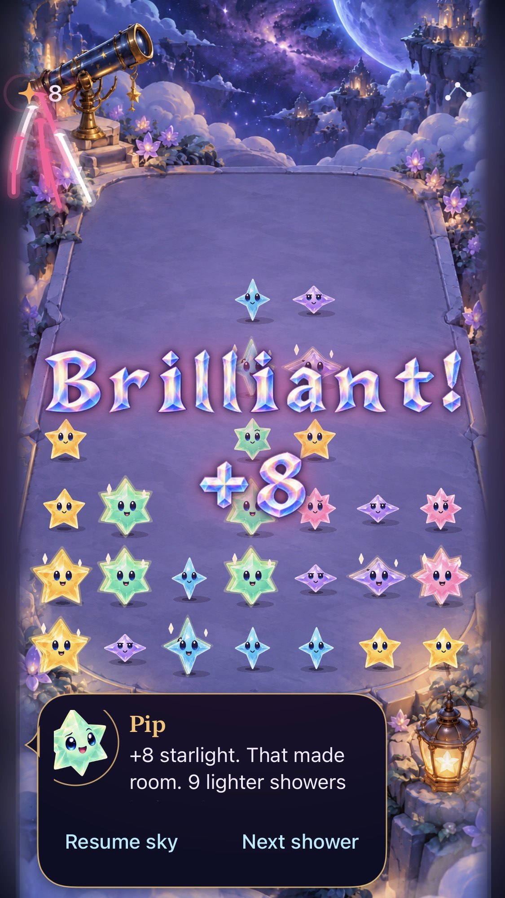

# Keep fast play readable, understandable and rewarding

**Status:** Accepted · **Owner:** current implementer · **Updated:** 2026-10-18

Polish the six gameplay priorities in order, merging and delivering each verified improvement through the canonical phone updater before starting the next. The player reported a “huge improvement” after the five gesture deliveries. Apply that same bounded process to the remaining experience.

**Next action:** Add concrete, interactive setup examples in Help.

## Scope and success

| Order | Priority | Observable acceptance | Status |
| --- | --- | --- | --- |
| 1 | Read the next move | Award lettering stays outside every playable cell throughout its animation; independent follow-up moves remain available; default and maximum text remain readable. | Delivered: PR #142, `dev.d7e15ddf2a`; physical comfort open |
| 2 | Understand consequences | Selection, committed clear, score gain and invalid actions give consistent, truthful feedback without covering the board or delaying input. | Delivered: PR #144/#146; physical comprehension open |
| 3 | Fair shower rhythm | The arrival cue agrees with the actual deadline; interruptions preserve remaining time; no catch-up burst; current survival rules receive a reproducible pacing review. | Delivered: PR #147, dev.9020625ab7; older-compiler CI pending |
| 4 | Discover useful setups | Players can find and practice recipes, Opal use and causal relays through concrete examples; hints match current legal actions and never surprise-commit a move. | In progress |
| 5 | Reward rhythm | Clear, growth, recipe and relay feedback are distinguishable, bounded and synchronized with committed outcomes; rapid play does not pile up sounds/haptics or effects. | Pending |
| 6 | End and replay | A final legal action resolves before the result; the reason and score are clear; replay and new sky have predictable save/seed behavior and survive interruptions. | Pending |

No new progression, power-ups, backend, analytics or automatic aging. Preserve saves, deterministic rules, native input and the original app. Each priority may need several small corrections; ship each verified correction separately.

## First batch: protected award placement

The current crystal-depth capture shows “Brilliant!” and +8 covering surviving Aqua, Opal and Pip stars. Hit testing remains enabled, but the player cannot reliably read those stars while planning a follow-up.

*Runtime evidence: integrated crystal-depth source b6e1d45, native 375×667 host, normal animation. Inspected before this change; it establishes overlap, not physical comfort.*

Use the shared board projection and live header bounds to place a compact horizontal award in the empty sky above all seven playable rows. Use readable native title/value text when decorative glyphs would fall below a 24-point cap height; preserve the accessibility-size award below the board. Bound the complete animated lettering inside its region; do not change board geometry or suppress normal falling motion. Keep clear particles and collection trails bounded, and inspect their effect on survivor recognition separately.

- [x] Reproduce the current obstruction and add a regression for all playable cells, compact/tall/tablet geometry and animation phases.
- [x] Inspect actual normal-motion crowded captures at compact/large sizes and default/maximum text; verify ordinary, recipe, trace and relay values still render.
- [x] Verify rapid follow-up input, interruptions, restart, settings and Reduce Motion using affected native/hosted checks; keep rule/save tests green.
- [x] Merge the verified source and record actual canonical installation before priority 2.

## Evidence and limits

Tests and native captures establish specific behavior, not an S-tier enjoyment rating. Physical speed, recognition, sound/haptic preference and repeated-round enjoyment require observation on the installed app. Record those limits with each delivery and incorporate player feedback without making it a new permission gate. Actual VoiceOver remains part of release-candidate acceptance, not routine iteration.

## Second batch: immediate committed consequences

The guide currently retains earlier instructions until a player-action animation completes, even though the score and award have committed. A traced four-star square also takes the generic constellation wording route, while explicit recipe activation names the square. A related reproduction shows adjacent automatic Dusk removal obscuring the tap recipe name. Correct the shared Store presentation boundary, without changing legal moves, awards or saved state.

- [x] Committed player clears and swaps publish their exact result immediately; completion never announces it twice or restores older copy over a newer instruction.
- [x] Automatic presentation completions cannot overwrite feedback created after that presentation began.
- [x] The same exact recipe set receives the same shape classification through tap, held trace and explicit accessible activation; extra neighboring stars are never silently classified as an exact recipe.
- [x] Final outcomes retain ceremony speech ownership; interruption/restore discards transient feedback; current rules, saves and follow-up input remain unchanged.
- [x] Verify focused reproductions, affected hosted/native checks and inspected normal-motion feedback, then merge and canonically deliver: PR #144, `dev.bf4ade9d68`.

## Third batch: truthful edge-swipe feedback

An outward swipe currently produces tap instructions. Keep the recognized intent explicit through the production adapter: explain that the chosen direction leaves the sky, consume this contact once, and immediately accept a new contact.

- [x] Verify all four outward directions give the edge explanation, with no swap, clear or delayed hold.
- [x] Preserve valid final-only/coarse swipes, held traces leaving the board, and interrupted/nonfinite samples.
- [x] Check all four real native edge swipes and a successful next move with normal motion; verify the packaged copy and Release build.
- [x] Merge and deliver before priority 3: PR #146, `dev.3be5031c35`.

## Fourth batch: a truthful shower forecast

The countdown currently uses a wall-clock date that becomes nil during admitted contact. Its fallback displays a fresh full interval even though the scheduler preserves the real remainder. Quiet motion pauses its timeline entirely. Give the renderer a narrow read of the Store-owned monotonic countdown; keep timing rules and save contracts unchanged.

- [x] The forecast progresses with the actual deadline, freezes at the actual remainder on contact/pause, resumes continuously, and shows due/arriving without resetting early.
- [x] Quiet motion updates timing at a low discrete cadence; normal motion retains smooth presentation and the same outcomes.
- [x] Preserve interruption grace, single-deadline/no-catch-up behavior, current forecasts, settings and rapid inputs. Test the clock boundary and native normal/quiet operation; inspect a source-bound capture before merge/delivery.
- [x] Review current no-aging survival cadence with reproducible samples separately; do not infer enjoyment or change balance from one fixed-seed sample.

## Fifth batch: examples that show useful setups

Add optional interactive examples at the top of Help for making a square, tracing a cross, including Opal and creating a relay. Each explicit action applies the actual Core rule to a small authored board; it displays the real reward and resulting arrangement. These are demonstrations of mechanics, not a replacement gesture-training mode. Keep the active round suspended through the existing Help sheet, with no access to its store, save or clock.

- [x] Square/cross traces spend exactly their selected stars; a swap creates a shape without clearing; Opal joins the chosen color; a relay's second recipe is absent before and created by the first clear.
- [x] Actions remain explicit, hints describe legal moves in the shown state, retry is local, and leaving/reopening examples cannot mutate or replace a saved round.
- [x] Show shared cast art, actual before/after movement and exact points; Reduce Motion keeps the same result. Preserve native button semantics, non-color descriptions and readable largest text.
- [ ] Verify Core examples, native example steps and interruption/dismissal, inspect screenshots, build Release, merge and canonically deliver before reward rhythm.
