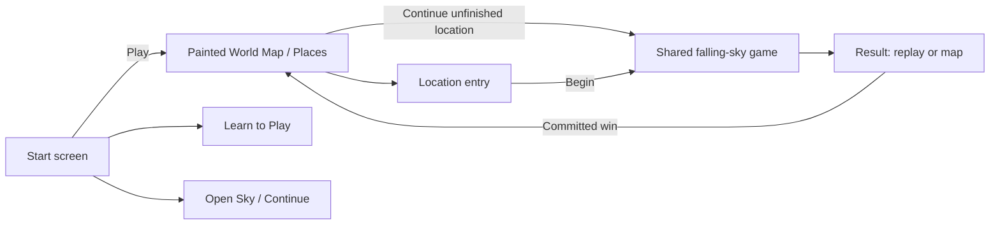

# Official locations, shared mechanics and a playable tutorial

**Status:** Existing integration development-verified; sixth-location extension under development · **Owner:** Current implementer · **Updated:** October 20, 2026

The normal app opens on its Observatory home: Story Mode leads to the full-page World Map, alongside Free Play, Tutorial and a retained-round shortcut. Six ready official locations can be chosen or revisited there when unlocked; an unfinished selected location offers Continue without replacing its board. Frostfruit Orchard is adopted as the sixth ready location with fifteen paintings; publication and canonical installation remain pending. New journeys start with Lantern Landing; committed restoration wins reveal repaired landmarks and open the next ready place. All six registered challenges support the current cardinal swaps, square/cross recipes and selected traces. Tutorial uses the real board and input store, with 21 disposable chapters that also serve as deterministic regressions.

This implements the user's authorized integration and subsequent direction: mysterious unreached places, no giant numbered badges, and a map that records repairs. The remaining six locations are visible but unavailable until their production content is ready. The optional skippable intro video remains deferred; no video asset is added. No phone installation was claimed by the original integration record. Its [verification and limits](evidence/official-world-2026-10-19/README.md) remain source-bound. The current [Frostfruit production plan](design/frostfruit-orchard-06/PRODUCTION_PLAN.md) owns the sixth-location extension through canonical delivery, which is pending.

## Observable acceptance

- Welcome and the game menu have one World Map entry; no appended Try rows or old scenery selector.
- The original five places retain their artwork and saved identities; the sixth adds three complete five-state art families. All six preserve seed 42, 18-light objectives and cadence. Swaps work in new, resumed and replayed rounds. All fifteen orchard paintings are adopted; [development evidence](evidence/frostfruit-orchard-2026-10-20/README.md) owns validation, separately from pending publication and installation.
- Browsing and canceling Entry preserve the round. Begin alone replaces it. Completed locations stay replayable; unbuilt content cannot start.
- The initial map is damaged and dim. Restoring a place reveals its repaired painting and onward road; unreached islands have a soft obscuring veil. The native Places list conveys the same status without relying on color.
- Practice teaches production gestures and scoring setups without saving, earning world completion or replacing a live round. Retry, skip, backgrounding and exit reject stale input/clock callbacks.
- Core, hosted and relevant native checks, Debug/Release membership and inspected screenshots establish development evidence. Actual VoiceOver, physical comfort and human tutorial comprehension remain distinct acceptance.

## Product and ownership

| Content | Integrated behavior |
| --- | --- |
| Lantern Landing (`firstLight`), Ribbon Crossing, Kite Harbor, Seed Moon, Silver Pools | Five ready restoration destinations, each with its existing complete art family |
| Frostfruit Orchard | Sixth ready destination with fifteen adopted paintings; requires a committed Silver Pools repair, including for legacy-access players. [Development evidence](evidence/frostfruit-orchard-2026-10-20/README.md) records validation; publication and installation remain pending. |
| Sunwheel Mill, Bell Choir, Starferry Station, Aurora Falls, Petal Beacon, Hollow Crown | Six authored route identities and map silhouettes; no entry until content registration and acceptance |
| Moonwake, Nebula Cradle, Shatterlight Reach, Night Garden, Ringdrift | Old selector, renderer and sixteen exclusively used packaged assets removed; source artwork and unique evidence retained as history |
| Open Sky | Existing survival rules, with completed Lantern Landing scenery; scenery cannot award completion or impose an 18-point ending |
| Classic puzzle, historical Dusk/gravity/aging | Retained save readers and Debug regression tooling; no new player routes |

`WorldLocation` owns stable order and content readiness, `WorldJourney` derives access and records valid wins, and `WorldJourneyStore` owns the separate local envelope. `WorldMapView` consumes values and narrow callbacks. The world is a full page in `SkyFlowState`, replacing the Welcome or gameplay surface. Back returns to its origin without replacing the round; practice and preferences remain sheets. The existing Entry ceremony owns Begin and the existing game store owns all play.

## Painted progress

The [production art package](design/world-01/production/README.md) contains registered damaged and repaired paintings. Their composition preserves the twelve approved landmarks, Murk and the four-region route. Numbered badges, the concept footer and unfamiliar helpers are absent. The damaged painting changes architecture and light: torn ribbons, grounded sails, closed buds, dry pools and cold lanterns.

`WorldMapPainting` reveals complete landmark regions from the repaired plate only for durable completions. A narrow outgoing route reveal accompanies each repair. A soft native veil conceals unreached details; it does not substitute for authored damaged scenery. The existing amber Crystal Glow is the small selection traveler. Selection movement is brief and immediate under quiet motion. The full page gives the painting the available canvas, with location details below it in portrait and alongside it in landscape. There is no modal frame or underlying Welcome screen. This is a tappable painted selector, not a free-roaming character controller.

The Places list appears automatically at accessibility text sizes. It puts selected-location actions before the long location list. Both surfaces keep names, readiness and completion as native accessibility semantics. Selecting a locked or unavailable landmark shows its explanation without starting a round.

### References and what to borrow

| Reference | Source observation | Starfall application — design inference |
| --- | --- | --- |
| [Super Mario 3D World electronic manual](https://www.nintendo.com/eu/media/downloads/games_8/emanuals/wii_u_6/super_mario_3d_world_3/ElectronicManual_WiiU_SuperMario3DWorld_EN.pdf), World Screen / controls | A navigable world lets players choose courses; flags distinguish completion, and a map supports checking progress. | Recognizable miniature landmarks, a visible current position, revisiting completed places and legible completion states |
| [Paper Mario: Sticker Star manual](https://www.nintendo.com/eu/media/downloads/games_8/emanuals/nintendo_3ds_2/paper_mario_sticker_star/ElectronicManual_Nintendo3DS_PaperMarioStickerStar_EN.pdf), World Map Screen / Stage Progression | Move a character to choose a stage; stage conditions and completion have visible map states. | A compact connected route with direct destination selection and an accessible equivalent list |
| [Paper Mario: Color Splash — Nintendo](https://www.nintendo.com/en-gb/Games/Wii-U-games/Paper-Mario-Color-Splash-1090845.html), Gameplay | Restoring color is the premise; Mini Paint Stars open courses and Big Paint Stars open areas. | A successful restoration visibly reconnects the world and makes the next place reachable |

Official sources were read on October 19, 2026; no comparative gameplay session was performed. These are structural references, not artwork or mechanics to copy. Paper Mario games differ: Sticker Star and Color Splash are more direct references for this course-map request than assuming every Paper Mario uses the same overworld.

## Mechanics reconciliation and saved compatibility

Audit source was clean `6c2483ab09f80751218feb02170079e04c0959b0`. The reported failure came from Core `challenge == nil` gates in arrangement legality and the four-star exception, mirrored in Help. All five places inherited that old First Light restriction. UI navigation alone could not fix it.

A versioned challenge action capability now admits current gestures and recipes. New rounds opt in; normal restore and replay apply the idempotent migration. Board, IDs, score, committed forecast, RNG, generation, cadence and outcome remain unchanged. The archive writes v9 and retains validated v3–v8 readers and their original bytes. A present rejected current archive still never falls back to an older round.

Action support and star supply remain separate. These five gentle challenges retain their authored supply; Opal and storm lessons use modern Open Sky scenarios. Historical raw Core behavior remains testable. Future location-specific supply or balance changes require their own versioned design and seed/replay acceptance.

World progress is a separate v1 envelope. A valid winning round is recorded after the round save succeeds and before presentation completion; replay cannot duplicate completion. Restoration of a saved win repairs an interrupted world write. Existing pre-v9 installations retain access to the five previously playable places without fabricated wins. New installs unlock ready successors sequentially. Frostfruit Orchard also requires a Silver Pools repair for legacy-access players; adding it does not expand the original five-place migration allowance. An unavailable successor remains unavailable even after its predecessor is restored. The orchard batch keeps archive v9 and world envelope v1 unchanged.

An invalid world envelope is preserved in a recovery slot before replacement; valid current-round completion can be recovered. Lost completion history cannot be inferred from a single non-winning round. The ordinary round archive and other preferences remain independent.

## Playable tutorial and regression bed

The 21 `SkyTutorial` chapters cover tap matching, grown-star value, all four exchanges, empty-space settling, five selected stars, diagonal and one-gap paths, branched drawing, squares, crosses, Opal, relays, trimming, drop-ins, banking a shape, forks, double setups, manual/automatic showers and pause, storms, making room and restoration.

Each chapter supplies an authored board and reference actions through Core. `SkyTutorialRun` compares committed before/after states and the requested action method. Equivalent taps are accepted; another legal outcome stays visible with Retry. Practice uses `FallingSkyStore`, native cells and the actual gesture surface. It has no archive capability, and chapter transitions cancel old presentations, input and clocks.

Tests replay all chapters through Core and the production store, asserting independently specified score/occupancy/shower totals, unchanged normal/world save bytes, and cancellation. Native checks exercise physical taps/swipes/held traces, recipe sequences, retries, exit and backgrounding. Automated correctness does not establish that the lessons are enjoyable or easy to understand.

## Remaining work

The [Frostfruit Orchard batch](design/frostfruit-orchard-06/PRODUCTION_PLAN.md) adopts all fifteen paintings and the sixth ready destination; [development evidence](evidence/frostfruit-orchard-2026-10-20/README.md) records validation, while publication and installation remain pending. Six later locations remain unbuilt. New compositions use the [level-design kit](design/level-design-kit/README.md). Registration requires artwork, rule identity and native acceptance; adding an enum case is not proof of readiness. Story scenes, generated travel clips and a finale remain design work. Human play should evaluate path mystery, repair readability and tutorial length before further visual or balance tuning.

A future cleanup may parameterize the historical per-challenge flow action cases; the public map already routes through the single challenge callback. This batch preserves those tested ceremony adapters while changing save/action behavior.
