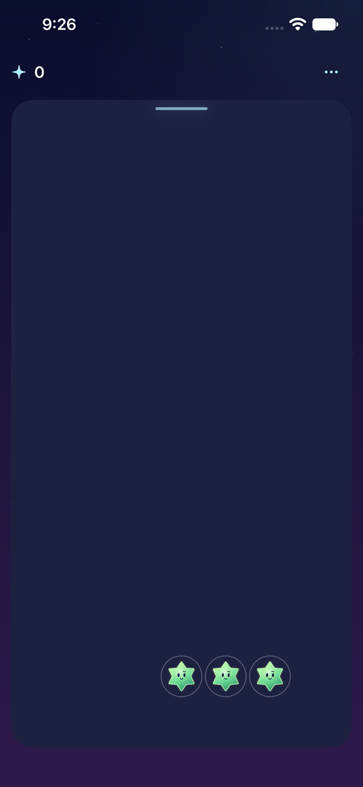

# Starfall roadmap

**Status:** Active · **Owner:** Current implementer · **Updated:** October 17, 2026, Eastern time

Build a small, readable falling-sky puzzle worth replaying. **Shower variety leads the next gameplay comparison.** Keep the default generator unchanged until observed play supports adoption. Phase and Surge native trials now exist; the agent-simulated comparison provisionally favors Surge, but human preference remains unverified.

**Next actions:** Review the clean Release baseline as its own change, then review the existing warning/burst/recovery trials and observe matched play. Physical feel can be reviewed independently in small batches.

**Open limits:** No gameplay participant preference results or general physical-device acceptance. Crystal Glow art direction and character masters are user-approved; runtime verification and remaining limits are recorded in the [cast integration evidence](evidence/crystal-glow-integration-2026-10-17/README.md). Accessibility evidence remains source-bound.

## The game we are improving

**Source-bound native reference:** October 17 compact-HUD candidate, iPhone 17e / iOS 27.0 Simulator; [capture source and verification limits](evidence/compact-hud-2026-10-17/README.md). The compact layout is adopted, but this capture does not establish current-build parity or human preference. See the [icon, opening screen and cast](design/VISUAL_REFERENCE.md) for the visual context behind the workstreams below.

## What happens next

| Priority | Next action | Done when |
| --- | --- | --- |
| Establish the candidate | Resolve the [Xcode project drift](ENGINEERING.md) in a separate reviewed change; retain a clean Release source/build record. | The exact candidate builds and its remaining visual/upgrade gaps are explicit. |
| Make choices engaging — active | Compare natural Shower Lab, Pressure Lab, and one [announced phase trial](design/SHOWER_PHASES.md), using matched seeds and [observed play](PLAYTEST-FALLING-SKY.md). | Opening is playable within one settled shower; long dead stretches do not return in the regression sample; a player explains a useful choice and prefers a candidate or identifies the next issue. Adopt, remove, or name a bounded remaining question. |
| Polish physical feel — active | Review arrivals, growth, clears and input on an iPhone; tune optional sound/haptics and profile repeated rounds. | Effects do not block decisions or input; effects stay bounded; device observations and profiles are retained. |
| Build living places — active | Finish the integrated Moonlit Observatory’s acceptance, then prove the [environment production process](design/environments/PRODUCTION.md) with Cloudsea Conservatory. | Full-screen setting, real cast, two responsive props, coherent depth and quiet modes meet native/device/accessibility gates. Art-direction approval stays distinct from release acceptance. |
| Explain danger and outcomes | Review nearly full columns, blocked growth, arrival information, overflow, replay and new sky. Keep landing places hidden and controls reachable on small screens/large text. | A first-time player explains the loss and next action; affected native input, settings dismissal and layout checks pass. |
| Finish accessibility and reliability | Complete the native/device checks below. | Evidence distinguishes automation, visual review, actual VoiceOver and device observations. |
| Prepare a shareable build | Reconcile acceptance/release docs, packaging and signing with the selected mechanics. | Reproducible signed build, known issues and device checklist; distribution only when requested. |

Owners are the current implementer unless a work item names another owner. These are workstreams, not permission to expand scope or delay an independently verified batch.

## Environment art direction — active

The user has selected five tactile, layered landing places and personally confirmed that the Observatory's telescope and lantern reactions deliver the intended delight. The [production strategy](design/environments/PRODUCTION.md) defines the repeatable brief → composition → separated art → native integration → motion/accessibility/device review → adoption process. The [five-place bible](design/environments/landing-places-01/README.md) owns location identities; the [Observatory adoption record](evidence/observatory-adoption-2026-10-17/README.md) owns current implementation evidence and limits. Observatory now runs in the actual game; the original lab is historical.

**Order:** finish Observatory's shipping pass; use Cloudsea Conservatory to establish reuse; then Comet Hearth, Prism Tide Grotto and Eventide Archive. Give each place its own materials, props, scenery, mood and acceptance record. Review enrichment after each adopted location and before release; improve these five before planning a sixth. This is a delivery sequence, not a campaign, unlock path or scheduled automation.

The palette picker and duplicate lab code are retired; cosmic paintings remain historical references. They do not create parallel location-production workstreams. Gameplay comparisons can proceed independently; unrelated mechanics uncertainty must not delay a verified environmental integration.

## Observatory interface refinement

The [celestial interface specification](design/OBSERVATORY_INTERFACE.md) owns the current design-system pass: full-bleed artwork, compact constellation controls, a deadline-driven comet trail, Sunny guidance and separate settings/help/balance pages. Finish native/physical comparison and accessibility checks before extending the family to Cloudsea. Sound and haptics default on for new preferences while saved mute remains authoritative.

## The next gameplay decision

**Question:** Do shower changes create useful decisions and a readable rhythm, rather than more groups that feel equivalent?

| Comparison | What the evidence says | Decision / remaining question |
| --- | --- | --- |
| [Natural Shower Lab](evidence/paired-showers-2026-10-17/README.md) | Five-star 3 + 2 runs raise clear-all multiple-choice decisions from 6.7% to 11.6%; native opening/choice comparison passed. | Lead comparison; human preference remains open. Broad pairing was rejected for excessive survival extension. |
| [Pressure Lab](evidence/pressure-showers-2026-10-17/README.md) | Consequential native clear and due-rain input boundary checked; cold-opening limitation retained. Both constant candidates offer choices by shower twenty in 160/200 first-policy rounds. | Compare pressure and comprehension in observed play. |
| [Phase Lab](evidence/shower-phases-native-2026-10-17/README.md) | Native warning/count/recovery cues exist; the [largest-text correction](evidence/phase-cue-2026-10-17/README.md) is verified. The original burst changes the first forecast in only 36/200 first-clear rounds. | Retain as the cue/flow comparison; actual VoiceOver and full-motion boundaries remain open. No production phase. |
| [Surge Lab](evidence/surge-native-2026-10-17/README.md) | Five-star bursts change that forecast in 200/200 rounds, while also extending sampled survival. [Agent-simulated play](evidence/simulated-surge-playtest-2026-10-17/README.md) provisionally preferred it. | Leading phase experiment; review threshold/growth instructions, remaining acceptance cases and human comparison before adoption. |

The user selected **shower variety and choices** to lead the next playable experiment. A separate [Shower Lab](evidence/paired-showers-2026-10-17/README.md) tests natural five-star 3 + 2 runs against the unchanged game. It raises clear-all multi-group decisions from 6.7% to 11.6%, preserves existing-save generation, and has passed a native opening/choice comparison. Broader pairing is rejected for excessive survival extension. The [higher-column Pressure Lab](evidence/pressure-showers-2026-10-17/README.md) now verifies a consequential native clear and the due-rain input boundary, while retaining its cold-opening limitation. Both candidates offer choices by shower twenty in 160/200 first-policy sample rounds; observed preference remains open. The default generator is unchanged pending observed play and pressure/comprehension review.

Preserve first-shower playability, bounded dry-board assistance, dark-star settings, save compatibility and committed previews. Measure simultaneous groups, waits without a useful move, score/survival distributions and whether clearing a high column helps. Include clear-all play; one clear per shower is a diagnostic constraint. Numeric targets are hypotheses, not release gates.

Use paused/manual explanation and normal automatic play. Record comprehension, perceived waiting, useful choices and replay preference, including failures and counterexamples. Core checks and a short actual simulator playthrough precede promotion; bot scores alone cannot choose the winner. The [experiment register](EXPERIMENTS.md) owns adoption status.

## Shipping gates — all remain open

| Gate | Required evidence / next action |
| --- | --- |
| Opening is enjoyable | Observe first-time players without coaching. Record time to first clear, waits, growth/dark-star comprehension and voluntary replay. Distinguish missed moves from no available move; respond to major confusion or waiting. |
| Each feature is complete | State observable acceptance criteria and record rule/save, interruption, accessibility, visual/full-animation and test results, including omissions. Apply [AGENTS.md](../AGENTS.md) and the [writing process](WRITING.md) throughout. |
| Exact shipping candidate is verified | After project-drift review, record clean source, configuration, toolchain and device/OS. Test fresh install and a retained previous-version save without reset: board, score, preview/RNG continuation, preferences and completed challenge. Test any migration explicitly; run current falling-sky acceptance flows. Compilation alone does not establish visual or upgrade acceptance. |
| Physical-device checks are routine | Use a smaller/older supported iPhone: repeated showers, clears, replay, background/resume and audio interruption. Record responsiveness/frame pacing, heat, energy, memory trend and leftover effects. Investigate reproducible issues with Instruments before optimizing; set measured device budgets. |
| Actual accessibility is accepted | Play a complete round with VoiceOver: location/value, matching-group rotor, activation, pause/manual advance, outcome/replay and Settings focus return. Separately inspect system Reduce Motion, largest text, contrast and identification without color alone. Labels/audits do not close this gate. |
| TestFlight feedback informs the candidate | After signing prerequisites and explicit upload/tester authorization, use approved testers and the actual Release candidate. Collect confusion, crashes, replay preference and device/build context; fix significant issues and verify again. No claim of universal enjoyment or crash-free play, and no analytics SDK. |

Reliability coverage also includes minimum-supported OS, small phone, iPad portrait/landscape, rapid taps, interruptions during arrivals, save/relaunch, replay/new sky, settings dismissal and repeated-round stress. Calm effects and paused/manual play must remain usable. Existing system Reduce Motion evidence does not close every later candidate’s acceptance.

The [engineering register](ENGINEERING.md) owns technical risks; the [release checklist](RELEASE_CHECKLIST.md) owns signing/submission details. Verify clean dependencies, privacy declaration, icons, version/build metadata and Release packaging before distribution.

## Current game and scope

Falling sky is the default in Debug and Release: a 7×7 board, five jewel kinds, orthogonal matches worth 3+, growth, dark stars, automatic showers, pause, manual next shower and local balance controls. Full falling animations and accessible reduced-motion alternatives remain required. Existing saves retain their generation behavior.

The [compact HUD](evidence/compact-hud-2026-10-17/README.md) uses score/goal, a quiet menu and an arrival cue instead of exact forecast/countdown/status rows. Pause is in the menu; Start/Resume and manual advance appear while paused. **Whether that simplification preserves useful decisions still needs observed play.** Any phase cue must work within that constraint.

First Light is one optional fixed-seed-42, 18-starlight challenge, with steady showers and no dark stars. Entry from Settings starts a new round. Validate completion/retry and compare goal-driven play with survival before considering more skies.

No campaign, unlocks, XP, currency, power-ups, backend, accounts, analytics, ads, purchases, paid assets or external SDKs. The original 70-jewel/18-move puzzle remains Debug regression tooling; its rules do not govern falling sky.

Supporting baseline and presentation evidence

- [Strategy baseline](evidence/falling-sky-strategy-2026-10-16/README.md): across 200 seeds, about 10% of match-ready states in one-clear-per-shower policies offer multiple groups; largest-first and first-group scores are nearly identical. This motivates investigation, not a conclusion about enjoyment.
- [Expanded baseline](evidence/mechanics-baseline-2026-10-17/README.md): clear-all offers alternatives in 6.7% of decision states; 43.0% of surviving shower states are dry, with no sampled dry run beyond one shower. Preserve those denominators in comparisons.
- Implemented feedback includes faster comets, paused clears, group outlines/count, clear rings/score popups and optional local sound/haptics. Keep sound/haptics off by default, mute immediate, and check silent mode and interruptions.
- The star cast is integrated in Debug and Release with shared board/comet/preview materials and non-color silhouettes: [rendering contract](design/star-cast/README.md), [native evidence](evidence/star-cast-2026-10-17/README.md). The [motion revision](evidence/star-cast-motion-2026-10-17/README.md) adds twelve frames per character, partial turns and grown/clear expressions. The [luminous revision](evidence/star-cast-luminous-2026-10-17/README.md) addresses eyes and emitted light; integration did not establish final art approval.
- Adopted [physical reactions](evidence/physical-reactions-2026-10-17/README.md) add angled arrivals, weight-sensitive rebounds and distance-delayed survivor ripples. They present committed turns; no collision-driven rules or supernova recoloring are adopted.
- [Connected contact](evidence/star-contact-2026-10-17/README.md) extends that presentation with one real receiver, local character looks, surface light and a gather/release clear. No new rule, save schema or perpetual idle action. Human, VoiceOver and device feel remain open.
- At the published [pacing tree](evidence/falling-sky-pacing-2026-10-16/README.md), local checks passed: 56 core tests, 14 store tests, seven UI checks and a Release simulator build, including real system Reduce Motion and a smaller iPhone at largest text. These historical results do not establish a new cloud run or current candidate acceptance.

Parked ideas and historical context

- [Supernova rules](evidence/supernova-rules-2026-10-17/README.md) and the [native input lab](evidence/supernova-native-2026-10-17/README.md) are parked while showers lead. Hold/release/cancel, interruption and superseded-touch checks remain recorded; ordinary clear effects and the weak tap/charge tradeoff are unresolved. Neither recoloring candidate is adopted.
- The [mechanics notebook](design/MECHANICS_IDEAS.md) retains constellations, light stars and void/drain/freeze ideas. These are deferred questions, not accepted scope.
- The [next-tranche record](evidence/falling-sky-tranche-2026-10-16/README.md) compares two offline mixed-color candidates; neither replaced the default. First Light is the one playable objective comparison.
- [Progression research](design/FALLING_SKY_RESEARCH.md) and [Mahjong research](design/MAHJONG_PROGRESSION.md) distinguish difficulty from a long level counter. If future challenge sequences are considered, vary layout, goals and pressure with relief rounds rather than assuming endlessly rising difficulty. No infinite-content generator is included.
- The [original-puzzle roadmap](archive/ROADMAP-original-puzzle-2026-10-16.md) is historical. Earlier game-bible/playtest documents describe that puzzle unless explicitly updated.
- Implementation resources, not evidence: [Instruments](https://developer.apple.com/tutorials/instruments), [accessibility settings](https://developer.apple.com/documentation/accessibility/testing-system-accessibility-features-in-your-app), [TestFlight feedback](https://developer.apple.com/testflight/).

Integrate small verified batches. Keep deterministic rules in StarfallCore, presentation and feedback explicit, saves compatible and other edits intact. Update this roadmap as decisions change; preserve historical evidence with its source context.

The user also proposed events or phases within a level. [Phase Lab](evidence/shower-phases-native-2026-10-17/README.md) now provides nine preparation showers, a warned three-shower pressure burst and recovery in an isolated native export. Next: matched observed play and comprehension review against Shower Lab; retain the [verified largest-text cue correction](evidence/phase-cue-2026-10-17/README.md), then resolve actual VoiceOver and full-motion validation before adoption. No campaign or new level progression is introduced.

The [burst exposure audit](evidence/burst-exposure-2026-10-17/README.md) changes the next phase question: original first bursts change a forecast in 36/200 first-clear rounds; a five-star surge does so in 200/200, but also extends survival. The [isolated Surge Lab](evidence/surge-native-2026-10-17/README.md) now provides explicit five-star wording and separate saves; next is simulated and human observed comparison. Retain the original Phase Lab only for that cue/flow comparison, then select/remove or name a remaining question. Do not infer difficulty or enjoyment from the additional choices.

The user-requested [agent-simulated play comparison](evidence/simulated-surge-playtest-2026-10-17/README.md) provisionally preferred Surge: it reported preparing before the event and prioritizing a high dark-star-adjacent group. This is paused agent observation, not human enjoyment or a controlled score comparison. Keep Surge as the leading phase experiment. The [shared startup introduction](evidence/clearing-introduction-2026-10-17/README.md) now states the value threshold and grown-plus-small example; [Seed-five rapid-input and due-rain boundaries](evidence/burst-input-2026-10-17/README.md) are now verified; learner comprehension and other acceptance limits remain open before adoption.

The [extended survival sample](evidence/surge-survival-2026-10-17/README.md) resolves the initial 60-shower censoring for these 200 seeds: every round ended before 240 under all six policies, with Surge clear-all median 38 and maximum 126 versus natural-only median 30 and maximum 82. Idle rounds end sooner with surges while active clearing lasts longer. Keep the current cadence for comparison; do not add a tuning variant from these bot results alone.

The [expanded save check](evidence/shower-legacy-2026-10-17/README.md) verifies 160 current and 160 synthetic marker-absent save continuations plus restored/new First Light through completion under Surge. Replay/new-sky generation selection and real historical-install upgrades remain adoption work; this does not change the human comparison decision.

[Compact phase HUD fit](evidence/compact-phase-2026-10-17/README.md) is now playable as Surge Lab HUD: native clears, sticky largest-text cues, restore, full-motion samples and Release build checked. Next phase decision: observe whether preparation/recovery changes useful clears without exact preview information, then select/remove the old HUD comparison. This does not establish current Observatory/physics parity or human preference.

Main-alignment decision: the [simulated HUD follow-up](evidence/simulated-compact-playtest-2026-10-17/README.md) does not accept the newer Observatory interface. Preserve the measured rule/save results, but move further phase/feedback comparison to a source-bound Observatory snapshot using its existing guide, trail and shared geometry. No further old-HUD variants; production generation remains unchanged.

The [integrated Observatory mechanics pair](evidence/observatory-phases-2026-10-17/README.md) is the current phase-comparison route. Its isolated natural/Surge generators preserve baseline save continuation and have current native phase/focus/activation checks. Next observe ordinary-text choices, resolve maximum-text baseline play and listen to automatic announcements; then decide adoption/removal. It adds timeboxed events within the existing sky, not campaign progression.

The [completed Observatory agent comparison](evidence/observatory-phases-2026-10-17/playtest.md) makes paused outcome feedback the next refinement: explain committed growth and dark-star outcomes while preserving quiet flowing play. Keep the generator stable for that comparison; verify the feedback and an uncoached opening before interpreting familiarity-assisted success as player comprehension.

[Paused outcome feedback](evidence/paused-feedback-2026-10-17/README.md) is implemented in the isolated pair and has current native/Release checks. Keep rules stable while judging whether its growth/dark feedback improves comprehension; the maximum-text board/guide boundary remains a separate acceptance gap.

The [paused-feedback simulated follow-up](evidence/paused-feedback-2026-10-17/playtest.md) supports retaining the guide refinement in the pair. The guide is now [adopted independently on production rules](evidence/paused-guide-adoption-2026-10-17/README.md). The [maximum-text board/guide boundary](evidence/accessible-terrace-layout-2026-10-17/README.md) is now corrected on portrait 17e/SE3. [Native VoiceOver round checks](evidence/voiceover-round-2026-10-17/README.md) now pass on 17e/SE3. Return to the [different-seed storm-choice comparison](evidence/storm-choice-followup-2026-10-17/README.md), then obtain uncoached human comparison before adopting Surge. Preserve the separate rule/save decision.

[VoiceOver gameplay flows](evidence/voiceover-gameplay-2026-10-17/README.md) now cover ordinary First Light completion/restore/replay, automatic play/menu/background, and maximum-text overflow/replay on 17e. Automatic nonterminal showers stay quiet during exploration. Keep device/custom-rotor acceptance and decorative-heading typography as separate follow-ups.
