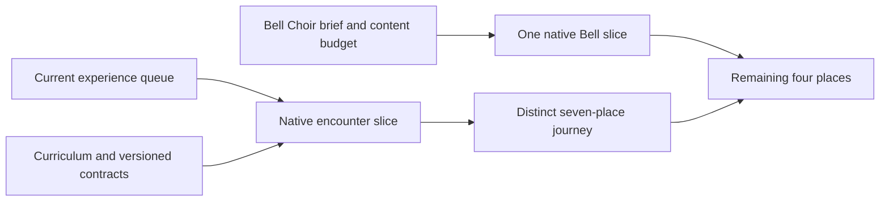

# Starfall roadmap

**Status:** Prioritized product plan; current implementation and future proposals distinguished below · **Owner:** Factory coordinator (lbeezr) · **Updated:** October 23, 2026

Build a satisfying restoration adventure for **iPhone and iPad**: make a thoughtful arrangement, earn a readable cascade, bring a place back to life, then discover a different puzzle at the next stop. Pokémon Puzzle League is the primary gameplay inspiration. The OpenAI showcases inform authored journeys, sensory coherence and small integrated slices.

**Next action:** Finish native verification and integrate [Kite headroom encounter #278](https://github.com/lbeezr/starfall/issues/278), then [Seed's ingredient choice #279](https://github.com/lbeezr/starfall/issues/279) and [Silver's sequencing fork #280](https://github.com/lbeezr/starfall/issues/280). The October 23 user request authorizes this next gameplay sequence and continued verified merges. Reuse the [seven-place curriculum](design/STORY_ENCOUNTER_CURRICULUM.md) and existing paintings; prove each complete native encounter before expanding the family. The [ordinary player pilot](design/CURRENT_STORY_PLAYTEST.md#a-five-minute-first-pilot) remains the source for comprehension, comfort and balance decisions, not a gate for these distinct encounters. Mastery, Bell artwork and later modes retain their separate contracts.

**Parallel visual work:** Preserve the separately authorized [ten-goal cohesion queue #281](https://github.com/lbeezr/starfall/issues/281) and its active reservations. [Goal 1](evidence/cohesion-goal-01-benchmark-2026-10-23/README.md) merged as #292; the [collection-light refinement](evidence/cohesion-goal-02-living-collection-2026-10-23/README.md) establishes the second material slice, with goals 3–10 next for that coordinator. Rebase gameplay onto those verified main changes before final native acceptance. The queues share source integration and host capacity, without making either a new human approval gate.

The [final stacked review](evidence/game-goal-10-coherent-game-2026-10-23/README.md) links all ten separate outcomes and their source-bound evidence: first-minute guidance, trustworthy movement, optional setup discovery, causal feedback, pressure/recovery, Lantern payoff, Ribbon identity, sensory coherence, safe returning and the final Help/Tutorial correction. Retain verified development results; player comprehension, difficulty and enjoyment remain unmeasured. GitHub records each merge/completed issue. [Direct Project recovery proof](evidence/project-recovery-2026-10-23/README.md) independently verifies canonical intake and automatic Done; #220 resolved through PR #294.

This is an outcome sequence, without calendar or playtime promises. The [previous roadmap](ROADMAP_HISTORY_2026-10-22.md) preserves its source-bound integration history and earlier proposals.

## What exists today

Original product-plan baseline: main `c9763dc502a3f8d46ef215451b1365059c9a3cbe`. The [stacked review](evidence/game-goal-10-coherent-game-2026-10-23/README.md) records the subsequent source-bound development changes.

- **Seven of twelve places are ready**, through Sunwheel Mill, with local completed-repair/access records. Bell Choir and the final four places remain unbuilt.
- New Lantern/Ribbon revision-4 visits use automatic squares, crosses and contiguous lines of at least four matching stars, survivor-created phases and 150,000/220,000-point objectives. Openings, five-star incoming supply and six-/four-second showers are unchanged. The four-line development trial is installed on the original phone; preference and balance remain unmeasured. Retained revision-3 rounds keep seven-star lines.
- The other five ready places still use historical 18-light rules on main. Kite’s distinct 17,000-point encounter is prepared in [draft PR #293](https://github.com/lbeezr/starfall/pull/293), with final native acceptance pending; it is not shipped by this roadmap. Historical saves and same-round replay retain their definition. Art variety still exceeds gameplay variety.
- Open Sky remains the accumulating survival game; Tutorial/practice is disposable and never earns journey progress. Optional mastery, move-limited puzzles, a full twelve-place playable campaign and nearby multiplayer are not implemented.

The [Story plan](STORY_MODE_GAMEPLAY_PLAN.md), [current four-line trial evidence](evidence/four-star-lines-2026-10-22/README.md), [world atlas](design/WORLD_ATLAS.md) and [engineering register](ENGINEERING.md) own details. Old tap/trace mastery examples are historical proposals; they cannot become new current-pattern instructions unchanged.

## What the inspirations contribute

These are deliberate Starfall adaptations, not promises to copy another game's systems.

| Reference fact | Starfall direction | Smallest useful proof |
| --- | --- | --- |
| Pokémon Puzzle League rewards larger clears and chains, makes stack height consequential, and offers several modes. [Nintendo description](https://www.nintendo.com/en-gb/Games/Nintendo-64/Pokemon-Puzzle-League-269657.html). | Arrangements should change usable space, the next opportunity and earned spectacle. | Two legal plans leave materially different scores/survivors/headroom; normal motion makes the causal phases readable. |
| Its University uses limited-move puzzles; Spa Service clears above a marked line. [Nintendo-authored manual, archived scan](https://www.emulation64.net/pdf/N64%20-%20Pokemon%20Puzzle%20League%20%28Anglais%29.pdf), PDF pages 22–25. | Proposed Pocket Puzzles and Clear the Skyline give deliberate reasoning and finite space management their own objectives. | One complete mode slice, including last-action success, retry and interruption, before expanding a set. |
| Captain Toad separates completion, collectibles and bonus objectives; its manual also describes gem gates. [Official manual](https://www.nintendo.com/eu/media/downloads/games_8/emanuals/wii_u_6/captain_toad__treasure_tracker/ElectronicManual_WiiU_CaptainToadTreasureTracker_EN.pdf). | Optional restoration mastery can reward replay while ordinary completion keeps unlocking places. Starfall's proposed star formula is its own design; gem gates are omitted. | One revision's attainable goals, qualifying/rejection cases and best single-run result, without blocking the next place. |
| Phantasy's published process develops a destination-based journey; MiniTown makes visible construction/inhabitation central. [Phantasy](https://developers.openai.com/showcase/phantasy-codex-adventure), [MiniTown](https://developers.openai.com/showcase/minitown). | Distinct places should ask different questions and visibly regain different functions. | Kite offers a genuine headroom decision; Bell Choir returns one shared voice rather than another interchangeable glow. |
| Sunwake's process connects movement response with water effects and lighthouse destinations. [Sunwake](https://developers.openai.com/showcase/sunwake). | Sound, light, motion and the next destination should express the same committed achievement. | Existing chain-phrase/next-place slices and one earned restoration finale; quiet play retains the same meaning. |

Reference games were not played in this review. The manual and published descriptions establish design facts, not their enjoyment or Starfall's quality. The [seven-showcase study](design/AI_GAME_FACTORY.md) retains all seven games, 63 cards and prompt-provenance limits: many prompts are reconstructed or unestablished. These sources do not prove autonomous throughput gains. [Puzzle League's adaptation guide](design/POKEMON_PUZZLE_LEAGUE_REFERENCE.md) remains the controlling gameplay reference.

## Milestones and completion conditions

| Milestone / priority | Player promise | Complete when | Delivery ownership |
| --- | --- | --- | --- |
| **1 · Now: a compelling first repair** | “My move works, I see why it matters, and I want to repair the next place.” | The existing ten experience outcomes integrate coherently across new Lantern, Ribbon, Open Sky and a retained historical round. Entry, setup, cascade, danger/recovery, repair, retry and return agree. Human comprehension remains separately observed in #206. | Game design + gameplay engineering; UI/UX, input, audio, animation and QA. |
| **2 · Next: seven places, different decisions** | “The next place changes how I think; replay offers another accomplishment.” | The seven-place curriculum is witnessed, Kite's first new encounter is playable, then Seed/Silver and the remaining ready places gain distinct encounters one at a time. Optional mastery has authoritative versioned qualification and preserves ordinary unlocks. | Level/game design + Core/save engineering; UX, user research and QA. |
| **3 · Next production: a complete twelve-place journey** | “My repairs reconnect a whole neighborhood with a satisfying ending.” | Bell Choir proves one native composition before its full family; Starferry, Aurora, Petal and Hollow Crown follow in separate complete slices. Each has distinct decisions, five-state restoration and a persistent map consequence. | Production + level design; environment/technical art, narrative, animation, audio and QA. |
| **4 · Parallel: a trustworthy handheld release** | “The game stays readable, responsive and intact on supported phones and tablets.” | Current-source player/device/minimum-OS and upgrade evidence meets the shipping conditions below, and distribution follows its actual authorization. | Platform/input, performance, accessibility, QA, release and support. |

A milestone is a player outcome, not a new approval stage. Plan/authoring work can run alongside Milestone 1; shared runtime contracts and native integration stay ordered. Native checks establish behavior. Player observations establish what people understand and enjoy.

## Completed experience sequence

[#240](https://github.com/lbeezr/starfall/issues/240) completed the ordered experience sequence through ten individual main merges: [first minute #242](https://github.com/lbeezr/starfall/issues/242) → [movement trust #243](https://github.com/lbeezr/starfall/issues/243) → [setup discovery #244](https://github.com/lbeezr/starfall/issues/244) → [causal cascades #245](https://github.com/lbeezr/starfall/issues/245) → [pressure/recovery #246](https://github.com/lbeezr/starfall/issues/246) → [Lantern transformation #247](https://github.com/lbeezr/starfall/issues/247) → [Ribbon identity #248](https://github.com/lbeezr/starfall/issues/248) → [sensory language #249](https://github.com/lbeezr/starfall/issues/249) → [safe return #250](https://github.com/lbeezr/starfall/issues/250) → [whole-game coherence #251](https://github.com/lbeezr/starfall/issues/251). Reuse the merged implementation and linked evidence when selecting new work; do not redispatch these completed outcomes.

Reuse the shipped bounded enhancements: [rising committed-chain phrase #236](https://github.com/lbeezr/starfall/issues/236) has [selected development acceptance](evidence/chain-audio-2026-10-22/README.md); [exact Map/Places goals #238](https://github.com/lbeezr/starfall/issues/238) has [native and save-preservation acceptance](evidence/map-goals-2026-10-22/README.md). [Named next ready restoration #237](https://github.com/lbeezr/starfall/issues/237) shipped with [earned onward-journey acceptance](evidence/game-goal-06-lantern-payoff-2026-10-22/README.md), and [#249](https://github.com/lbeezr/starfall/issues/249) completed the [wider sensory-language review](evidence/game-goal-08-sensory-language-2026-10-23/README.md). Keep one implementation owner for future overlapping audio, copy, flow and snapshot changes.

A new-play session, model win or automated completion cannot close [uncoached iPhone/iPad study #206](https://github.com/lbeezr/starfall/issues/206) without the actual observations. Conditional practice [#210](https://github.com/lbeezr/starfall/issues/210) retains its evidence dependency; reconcile #244's optional setup work with that leaf rather than silently replacing its uncoached baseline.

## Next: make each location a different puzzle

**Authorized next gameplay sequence.** These three feature leaves include authoring, production-rule contrasts, App integration and complete native rounds. They are not a queue of research-only witnesses. Core definitions and copy remain serialized between slices; workers may split disjoint Core/App paths after their content contract settles. Each fully resolving main PR closes its own leaf; the verified Project recovery in #220 stays independent of gameplay acceptance. Actual VoiceOver remains deferred.

| Order | Leaf and player decision | Complete slice and disconfirming case |
| --- | --- | --- |
| **1 · P1** | [Kite #278](https://github.com/lbeezr/starfall/issues/278): smaller high clear for headroom versus a larger low award. | Select the brief's 24-star opening, Kite revision 4 and **17,000-point whole-round finish**; both proved paths can complete. Verify ordinary Entry, real swipes, recovery, repair/Seed access, Replay and restore. Revise if recovery depends on hidden receiving columns or native setup becomes impractical. |
| **2 · P1** | [Seed #279](https://github.com/lbeezr/starfall/issues/279): spend a useful grown ingredient now or preserve it for a different later pattern. | Author a distinct incomplete fork and freeze its complete objective/supply/version; reuse existing Seed art. Verify both full wins and recovery after declining preservation. A completed automatic recipe cannot wait for a tap, and relabeling Kite's grown-star recovery does not provide a distinct encounter. |
| **3 · P2** | [Silver #280](https://github.com/lbeezr/starfall/issues/280): deeper survivor-created sequence versus a larger immediate clear. | Author competing real phase/survivor consequences with an alternate finish, then complete the normal Silver→Frostfruit journey. Reject a supposed chain made from separate actions or a target increase without a different decision. |

**Remaining curriculum.** “Ready” below refers to shipped location content, not adoption of new rules. New definitions require explicit versioning; historical saves/replay stay valid. Frostfruit/Sunwheel follow only after the earlier native lessons establish useful distinct decisions; Bell remains a larger production slice.

| Place / region | Current readiness | Proposed decision and distinct restored function | Next boundary |
| --- | --- | --- | --- |
| **01 Lantern Landing · Soft Skies** | Ready; current automatic rules | Recognize a useful pattern; earn a welcoming light and gathering place. | Current first-minute/setup/transformation work; no new target assumed. |
| **02 Ribbon Crossing · Soft Skies** | Ready; current automatic rules | Predict a survivor-created chain; reconnect neighbors. | #248 establishes contrast with Lantern; preserve alternatives and recovery. |
| **03 Kite Harbor · Soft Skies** | Ready artwork; new encounter prepared | Choose headroom versus immediate points; let the fleet set out. | [#278](https://github.com/lbeezr/starfall/issues/278) adopts the [brief's](design/STORY_ENCOUNTER_CURRICULUM.md) choice/recovery with an explicit 17,000-point finish; [development evidence](https://github.com/lbeezr/starfall/pull/293) records earlier complete phone/tablet rounds and the later unresolved clock repeat before merge. |
| **04 Seed Moon · Wild Moons** | Ready; historical rules | Position a useful grown ingredient for a later pattern versus spending it now; restore shelter. | [#279](https://github.com/lbeezr/starfall/issues/279) follows Kite's native route; a completed automatic pattern cannot be banked awaiting a tap. |
| **05 Silver Pools · Wild Moons** | Ready; historical rules | Choose the order that creates a deeper causal sequence; restore continuous flow. | [#280](https://github.com/lbeezr/starfall/issues/280) proves divergent exchanges, complete wins and recovery after Seed. |
| **06 Frostfruit Orchard · Wild Moons** | Ready; historical rules | Proposed compression/recovery challenge; restore a living winter rhythm. | Author one contrasting encounter; preserve the cool seasonal identity. |
| **07 Sunwheel Mill · Clockwork Belt** | Ready; historical rules | Combine earlier space/ingredient/sequence decisions; restore useful work and an open outlet. | Demonstrate synthesis rather than another unexplained target increase. |
| **08 Bell Choir · Clockwork Belt** | **Unbuilt** | Proposed coordination of two useful pattern opportunities; restore a shared voice. | [Production brief](design/BELL_CHOIR_AND_CAMPAIGN_BUDGET.md): three unequal chimes, unfinished large chime at 75%, one earned ensemble response. No rhythm/pitch minigame. |
| **09 Starferry Station · Clockwork Belt** | **Unbuilt** | Proposed preparation before committing a useful sequence; restore departure across distance. | After Bell's native lesson, brief one encounter and a short ferry payoff. |
| **10 Aurora Falls · Night's Edge** | **Unbuilt** | Proposed continuity through linked consequences; restore one continuous aurora. | Witness a distinct chain problem before producing the next asset family. |
| **11 Petal Beacon · Night's Edge** | **Unbuilt** | Proposed controlled release of a prepared opportunity; reveal a route onward. | Make the opening/beam reward readable without new hidden rules. |
| **12 Hollow Crown · Night's Edge** | **Unbuilt** | Proposed final synthesis of learned decisions; return circulating light to everyone. | Announced restoration objective is the finish. No surprise boss meter or final timed input. |

[The curriculum and Kite brief](design/STORY_ENCOUNTER_CURRICULUM.md) supply the first source-witnessed encounter, with hypothetical-carrier and native/adoption limits explicit. Every adopted encounter needs two meaningful legal plans, materially different consequences, an understandable recovery route and a complete native round. A deterministic witness establishes consequences/solvability, not difficulty or fun. Keep the later target/time figures in the older Story plan as hypotheses.

[The campaign budget](design/BELL_CHOIR_AND_CAMPAIGN_BUDGET.md) compares the **twelve-repair baseline** with optional multi-round chapters. Additional rounds must add a distinct decision, variation or capstone. Define round-versus-location completion and save identity before implementation; do not assume 36/48 rounds or several hours. Skilled play may finish promptly.

## Replay depth and future modes

These are prioritized proposals. Create runtime leaves when their prerequisite contract is settled; this roadmap does not silently enable them.

| Horizon | Outcome / small first slice | Required contract and observable acceptance |
| --- | --- | --- |
| **Next contract; later runtime · P2** | **Optional restoration mastery.** Begin with one Lantern revision and two automatic-pattern accomplishments, such as grown-light collection and a genuine causal chain. | [The mastery contract](design/STORY_MASTERY_CONTRACT.md) defines qualification, winning-action credit, content/goal versions and best result from one completed run; [real joint and declined-opening recovery wins are verified](evidence/story-mastery-recovery-2026-10-23/README.md); missed-first-grown recovery, completion-only alternatives and remaining qualification/ledger cases are still required. Ordinary completion unlocks the next place; preserve stronger records and historical completion without inventing mastery. No speed or aggregate-star gate. |
| **Following the core encounter slice · P2** | **Pocket Puzzles.** A small authored set: create a pattern, cause a falling follow-up, combine both. | Separate content/save identity; visible accepted-exchange budget, no automatic showers, retry and proposed one-step undo. Define move/checkpoint semantics first. Prove last-move success and interruption restore; keep this separate from Tutorial #210 and world progression. |
| **Following core payoff work · P2 candidate** | **View a restored place.** Inspect an existing 100% painting without beginning another puzzle. | One Lantern native slice reuses existing art. Back/inspect preserve the retained round, clocks and repairs; replay/new visit stays explicit. Reuse #250 if it already delivers this outcome. |
| **Later experiment · P3** | **Clear the Skyline.** One finite challenge to remove occupancy above a visible line. | Core objective/supply policy and separate identity. Show a high-clear versus low-score choice, immediate earned finish and retry. Expand only if it differs meaningfully from Pocket Puzzles/Open Sky. |
| **Later experiment · P3** | **Score attack.** Consider one clearly separate, timed round only if it adds a useful reason to replay. | A clock belongs to this mode; no countdown or minimum-duration lock is imposed on restoration. Do not duplicate existing Open Sky survival. |
| **Later story proposal · P3** | **One optional Murk opening.** A short Lantern arrival/theft/departure storyboard develops the approved villain. | Storyboard before new runtime assets; skip, quiet mode, retry and background reach the same committed board/objective. No mandatory delay, star sacrifice or mid-round sabotage. |
| **Future user-requested direction** | **Nearby versus and cooperative restoration**, designed separately. | Separate-board versus pressure/recovery; shared-restoration co-op with explicit authority, reconnect and repair-credit semantics. Local host/join only. Networking waits for its own implementation task; no accounts, backend or online matchmaking. |

## Dependencies that actually matter

**Proposed delivery dependencies, not implementation evidence.** Independent design/research can begin now. Device/release evidence progresses in parallel.

- **#206 gates its balance conclusions and conditional #210.** It does not block chain audio, truthful progress UI, mastery contracts, encounter briefs or twelve-place planning.
- **Contracts precede dependents:** qualification/persistence before rating UI; versioned content before changed challenges; round/location semantics before multi-round progression; settled native composition before multiplying an art family.
- **Carry the trial boundary forward:** each encounter/mastery runtime packet names its selected content revision and how the current four-line trial affects it. Record the retain/revise/remove decision in the existing experiment owner before adopting that extension; installation alone establishes no balance result. This does not hold parallel design or unrelated development.
- **Shared resources serialize actual work.** One owner integrates copy/flow/Core contracts. One native resource reservation at a time when the host is constrained. Stop adding workers when returned work awaits integration.
- **Project projection never gates gameplay.** [#220 recovery](evidence/project-recovery-2026-10-23/README.md) is verified for actual intake/completion cases. Keep native issue closure authoritative and check each merged leaf’s canonical Done; preserve the [incident-aware contract](evidence/project-processing-2026-10-22/README.md).

## Workstream coverage and allocation

Use [29 workstreams / 292 responsibilities](GAME_ROLE_CATALOG.md) and the [label contract](GAME_WORKSTREAMS.md). Each leaf has one primary stream/kind; supporting roles stay in its packet. The factory coordinator owns delivery; human/device participation and real capacity remain **Unknown** until recorded. Ticket counts do not measure investment.

| Work to cover | Primary homes and supporting expertise | Current action / gap |
| --- | --- | --- |
| Rules, progression, authored decisions, replay | Game design, level design, gameplay engineering; puzzle designer, balance designer, save engineer, QA | #240, the [encounter curriculum](design/STORY_ENCOUNTER_CURRICULUM.md) and the [mastery contract](design/STORY_MASTERY_CONTRACT.md); biggest product gap is distinct encounters beyond the first pair. |
| World, cast, story and restoration payoff | Production, narrative, art direction, environment/character art, animation/VFX, audio, technical art | Seven ready identities; five unbuilt. [The Bell brief](design/BELL_CHOIR_AND_CAMPAIGN_BUDGET.md) budgets the next complete slice; avoid parallel mass asset generation. |
| HUD, map, controls, teaching and sensory meaning | UI/UX, platform/input, audio, accessibility; HUD designer, interaction designer, UX writer, native QA | Reuse #236–#238/#242–#250; quiet, largest-text and non-color meaning remain part of applicable development checks. Actual VoiceOver is deferred. |
| Player understanding and balance | User research, game design, QA; participants, researcher, touch specialist | #206 needs real phone/tablet observations; simulation cannot supply them. |
| Sustained performance and platform compatibility | Performance, rendering, technical art, platform/input, QA | #207 physical budgets; #208 minimum iOS; #209 physical readability/cues. Simulator evidence does not close device acceptance. |
| Delivery pipeline and project tracking | Build/tools, production, QA, release engineering | Use existing checks and merge closure; Retain #220’s verified recovery and check each merged leaf. Do not expand paid CI or add process gates. |
| Language, distribution and aftercare | Localization, release, marketing/support, security/privacy and compliance | Declare release/language scope and prepare existing checklist when an RC is selected. No implied App Store/TestFlight upload or localization feature. |
| Nearby multiplayer; Mac | Future multiplayer design and deferred porting assessment | Keep directions visible; neither is a current handheld shipping requirement. Online services, commerce and live-service analytics remain excluded. |

## Shipping quality gates

These six conditions apply to a selected shipping candidate. They do not become human approval columns for development merges. Current open evidence remains with its existing owners.

| Condition | Evidence / next action |
| --- | --- |
| **Opening is enjoyable and understood** | #206 actual uncoached iPhone/iPad observations: intended swaps, pattern discovery, decision opportunities, recovery and replay preference. Preserve observations versus interpretation. |
| **Each feature is complete** | Observable acceptance and change-appropriate Core/save/native/quiet/large-text evidence, including failed and missing checks; ordinary and contrasting paths. Follow [the verification matrix](ENGINEERING.md#verification-by-change). |
| **Exact shipping candidate is verified** | Clean source/configuration/toolchain, actual minimum-supported iOS #208, fresh/retained saves, RNG continuation, preferences, completed repairs and historical/current replay. No player-data reset. |
| **Physical-device quality is measured** | #207 sustained responsiveness/frame pacing, memory and thermal/energy observations; #209 composited contrast and actual cue recognition on phone and tablet. Fix demonstrated failures, then recheck. |
| **Actual accessibility is accepted at RC** | [Development/RC cadence](DEVELOPMENT_BUILDS.md#accessibility-checks-by-build-stage). Keep #217 and actual VoiceOver deferred during ordinary gameplay/refill. A selected RC's complete actual-VoiceOver round remains separate acceptance. |
| **Authorized release feedback informs the candidate** | Follow [release checklist](RELEASE_CHECKLIST.md); TestFlight upload/testers require their actual authorization. Record source/device/build and feedback without analytics SDKs. |

The game remains one offline iOS 17+ app. Preserve historical saves, deterministic ownership and normal-app routing. No XP, power-ups, purchases, paid assets, SDKs, accounts or network features follow from planning. This planning batch does not request another phone installation. Notifications remain planned/deferred in the [historical direction](ROADMAP_HISTORY_2026-10-22.md#notifications--planned-implementation-deferred), with no implementation added here.

## Keep the roadmap useful

Review this plan after an integrated gameplay/content slice, new player/device evidence or a meaningful discovery. Update the affected outcome and dependency, then deliver the next ready slice through [the factory](AGENT_FACTORY.md). Capture out-of-scope findings on their originating issue/PR, deduplicate, and create only useful bounded leaves. Keep the longer horizon in this document until ready; a role or idea does not need its own ticket.

GitHub issues remain the task record. Use default-main closing references only for fully resolved leaves, confirm issue completion, and check Project Done separately. This roadmap does not add another status database, standing research queue or sign-off gate.

**Planning acceptance:** Reconcile current source, reference facts, milestone exits, dependencies and linked issue ownership; run documentation hygiene/diff/local-link checks. No app behavior or experiment has been adopted by this document, so gameplay/native/device enjoyment claims are inapplicable. [EXPERIMENTS](EXPERIMENTS.md) and [ENGINEERING](ENGINEERING.md) retain their existing adoption/evidence owners.
