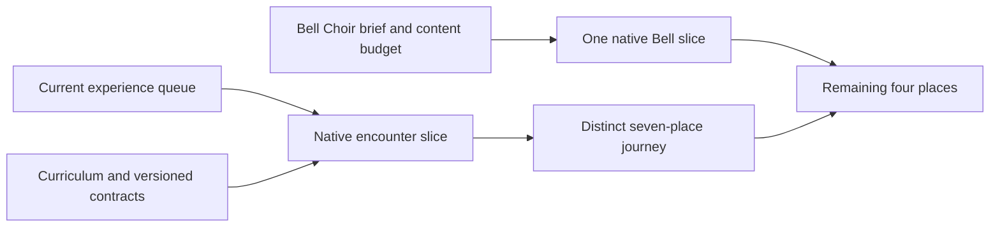

# Starfall roadmap

**Player momentum — October 24:** [#393](https://github.com/lbeezr/starfall/issues/393) prioritizes responsive input and a quick first understood clear. [Study preparation #396](https://github.com/lbeezr/starfall/pull/396) and [pacing/repeat audit #397](https://github.com/lbeezr/starfall/pull/397) are merged. The [isolated nonvisual FIFO correction #398](https://github.com/lbeezr/starfall/pull/398) passes 352 Core/88 hosted/one real five-phase native journey and Debug/Release; first-play/feedback visual work remains held in #395 and the ordered HUD #381 refinements. Human observations and phone delivery remain unperformed.

**Bounded HUD stack — goals 1–4 merged and goal 5 verified for development, October 24:** [#381](https://github.com/lbeezr/starfall/issues/381) records ten sequential HUD/design-system refinements. [The correction](evidence/hud-stack-2026-10-24/README.md#goal-1-correction-native-and-visual-acceptance) replaces the wrong inspection role, joins the painting, preserves complete native text and excludes packet ink from the header. Independent whole-screen/export review passes the named phone/tablet states; earlier reader stalls remain source-bound with an unchanged isolated pass and explicit recurrence investigation. [PR #402](https://github.com/lbeezr/starfall/pull/402) completed #382; [Goal 2 / #383](https://github.com/lbeezr/starfall/issues/383) passed shared type, native phone/tablet and retained-export checks and merged in [PR #403](https://github.com/lbeezr/starfall/pull/403) as `1ed733bb`. [Goal 3 / #384](evidence/hud-stack-2026-10-24/README.md#goal-3-pause-separation-over-scenery) has passed its pause-only native bright/darker comparison, affected tests and independent final visual review; [PR #404](https://github.com/lbeezr/starfall/pull/404) merged as `47b0b5e9`, completed #384. Goal 4 has passed its bounded contact/state, native whole-screen and final export reviews; [PR #405](https://github.com/lbeezr/starfall/pull/405) merged as `bac7bcf3`, completed #385. Goal 5 passes bounded whole-native-screen, sampled-motion and all retained-export reviews; its individual merge precedes goal 6. The queue adds no gameplay rule, save, scheduler or delivery authority.

**Status:** Prioritized product plan; current implementation and future proposals distinguished below · **Owner:** Factory coordinator (lbeezr) · **Updated:** October 23, 2026

Build a satisfying restoration adventure for **iPhone and iPad**: make a thoughtful arrangement, earn a readable cascade, bring a place back to life, then discover a different puzzle at the next stop. Pokémon Puzzle League is the primary gameplay inspiration. The OpenAI showcases inform authored journeys, sensory coherence and small integrated slices.

**Standing factory queue — October 23:** The user authorizes [automatic ten-goal replenishment](AGENT_FACTORY.md#standing-ten-goal-refill): whenever no usable product goals remain, derive and queue ten ordered goals that build on accepted improvements, then keep implementing, testing and merging each separately. The final #312/#313 outcomes complete [#303's depth sequence](https://github.com/lbeezr/starfall/issues/303) before the already queued identity successor; old tranche stops do not require another confirmation. The existing 30-minute thread heartbeat continues this loop with bounded WIP and no duplicate stacks. Player/device-only observations do not block unrelated enhancements; actual VoiceOver remains deferred. This authorizes neither phone installation nor new network/monetization scope.

**Standing refill — October 24:** [Decision stack #360](https://github.com/lbeezr/starfall/issues/360) follows the individually completed identity implementation #336–345/#350–359. Fresh main `ed563137` has no other usable product leaves: #335/#206–210 retain actual external/conditional evidence and #217 stays deferred. Three bounded read-only returns found concrete presentation capabilities below; their usefulness is a hypothesis, not a player complaint or learning result. One continuing coordinator reserved the refill, published exactly ten ordered leaves and reuses current depth/identity owners. No new campaign, mode, rule, target/cadence, generator, asset family or schema is authorized. Finish each playable slice with its own verified main merge, native completed issue closure and specific canonical Done, then continue without another tranche confirmation. External observations do not suppress delivery or the next zero-usable-goal refill.

| Order | Player outcome | Leaf |
| --- | --- | --- |
| 1 | Inspect the actual Story ingredient | [#361](https://github.com/lbeezr/starfall/issues/361) |
| 2 | Recognize optional Full Board choices on the board | [#362](https://github.com/lbeezr/starfall/issues/362) |
| 3 | Connect an announced forecast to its real column | [#363](https://github.com/lbeezr/starfall/issues/363) |
| 4 | Inspect the next announced shower against the current sky | [#364](https://github.com/lbeezr/starfall/issues/364) |
| 5 | See the room a committed clear really opened | [#365](https://github.com/lbeezr/starfall/issues/365) |
| 6 | Explain the points of the clear as they are earned | [#366](https://github.com/lbeezr/starfall/issues/366) |
| 7 | Show which actual survivors carried a causal follow-up | [#367](https://github.com/lbeezr/starfall/issues/367) |
| 8 | Read one last clear without replaying its rewards | [#368](https://github.com/lbeezr/starfall/issues/368) |
| 9 | Visit restored Lantern without beginning another round | [#369](https://github.com/lbeezr/starfall/issues/369) |
| 10 | Carry earned-place inspection through the seven-place journey | [#370](https://github.com/lbeezr/starfall/issues/370) |

**Decision goal9 implemented — October24:** [Restored Lantern evidence](evidence/decision-goal-09-restored-lantern-2026-10-24/README.md) adds read-only **View restored place** to completed Lantern’s Map/Places actions. Both complete phone/AX3XL actual-Calm tablet journeys preserve actual results, opposite-mode rounds, recaps and world through Back/background/rotation/cold Continue.180affected hosted checks and independent appearance review pass. Revisit still stages Entry; Begin alone replaces. Continue the one remaining ordered family leaf#370 after this goal’s individual verified merge. Other coordinators’ usable work and external recognition retain their own owners; no refill is due here.

**Decision goal8 implemented — October 24:** [Last clear evidence](evidence/decision-goal-08-last-clear-2026-10-24/README.md) adds optional exact phase/ingredient diagrams and complete earned-score/survivor/room facts in the existing menu/result. New genuine zero-light clears replace older detail, no-clear setups/losses retain a correctly named earlier clear, and cold restore omits unavailable session history. Four complete normal-phone/AX3XL actual-Calm tablet methods plus162 affected hosted checks pass on their recorded source; terminal decisions stay ahead of optional accounting. Actual usefulness is unmeasured. Continue ordered#369/#370; external recognition does not gate them or the eventual zero-usable-goal refill.

**Decision goal7 implemented — October 24:** [Actual-survivor evidence](evidence/decision-goal-07-survivor-ingredients-2026-10-24/README.md) ties unfilled current-return diamonds and complete guide/result facts to exact original-action ingredients. Normal Ribbon three phases/separate action/Silver terminal and AX3XL actual-Calm Lantern/Compare journeys pass. Goals1–7 are delivered; three ordered usable product leaves#368–370 remain. No refill or new human gate.

**Decision goal6 implemented — October 24:** [Exact-score evidence](evidence/decision-goal-06-earned-score-2026-10-24/README.md) separates actual stars/light from base, size and causal points using committed receipts. Current Silver5k+14k/19k versus independent7k+5k and AX3XL actual-Calm grown Seed/Open Sky5-point native journeys pass. At that checkpoint goals1–6 were delivered; goal7 above records the later three-leaf queue.

**Decision goal5 implemented — October 24:** [Committed-headroom evidence](evidence/decision-goal-05-committed-headroom-2026-10-24/README.md) adds exact named-column top-space facts alongside points and actual Full Board replacement counts through the existing guide. Normal Kite choice/recovery/win/Replay and AX3XL actual-Calm Full Board/next-action journeys pass, preserving original oracle failures. At that checkpoint goals1–5 were delivered and five product leaves remained; goal6 above records the later queue state. Human recognition/#206 and actual VoiceOver keep their separate dependencies.

**Decision goal4 implemented — October 24:** [Announced-shower evidence](evidence/decision-goal-04-shower-inspection-2026-10-24/README.md) adds optional ordered growth/placement/block reading from one Core value copy, without pausing or changing live saves/deadlines. Normal phone actual arrivals/ordinary-clock dismissal and AX3XL actual-Calm tablet reading/Full Board contrast pass, retaining the initial form-sheet failure and verified page-sizing correction. Its recorded source and limits remain specific to goal4.

[Goal1’s ingredient-inspection development slice](evidence/decision-goal-01-ingredient-inspection-2026-10-24/README.md) reports actual small/grown facts with normal phone, AX3XL Calm tablet and exact state/deadline acceptance. [Goal2’s optional choice diagrams](evidence/decision-goal-02-choice-diagrams-2026-10-24/README.md) retain exact source/setup/final ingredients, passive scrolling and ordinary next actions, with normal Lantern6 and AX3XL Calm Ribbon7 development acceptance. [Goal3’s forecast column locator](evidence/decision-goal-03-forecast-columns-2026-10-24/README.md) connects actual announced stars to a passive bracket with source/cancellation and normal/AX3XL Calm acceptance. Goal6 follows goal5’s verified individual merge; five outcomes remain queued. Each leaf depends on its immediate predecessor’s individual verified merge. Literal write/native reservations are frozen at activation, not inferred from this table. Goal2 diagrams use the actual post-exchange board/IDs; goal8 must name zero-award replacement honestly. Goal9 proves one existing-art Lantern viewer before goal10 expands to the remaining repaired places. Keep the seven-place definition registry, archive19, both Story modes, exact historical Continue/Replay, committed-win immediate successor and Begin-only replacement. The same #206 study owns actual comprehension; no actual VoiceOver investigation or phone installation is implied.

**Requested identity successor — October 23:** [The identity stack #335](https://github.com/lbeezr/starfall/issues/335) queues ten compounding player-facing outcomes, [#336–345](https://github.com/lbeezr/starfall/issues/335#ten-compounding-outcomes), after #312/#313 under the continuing factory. Its promise is looking after living stars and returning light to little night places: Open Sky returns the player's exact drawn constellation; Story keeps automatic arrangements and survivor chains. The sequence develops shape returns, selective drawing, helper departures, existing trace practice, automatic patterns, causal cascades, Lantern/Ribbon receivers, immediate endings and truthful mode/return guidance. Each leaf retains earlier results and needs its own playable native slice and verified main merge. Its implementation is complete through #359; it took no competing runtime reservations. Actual recognition remains independent under #335/#206, while the standing successor is #360.

[Goal1's exact constellation return](evidence/identity-goal-01-constellation-return-2026-10-24/README.md) is the first verified development slice after #313/#349: original ordered manual topology rises into protected space, with static quiet equivalence and native next-input acceptance. [Goal2’s selective-star cues](evidence/identity-goal-02-retained-stars-2026-10-24/README.md) distinguish chosen rays from matching stars kept behind, with partial/full, dense and AX3XL Calm development acceptance. [Goal3’s helper departures](evidence/identity-goal-03-helper-departures-2026-10-24/README.md) preserve the actual cleared bodies and separate credited light in manual and automatic play, with 348 Core,174 hosted and eight native executions passing on the recorded source. Full short native trajectories and human recognition remain unproved. [Goal4’s existing Open Sky practice](evidence/identity-goal-04-open-sky-practice-2026-10-24/README.md) now teaches choosing five of six helpers with optional Hint, either endpoint retained and exact saved-round isolation. [Goal5’s automatic Story returns](evidence/identity-goal-05-story-patterns-2026-10-24/README.md) now preserve every committed recipe as its own figure, with normal phone and AX3XL Calm Full Board/practice acceptance. [Goal6’s successive cascade returns](evidence/identity-goal-06-cascade-returns-2026-10-24/README.md) retain earlier exact figures beside the active phase and tie receiver acknowledgement to its displayed flight, with normal/quiet development acceptance. [Goal7’s Lantern receiver](evidence/identity-goal-07-lantern-response-2026-10-24/README.md) answers delivered light below a painting milestone, with native normal/quiet journeys, visible Calm tablet response and live normal-render sampling. [Goal8’s Ribbon receiver](evidence/identity-goal-08-ribbon-response-2026-10-24/README.md) answers at its woven seam with native normal-phone reveal/cleanup and actual AX3XL Calm tablet portrait/landscape acceptance. [Goal9’s final-light signature](evidence/identity-goal-09-final-light-2026-10-24/README.md) keeps one exact in-session figure beside the committed result, with normal win/loss/cold-return and AX3XL Calm practice/Full Board acceptance. [Goal10’s coherent Home and returning play](evidence/identity-goal-10-coherent-return-2026-10-24/README.md) completes the implementation sequence with truthful mode promises, selected-context Help and three corrected native journeys. Its individual verified merge is #359; [#360](https://github.com/lbeezr/starfall/issues/360) now carries the standing successor. The parent’s actual recognition observation remains independent. None is human-validated. Preserve current rules, saves, exact Continue/Replay and both supply modes; add no campaign/progression, generator changes, asset family or persistence schema. The initial identity conversation reviewed older `f35eba87`; its isolated-tracing status and tap-frequency observations are historical, not current evidence. The stack reconciles source `c6c726f5`; actual uncoached recognition stays with [#206](https://github.com/lbeezr/starfall/issues/206), and the parent remains open until its implementation and player evidence are met.

**User-selected comparison — October 23:** [Visible ceiling and full-board Lantern](evidence/ceiling-lantern-refill-2026-10-23/README.md) adds a real Entry choice while retaining current Falling Sky. Full Board uses the same pattern gestures and 150,000-point goal with immediate refill and relaxed untimed setup. The user’s positive first-pass feedback now authorizes retaining both modes through the [ten-goal depth queue #303](https://github.com/lbeezr/starfall/issues/303). Goals 1–8 develop learning, choices, deliberate cascades, round structure, forecast fairness and distinct Ribbon/Frostfruit/Sunwheel encounters in separate main merges. [Goal9](evidence/depth-goal-09-optional-mastery-2026-10-23/README.md) adds Lantern mastery; [goal10](evidence/depth-goal-10-repeat-journey-2026-10-23/README.md) completes the journey review with context-preserving Back and saved-mode clarity. Human balance and comprehension remain separately observed. The shared ceiling fix is independently useful across accumulating skies.

**Current depth tranche:** Goals 1–4 merged individually as PRs #316/#318/#319/#323: [discoveries](evidence/depth-goal-01-mode-discoveries-2026-10-23/README.md), [visible advice](evidence/depth-goal-02-visible-choices-2026-10-23/README.md), [survivor comparison](evidence/depth-goal-03-survivor-cascades-2026-10-23/README.md) and [Full Board round arc](evidence/depth-goal-04-full-board-round-arc-2026-10-23/README.md). The user then authorized goals 5–8, one main merge each. [Forecast columns](evidence/depth-goal-05-forecast-columns-2026-10-23/README.md) merged through #326, [Ribbon Full Board](evidence/depth-goal-06-ribbon-full-board-2026-10-23/README.md) through #330, and [Frostfruit pressure](evidence/depth-goal-07-frostfruit-pressure-2026-10-23/README.md) through #331. [Sunwheel synthesis](evidence/depth-goal-08-sunwheel-capstone-2026-10-23/README.md) completes this tranche’s implementation with contrasting room/sequence choices and mistake recovery. Both Lantern and Ribbon retain Falling Sky/Full Board; historical saves and Replay keep their own definitions. [Goal9 Lantern mastery](evidence/depth-goal-09-optional-mastery-2026-10-23/README.md) adds two optional accomplishments per mode, exact enrollment and independent best records; [Goal10 repeat-visit continuity](evidence/depth-goal-10-repeat-journey-2026-10-23/README.md) completes the ordered queue. No scheduler or phone installation is implied. Revisit player comprehension and preference at the next ordinary session, independently of mechanical reachability.

**Encounter follow-through:** The encounter sequence is development-verified through [Silver’s 12,000-point sequencing encounter #280](evidence/silver-sequence-2026-10-23/README.md), following [Seed's ingredient choice #279](evidence/seed-ingredient-2026-10-23/README.md) and [Kite's headroom encounter #278](evidence/kite-headroom-2026-10-23/README.md). The October 23 user request authorizes this next gameplay sequence and continued verified merges. Reuse the [seven-place curriculum](design/STORY_ENCOUNTER_CURRICULUM.md) and existing paintings; prove each complete native encounter before expanding the family. The [ordinary player pilot](design/CURRENT_STORY_PLAYTEST.md#a-five-minute-first-pilot) remains the source for comprehension, comfort and balance decisions, not a gate for these distinct encounters. Mastery, Bell artwork and later modes retain their separate contracts. Continue through the existing [depth coordinator #303](https://github.com/lbeezr/starfall/issues/303), its ordered leaves #304–313 and actual reservations; #304–306 completed through #316/#318/#319 and #307 completed through #323; goals 5–7 completed forecast, Ribbon and Frostfruit outcomes; Sunwheel #311 completed the encounter tranche; goals #312/#313 then complete mastery and repeat-visit continuity. This sequence feeds that coordinator rather than creating another queue.

**Parallel visual work:** Preserve the separately authorized [ten-goal cohesion queue #281](https://github.com/lbeezr/starfall/issues/281) and its active reservations. [Goal 1](evidence/cohesion-goal-01-benchmark-2026-10-23/README.md) merged as #292; the [collection-light refinement](evidence/cohesion-goal-02-living-collection-2026-10-23/README.md) establishes the second material slice, and the [HUD hierarchy](evidence/cohesion-goal-03-hud-hierarchy-2026-10-23/README.md) gives score and forecast clear roles; the [compact-action finish](evidence/cohesion-goal-04-compact-actions-2026-10-23/README.md) aligns small actions with that material language; [Seed Moon’s connected scenery](evidence/cohesion-goal-05-seed-place-2026-10-23/README.md) completes the fifth visual slice; [Opening flight handoffs](evidence/cohesion-goal-06-flight-handoff-2026-10-23/README.md) now finish body/light at their actual arrival; [Earned tablet fitting light](evidence/cohesion-goal-07-cumulative-light-2026-10-23/README.md) now persists through the restoration midpoint; [Ribbon’s travel identity](evidence/cohesion-goal-08-travel-identity-2026-10-23/README.md) aligns its torn map bridge with Entry and play; [collection score priority](evidence/cohesion-goal-09-score-focus-2026-10-23/README.md) preserves earned totals through packet light; [goal10’s integrated review](evidence/cohesion-goal-10-integrated-review-2026-10-23/README.md) reserves readable practice award space and retains all nine earlier outcomes. Rebase gameplay onto those verified main changes before final native acceptance. The queues share source integration and host capacity, without making either a new human approval gate.

The [final stacked review](evidence/game-goal-10-coherent-game-2026-10-23/README.md) links all ten separate outcomes and their source-bound evidence: first-minute guidance, trustworthy movement, optional setup discovery, causal feedback, pressure/recovery, Lantern payoff, Ribbon identity, sensory coherence, safe returning and the final Help/Tutorial correction. Retain verified development results; player comprehension, difficulty and enjoyment remain unmeasured. GitHub records each merge/completed issue. [Direct Project recovery proof](evidence/project-recovery-2026-10-23/README.md) independently verifies canonical intake and automatic Done; #220 resolved through PR #294.

This is an outcome sequence, without calendar or playtime promises. The [previous roadmap](ROADMAP_HISTORY_2026-10-22.md) preserves its source-bound integration history and earlier proposals.

## What exists today

Original product-plan baseline: main `c9763dc502a3f8d46ef215451b1365059c9a3cbe`. The [stacked review](evidence/game-goal-10-coherent-game-2026-10-23/README.md) records the subsequent source-bound development changes.

- **Seven of twelve places are ready**, through Sunwheel Mill, with local completed-repair/access records. Bell Choir and the final four places remain unbuilt.
- New Lantern/Ribbon revision-4 visits use automatic squares, crosses and contiguous lines of at least four matching stars, survivor-created phases and 150,000/220,000-point objectives. Openings, five-star incoming supply and six-/four-second showers are unchanged. The four-line development trial is installed on the original phone; preference and balance remain unmeasured. Retained revision-3 rounds keep seven-star lines.
- New Kite/Seed/Silver visits use distinct 17,000-point headroom, 11,000-point grown-ingredient and 12,000-point causal-sequence encounters. Frostfruit8 uses a15,000-point pressure/growth encounter and Sunwheel9 a24,000-point synthesis encounter; retained revision0 rounds keep historical18-light rules. Historical saves and same-round replay retain their definition. Art variety still exceeds gameplay variety.
- Open Sky remains the accumulating survival game; Tutorial/practice is disposable and never earns journey progress. Lantern has a bounded optional mastery slice in both modes. Move-limited puzzles, a full twelve-place playable campaign and nearby multiplayer remain proposals.

The [Story plan](STORY_MODE_GAMEPLAY_PLAN.md), [current four-line trial evidence](evidence/four-star-lines-2026-10-22/README.md), [world atlas](design/WORLD_ATLAS.md) and [engineering register](ENGINEERING.md) own details. Old tap/trace mastery examples are historical proposals; they cannot become new current-pattern instructions unchanged.

## What the inspirations contribute

These are deliberate Starfall adaptations, not promises to copy another game's systems.

| Reference fact | Starfall direction | Smallest useful proof |
| --- | --- | --- |
| Pokémon Puzzle League rewards larger clears and chains, makes stack height consequential, and offers several modes. [Nintendo description](https://www.nintendo.com/en-gb/Games/Nintendo-64/Pokemon-Puzzle-League-269657.html). | Arrangements should change usable space, the next opportunity and earned spectacle. | Two legal plans leave materially different scores/survivors/headroom; normal motion makes the causal phases readable. |
| Its University uses limited-move puzzles; Spa Service clears above a marked line. [Nintendo-authored manual, archived scan](https://www.emulation64.net/pdf/N64%20-%20Pokemon%20Puzzle%20League%20%28Anglais%29.pdf), PDF pages 22–25. | Proposed Pocket Puzzles and Clear the Skyline give deliberate reasoning and finite space management their own objectives. | One complete mode slice, including last-action success, retry and interruption, before expanding a set. |
| Captain Toad separates completion, collectibles and bonus objectives; its manual also describes gem gates. [Official manual](https://www.nintendo.com/eu/media/downloads/games_8/emanuals/wii_u_6/captain_toad__treasure_tracker/ElectronicManual_WiiU_CaptainToadTreasureTracker_EN.pdf). | Optional restoration mastery can reward replay while ordinary completion keeps unlocking places. Starfall's proposed star formula is its own design; gem gates are omitted. | One revision's attainable goals, qualifying/rejection cases and best single-run result, without blocking the next place. |
| Phantasy's published process develops a destination-based journey; MiniTown makes visible construction/inhabitation central. [Phantasy](https://developers.openai.com/showcase/phantasy-codex-adventure), [MiniTown](https://developers.openai.com/showcase/minitown). | Distinct places should ask different questions and visibly regain different functions. | Kite offers a genuine headroom decision; Bell Choir returns one shared voice rather than another interchangeable glow. |
| Sunwake's process connects movement response with water effects and lighthouse destinations. [Sunwake](https://developers.openai.com/showcase/sunwake). | Sound, light, motion and the next destination should express the same committed achievement. | Existing chain-phrase/next-place slices and one earned restoration finale; quiet play retains the same meaning. |

Reference games were not played in this review. The manual and published descriptions establish design facts, not their enjoyment or Starfall's quality. The [seven-showcase study](design/AI_GAME_FACTORY.md) retains all seven games, 63 cards and prompt-provenance limits: many prompts are reconstructed or unestablished. These sources do not prove autonomous throughput gains. [Puzzle League's adaptation guide](design/POKEMON_PUZZLE_LEAGUE_REFERENCE.md) remains the controlling gameplay reference.

## Milestones and completion conditions

| Milestone / priority | Player promise | Complete when | Delivery ownership |
| --- | --- | --- | --- |
| **1 · Now: a compelling first repair** | “My move works, I see why it matters, and I want to repair the next place.” | The existing ten experience outcomes integrate coherently across new Lantern, Ribbon, Open Sky and a retained historical round. Entry, setup, cascade, danger/recovery, repair, retry and return agree. Human comprehension remains separately observed in #206. | Game design + gameplay engineering; UI/UX, input, audio, animation and QA. |
| **2 · Next: seven places, different decisions** | “The next place changes how I think; replay offers another accomplishment.” | Kite, Seed and Silver are playable distinct encounters; Frostfruit/Sunwheel complete the seven-place curriculum one verified slice at a time. Optional mastery has authoritative versioned qualification and preserves ordinary unlocks. | Level/game design + Core/save engineering; UX, user research and QA. |
| **3 · Next production: a complete twelve-place journey** | “My repairs reconnect a whole neighborhood with a satisfying ending.” | Bell Choir proves one native composition before its full family; Starferry, Aurora, Petal and Hollow Crown follow in separate complete slices. Each has distinct decisions, five-state restoration and a persistent map consequence. | Production + level design; environment/technical art, narrative, animation, audio and QA. |
| **4 · Parallel: a trustworthy handheld release** | “The game stays readable, responsive and intact on supported phones and tablets.” | Current-source player/device/minimum-OS and upgrade evidence meets the shipping conditions below, and distribution follows its actual authorization. | Platform/input, performance, accessibility, QA, release and support. |

A milestone is a player outcome, not a new approval stage. Plan/authoring work can run alongside Milestone 1; shared runtime contracts and native integration stay ordered. Native checks establish behavior. Player observations establish what people understand and enjoy.

## Completed experience sequence

[#240](https://github.com/lbeezr/starfall/issues/240) completed the ordered experience sequence through ten individual main merges: [first minute #242](https://github.com/lbeezr/starfall/issues/242) → [movement trust #243](https://github.com/lbeezr/starfall/issues/243) → [setup discovery #244](https://github.com/lbeezr/starfall/issues/244) → [causal cascades #245](https://github.com/lbeezr/starfall/issues/245) → [pressure/recovery #246](https://github.com/lbeezr/starfall/issues/246) → [Lantern transformation #247](https://github.com/lbeezr/starfall/issues/247) → [Ribbon identity #248](https://github.com/lbeezr/starfall/issues/248) → [sensory language #249](https://github.com/lbeezr/starfall/issues/249) → [safe return #250](https://github.com/lbeezr/starfall/issues/250) → [whole-game coherence #251](https://github.com/lbeezr/starfall/issues/251). Reuse the merged implementation and linked evidence when selecting new work; do not redispatch these completed outcomes.

Reuse the shipped bounded enhancements: [rising committed-chain phrase #236](https://github.com/lbeezr/starfall/issues/236) has [selected development acceptance](evidence/chain-audio-2026-10-22/README.md); [exact Map/Places goals #238](https://github.com/lbeezr/starfall/issues/238) has [native and save-preservation acceptance](evidence/map-goals-2026-10-22/README.md). [Named next ready restoration #237](https://github.com/lbeezr/starfall/issues/237) shipped with [earned onward-journey acceptance](evidence/game-goal-06-lantern-payoff-2026-10-22/README.md), and [#249](https://github.com/lbeezr/starfall/issues/249) completed the [wider sensory-language review](evidence/game-goal-08-sensory-language-2026-10-23/README.md). Keep one implementation owner for future overlapping audio, copy, flow and snapshot changes.

A new-play session, model win or automated completion cannot close [uncoached iPhone/iPad study #206](https://github.com/lbeezr/starfall/issues/206) without the actual observations. Conditional practice [#210](https://github.com/lbeezr/starfall/issues/210) retains its evidence dependency; reconcile #244's optional setup work with that leaf rather than silently replacing its uncoached baseline.

## Next: make each location a different puzzle

**Accepted encounter sequence.** These three feature leaves include authoring, production-rule contrasts, App integration and complete native rounds. They are not a queue of research-only witnesses. Core definitions and copy remain serialized between slices; workers may split disjoint Core/App paths after their content contract settles. Each fully resolving main PR closes its own leaf; the verified Project recovery in #220 stays independent of gameplay acceptance. Actual VoiceOver remains deferred.

| Order | Leaf and player decision | Complete slice and disconfirming case |
| --- | --- | --- |
| **1 · completed** | [Kite #278](https://github.com/lbeezr/starfall/issues/278): smaller high clear for headroom versus a larger low award. | Select the brief's 24-star opening, Kite revision 4 and **17,000-point whole-round finish**; both proved paths can complete. Verify ordinary Entry, real swipes, recovery, repair/Seed access, Replay and restore. Revise if recovery depends on hidden receiving columns or native setup becomes impractical. |
| **2 · completed** | [Seed #279](https://github.com/lbeezr/starfall/issues/279): spend a useful grown ingredient now or preserve it for a different later pattern. | Seed4 adopts its distinct 23-star/24-light opening and 11,000-point goal. [Development evidence](evidence/seed-ingredient-2026-10-23/README.md) records both full wins, ordinary-clock recovery, historical saves and earned Silver access. A completed automatic recipe cannot wait for a tap. |
| **3 · development-verified** | [Silver #280](https://github.com/lbeezr/starfall/issues/280): deeper survivor-created sequence versus a larger immediate clear. | Silver4 selects 12,000 points: support-first earns a real two-phase 19,000 chain; immediate-first earns 7,000 then a separate 5,000 finish. [Development evidence](evidence/silver-sequence-2026-10-23/README.md) verifies native recovery, retained Silver0, Help/Replay and earned Silver→Frostfruit access, with detailed recorded-motion review unavailable. No required move order or shower. |

**Curriculum status.** The seven ready places now have development-verified encounters. Frostfruit8 and Sunwheel9 were adopted through [#310](https://github.com/lbeezr/starfall/issues/310) and [#311](https://github.com/lbeezr/starfall/issues/311); historical saves/replay retain their exact definitions. Bell remains a larger production slice.

| Place / region | Current readiness | Proposed decision and distinct restored function | Next boundary |
| --- | --- | --- | --- |
| **01 Lantern Landing · Soft Skies** | Ready; current automatic rules | Recognize a useful pattern; earn a welcoming light and gathering place. | Current first-minute/setup/transformation work; no new target assumed. |
| **02 Ribbon Crossing · Soft Skies** | Ready; current automatic rules | Predict a survivor-created chain; reconnect neighbors. | #248 establishes contrast with Lantern; preserve alternatives and recovery. |
| **03 Kite Harbor · Soft Skies** | Ready; 17,000-point headroom encounter | Choose headroom versus immediate points; let the fleet set out. | [#278](https://github.com/lbeezr/starfall/issues/278) adopts the [brief's](design/STORY_ENCOUNTER_CURRICULUM.md) choice/recovery with an explicit 17,000-point finish; [development evidence](evidence/kite-headroom-2026-10-23/README.md) records both finishes, historical saves and current integrated phone/tablet acceptance; earlier failed repeats retain their limits. |
| **04 Seed Moon · Wild Moons** | Ready; 11,000-point ingredient encounter | Position a useful grown ingredient for a later pattern versus spending it now; restore shelter. | [#279](evidence/seed-ingredient-2026-10-23/README.md) adopts the complete spend/preserve fork, naturally grown recovery, retained Seed0 and earned Silver journey; completed automatic patterns cannot be banked awaiting a tap. |
| **05 Silver Pools · Wild Moons** | Ready; 12,000-point sequence encounter | Choose rose supports for a causal follow-up or take an immediate clear and separate recovery; restore continuous flow. | [#280](evidence/silver-sequence-2026-10-23/README.md) adopts both complete wins/recovery, native phone/tablet, retained Silver0 and earned Frostfruit access. |
| **06 Frostfruit Orchard · Wild Moons** | Ready; revision 8 pressure/growth, 15,000 points | Choose space now versus matching-top growth; restore a living winter rhythm. | [Adopted goal 7](evidence/depth-goal-07-frostfruit-pressure-2026-10-23/README.md) retains contrasting complete routes, mistake recovery, native phone/tablet checks and historical saves. Player difficulty and preference remain unmeasured. |
| **07 Sunwheel Mill · Clockwork Belt** | Ready; revision 9 synthesis, 24,000 points | Combine space, a grown ingredient and survivor sequencing; restore useful work and an open outlet. | [Adopted goal 8](evidence/depth-goal-08-sunwheel-capstone-2026-10-23/README.md) retains contrasting complete plans, recovery and native phone/tablet checks. Historical Sunwheel0 remains exact. |
| **08 Bell Choir · Clockwork Belt** | **Unbuilt** | Proposed coordination of two useful pattern opportunities; restore a shared voice. | [Production brief](design/BELL_CHOIR_AND_CAMPAIGN_BUDGET.md): three unequal chimes, unfinished large chime at 75%, one earned ensemble response. No rhythm/pitch minigame. |
| **09 Starferry Station · Clockwork Belt** | **Unbuilt** | Proposed preparation before committing a useful sequence; restore departure across distance. | After Bell's native lesson, brief one encounter and a short ferry payoff. |
| **10 Aurora Falls · Night's Edge** | **Unbuilt** | Proposed continuity through linked consequences; restore one continuous aurora. | Witness a distinct chain problem before producing the next asset family. |
| **11 Petal Beacon · Night's Edge** | **Unbuilt** | Proposed controlled release of a prepared opportunity; reveal a route onward. | Make the opening/beam reward readable without new hidden rules. |
| **12 Hollow Crown · Night's Edge** | **Unbuilt** | Proposed final synthesis of learned decisions; return circulating light to everyone. | Announced restoration objective is the finish. No surprise boss meter or final timed input. |

[The curriculum and Kite brief](design/STORY_ENCOUNTER_CURRICULUM.md) supply the first source-witnessed encounter, with hypothetical-carrier and native/adoption limits explicit. Every adopted encounter needs two meaningful legal plans, materially different consequences, an understandable recovery route and a complete native round. A deterministic witness establishes consequences/solvability, not difficulty or fun. Keep the later target/time figures in the older Story plan as hypotheses.

[The campaign budget](design/BELL_CHOIR_AND_CAMPAIGN_BUDGET.md) compares the **twelve-repair baseline** with optional multi-round chapters. Additional rounds must add a distinct decision, variation or capstone. Define round-versus-location completion and save identity before implementation; do not assume 36/48 rounds or several hours. Skilled play may finish promptly.

## Replay depth and future modes

These are prioritized proposals. Create runtime leaves when their prerequisite contract is settled; this roadmap does not silently enable them.

| Horizon | Outcome / small first slice | Required contract and observable acceptance |
| --- | --- | --- |
| **Implemented Lantern slice; broader rollout deferred · P2** | **Optional restoration mastery.** Lantern Falling Sky4 offers grown collection and a causal chain; Full Board6 offers a cascade and eight stars in one phase. | [The mastery contract](design/STORY_MASTERY_CONTRACT.md) defines qualification, winning-action credit, content/goal versions and best result from one completed run; [real joint and declined-opening recovery wins are verified](evidence/story-mastery-recovery-2026-10-23/README.md); [Goal9](evidence/depth-goal-09-optional-mastery-2026-10-23/README.md) implements strict enrollment and independent whole-run bests. Natural rank1 and missed-first-grown recovery remain unproved; mechanical accounting fixtures do not establish player experience. Ordinary completion unlocks the next place; preserve stronger records and historical completion without inventing mastery. No speed or aggregate-star gate. |
| **Following the core encounter slice · P2** | **Pocket Puzzles.** A small authored set: create a pattern, cause a falling follow-up, combine both. | Separate content/save identity; visible accepted-exchange budget, no automatic showers, retry and proposed one-step undo. Define move/checkpoint semantics first. Prove last-move success and interruption restore; keep this separate from Tutorial #210 and world progression. |
| **Lantern delivered at decision goal9; six-place extension#370 queued** | **View a restored place.** Inspect an existing 100% painting without beginning another puzzle. | One Lantern native slice reuses existing art. Back/inspect preserve the retained round, clocks and repairs; replay/new visit stays explicit. Reuse #250 if it already delivers this outcome. |
| **Later experiment · P3** | **Clear the Skyline.** One finite challenge to remove occupancy above a visible line. | Core objective/supply policy and separate identity. Show a high-clear versus low-score choice, immediate earned finish and retry. Expand only if it differs meaningfully from Pocket Puzzles/Open Sky. |
| **Later experiment · P3** | **Score attack.** Consider one clearly separate, timed round only if it adds a useful reason to replay. | A clock belongs to this mode; no countdown or minimum-duration lock is imposed on restoration. Do not duplicate existing Open Sky survival. |
| **Later story proposal · P3** | **One optional Murk opening.** A short Lantern arrival/theft/departure storyboard develops the approved villain. | Storyboard before new runtime assets; skip, quiet mode, retry and background reach the same committed board/objective. No mandatory delay, star sacrifice or mid-round sabotage. |
| **Future user-requested direction** | **Nearby versus and cooperative restoration**, designed separately. | Separate-board versus pressure/recovery; shared-restoration co-op with explicit authority, reconnect and repair-credit semantics. Local host/join only. Networking waits for its own implementation task; no accounts, backend or online matchmaking. |

## Dependencies that actually matter

**Proposed delivery dependencies, not implementation evidence.** Independent design/research can begin now. Device/release evidence progresses in parallel.

- **#206 gates its balance conclusions and conditional #210.** It does not block chain audio, truthful progress UI, mastery contracts, encounter briefs or twelve-place planning.
- **Contracts precede dependents:** qualification/persistence before rating UI; versioned content before changed challenges; round/location semantics before multi-round progression; settled native composition before multiplying an art family.
- **Carry the trial boundary forward:** each encounter/mastery runtime packet names its selected content revision and how the current four-line trial affects it. Record the retain/revise/remove decision in the existing experiment owner before adopting that extension; installation alone establishes no balance result. This does not hold parallel design or unrelated development.
- **Shared resources serialize actual work.** One owner integrates copy/flow/Core contracts. One native resource reservation at a time when the host is constrained. Stop adding workers when returned work awaits integration.
- **Project projection never gates gameplay.** [#220 recovery](evidence/project-recovery-2026-10-23/README.md) is verified for actual intake/completion cases. Keep native issue closure authoritative and check each merged leaf’s canonical Done; preserve the [incident-aware contract](evidence/project-processing-2026-10-22/README.md).

## Workstream coverage and allocation

Use [29 workstreams / 292 responsibilities](GAME_ROLE_CATALOG.md) and the [label contract](GAME_WORKSTREAMS.md). Each leaf has one primary stream/kind; supporting roles stay in its packet. The factory coordinator owns delivery; human/device participation and real capacity remain **Unknown** until recorded. Ticket counts do not measure investment.

| Work to cover | Primary homes and supporting expertise | Current action / gap |
| --- | --- | --- |
| Rules, progression, authored decisions, replay | Game design, level design, gameplay engineering; puzzle designer, balance designer, save engineer, QA | #240, the [encounter curriculum](design/STORY_ENCOUNTER_CURRICULUM.md) and the [mastery contract](design/STORY_MASTERY_CONTRACT.md); biggest product gap is distinct encounters beyond the first pair. |
| World, cast, story and restoration payoff | Production, narrative, art direction, environment/character art, animation/VFX, audio, technical art | Seven ready identities; five unbuilt. [The Bell brief](design/BELL_CHOIR_AND_CAMPAIGN_BUDGET.md) budgets the next complete slice; avoid parallel mass asset generation. |
| HUD, map, controls, teaching and sensory meaning | UI/UX, platform/input, audio, accessibility; HUD designer, interaction designer, UX writer, native QA | Reuse #236–#238/#242–#250; quiet, largest-text and non-color meaning remain part of applicable development checks. Actual VoiceOver is deferred. |
| Player understanding and balance | User research, game design, QA; participants, researcher, touch specialist | #206 needs real phone/tablet observations; simulation cannot supply them. |
| Sustained performance and platform compatibility | Performance, rendering, technical art, platform/input, QA | #207 physical budgets; #208 minimum iOS; #209 physical readability/cues. Simulator evidence does not close device acceptance. |
| Delivery pipeline and project tracking | Build/tools, production, QA, release engineering | Use existing checks and merge closure; Retain #220’s verified recovery and check each merged leaf. Do not expand paid CI or add process gates. |
| Language, distribution and aftercare | Localization, release, marketing/support, security/privacy and compliance | Declare release/language scope and prepare existing checklist when an RC is selected. No implied App Store/TestFlight upload or localization feature. |
| Nearby multiplayer; Mac | Future multiplayer design and deferred porting assessment | Keep directions visible; neither is a current handheld shipping requirement. Online services, commerce and live-service analytics remain excluded. |

## Shipping quality gates

These six conditions apply to a selected shipping candidate. They do not become human approval columns for development merges. Current open evidence remains with its existing owners.

| Condition | Evidence / next action |
| --- | --- |
| **Opening is enjoyable and understood** | #206 actual uncoached iPhone/iPad observations: intended swaps, pattern discovery, decision opportunities, recovery and replay preference. Preserve observations versus interpretation. |
| **Each feature is complete** | Observable acceptance and change-appropriate Core/save/native/quiet/large-text evidence, including failed and missing checks; ordinary and contrasting paths. Follow [the verification matrix](ENGINEERING.md#verification-by-change). |
| **Exact shipping candidate is verified** | Clean source/configuration/toolchain, actual minimum-supported iOS #208, fresh/retained saves, RNG continuation, preferences, completed repairs and historical/current replay. No player-data reset. |
| **Physical-device quality is measured** | #207 sustained responsiveness/frame pacing, memory and thermal/energy observations; #209 composited contrast and actual cue recognition on phone and tablet. Fix demonstrated failures, then recheck. |
| **Actual accessibility is accepted at RC** | [Development/RC cadence](DEVELOPMENT_BUILDS.md#accessibility-checks-by-build-stage). Keep #217 and actual VoiceOver deferred during ordinary gameplay/refill. A selected RC's complete actual-VoiceOver round remains separate acceptance. |
| **Authorized release feedback informs the candidate** | Follow [release checklist](RELEASE_CHECKLIST.md); TestFlight upload/testers require their actual authorization. Record source/device/build and feedback without analytics SDKs. |

The game remains one offline iOS 17+ app. Preserve historical saves, deterministic ownership and normal-app routing. No XP, power-ups, purchases, paid assets, SDKs, accounts or network features follow from planning. This planning batch does not request another phone installation. Notifications remain planned/deferred in the [historical direction](ROADMAP_HISTORY_2026-10-22.md#notifications--planned-implementation-deferred), with no implementation added here.

## Keep the roadmap useful

Review this plan after an integrated gameplay/content slice, new player/device evidence or a meaningful discovery. Update the affected outcome and dependency, then deliver the next ready slice through [the factory](AGENT_FACTORY.md). Capture out-of-scope findings on their originating issue/PR, deduplicate, and create only useful bounded leaves. Keep the longer horizon in this document until ready; a role or idea does not need its own ticket.

GitHub issues remain the task record. Use default-main closing references only for fully resolved leaves, confirm issue completion, and check Project Done separately. This roadmap does not add another status database, standing research queue or sign-off gate.

**Planning acceptance:** Reconcile current source, reference facts, milestone exits, dependencies and linked issue ownership; run documentation hygiene/diff/local-link checks. No app behavior or experiment has been adopted by this document, so gameplay/native/device enjoyment claims are inapplicable. [EXPERIMENTS](EXPERIMENTS.md) and [ENGINEERING](ENGINEERING.md) retain their existing adoption/evidence owners.
