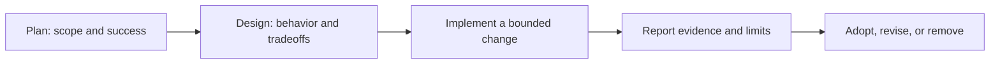

# Write for decisions

A reader should be able to understand the proposal, judge the evidence, and find the next action without reading every detail. Edit with William Zinsser’s principles in mind: clarity, simplicity, economy, and humanity. Use plain words, concrete verbs, and a recognizable human voice.

## Choose the smallest useful document

| Need | Start here | Keep the result |
| --- | --- | --- |
| Explain a folder and how to use it | [Folder README](templates/FOLDER_README.md) | `README.md` in that folder |
| Decide what to do and in what order | [Plan](templates/PLAN.md) | Beside the work it coordinates |
| Decide how something should work | [Design](templates/DESIGN.md) | `docs/design/` |
| Explain what happened and what it proves | [Report](templates/REPORT.md) | `docs/evidence/<topic-date>/README.md` |
| Review a proposed code change | [Pull request](../.github/pull_request_template.md) | GitHub PR |
| Reproduce a problem | [Bug](../.github/ISSUE_TEMPLATE/bug_report.md) | GitHub issue |
| Decide whether to pursue an idea | [Proposal](../.github/ISSUE_TEMPLATE/proposal.md) | GitHub issue |

A small fix may need only an issue and PR. A substantial or uncertain change may need a plan and design. Do not create all three documents by default. Link the authoritative record instead of copying it. Existing experiment, engineering, and acceptance rules still apply.

## Use three layers

1. **First screen:** State the problem or outcome, recommendation, status, and next action. Aim for roughly 150 words or fewer before supporting detail. This is a guide, not a reason to omit a material risk.
2. **Decision support:** Explain behavior, acceptance criteria, alternatives, and tradeoffs. Use short sections. Use tables only for comparisons, evidence, or action tracking.
3. **Reference:** Link raw logs and long background. On GitHub, use `
` for optional reasoning or reproduction detail. Never hide the recommendation, blockers, failed checks, or consequential risks.

Use descriptive headings that answer a reader’s question. Keep paragraphs to one idea. Prefer three useful bullets to ten fragments. Remove repeated summaries, throat-clearing, jargon, and empty headings. Delete template prompts and unused optional sections before publishing; use “not run” or “not applicable — reason” for verification gaps.

## Follow the work through

- **Before implementation:** Write observable acceptance criteria. Name scope, exclusions, the important uncertainty, and the next decision. Add an owner when work is shared; otherwise “current implementer” is enough.
- **When direction changes:** Update the recommendation and status in place. Keep consequential decisions with their reason and date; Git preserves routine draft history. Follow [the experiment register](EXPERIMENTS.md) for trials and adoption.
- **After implementation:** Report outcomes against the criteria, failed or missing checks, residual risks, and the next action. Link source-bound evidence. Update the roadmap or engineering register when their facts change.

Use precise statuses such as **Draft**, **Ready for review**, **Accepted**, **Superseded**, or **Closed** for plans/designs. Reports use **Verified**, **Partially verified**, or **Blocked**, with the limits stated. A document’s acceptance does not mean the implementation is verified. Request a decision only when one is actually needed; documentation adds no new approval gate.

## Make visuals earn their space

Use a small Mermaid diagram when a sequence, ownership boundary, or state transition is easier to understand visually. Label it as proposed or implemented, and add a plain-language takeaway. Keep it to roughly seven nodes; split a crowded diagram.

This is the substantial-change workflow; small changes can go directly from an issue to a PR and its evidence.

Embed a screenshot or generated image when appearance or a spatial idea matters. Add useful alt text and a caption explaining what to inspect. Mark generated concepts as **Concept — not implementation evidence**. Record the source/build and capture context for runtime images. Prefer repository-relative image paths for durable GitHub docs; keep large media in the established artifact location and link it. Always provide a text explanation so the decision survives an unavailable image or diagram.

## Edit before sharing

- Can a new reader state the problem, recommendation, tradeoff, and next action after the first screen?
- Can they distinguish observations, inferences, proposals, and unknowns?
- Does every completion claim have evidence at the right level? Core tests, compilation, interaction, visuals, animation, actual VoiceOver, and device behavior are separate claims.
- Are actions concrete, with an owner and completion condition? Are blockers visible?
- Can any sentence, section, diagram, or repeated fact be removed without losing meaning?

Apply this format to new documents and substantive updates. Preserve historical evidence and source context; do not reformat the archive merely for consistency.

## Use the artwork we already have

For product READMEs, visual designs and presentation reports, inspect [the visual reference](design/VISUAL_REFERENCE.md) and the relevant evidence folder before writing. Embed an existing image when the reader needs to judge appearance, understand a character, or see the screen being discussed. A link alone makes that judgment harder. Text-only rule or tooling docs do not need decoration.

- Prefer the current packaged icon for product identity, a source-bound native capture for implemented UI, and a labeled concept for a proposed appearance. Never present an opening board as a launch/splash capture.
- Inspect the image before choosing it. Explain what to notice and what it cannot prove. Place it beside the relevant decision; use a compact table for a cast or before/after comparison.
- Use a repository-relative Markdown image, or `` when limiting its size helps reading. Set width only to preserve proportions. Do not duplicate binaries merely to embed them; link the authoritative asset or evidence copy. Follow [screenshot practice](SCREENSHOTS.md): name new retained captures for their actual release/build or development source, and update the capture index status when a visual change affects them.
- Keep the source/build, capture environment and limitations nearby or in a clearly linked evidence record. Existing exports may be historical even when the feature is adopted. If a needed visual does not exist, say so and name the future capture or design task.

## Give folders a useful front door

Every maintained project folder should explain its purpose through a `README.md`, starting from the [folder template](templates/FOLDER_README.md). Keep it short: purpose, where to start, important contents and boundaries. A three-sentence README is enough for a small folder. The root README explains the product and how to run it; child READMEs explain their local responsibility without repeating repository policy.

**Coverage boundaries:** Packaged containers (`*.xcassets`, their asset sets and `*.xcodeproj`), the sealed `Artwork/Crystals/v2` handoff, historical nested evidence payloads, retained tool outputs/baselines and ignored/generated directories inherit their nearest owning README. Do not insert documentation into those payloads or alter their hashes to satisfy coverage. The sealed handoff already has its own README; [App](../App/README.md), [Artwork/Crystals](../Artwork/Crystals/README.md), [evidence](evidence/README.md) and [tools](../tools/README.md) explain the other ownership boundaries. Repository metadata such as `.git` is outside project documentation.

When creating or changing a maintained folder:

1. Add or update its README in the same batch. Explain any new subfolder, command, ownership or regeneration boundary.
2. Link the useful entry points, not every file. Add a visual when it explains the folder’s contents; omit empty template sections.
3. Check local links and image paths, inspect embedded images, and review the rendered document when a viewer is available. Record when rendering has not been checked. Folder documentation does not require unrelated app tests when app sources, resources and build configuration are unchanged.
4. Preserve historical evidence and sealed packages. For an inherited folder, explain its purpose in the owning README instead of adding boilerplate at every depth.

The [documentation map](README.md) is the starting point for current docs. Update links when files move; avoid directory inventories that go stale after every filename change.
