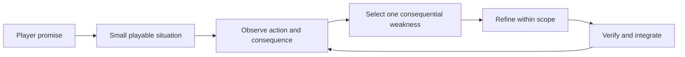

# Teach the factory to improve a playable experience

**Status:** Research complete; guidance integrated; effectiveness unmeasured · **Owner:** Current coordinator · **Updated:** October 22, 2026

Give every creative batch a clear player promise, a meaningful action and consequence, and a small playable scenario that can challenge the design. Starfall's [factory](../AGENT_FACTORY.md) already coordinates ownership, parallel work, integration and closure. This guidance adds game direction to those task packets. It reuses the existing [UI production](UI_PRODUCTION.md), [level-design](level-design-kit/README.md), [experiment](../EXPERIMENTS.md) and [verification](../ENGINEERING.md#verification-by-change) contracts.

The study covers all **63 expanded build-process cards across seven OpenAI showcases**. Most are reconstructions or have unestablished provenance. They suggest useful techniques; they do not demonstrate an autonomous swarm, optimal prompts, enjoyable results or improved throughput. No attributable original public repository was found in the bounded search, and no showcase game was played or built for this study.

**Next application:** Use the experience brief below in the next authorized creative batch. Current Lantern/Ribbon [physical observations](CURRENT_STORY_PLAYTEST.md) remain the prerequisite for evidence-based balance conclusions. This research changes guidance, not gameplay.

## What the published prompts actually establish

Checked October 22, 2026. The ordinary text view omits prompt and evidence fields. Reading the embedded page data exposes those fields without needing to infer prompts from screenshots. Card counts describe the published presentation, not the number of development turns.

| Showcase | Cards | Prompt provenance and evidence limits |
| --- | ---: | --- |
| [Hollowflux](https://developers.openai.com/showcase/hollowflux) | 18 | All prompts are adapted/reconstructed. Several milestones reuse staged captures of a later local build; these are not a historical before/after sequence. |
| [Little Ritual](https://developers.openai.com/showcase/little-ritual) | 8 | Only the starting brief and mural prompt are explicitly available verbatim. Six prompts are recreation guides. An exact final asset does not establish exact prompt wording; its trailer is cinematic. |
| [Sunwake](https://developers.openai.com/showcase/sunwake) | 7 | All prompts are reconstructed; milestones combine iterations and sometimes use later illustrations. A local correction capture does not establish deployment. |
| [Void Explorer](https://developers.openai.com/showcase/void-explorer) | 8 | All prompts are reconstructed. The first-build image is unavailable; some earlier milestones use later captures. The timeline is explicitly incomplete. |
| [Phantasy Codex Adventure](https://developers.openai.com/showcase/phantasy-codex-adventure) | 7 | Initial brief is presented as such, with no provenance fields. Six follow-ups wrap editorial summaries in generic instructions; original wording is unestablished. |
| [MiniTown](https://developers.openai.com/showcase/minitown) | 7 | Initial brief is presented as such, with no provenance fields. Six follow-ups wrap editorial summaries; they cannot establish the original conversation. |
| [Time to Fly](https://developers.openai.com/showcase/time-to-fly) | 8 | Initial brief is presented as such, with no provenance fields. Seven follow-ups wrap editorial summaries. Difficulty and optimization claims lack reproducible evidence here. |

The companion [Building games with Astra](https://developers.openai.com/blog/how-to-build-games-with-astra), dated September 4, 2026, explicitly edits prompts for clarity and length. It describes named starting scenes, inspectable state and readiness, journey tests using real controls, and controlled performance investigations. Its scheduling and geometry measurements are not hardware frame-rate benchmarks. These are author-reported practices, not results reproduced in Starfall.

Repository discovery inspected showcase metadata and links, available landing-page source, and bounded GitHub searches by title, domain and identifiable author. Phantasy and MiniTown link an author profile; no original project repository was established for any of the seven. Similar titles and a Time to Fly recreation were excluded. Consequently, there is **no source-code corroboration here of their instructions, test coverage, architecture or performance**. Revisit code research if an attributable repository becomes available; pin a commit before drawing implementation conclusions. No source or asset was vendored.

## What each example contributes

These are interpretations of the published material, followed by proposed Starfall adaptations.

| Example | Distinct useful technique | Starfall application |
| --- | --- | --- |
| [Hollowflux](https://developers.openai.com/showcase/hollowflux) | Develop one signature system through interacting rules, then repeatedly restore action readability as the game expands. Water affects combat as well as appearance. | Prefer improvements that connect an existing decision to a clear consequence. Check dense-board readability after adding effects. The showcase's XP and equipment systems are outside Starfall's scope. |
| [Little Ritual](https://developers.openai.com/showcase/little-ritual) | Its starting brief combines activity, mood, spatial structure, a concrete opening, visible capacity and editable assets. Its mural request describes where and how the texture will be used. | Brief art with runtime context, dimensions, scale and composition. Keep editable sources and verify exports in the native scene. Avoid treating a detailed illustration as a working component. |
| [Sunwake](https://developers.openai.com/showcase/sunwake) | Refine a sensory promise through contact: boat movement, water and visible response should agree. Compare a treatment while preserving a baseline. | Tie light, motion and sound to committed events. Inspect contact, settling and rapid follow-ups in motion. Reuse Starfall's existing preference and presentation owners. |
| [Void Explorer](https://developers.openai.com/showcase/void-explorer) | Define a player capability spanning several systems; preserve it through transitions. Consistent asset views give production an authoritative silhouette. | Test complete ordinary-app journeys across entry, input, results and restore. Identify the controlling reference when art views disagree; keep simulation independent of presentation. |
| [Phantasy](https://developers.openai.com/showcase/phantasy-codex-adventure) | Revisit the game's structure after play, moving from repetition toward authored destinations; repeat direction and polish passes. | Let the coordinator select a consequential weakness inside the authorized outcome and reassess it after integration. Feature count and indefinite expansion are poor completion criteria. |
| [MiniTown](https://developers.openai.com/showcase/minitown) | Name the central pleasure explicitly: watching a place become inhabited. Specify the spatial invariant behind a simple gesture, alongside several world states. | Make restoration progress intelligible at the player's viewing scale. State exact gesture/state semantics. Atmospheric detail should support the location's promised payoff. |
| [Time to Fly](https://developers.openai.com/showcase/time-to-fly) | Specify information, failure and retry behavior; require each added puzzle element to matter. Solvability and difficulty receive separate attention. | Preserve saved replay contracts and examine whether a setup teaches useful reasoning. Reachable objectives alone cannot establish understandable or enjoyable difficulty. Online rankings and server verification are outside scope. |

## Add a small experience brief to the existing packet

The following is Starfall's proposed working method, not a recovered OpenAI recipe. Use only the fields that change the current decision. A bug or tooling correction can identify its player impact and regression scenario in a sentence; it does not need concepts, a new design document or extra agents.

| Field | Useful content |
| --- | --- |
| Player promise | What the player should be able to understand, attempt, discover or enjoy in this situation. Treat a desired feeling as a hypothesis. |
| Action, choice and consequence | The actual input, relevant alternatives, committed result and why the choice matters. For observational content, identify what changes and what the player can notice. |
| Feedback and reference authority | What makes the result legible through appearance, motion, sound or touch; the controlling reference and native viewing conditions. |
| Smallest playable slice | One complete situation using existing production owners, plus a contrasting boundary case. Name the mode, rule revision and source. |
| Preservation and ownership | Existing behavior that must survive, shared interfaces, literal write paths and exclusive resources. Use the ordinary factory packet. |
| Evidence and decision | What could disprove the hypothesis, what can be checked mechanically, what needs native or human observation, and when to retain, revise or remove the candidate. |

For Starfall, the [Pokémon Puzzle League reference](POKEMON_PUZZLE_LEAGUE_REFERENCE.md) remains the user's primary gameplay inspiration. Verify relevant reference behavior and distinguish it from our adaptations. Current source and versioned definitions determine actual Starfall rules; neither a showcase nor a historical design paragraph overrides them.

## Work from an experience to an integrated slice



*Proposed operating method, not completed gameplay evidence. Exit when the authorized acceptance is met; preserve missing evidence at its actual stage.*

**Explore the uncertain dimension, then converge.** A few materially different concepts can settle a new visual question. Reuse accepted references when direction is already settled. For visual work, consider gameplay states and actual camera/board scale, including clutter and transitions. Use the existing art skills for production; generating concepts is not mandatory for a rule fix.

**Prove the interaction before multiplying content.** Implement one coherent native slice before parallel production of a family. A screenshot cannot prove touch, and an attractive effect cannot supply a missing decision. Evolving coupled rules, controls and feedback may need serial work; research and contract-compliant variations can run independently. The coordinator holds the experience together without creating permanent designer/programmer/reviewer approval silos.

**Turn adjectives into observations.** For “responsive,” identify which touch should produce which acknowledgement, including busy-board behavior. For “rewarding,” identify the earned change, whether the player recognizes its cause, and whether the next decision remains available. Technical timing can be measured; satisfaction requires actual player evidence. Choose thresholds from the current contract or a measured baseline rather than inventing universal numbers.

**Observe the whole causal path.** Inspect input → committed result → feedback → next decision, including interruption and retry where relevant. In Starfall, Core decides outcomes; stores coordinate input, clocks and saves; scenes present them. Visual intensity must not invent score, legality, progress or timing. Quiet presentation communicates the same result.

**Give the agent an oracle it can inspect.** Reuse deterministic seeds, existing fixtures, native controls, state assertions, readiness conditions and capture tools. A direct setup fixture helps reproduce a state; a separate journey using real controls proves the transition. Add a narrow observation seam only for a demonstrated gap. Browser JavaScript hooks and new telemetry frameworks are not requirements for this native game.

**Critique and repair within the outcome.** After integration, identify the largest remaining evidenced weakness and correct its responsible owner. Compare the same scenario before and after, preserving counterexamples. Keep source, UI, animation, actual VoiceOver, physical play and sustained performance claims separate. An agent's simulated play is useful for hypotheses and coverage, not a substitute for uncoached human experience.

## Reusable prompts

These are newly authored Starfall prompts. Replace brackets with the actual task; they are not quotations from the showcases and do not authorize their own execution.

### Direct a creative batch

```text
Use $starfall-factory to deliver [authorized player-visible outcome].
Start with the current owners, shipped behavior, player feedback and evidence.
Describe the player promise, the relevant action or choice, its consequence,
and the feedback that makes it understandable. State the largest uncertainty.

Choose the smallest complete playable situation and a contrasting boundary
case. Reuse accepted references; explore alternatives only where direction is
unresolved. Settle shared contracts and prove the native slice before expanding
the family. Delegate genuinely independent work with disjoint ownership.

Implement, inspect and refine within this outcome. Preserve applicable rules,
saves, replay, accessibility and performance contracts. Use actual controls
to verify the ordinary journey as well as deterministic setup fixtures.
Identify the largest remaining evidenced weakness after each integration.

Return the changed source, source-bound evidence, what improved, what failed
or remains unknown, and the retain/revise/remove decision. Human feel and
device acceptance need their actual evidence. Stop at the requested acceptance;
record discoveries through the existing factory contract.
```

### Investigate a player complaint

```text
Investigate [reported experience] on [mode/revision/source/device if known].
Separate observation from explanation. Reproduce the ordinary input sequence,
trace the responsible rule/input/presentation boundary, and inspect a sibling
case. Identify one correction with a visible expected result and a scenario
that could disprove it. Implement only within the authorized scope. Compare
the same situation before and after; retain failures and missing evidence.
```

### Brief an asset for the game

```text
Produce [authorized asset] for [native component or restoration scene].
Use [controlling reference] and the existing production contract. Specify the
camera, real display scale, states, transparent/opaque regions, protected
gameplay space, export dimensions and editable source. Show the asset in its
actual sparse/dense or mixed-state context. Verify one native integration
before deriving the family; explain any disagreement between references.
```

### Evaluate a puzzle or pacing proposal

```text
For [authorized proposal], identify the player decision it changes and why.
Verify the current rules and relevant reference behavior. Examine legal
solutions, plausible alternatives, opportunity availability, recovery and
retry/save invariants using production rules. Distinguish mechanical
reachability from player comprehension and difficulty. Propose the smallest
comparison that could reject the idea; do not expand content to hide a weak loop.
```

### Review a playable result

```text
Review [source-bound slice] against its player promise. Exercise a normal
journey and a relevant boundary case. Identify where input, committed state,
feedback or the next decision disagree. Rank concrete findings by player
impact; give each a reproduction or explicit hypothesis, responsible owner
and smallest correction/check. Mark synthetic, native and human observations
accurately. Preserve successful behavior when selecting the next correction.
```

## First Starfall application and trial

The current first-pair question is whether people understand arrangement-only play, find useful setups and recover. Use [the existing physical-play packet](CURRENT_STORY_PLAYTEST.md); preserve its uncoached baseline, identified rule revisions and opportunity/assistance denominators. Do not coach a player to demonstrate success or treat repeated visits as independent people. No new playtest result or gameplay correction is supplied by this study.

When that evidence supports a correction, choose one bounded problem in the relevant owner and state its expected visible improvement. For example, an input acknowledgement failure and a misunderstood strategy need different diagnoses. Reuse existing ordinary-app scenarios; avoid a new lab, a save reset or a global rule change to manufacture a comparison. New Lantern/Ribbon rules must remain distinct from Open Sky, Tutorial and retained rounds.

**Hypothesis:** Making the experience and disconfirming scenario explicit will reduce iterations that satisfy a feature list while missing the player problem. During the existing three-batch factory trial, record this for applicable creative slices in their normal evidence: player problem and baseline; expected change; observed result or missing observation; rework caused by misunderstood experience; coordination overhead. Mark unavailable evidence unknown. Compare with a similar earlier slice only if its records support the comparison. Keep this separate from the factory's throughput measurements.

At the third batch, or an earlier repeated failure, keep, simplify or revise these fields based on use. Do not infer a causal improvement from an uncontrolled sample. This refinement adds no scheduler, mandatory document, review gate, model change, analytics, new target or gameplay commitment.

## Scope and validation record

Prepared from clean source `0214cf09b61fd9bf13bb6d37e9dd40aea97a6040`. Acceptance for this research/instruction batch: inspect all seven supplied showcases including expanded prompts and provenance; report repository search limits; distinguish facts and proposals; add discoverable, appropriately scoped guidance and reusable prompts; verify instructions and local links. Temporary HTML and decoded data remain outside the repository. No source code, build configuration, app resource or dependency changes are part of this batch.

Working-tree validation on macOS 27.0.1 (`26A434`), arm64, Python 3.9.6:

- `python3 scripts/ci-hygiene.py` and `git diff --check`: passed.
- Local Markdown target check: 644 targets across the nine changed Markdown files, all present. The seven decoded card inventories independently total 63 cards and 63 prompt objects.
- `PYTHONPATH=/private/tmp/starfall-skill-validation-deps python3 /Users/lbeezr/.codex/skills/.system/skill-creator/scripts/quick_validate.py .agents/skills/starfall-factory`: passed. The initial invocation lacked PyYAML; a temporary dependency resolved that without changing project dependencies.
- Independent read-only decision exercise: cascade feedback, a spelling correction, retained-save replay divergence and showcase-evidence interpretation all kept appropriate scope and evidence boundaries. This checks instruction decisions, not runtime task execution or improved game quality.

The nine dirty paths are this study, the factory contract and skill/skill README, root/documentation/design READMEs, ROADMAP and EXPERIMENTS. All changes are Markdown; there are no build-affecting dirty inputs. No publication or installation is claimed. App tests/builds are inapplicable under the documentation-only verification matrix. Markdown/Mermaid rendering, native gameplay, physical feel and showcase performance were not inspected.
