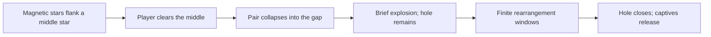

# Give Dusk, white and gravity different decisions

**Status:** Draft research recommendation · **Owner:** current implementer · **Updated:** 2026-10-17

Keep Dusk as a removable local constraint, white as a consumable connection, and magnetic stars → hole as a separate proposed lifecycle. Research favors predictable changes with mixed consequences over continuous uncontrollable movement. Test collision, orbit geometry and pacing separately before combining them. No gameplay implementation or balance measurement was performed for this research.

**Decision:** retain Dusk's one-touching-clear removal; evaluate its growth suppression against occupancy alone. For gravity, first prove a visible player-created collision and a legal floor/corner orbit. The earlier suggestion to rotate three available positions at the floor is insufficient: Starfall's packed columns can still be broken.

**Next action:** current implementer authors paired board examples for Dusk, magnetic collision and an orbit, including floor/corner cases. Reject or revise candidates without a useful choice visible before an unseen arrival. Runtime work needs a separate bounded trial contract. White's parallel work remains independent.

**Implementation follow-through:** the [gravity design](GRAVITY_MECHANICS.md) and [trial plan](GRAVITY_MECHANICS_PLAN.md) now have an isolated implementation on published source `06ce514`. The research below remains the original proposal; production Opal/tracing were integrated independently while this work proceeded.

## What the research supports

These are primary rules descriptions and first-person design guidance, accessed October 17, 2026. They establish precedents and design arguments, not evidence that Starfall players will enjoy these proposals.

| Source / observation | Application to Starfall — inference |
| --- | --- |
| King's [blocker guide](https://candycrush.zendesk.com/hc/en-us/articles/360000754717-Which-Blockers-can-I-find-in-the-game) describes adjacent-match removal, movable Licorice Swirls, and locks whose captive candies can participate in matches. | Keep Dusk's escape local and simple. Orbit capture need not make a star unusable. Avoid stacking multiple-hit removal onto suppressed growth. |
| King's [Magic Mixer explanation](https://candycrush.zendesk.com/hc/en-us/articles/360002011778-What-does-the-Magic-Mixer-do) describes a threat that produces blockers, but sometimes must be preserved because its output is required. | A troublesome object can earn a reason to keep it. A hole should sometimes offer a better future arrangement; difficulty alone does not justify it. Starfall has no collection objectives requiring spawned blockers, so do not copy that dependency. |
| EA's [Bejeweled Twist description](https://www.ea.com/games/bejeweled/bejeweled-twist) establishes rotation as a matching interaction. The page does not establish detailed rotation, timing or gravity rules. | Rearrangement is a credible source of combinations. This does not validate an automatic local orbit; player control and board topology differ. |
| In a [developer interview](https://www.gamedeveloper.com/game-platforms/road-to-the-igf-subset-games-i-into-the-breach-i-), Justin Ma describes telegraphed attacks, competing priorities and how one extra enemy can sharply change difficulty. | Preview direction and show settled opportunities. Begin with one active hole; simultaneous disruptive objects may have nonlinear costs. Predictability can preserve challenge. |
| Ian Schreiber's [cost/benefit lesson](https://gamebalanceconcepts.wordpress.com/2010/07/21/level-3-transitive-mechanics-and-cost-curves/) includes limitations and drawbacks as costs; [situational balance](https://gamebalanceconcepts.wordpress.com/2010/08/11/level-6-situational-balance/) considers circumstances and opportunity costs. | Measure space, local overflow risk, foregone connections and attention separately. An average score or spawn rate cannot describe an object's value in every location. |

## Keep each unit's purpose legible

| Unit | Proposed decision | First boundary |
| --- | --- | --- |
| White | Which family's connection should I spend? | Preserve the [current Opal connector](WHITE_STAR_AND_STORMS.md) as the reference proposal; adapting it to selected tracing belongs to its own workstream. Universal does not mean every color clears together. |
| Dusk | Which area should I free, and when? | Zero starlight; one legal clear touching it orthogonally removes it. No magnetic or orbital behavior. |
| Magnetic pair → hole | Should I trigger a rearrangement, then use this window or wait? | Separate proposed object lifecycle. Magnetic-star identity is a working assumption: the conversation's “2xs” has not conclusively specified its unit identity. Do not silently make Dusks collide. |

Dusk currently prevents a matching arrival from growing an adjacent small top star; the arrival stacks instead. It neither drains existing value nor prevents matching. That creates **space pressure**, not simply a score penalty: the arrival still contributes light, but uses another cell. Near the ceiling, preventing growth can turn a safe arrival into overflow. This consequence needs feedback at the blocked arrival, not just a permanent decorative aura.

Compare current Dusk with an occupancy-only variant using the same Dusk arrivals. Retain growth suppression only if players attribute its effect correctly and it changes a useful choice. First Light remains unchanged. White can still help a colored clear reach Dusk, but must remain useful without Dusk; no mandatory antidote relationship.

## A collision can create the hole, with important limits

**Proposed concept — not runtime evidence:**

For an authored first example, use a horizontal pair exactly two columns apart at the same row. Resolve a qualifying collision immediately after the clear and before normal settling, so falling cannot erase the gap before attraction checks. Endpoint stars are consumed; a hole forms at the middle. Start with visual impact and no additional blast removals or score bonus. This isolates the collision's own benefit and cost.

Two endpoint cells becoming one center object reduces total occupancy by one, but **does not guarantee safety**: the center column gains an object at a specific location. Check column capacity and supported placement explicitly. A floor gap is straightforward; an elevated gap can expose unsupported cells, and the hole's later anchoring remains unresolved.

A pair must offer an ordinary way out when no partner can be reached; otherwise random solitary arrivals become dead weight. Adjacent-clear removal is one candidate for the precursors. If the same clear touches a precursor and opens the middle, collision precedence must be explicit and previewed. Defer vertical/diagonal attraction, overlapping pairs and chain explosions until a single collision earns its complexity. A future trial must still define deterministic non-overlapping pair selection rather than relying on animation order.

## Orbit geometry is the main unresolved design risk

Current [Core](../../Sources/StarfallCore/FallingSky.swift) rejects any saved column with an occupied cell above an empty cell. Clear resolution compacts columns, and arrival landing uses occupied count as column height. Literal pinned captives are therefore a new gravity model, not merely an animation.

There are two additional problems. Four orthogonal positions around a center are not neighboring steps around a square; a literal motion path must curve around the center. Also, rotating only in-bounds positions at a floor or corner gives unequal paths and can move an empty position underneath a survivor. Immediate ordinary settling can then erase the promised orbit and its matching window.

| Geometry candidate | Advantage | Cost / disposition |
| --- | --- | --- |
| Pinned center and captive neighboring slots | Closest to the proposed helpless orbit; stable local matching positions. | Needs explicit support, falling, arrivals and release rules, plus a new save model. Preserve as the literal design candidate; solve floor/corner examples before implementation. |
| Cycle only occupied stars among fixed occupied positions | Preserves column occupancy and works without unsupported empty slots. | Reorders identities rather than carrying empty slots; fewer stars give a swap or no effect, and matching changes may release captives. Useful simpler comparison, not a complete hole implementation. |
| Rotate then immediately settle everything | Reuses existing gravity. | Can destroy the orbit and move the center; may be a one-time vortex rather than the requested sustained orbit. Consider only as an explicit alternative. |

Do not sell any of these as solved. For each, draw the same floor, corner, unequal-height and empty-neighbor examples, then predict two successive outcomes. With unchanged surroundings, a four-slot permutation repeats after at most four steps (three/two at corresponding smaller rings); waiting alone does not generate unlimited new arrangements. Match windows depend on connections to the surrounding board, not movement spectacle alone.

## Balance the decisions before tuning frequency

The following values are **starting hypotheses for authored comparisons, not researched optimums or implementation instructions**.

| Lever | Initial comparison | What would justify changing it |
| --- | --- | --- |
| Dusk severity | Existing four-neighbor suppression versus occupancy alone; same arrivals. | Comprehension, useful rescue choices and avoidable versus unavoidable overflow. Existing regular cadence is 4–6 showers; do not also change it in this comparison. |
| Hole concurrency | One active hole, no overlapping capture. | Only increase after players reliably predict one hole and still attend to normal stars. |
| Orbit trigger | One discrete step per existing shower event versus every second shower. | Compare recognition and actual successful use of windows; no independent repeating timer initially. |
| Hole lifetime | Two versus four orbit steps, with visible remaining duration. | Opportunities used, forced waiting, and whether players keep or close it deliberately. Closure releases survivors, never silently deletes them. |
| Collision blast | No extra removal first; then compare a narrowly defined blast only if needed. | Players cannot identify a useful collision without it. Measure added relief separately from orbit value. |
| Precursor supply | Authored pairs before natural spawning. | Prove a useful setup first, then measure encounter rate and orphan lifetime. Two independent rare arrivals can make usable pairs far rarer than either unit. |

Production's default shower interval is three seconds, but existing saves/settings differ. Tying orbit to showers limits clocks; it does not prove a three-second decision window is comfortable, especially with tracing. Manual next-shower input must advance the same event sequence, with no repeated orbit while paused. A source-changing event must cancel stale traces, not clear stars that moved under the finger. Never accelerate or suppress the rule for Reduce Motion or VoiceOver.

## Acceptance for the next bounded investigation

- **Visible choice:** one Dusk example favors the smaller local clear for safety; another permits safely deferring Dusk. One magnetic example favors collision; another favors avoiding/delaying it. Enumerate competing ordinary clears and selected traces rather than presenting only the intended answer.
- **Orbit benefit and cost:** one example creates a usable new connection, another breaks a useful existing connection, and a third offers a reason to close rather than preserve the hole. Compare against the same board without rotation. State exactly which future information the player can see.
- **Boundaries:** resolve floor, corner, different column heights, zero/one/two/four captives, a cleared captive, grown stars and expiry. Decide Dusk/white capture separately; start the proposed orbit with ordinary colored stars only. Reject an example requiring unsupported occupancy without an explicit gravity contract.
- **Measurement:** record threatened-column headroom, occupied cells, distinct resulting opportunities, choices actually used, dry waits, orphan duration, time spent reading motion and overflow cause. Count choices by distinct consequences, not merely different taps. Use matched seeds and scripted arrivals; record generator changes separately.
- **Human check:** ask players to predict the next movement and explain why they chose to keep, trigger or remove the object. Compare perceived control, frustration and voluntary replay. Small observed sessions are qualitative evidence, not population estimates. Reject or revise if the only benefit is more movement or longer survival.
- **Future implementation gate:** deterministic committed outcomes, old-save rejection/migration, round-trip continuation, conserved IDs/value, bounded objects/effects and explicit event order. Magnetic consumption and hole expiry require new accounting; current dark-clear counters must not absorb them. No scoring rule is selected here.
- **Native follow-through:** normal full-motion windows and native hits, tracing cancellation, rapid input, background/resume, restart, menu dismissal, readable non-color identities, largest text and Reduce Motion. Follow routine lightweight accessibility checks, reserving full actual VoiceOver acceptance for RC. Pair sources, geometry, lifetime and adoption/removal decision belong in the trial contract before code.

## Verification and decision boundary

Repository inspected at `f35eba87311f5e9e56740b9677bceb699154e8ae`, initially clean. Inspected Core matching, dark adjacency, growth, landing, compacting and save validation; balance constants; white connector contract; tracing contract; and the earlier local visible-setup counterevidence (`trace-visible-setups-2026-10-17`). That earlier sample found no smaller-first immediate advantage; it does not establish greedy optimality or validate these new mechanics.

Only research/navigation/register documents change. No simulation, package tests, simulator build, runtime interactions, visuals, animation, interruption, accessibility, actual VoiceOver or physical-device validation was performed for these candidates. Core/app checks are inapplicable to this documentation-only change. `python3 scripts/ci-hygiene.py`, `git diff --check`, an explicit new-file whitespace check and local Markdown file-link checks passed. Markdown was reviewed as source, not rendered.

Retain the ideas as proposed research in the [experiment register](../EXPERIMENTS.md). After the authored comparisons, select one gravity topology and a single collision payoff, or remove/defer the candidate with its reason. Do not introduce natural spawning, production saves or another permanent pilot flag from this document.
