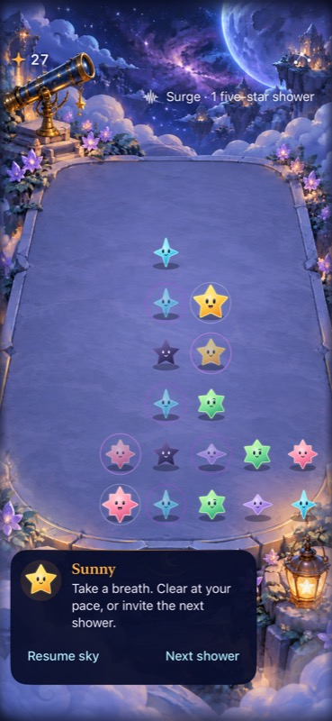

# Character chat and a complete shower trail

**Status:** Implemented; scoped development checks verified · **Owner:** Current implementer · **Updated:** October 17, 2026

Move gameplay messages into one small character chat at the bottom of the screen. Keep the sky and terrace free of floating announcements. Make every star in the shower cue reach its destination before that cue resets. These are presentation changes; shower rules and timing remain authoritative.

**Direction:** On October 17, the user selected the generated bubble and avatar direction (“that’s way better”). The bottom character chat, midnight/brass styling and expressive multi-speaker portraits are the visual baseline. Redesign the bubble and author dedicated conversation avatars for the existing cast. Sunny speaks first; other characters can speak later through the same component. The compact appearance and trail finish still need native motion review.

**Next action:** Review the [source-bound native acceptance record](../evidence/character-chat-2026-10-17/README.md). For future content, use the [authoring guide and Debug Dialogue studio](../../App/DialogueScripts/README.md). The [production integration record](../evidence/character-chat-production-2026-10-17/README.md) covers current storm/cadence, Opal, gravity and constellation input; the earlier record remains bound to its old base.

## What the player experiences

The header keeps score, the visual shower cue and the sky menu. Gameplay information comes from the current speaker, initially Sunny, in a small bottom speech bubble: portrait beside a short line, with comfortable contrast and no full-width announcement banner. During active play the bubble appears for useful information and then settles away; it does not narrate every shower or clear. Paused play retains the latest useful information and its existing actions.

| Event | Example Sunny copy / behavior |
| --- | --- |
| Storm warning | “A storm is coming. Make a little room.” |
| Last heavy shower | “One heavy shower left. You've got this.” |
| Recovery | “The sky is calming down.” |
| Changed pace | “The showers are coming faster now.” Only if the game actually changes pace. |
| Invalid clear or requested help | A brief explanation of the actual rule, replacing routine chatter. |
| First Light / full sky | The committed outcome is spoken through Sunny; existing replay and exit actions remain available. |

Copy is proposed, not a new rule contract. Preserve exact counts and objectives where they matter. Welcome, entry and endings may keep their composition and buttons, but their explanatory messages use the same character voice and bottom chat rather than a second narrator. Score, button labels and settings content remain functional UI.

Keep only one message visible. Outcome takes priority over warnings; warnings over routine feedback. Coalesce repeated events and replace outdated phase information rather than queueing a backlog. Important information remains available by reopening the chat from the current speaker portrait; automatic visual dismissal must not make instructions inaccessible. The chat never blocks a clear or silently pauses the shower clock. Opening settings suspends play through the existing contract.

## Visual reference and proposed placement

**Historical native reference — not the proposed implementation.** [Observatory phase evidence](../evidence/observatory-phases-2026-10-17/README.md) records the source and capture limits. This image shows the split to remove: phase information above, Sunny below. The proposed chat is smaller during active play; retain the existing bottom setting without covering the nearest star row or lantern. At large text sizes, give the chat a separate region below the terrace with reachable, scrollable content instead of shrinking the type or covering stars.

**Existing native cast export — source `6cc9efd`.** [Integration evidence](../evidence/crystal-glow-integration-2026-10-17/README.md). Preserve the approved cast identities while authoring dedicated dialogue portraits with larger, clearer faces and more intentional poses than the gameplay thumbnails. A restrained expression change can accompany speech. Do not require typewriter text, repetitive bouncing or recorded voice for this change.

## A bubble and portraits made for conversation

**Generated concept — not implementation evidence.** Built-in image generation, using the approved Sunny master and historical Observatory screen. [Prompt, inspection and production limits](character-chat/README.md). The phone inset illustrates placement only; its transformed board is not a geometry reference.

Use a softly rounded midnight-violet bubble, warm ivory text, a fine brass edge and a short tail pointing toward the portrait. A small speaker name makes attribution explicit. Put celestial detail in the frame, leaving the message area calm and opaque enough to read against the painting. Keep glow restrained in the native version. Ordinary active messages have no action-button row; paused and outcome actions retain their own clear native controls.

The portrait slightly overlaps the bubble's leading edge in a moonlike medallion. Target roughly 56–64 points on ordinary phones, subject to actual-size review; do not let it consume board space. Keep the full character silhouette inside the portrait with breathing room, a larger readable face and a subtle three-quarter pose. Use the same lighting, framing and optical face scale across the cast, rather than scaling every differently shaped body to the same bounding box. This is a dedicated avatar asset set, not a redesign of the board jewels.

Prepare Sunny, Spark, Pip, Twinkle, Nova and Dusk using their approved personalities and distinct silhouettes. The delivered set has one expressive portrait per speaker, with all six packaged and previewable. Additional attentive/concerned expressions remain an optional art extension; no facial animation is claimed. The generated study is not a cut-ready atlas: point counts, turns and expressions must be checked against the approved masters. Do not infer dialogue identities from a gem's gameplay state or assign new gameplay roles to characters.

Each message carries a stable speaker ID alongside its text and semantic event. Bundled JSON owns editable text, speakers, priorities and optional reading duration; typed validation and the Debug studio are implemented. A small portrait catalog maps that ID to display name, avatar and expression; the bubble accepts those values without hard-coding amber artwork or the name Sunny. The message owner chooses the speaker; the view renders it. Speaker changes replace name, portrait, accessible attribution and message together. No multi-character transcript or dialogue engine is needed. Give each event an explicit default speaker so missing avatar art cannot silently misattribute a message.

At accessibility text sizes, reflow the portrait/name and message into the separate chat region; keep the named identity even if the decorative medallion is simplified. Reopening the portrait is a labeled native button with a full touch target. VoiceOver reads speaker and message once; decorative faces are hidden from accessibility. Reduced Motion uses a static expression change. Neither speaker switching nor bubble appearance changes the clock or committed outcome.

## Every trail star finishes

The user's photo shows several stars around the top safe area; they report that stars behind the leader stop short. A still image cannot establish the timing failure. The checked-in main `SkyShowerTrail` draws one head with decorative dust; the inspected phase exporter adds a separate count. The exact multi-star renderer and installed source must be identified before diagnosing the cause. The dark “Faster showers” banner's owner is also unconfirmed; app-owned messaging belongs in chat, while an OS overlay is outside app layout control.

Treat the cue as a shower countdown, not a ranking. Each cast star travels along the same safe-area-aware path and visibly arrives at its endpoint. Do not compute followers as a permanently fixed distance behind a leader whose progress clamps at the end: that can leave them stranded when the cycle resets. Use bounded per-star progress that reaches one within the existing cycle, with gentle convergence near the finish and legible spacing earlier. Stars can dissolve at the endpoint; they must not vanish halfway along the path. Decorative dust can fade behind them.

The store's existing deadline and committed arrival state drive the presentation. The correction must not delay a shower, add catch-up showers, or wait for an animation completion to commit rules. If the actual renderer cannot fit a readable multi-star finish into that interval, simplify to the existing single-star cue rather than extend gameplay time. Pause, menu, background, restart and scene replacement cancel or hide the old cue without replaying stale arrivals. Quiet modes retain equivalent countdown information with static/discrete changes and no forced travel animation.

## Ownership and implementation order

1. **Chat:** Extend the existing `SkyGuideCard`/guide boundary instead of adding another HUD. Pass speaker identity and expression through a narrow portrait catalog. Give transient gameplay messages one main-actor presentation owner with semantic event identity, priority and dismissal. Feed it committed store outcomes and, only in the applicable lab, the existing phase forecast. Reuse that event for accessibility; remove duplicate top text and duplicate announcements. Keep transient chat out of saves. Preserve exact objectives and existing ceremony actions.
2. **Trail:** Reproduce the original cutoff on the identified lab, inspect sibling reset/clamp/offset paths and correct progress at the shared path boundary. Keep the cue independent of chat and of rule scheduling. Record which renderer and branches were actually examined.
3. **Review:** Capture normal-motion video of a complete cycle and a warning-to-recovery sequence on the target build. Inspect the compact chat on small and large phones before adopting the presentation. Integrate verified pieces separately; do not adopt experimental shower mechanics with the UI.

## Acceptance before adoption

- [x] No app-owned gameplay announcement remains above the terrace; exactly one character chat presents warning, help, pause and outcome information. Ordinary automatic arrivals remain quiet.
- [x] Swap Sunny and a second speaker through the same bubble: name, portrait, expression and spoken attribution agree, with no amber/Sunny assumptions. Inspect all six portraits at actual display sizes against their approved silhouettes; do not ship the concept sheet as assets.
- [x] Latest-event priority, repeated events and dismissal/reopen are checked with focused presentation tests. A stale recovery/help event cannot replace a terminal result.
- [x] Reproduce the cutoff mapping (exact installed photo identity remains unconfirmed), then verify every visible star at cycle start, middle, endpoint and reset. Inspect at least two complete native full-motion cycles, including the shortest supported shower interval. Check safe-area and resized layouts; a screenshot alone does not prove arrival motion.
- [x] Rules, seeded replay, saves and the single shower deadline remain unchanged. Verify pause/resume, settings dismissal, background/resume, restart and rapid input reject stale chat/trail completions and produce no catch-up.
- [x] Inspect default and largest Dynamic Type, non-color meaning, full touch targets and chat retrieval. Check Reduce Motion, Calm effects and existing VoiceOver announcement policy without duplicate speech or timed loss of information. Full actual VoiceOver acceptance remains an RC check under the established cadence.
- [x] Inspect normal play, First Light win, full-sky loss and replay. Verify bottom-row native taps if layout/hit geometry changes. Preserve full falling animation in normal mode.
- [x] Run focused Core/hosted/UI checks as affected, `swift test`, Debug and Release simulator builds, hygiene and diff checks. Record exact build/source, configuration, simulator/OS and dirty build inputs; report interaction, visual, motion and device evidence separately.

**Current verification:** See the [delivery evidence](../evidence/character-chat-2026-10-17/README.md) for source-bound hosted/UI/build results and remaining checks. Native screenshots were inspected. Actual VoiceOver and physical-device acceptance remain separate; documentation rendering has not been checked in a viewer.

## Scope and decision point

Hypothesis: one familiar speaker makes useful information feel part of the Observatory, while a complete trail makes the countdown feel intentional. Compare the compact chat against the current split presentation on the same board and cadence. After native verification and user review, adopt or revise/remove the compact presentation; do not retain another permanent pilot route. Human readability and the exact multi-star source are the principal open questions. Scope includes new conversation portrait assets and the bubble design. No new mechanics, progression, audio system, online behavior or save migration belongs to this work.
