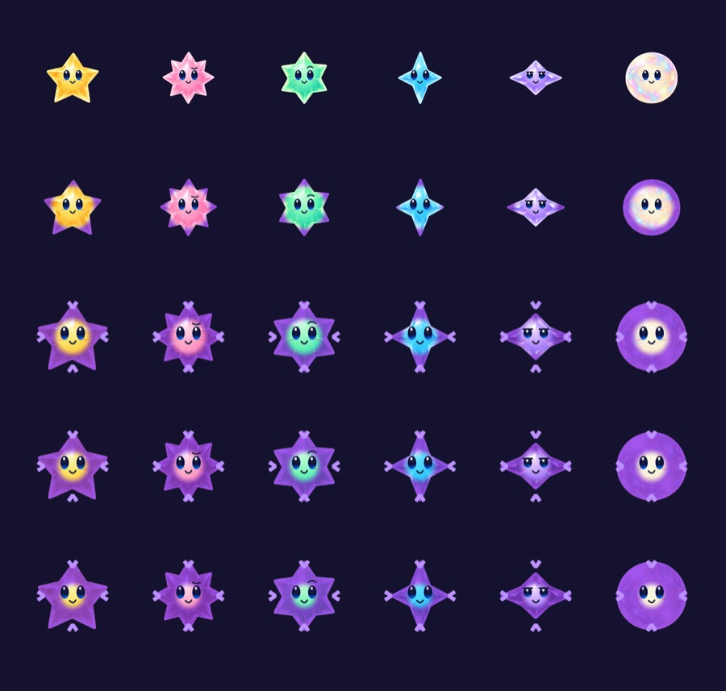

# Universal critical mass

**Status:** Accepted; implemented and development-verified · **Owner:** current implementer · **Updated:** October 18, 2026

Fresh survival skies replace Dusk arrivals with pressure from the whole cast. Stars age even when buried: stage three turns purple and stage four implodes. Dusk and the retained Radiant Pearl/Soft Tri-Star designs are pocketed for a later character decision. Existing rounds and First Light retain their contracts.

**Decision:** Every three survived showers advances a stage: age zero is stage one, age three stage two, age six stage three, and age nine collapses before new arrivals. Matching growth can show stage two earlier, but remains worth two starlight. Aging adds no score or solo-clear eligibility. The three-shower purple warning permits a deliberate rescue, exchange or sacrifice.

**Next action:** Observe rescue/sacrifice choices with the user and husband. Human preference and do-nothing survival balance remain explicit follow-up judgments after play. The [evolving-facet refinement](../evidence/stellar-evolution-2026-10-18/README.md) removes the static core and retains family detail.

## Player experience and boundaries

All colored stars and Opal age on committed showers, excluding their birth shower. Clearing, exchanging, pausing, settings and background time never add age or reset survivors' age. Evolution retains family matching, shape and collectible value. From stage two, violet corruption spreads from the outer facets toward the center with each survived shower, retaining the original family at the heart. Stage three adds four inward chevrons to convey compression without relying on color or motion. No static black core covers the character; the dark well appears only during implosion. Stage sizes stay inside the existing native cell geometry. No persistent black-hole piece or continuous neighbor drain is introduced.

An implosion consumes the center plus its current four orthogonal collectible neighbors for no score. Simultaneous centers read one snapshot and consume shared targets once. They do not cascade; survivors settle before arrivals. An isolated old star still implodes. The animation reuses the existing bounded inward swallow; Core commits targets/lost starlight independently from callbacks. Quiet motion preserves outcomes and static state.

The saved critical-mass version is separate from legacy Dusk rules. The v8 app archive reads v3–v7 through their prior contracts and writes only at activation/commit. Retained rounds and same-sky replay preserve their mechanics; a fresh sky chooses aging. Invalid current bytes never fall back to old rounds. No Dusk redesign, art generation, campaign or extra app is included.

## Acceptance

- [x] Birth exclusion; buried/Opal aging; stages at three/six; collapse at nine; rescue, isolation, edges, overlapping simultaneous sources and no chains.
- [x] Matching weight/reward remain 1/2; conservation includes all swallowed centers/neighbors; before-arrival headroom, seeded replay and round-trip continuation pass.
- [x] Reject impossible ages/versions and aging in historical envelopes/First Light; preserve old Dusk replay and v7 bytes.
- [x] Native normal motion shows warning and inward swallow, settlement and arrivals; real taps, rapid input, restart, restore, settings/background interruption and quiet/large-text checks pass.
- [x] Debug/Release simulator builds, core and affected hosted/UI tests, hygiene and diff checks pass. Actual VoiceOver and physical device acceptance remain RC work.

## Tuning risk and decision point

An implosion makes space, so waiting could become more effective than collecting. Compare idle and collect-all policies on fixed seeds, then observe the user and husband rescuing or sacrificing a purple star. Seed samples establish reproducibility, not enjoyment. After those rounds choose timing/consequence refinement or retain the rule; do not add persistent hazards to compensate without evidence.

[Development evidence and remaining limits](../evidence/critical-mass-2026-10-18/README.md) separates core, native interaction, sampled motion and actual VoiceOver/device acceptance. The broad hosted suite's existing gravity wording failure is explicitly excluded from its 236-pass run.

**Historical warning artwork — static cores superseded:** clean `c9c8d2e`, iPhone 17e / iOS 27.0 Simulator, default text and normal motion. This frame shows the warning appearance; the linked recording/frame analysis separately verifies the bounded swallow. Existing [Dusk captures](../evidence/dusk-feeding-2026-10-18/README.md) describe retained rounds only.

## Evolving-facet refinement — October 18

The user found the static black core confusing and requested its removal plus clearer evolution. The original uniform purple treatment also obscures family material detail. This presentation refinement changes no rules, saves, touch geometry or collapse motion.

Acceptance: the face has no extra black dot; stage two starts a visible edge change, stage three strengthens it while preserving recognizable family detail; inward chevrons remain visible with motion disabled; the actual collapse retains its temporary well and committed outcome. Verify all cast families in a native capture plus rescue and interruption/restore checks. Human recognition under dense automatic play remains the next design judgment. The older capture below is historical for the warning artwork.

**Current sampled appearance:** native SpriteKit export at `d0e9dd3`, iPhone 17e / iOS 27.0, quiet motion. Rows show ages 0/3/6/7/8; columns retain each family. [Verification and limits](../evidence/stellar-evolution-2026-10-18/README.md).
