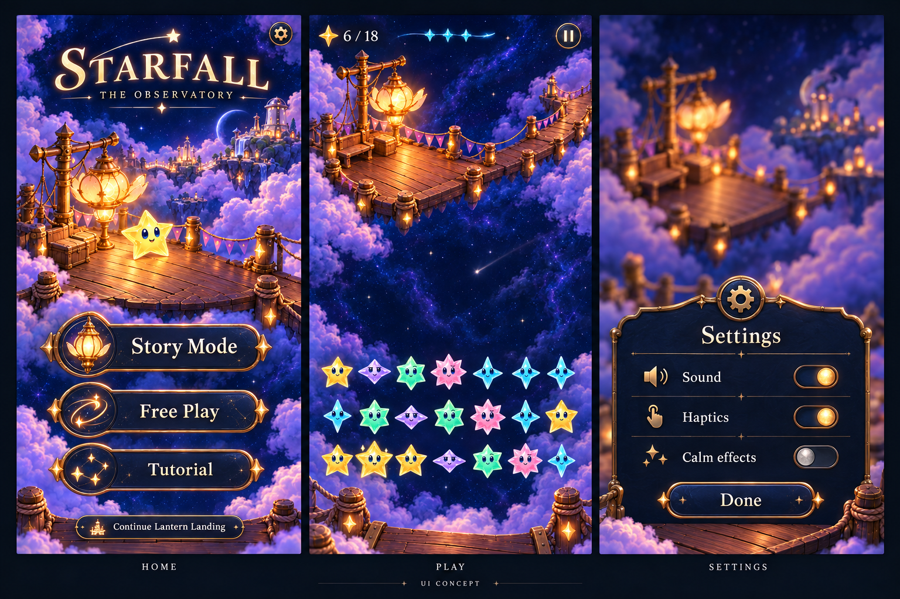

# Starfall game UI system

**Status:** Adopted for development in the normal app · **Owner:** Current implementer · **Updated:** October 24, 2026

The normal app now uses one authored Observatory family: midnight enamel, fine brass fittings, pearl text and dedicated celestial glyphs. The native family covers the scenic Story Mode / Free Play / Tutorial home, Entry/results, world/tutorial, viewport-edge gameplay instruments and preferences. Existing owners retain rules, saves, progression, input and clocks.

The user approved the game concept, [source kit](../../Artwork/ObservatoryUI/README.md), full native integration and canonical shipping. The bounded system is adopted for development. Exact coverage and canonical delivery status are recorded in the [native record](../evidence/observatory-ui-native-2026-10-19/README.md); the [capture index](../evidence/observatory-ui-native-2026-10-19/captures.json) identifies inspected appearances. The [atlas](interface/atlas-2026-10-19/README.md) remains composition guidance, while [source-kit evidence](../evidence/observatory-ui-kit-2026-10-19/README.md) retains its asset/browser scope.

**Continuing acceptance:** Use this shared system for future UI work and retain its regression contracts. The native evidence owns publication and canonical delivery status. Physical reading comfort, sustained performance and full VoiceOver remain release-candidate checks; development adoption does not establish them.

**Component rule:** Use only this official design/component system, in the documented role. When a necessary piece is missing, design it, add it to the shared component owner and roster, and prove one native slice before using it across screens. Shared tokens or an official component borrowed from the wrong context do not establish design compliance. Ordinary composition remains screen-owned; new visual roles and control states do not.

**Concept — not implementation evidence.** Built-in ImageGen, October 19, using existing Lantern Landing scenery, a source-bound native board capture and world-map artwork. [Provenance and brief](interface/README.md#game-ui-concept--october-19). The image illustrates material and hierarchy, not final camera clearance, star geometry, exact progress art or text metrics.

## Two levels of detail, one family

| Context | Treatment | Priority |
| --- | --- | --- |
| Home, pause, settings, story moments | Tactile enamel, shallow brass edges, authored emblems, restrained depth | Clear choices, readable labels and a visible primary action |
| Active play | Small instruments, minimal backing, fine comet forecast, localized contrast | Exact score/objective, next shower and pause; the star field dominates |

Share icon shapes, light direction, materials and press response. Ornament belongs at meaningful edges and junctions. Avoid continuously glowing borders, oversized medallions, repeated framed cards and routine pulsing. Keep scenery and star art vivid; interface gold is an action accent.

## What exceptional quality means here

**Research synthesis, October 19, 2026.** The accepted identity is a set of small celestial instruments made in Starfall's world. Midnight enamel gives labels a quiet surface; fine brass catches warm lantern light; pearl lettering carries information; crystal brilliance marks an achievement. The concept establishes this direction, but its uniform gold outlines, large emblem collars and fine text still need refinement at actual phone size.

The following sources explain transferable principles; their visual styles and implementation stacks are not prescriptions for Starfall.

| First-party source | Finding | Starfall application — design judgment |
| --- | --- | --- |
| [Blizzard: Hearthstone art with Ben Thompson](https://hearthstone.blizzard.com/en-gb/news/13023802) | Elaborate material stacks consumed space and overwhelmed essential card information. The team retained physical character while prioritizing numbers, title and art. | Keep tactile material, reduce frame mass. Judge every embellishment beside actual labels and stars. |
| [Riot: Clarity in League](https://www.leagueoflegends.com/en-us/news/dev/clarity-in-league/) | Attention should follow gameplay importance; visual and audio noise must be controlled together. | Reserve the strongest light and movement for meaningful events. Review HUD, scenery, tracing and celebration simultaneously. |
| [ustwo: Monument Valley design essay](https://ustwo.com/blog/monument-valley-out-now/) | Restraint across art, sound, text and animation supports emotional engagement; references extend beyond games. | Compose the whole scene. Study observatory instruments, illuminated dials and astronomical engraving for original motifs. |
| [Apple: Design advanced games for Apple platforms](https://developer.apple.com/videos/play/wwdc2024/10085/) | Anchor UI groups to edges, adapt to the device, preserve safe areas and provide clear touch feedback. | Separate chrome placement from painting landmarks. Keep scenery full bleed, controls comfortably reachable and targets larger than their visible glyphs. |
| [Riot: Hextech UI architecture](https://www.riotgames.com/en/news/under-hood-league-client%E2%80%99s-hextech-ui) | Shared typography and colors are complemented by reusable components, motion conventions and coordinated audio. | Extend existing native owners with full component states; avoid a collection of unrelated decorated views. |

These are predominantly historical design accounts, selected for their relevance rather than recency. Hearthstone's example concerns card objects; Riot's clarity article concerns competitive gameplay. Neither establishes a suitable density or timing for this slower portrait game.

### Observable quality bar

- **Composition:** In active play, the eye finds the stars and current trace first. No persistent central panel competes with them. Home offers three unmistakable destinations and a contextual return to the retained round; settings has a clear exit.
- **Craft:** One light direction, coherent edge thickness and consistent depth across controls. Brass reads as a thin fitting rather than a luminous outline everywhere. Texture remains quieter than text. Optical alignment matters as much as equal numeric padding.
- **Meaning:** Glyphs distinguish actions by silhouette at their actual size. Detailed home emblems have simpler utility counterparts. Selected, pressed and disabled states remain distinguishable without relying on hue alone.
- **Feel:** A touch immediately changes the control's material; release settles it. Optional sound/haptics agree with the visual event and existing preferences. Animation never delays navigation or input. A score update, ordinary button and major celebration have different emphasis. [Blizzard's sound-team account](https://hearthstone.blizzard.com/en-us/news/23964694) supports treating omission and competing sounds as deliberate design decisions.
- **Reading:** Labels remain crisp with glow removed. Essential text passes contrast checks over the lowest-contrast part of its actual backdrop, including bright clouds. Use 4.5:1 for ordinary essential text as the proposed baseline; provide appropriate solid backing where needed. [Xbox contrast guidance](https://learn.microsoft.com/en-us/xbox/accessibility/xbox-accessibility-guidelines/102) explains this measurement and distinguishes large and inactive text.
- **Resilience:** Long labels, exact large scores, accessibility text, reduced motion/transparency, interruptions and rapid repeated input retain meaning and control. Native VoiceOver and physical-device reading require separate observation.
- **Performance:** Profile dense play with celebrations and UI transitions together on supported hardware. Compare frame pacing and memory with the existing baseline; reject new hitches from text/material generation. A static concept or simulator build does not establish this result.

The quality bar remains a continuing acceptance target, not a claim that every concept or implemented surface meets it. Keep two reviews: visual craft at actual size, then behavior during play. Neither replaces the other. Apply the [visual acceptance review](UI_PRODUCTION.md#decide-visual-acceptance-separately) before merging visual work; a known visual failure keeps its goal open even when every mechanical check passes.

## Typography: related voices with different jobs

**Current implementation:** Crystal Comet remains the celebration voice. Menus and headings use the shared native serif roles with pearl ink; functional copy and exact score digits remain native text. No new font or sprite alphabet is packaged. A bespoke display face is a separate refinement that requires an actual-size comparison before font production.

| Role | Intended appearance | Production approach |
| --- | --- | --- |
| Brand / wordmark | Most distinctive, carefully spaced display lettering | Existing brand master; separately reconcile it with the generated concept, which is not a replacement asset |
| Menu headings and major actions | Restrained flared serif, open counters, warm pearl face, slight highlight; no turning or fractured interiors | Native text using an evaluated face; if the custom specimen wins, an original display OpenType font |
| HUD, preferences and explanation | Clear compact forms, stable-width score digits, mostly flat moonlight ink | Native text with semantic scaling; decoration diminishes at smaller sizes |
| Combo / award | Existing opalescent facets, depth and finite turn/settle | Existing Crystal Comet renderer and its native fallbacks |

Share the flare of terminals, rounded bowls, pearl warmth and light direction where useful. Do not require every role to use identical glyph outlines. The small functional face earns its place through readability; the display face supplies personality; Crystal Comet supplies the expressive peak.

### What Crystal Comet already provides

The [master pack](../../Artwork/CrystalComet/pack/README.md) contains 106 characters and 4,725 sprites across 45 views. It is raster sprite lettering, not an installable font. It has proportional advances but no comprehensive kerning table or accented-letter coverage. Its [native profile](../../Artwork/CrystalComet/NATIVE.md) packages 15 yaw views; the recorded atlas pixel roster is 51.75 MiB, not measured process or GPU peak memory.

The [current renderer](../../App/CrystalCelebrationArtwork.swift) already falls back to native text for unsupported content, accessibility sizes and a fitted cap height below 24 points. This is evidence of its intended display role, not a proposed universal text-size threshold.

### Luminosity does not require another sprite alphabet

Separate **letterform**, **typesetting** and **material**. The generated concept shows an appealing treatment, but supplies neither a font file nor verified spacing. Start with a crisp text face; add a restrained static pearl-to-warm highlight, shallow shadow and optional localized halo. Turn off the halo to check the underlying letterform. Avoid rainbow facets, extruded sides and continuously moving shine on routine text.

SwiftUI supports bundled custom fonts and adaptive text; use its [native font path](https://developer.apple.com/documentation/swiftui/applying-custom-fonts-to-text) if a new face is warranted. A custom display font needs deliberate outlines, spacing/kerning, baseline and line metrics, punctuation, required language coverage, fallback behavior and review at its actual sizes. [OpenType's production recommendations](https://learn.microsoft.com/en-us/typography/opentype/spec/recom) cover mappings, metrics, kerning and optical-size metadata. A variable optical-size axis is optional, not a prerequisite.

That is a different production job from rendering every character at multiple angles. We should reuse the Crystal Comet pipeline's disciplined specimen, coverage and provenance practices, without repeating its multiview atlas work. Generated letter sheets can guide art direction; they do not replace a coherent typeset font. Keep labels separate from button artwork.

For stylized text, preserve a plain readable rendering and supported-character coverage; [Xbox text guidance](https://learn.microsoft.com/en-us/xbox/accessibility/xbox-accessibility-guidelines/101) specifically addresses stylized-font alternatives and scaling. Evaluate native Dynamic Type behavior independently of raster mockups.

### First proof before full font production

Compare two treatments in the same phone-scale composition: **A**, a native serif with the intended material; **B**, a small original vector lettering study with related flared shapes. B is a design study, not baked production button labels. Use `Story Mode`, `Free Play`, `Tutorial`, `Settings` and `Resume`; include native `18 / 18`, `1,024`, a long explanation and existing `Relay! +128` alongside them.

Show the set over enamel, dark sky and bright restoration artwork. Include idle, pressed, selected where relevant, disabled, glow-off and large-text treatments. Check ambiguous forms such as `I/l/1` and `O/0`, counters, word spacing and exact number widths. Inspect individual screens at actual size rather than judging a reduced triptych.

The adopted native family uses A. Continue to judge its identity and clarity at actual size. If a later B study materially improves recognizable Starfall character without weakening reading, produce and validate a restrained display font as its own bounded change. No such font is required for this integration, and neither path requires another full 3D alphabet.

## Native component contract

### 1. Shared roles

`StarfallTheme` remains the token and control-role owner. `ObservatoryArtwork` owns the glyph, emblem and passive skin views plus measured action layout. Screens select these roles rather than inventing local colors, shadows and padding.

- **Materials:** enamel body, lit enamel, brass edge, pressed brass, moonlight ink, subdued ink and opaque contrast fallback.
- **Type:** existing wordmark for identity; native display/action typography for menus; clear native text and exact digits during play. Labels stay separate from artwork and support wrapping and Dynamic Type.
- **Registered dimensions:** 20–24-point rendered utilities with 48-point utility targets (45 points for gameplay actions); 40-point home emblems; 52/64-point horizontal action skins. Tall labels switch to the reading skin and measured content with 32-point insets. Mode art stacks above labels at accessibility sizes; text never scales down to fit artwork.
- **Geometry:** distinguish visible silhouette, content bounds, stretch region and touch bounds. A small pause glyph retains a full target.

[Goal 2's instrument type refinement](../evidence/hud-stack-2026-10-24/README.md#goal-2-instrument-typography) is adopted for its bounded native development slice. `Typography.instrumentScore` retains the existing semibold serif headline; `instrumentTarget` retains its regular secondary counterpart. `instrumentLabel` retains the medium rounded caption for forecast state, mode and pressure. `instrumentNumber` uses that same native caption size with semibold weight for monospaced forecast destinations. No general `skyCaption` consumer changes. All roles retain full Dynamic Type; exact values, native accessibility and component enabled/selected ink remain authoritative. `SkyScoreInstrument` aligns its existing 24-point symbol with the earned line's native center, including a stacked target, without allocating more width or introducing measured state. Its private guide follows the [native cross-stack alignment pattern](https://developer.apple.com/documentation/swiftui/aligning-views-across-stacks).

### 2. Authored production assets

The concept sheet remains a reference. The native catalog packages twenty rendered original-color utility icons, three illustrated mode emblems and three reusable skins from the retained masters. The October 20 utility refinement replaces the former template PDF family at the same asset names; those SVG/PDF sources remain historical source-kit material. Complete screen paintings from the atlas and baked readable labels are not runtime controls.

| Master | Production treatment | Use |
| --- | --- | --- |
| Rendered utility icons | Transparent pearl/enamel/brass masters, deterministic 24-point registration and original-color 1×/2×/3× PNG renditions | Story lantern, Free Play comet, tutorial constellation, pause/play, settings, home/back, restart, sound, haptics, calm effects |
| Mode emblems | Lantern/comet/constellation masters reused for their matching small utility roles | Home/story selection and labeled menu destinations |
| Button/panel skins | Transparent enamel/brass artwork, fixed corners/end fittings and a stretchable middle | Shared actions and panels |
| Material detail | Bounded texture/highlight layers, exported once | Static surfaces; no per-frame texture production |
| Brand, scenery and cast | Existing masters and runtime owners | No alternate mascot or redesigned star bodies |

Keep unchanged generated masters, exact prompts, source hashes and deterministic registration metadata. The utility exporter trims only documented faint alpha fringe before proportional downsampling; never slice a screen mock or stretch an icon. Retain the superseded SVG masters as history. Verify the chosen asset-catalog rendition in Debug and Release. Add no runtime SVG parser or external SDK. SwiftUI can supply simple geometry and state overlays; authored artwork supplies painted material detail where code-only approximations lose the approved character.

Fixed corners prevent long labels from stretching a lantern or bevel. SwiftUI's [image cap insets](https://developer.apple.com/documentation/swiftui/image/resizable%28capinsets%3Aresizingmode%3A%29/) support this boundary. Keep ornamental caps outside label bounds and reduce decoration as text grows.

### 3. Shared native components

| Component | Context and variants/states | Native owner |
| --- | --- | --- |
| Menu/reader action | Home, Entry, pause, settings and reading decisions; primary, secondary, compact, quiet; resting, pressed, disabled, focused | `StarfallButtonStyle` |
| Action caption | Complete natural-size single line; decorative glyph may drop before words; explicit icon-only only for recognizable contextual actions; enclosing button keeps its complete spoken label | `StarfallActionLabel` |
| Gameplay text action | 45-point gameplay action with native subheadline; clear default backdrop, material press/contrast response and disabled/focused states; explicit scenic actions may use the fitted protection below | `StarfallGameButtonStyle` |
| HUD context | `.instrument` uses the shared native caption for mode and persistent pressure facts; ordinary `.message` feedback keeps its callout; full Dynamic Type scaling in both roles | `StarfallStatusText` |
| Selectable forecast target | `.forecast(selected:)`;44-point minimum, native caption and star, quiet selected underline, independent pressed/disabled/focused states with stable target geometry | `StarfallGameButtonStyle`, `SkyForecastDestinations` |
| Fitted scenery protection | Exact score, complete forecast group, instrument status, explicitly scenic gameplay actions and viewport pause visual; bounded native content with passive material outsets; named whole-screen slices reviewed | `starfallSceneryProtection`, `StarfallTheme` |
| Utility icon control | Small utilities; original glyph size during enabled pressed-material response, single disabled artwork treatment, shared focus weight and complete spoken label; clear default. Explicit `.scenery` backing follows the 24-point pause allocation within its 48-point target; named native/contact slice reviewed | `StarfallUtilityButtonStyle`, `ObservatoryIcon` |
| Instrument panel | Menu/reading surfaces; half-scale compact fitting and full reading panel; fixed header/footer, scrolling body, large-text reflow | `StarfallTheme`, `ObservatorySurface`, `SkyMenuSurface` |
| Preference toggle | Preferences; on/off, pressed, disabled, focused; native label/value semantics | `ObservatoryToggleStyle`, `SkyPreferenceToggle`, `SkyFeelSection` |
| Gameplay instruments | Active-play exact score/goal, committed forecast and pause action; compact visual emphasis with complete native reading | `FallingSkyHUD`, `SkyShowerTrail`, `FallingSkyView.readingPlayfield` |
| Transparent committed-star surface | Adopted normal-app scene host for the named corrected Goal8 slice: an explicitly clear, nonopaque native `SKView` presents the existing scene with its existing resize mapping. Transfer detaches the prior owner before attachment; unchanged requests from a retiring host cannot reclaim it, and teardown releases only the current owner. No empty-board substitute, scene reset or gameplay capability. The actual empty reader-cover/return probe, full selected verification and independent final review pass for this bounded Goal 8 slice. The earlier covered-layout retention candidate was rejected | `FallingSkySceneSurface`, `FallingSkyScene` |
| Feedback surface | Brief active message, retained/reopened message, player-paced script, important outcome | `SkyDialogueOverlay`, `SkyDialogueBubble` |
| Transient earned-light receipt | Passive exact award, committed source pulse, source-local bounded exceptional wash, up to six packets, exact returned figures and actual receiver; one latest-only lifetime, quiet settled meaning; named Goal 7 development evidence remains source-bound | `StarlightCelebrationOverlay`, `SkyLightReceiptSession`, `StarfallTheme.Layout` |
| Exact whole-clear reader total | Optional Last clear and multi-phase terminal accounting; complete static text in existing serif `skyHeading` and primary ink, natural full scaling; adopted for the named corrected Goal 8 development slice | `SkyLastClearView`, `SkyScoreExplanationView`, `StarfallTheme.Typography` [Goal 8 evidence](../evidence/hud-stack-2026-10-24/README.md#goal-8-exact-whole-clear-reader-totals) |

**Goal 7 source light — Adopted:** The existing exceptional normal wash uses the committed cleared-cell centroid with a radius of 1.5–2 star steps over its unchanged 0.06–0.85-second envelope. Reuse family tint, physical-light energy and the single finite Canvas. Clip the wash to the shared arena and outside the measured header, score and registered award/return slots; no off-board wash is drawn. Ordinary, quiet, pre-onset and expired cases draw no wash. Normal source pulse, flight, figures and receiver retain their existing timing and ownership. Quiet preserves its exact settled receipt. This passive accessibility-hidden role owns no input, award, save, clock or completion; a centroid can lie between simultaneous patterns. [The bounded review](../evidence/hud-stack-2026-10-24/README.md#goal-7-source-local-earned-light-and-ceiling-safe-receipts) keeps component raster, whole native composition, sampled motion and human recognition distinct.

**Goal 7 ceiling-safe receipt composition:** The shared non-AX award ends four points before the complete scaled ceiling strip; fallback manual, recipe and chronological figure fitting shares that boundary. Explicit practice bands and fixed 80-point reading return slots remain authoritative; AX awards retain the existing below-board apron. Compact non-island portrait challenge-nil Survival/retained Dusk uses the existing reading composition from opening, without the short Story header or near-status copy. Actual native header/board anchors replace the obsolete synthetic reading-header fixture; full text, targets, scene projection, lifetime and original fit gates remain. The rejected first candidate, pressure-wording erratum and final source-bound reviews remain separate in the evidence; the crowded witness has one-space badges and does not establish a full-column receipt case.

**Fitted scenery protection is adopted for the inspected goal 1 development slice.** `starfallSceneryProtection(_ enabled: Bool = true)` places the existing nightglass surface at 82% opacity behind measured native content, with modest rounded corners, an 8-point visual-only outset and a 3-point feather. Reduced Transparency or Increased Contrast makes the same core opaque and removes the feather. The background ignores input and accessibility; it adds no layout padding, frame, hit area or accessibility element. Attach it to the fitted instrument before outer expansion, keeping the protection local rather than creating a full-header shelf.

The shared role protects `SkyScoreInstrument`, the whole `SkyForecastDestinations` group and `StarfallStatusText.instrument`; `.message` retains its existing presentation. `StarfallGameButtonStyle.Backdrop.scenery` explicitly opts scenic gameplay actions into the same material, while `.clear` remains the default. Existing targets and pressed, disabled, selected and focused states remain authoritative. Goal 1 left the 48-point utility component unchanged, including the inspection action within its protected forecast group; goal 3 adds the narrow viewport-pause backdrop below. Independent review passed three Sunny AX5 frames at `dev.bca571394e`, with selected adjacent RGB samples of 6.39:1–15.29:1. This bounded result establishes no complete or physical contrast pass. The complete correction at `dev.3ebf052fca` has independent native/export review for its named default, selected-column and AX states; [the evidence](../evidence/hud-stack-2026-10-24/README.md#goal-1-correction-native-and-visual-acceptance) distinguishes settled tablet equivalence and earlier reader-pan uncertainty.

The menu `compact` variant describes its menu size, not permission to use its serif panel as a gameplay instrument. The [HUD guide](hud/README.md) maps the native owners; known missing component contracts remain correction work until registered and proved.

**Goal 3 utility backing is adopted for the inspected development slice.** `StarfallUtilityButtonStyle.Backdrop.scenery` reuses fitted scenery protection after the glyph shadow and before the outer 48-point target (goal 4 replaces the earlier press scaling with stable material response). Its material follows the 24-point visual allocation; the actual pause glyph remains 20 points. `.clear` remains the default, including forecast Help inside its protected group and tutorial Close. Only the existing viewport pause action opts in. [Native and exact-export review](../evidence/hud-stack-2026-10-24/README.md#goal-3-pause-separation-over-scenery) passes the named bright Seed, darker Frostfruit, default/AX5 phone and whole-screen states at `4d7cfa21` / `dev.189706f888`. Selected pearl/background RGB pairs improve over matched Seed frames; the original dark contour already distinguished the full symbol. This is bounded separation evidence, not all-sky or physical contrast certification. Increased Contrast, Reduced Transparency, platform focus and native disabled appearance remain unperformed.

**Goal 4 utility contact response is adopted for the inspected development slice.** Utilities retain their caller-selected glyph size during enabled native contact and use shared `surfacePressed` material in a 40-point circle inside the existing 48-point target. Pause remains 20 points and forecast Help 24 points; neither shrinks, shifts or dims during press. Native cancellation, clear/scenery resting roles and Observatory artwork’s single disabled treatment remain. Forecast selection retains its independent underline; platform focus retains its circle with `Layout.focusWidth`. [Native contact and whole-screen review](../evidence/hud-stack-2026-10-24/README.md#goal-4-stable-glyphs-and-shared-contact-material) passes the named default-phone, AX5 actual-Calm tablet and current Frostfruit states at `4218c877` / `dev.dcb267d534`. Hosted specimens cover resting/disabled geometry at 2×/3×; actual platform focus, native disabled touch and current contrast/transparency modes remain unperformed.

**Goal 5 regular timing cue is adopted for the inspected development slice.** The ordinary `SkyShowerTrail` becomes timing-only while `SkyForecastDestinations` retains the single complete ordered family/column row. A fixed 5-point pearl head with a 1-point midnight keyline follows the existing computed head on the unchanged 132×28 path, including cycle start and quiet updates. It cannot imply a destination, alter timing or commit a shower. Exact accessibility/status facts remain; calibrated island followers and geometry stay unchanged. [Native timing, whole-screen and final export review](../evidence/hud-stack-2026-10-24/README.md#goal-5-one-forecast-row-and-a-timing-only-trail) passes at `08aa30c0` / `dev.38edbb845c`. Normal shows Arriving; legitimate quiet and actual system Reduce Motion samples show approach then refreshed Next without a witnessed Arriving dwell. Native island/AX5-phone and physical acceptance remain separate.

**Goal 6 occupied-space status is adopted for the named development slice and merged in [PR #407](https://github.com/lbeezr/starfall/pull/407) as `5b783e47`; issue #387 completed.** Existing `StarfallStatusText.instrument` shows exact one-space column facts beside the full-only pressure status, sourced from `SkyCeilingSnapshot.warnings` and restricted to ordinary automatic Story visits. Guided practice keeps its existing full cue and lesson guide. Keep separate full/near native identities and complete spoken column facts. A natural-width horizontal pair falls back to full-font vertical reading; one fact uses the original single status. No prediction, alert animation, new surface or geometry owner. [Acceptance and independent native/export review](../evidence/hud-stack-2026-10-24/README.md#goal-6-specific-calm-pressure-facts) pass the named real pressure/recovery, Full Board/terminal suppression and default/AX5 phone/tablet states at App `0ba8de86` / `dev.606ce1efbe`, with final native tests `b28321ca`. The reproduced baseline and candidate failures established the compact Story reading composition: compact portrait ordinary Story uses the existing common cropped canvas/scroll owner throughout opening→pressure→recovery, while calibrated island/practice/Full Board remain on their existing routes. At accessibility text, the same exact score remains full-sized; a 96×28 timing trail, 48-point Pause and short Next/Now phase label form a utility column beside it. The ordered forecast keeps its complete semantic label and original buttons, with that visible short label supplied by the compound header. A short one-space summary keeps complete spoken column descriptions. The shared status component owns optional accessibilityText and nativeIdentifier inputs supplied by the same native Text accessibility-representation pattern as the score, before decorative protection, preserving one passive element with text-sized bounds; screen wrappers may not duplicate that semantic role. The forecast semantic group and identifier also precede its decorative protection: visual outsets own no semantic or control bounds. No clock, target, return band, star size or typography scale may change. The original strict layout/input gates and independent whole-native-screen review pass this bounded variant. Hosted programmatic reveal does not establish native pan behavior; physical reading, actual VoiceOver, minimum-iOS and continuous motion remain separate.

Settings, Help and balance share `SkyMenuSurface`. A transparent full-screen native modal retains focus/dismissal ownership while `SkyMenuPresentation` supplies the game scrim and panel height; no system sheet glass surrounds the authored instrument. The retained board withdraws its accessibility group, value and rotor while a modal covers it.

Use real native buttons, toggles and navigation beneath the skins. SwiftUI supports [custom control styles](https://developer.apple.com/documentation/swiftui/view-styles) without creating a separate input system. Components receive values, bindings and narrow actions; they own no game store, save or timer.

The retained browser specimen exercises source assets over dark sky and bright clouds with short/long labels and material states. Native controls are now integrated in the normal app; their default/maximum-text, contrast and reduced-transparency behavior requires native inspection. There is no separate app or player-facing laboratory.

### 4. Screen and edge-placement rules

- **Home:** dedicated composition, separate from ceremony dialogue. Stable Story Mode, Free Play and Tutorial destinations. One Settings utility. A contextual Continue action identifies the single retained round. Story opens the existing map; a new round still passes through Entry and explicit Begin.
- **Active play:** score/goal, forecast and pause anchor to the root viewport's top safe edge. Their vertical position must not come from a painting landmark or decorative board inset. Aim for one row at default text; camera clearance and readable accessibility layouts take precedence.
- **Bottom edge:** automatic play reserves no permanent dialogue panel. Useful messages appear briefly near the safe edge; retained information can be reopened. Important scripts and VoiceOver retain deliberate dismissal/readability. Showers-paused play still supports board interaction, Resume showers and Next shower at the bottom edge.
- **Pause/settings:** anchor compact reading sheets to the bottom safe edge. Large text or short viewports may use a scrolling full-height surface. Preferences retain existing bindings.
- **Results:** retain the committed final board and restored scenery. `SkyFlowCeremony` supplies fitted compact reading surfaces behind win/overflow headings and result text/actions, using the shared `starfallPanel` role. Apply the backing to measured content before outer expansion; keep decoration behind usable controls and the restored landmark clear. Check dense stars and bright scenery together rather than relying on text shadows. The integrated result presentation uses Observatory's vertical `ViewThatFits`: the scenic composition first, a compact fallback without decorative cast or restored-scene clearance next, then scrolling when necessary. Local `starfallPanel` surfaces protect headings and text/actions. `resultContent` places actions before decorative cast, while the primary World Map action and adaptive secondary action row keep their incoming Observatory hierarchy. This correction is development-verified within the [Frostfruit Orchard evidence](../evidence/frostfruit-orchard-2026-10-20/README.md), at combined native input source `6aee65e` / runtime `dev.bd94e46b80`. The `bede49c` and `f7b5c71` samples are pre-integration history. It does not establish measured contrast, full release-candidate, actual VoiceOver or physical gameplay acceptance.
- **Board:** `LandingGeometry` stays authoritative for stars, native hit cells and accessibility cells. Chrome derives placement from the root viewport independently. Reserve non-overlapping clearance when controls/messages are visible. Any changed board projection requires separate native corner-tap and trace verification.
- **Tablet/landscape:** use the actual local viewport and bounded reading widths. Do not stretch phone controls or paintings across a tablet.
- **Reading gameplay:** one viewport-sized `RestorationEnvironment` backs both pinned instruments and scrolling play. The foreground board keeps one `LandingGeometry` for sprites, native cells, gestures, ceiling and receipt sources; crop its unused upper sky as a whole, preserving the ceiling's scaled warning clearance. Keep a fixed protected figure-return slot outside scrolling cells. A compact initial viewport aligns to the board's lower edge so the current stars are visible; all rows and the complete ceiling remain reachable by scrolling. At accessibility sizes the score measures the actual objective's digit width before choosing one or two lines, keeping early earned points from moving play. The pinned header retains its complete intrinsic vertical size under finite proposals, allowing the reading viewport to yield space. The painting, light receiver and restored-landmark anchors share one aspect-fill transform. No duplicate painting or opaque header shelf is needed. The goal-1 correction must prove this composition natively before adoption.
- **Forecast context:** the existing 48-point help utility opens inspection beside the complete ordered destinations. Keep that action outside fitting candidates so only one native inspection target exists. Its complete spoken action remains **Inspect next shower**. Falling Sky's mode remains the header's exact native accessibility value; Full Board retains its visible context because it has no shower forecast. Gameplay footer actions use the registered gameplay style and natural single-line action label.

Menu suspension and player-controlled shower pause remain distinct. The showers-paused board is playable; modal settings suspend input and the deadline. Preserve cancellation, resume and focus ownership.

### 5. Motion, feedback and maintenance

A press visibly depresses its face/light and settles on release while the target stays fixed. A brief light response can identify activation. Define this once; navigation must not wait for decoration. Preview rapid presses, interruption and cancellation.

Menus may have a short reveal. Ambient scenery keeps its existing owner. Reduced Motion uses a settled presentation; reduced transparency uses opaque readable materials. Approved sound/haptics go through the existing feedback owner and preferences, without duplicate output or another audio engine.

For future UI, reuse a component or add a demonstrated missing variant to its owner. Keep the specimen current so visual drift is visible during ordinary development. Avoid screen-specific gold frames, arbitrary local measurements and near-duplicate components.

## Native adoption — October 19

The user authorized full integration and shipping through the canonical updater. The normal app uses the kit across home, Entry/results, world/tutorial, gameplay and preferences in the normal target. Home provides Story Mode, Free Play and Tutorial, a Settings utility and a contextual Continue or View last sky action. Shared native controls preserve their route identifiers; new choices remain previews until Begin. The home's existing cast supplies a scenic focal point without another mascot.

The adopted contract preserves full targets, board access, Begin/Back/save boundaries, progression, tutorial isolation, forecast and pause semantics while placing instruments at viewport edges and allowing large-text reflow. Native refinements preserve ceremony control identities, make preference/menu sheets scroll, keep dialogue backgrounds fitted to content and reserve the accessible award region. The [native record](../evidence/observatory-ui-native-2026-10-19/README.md) identifies exact source-bound coverage and remaining release-candidate limits. Crystal Comet and deterministic rules remain unchanged. No separate lab app, runtime pilot or player-facing comparison route remains.

## Native scope and regression contract

**Development decision:** Adopt the shared authored kit and separate menu/play density in the normal app. The bounded integration is closed; physical-play review must still assess the original goals of coherent identity, readable controls and reduced visual obstruction.

| Area | Adopted scope | Required regression coverage |
| --- | --- | --- |
| Shared kit | Template SVG-derived glyph renditions, emblems, stretchable skins, native serif strategy and button/toggle/panel roles | Character at actual phone scale; readable states; intact corners; full targets; coherent type roles alongside Crystal Comet |
| Gameplay and pause/settings | Viewport-edge instruments, bottom feedback/manual controls and common preference surface | Sparse/dense compact/large-phone and iPad layouts; no overlap; forecast, pause, advance, message recovery and preferences remain usable |
| Home and Entry | Scenic three-mode home, retained-round action and coordinated entry controls | All routes work; Back preserves the round; only Begin replaces it; interrupted previews remain safe |
| Results, world and tutorial | Shared results/actions, map/list controls, tutorial index/guide and reading/balance surfaces | Consistent roles and readable states; practice writes no saved round or progression; existing result and return paths remain usable |

Inspect full-motion interaction as well as stills. Verify default/maximum text, compact portrait/landscape, iPad, contrast, reduced motion/transparency, rapid presses, cancellation and background/resume as affected. Existing `SkyFlowInteractionTests` and `WorldJourneyInteractionTests` cover navigation/save boundaries; extend only for new behavior. Use the [verification matrix](../ENGINEERING.md#verification-by-change), including Core, affected hosted/UI checks, simulator Debug/Release builds and membership checks for subsequent runtime changes. Full VoiceOver and physical-device acceptance remain release-candidate work.

No rule, RNG, save schema, story unlock or tutorial progression change belongs to this system. Existing caches, forecast deadlines, committed outcomes, feedback and persistence remain authoritative. Phone installation is a separate canonical updater action.

## Continued visual acceptance

- Brass must read at small scale without restoring the chunkiness the user rejected. Inspect the packaged glyphs, action skins and reading panels at actual size.
- A quiet HUD must survive bright paintings and long exact scores. Test contrast backings and accessible reflow rather than treating the concept as proof.
- Compact guidance must retain discoverable message recovery, manual shower controls and player-paced instructions. Verify the migrated surfaces and interruptions.
- Masters have recorded transparency and stretch measurements. Validate their native density selection, state treatment and target membership independently.

## Source and evidence boundaries

The design audit and source kit began at `cfd6ab7`. Native integration was developed on `codex/observatory-native-ui`, with build-affecting app, catalog, copy, test and project-membership changes identified by the native source record. Current owners include `ObservatoryArtwork`, `StarfallTheme`, `SkyFlowCeremony`, `FallingSkyView`, `FallingSkyHUD`, `FallingSkyMenu`, `SkyPreferences`, `WorldMapView`, `SkyTutorialView` and the existing dialogue owners.

The [atlas review record](interface/atlas-2026-10-19/README.md#provenance-and-review-checks) owns mock provenance and concept checks. The [source-kit report](../evidence/observatory-ui-kit-2026-10-19/README.md) preserves its completed asset/export/browser checks at their original inputs. The [native integration record](../evidence/observatory-ui-native-2026-10-19/README.md) owns source snapshots, exact coverage, corrected failures and release-candidate limits; its [capture index](../evidence/observatory-ui-native-2026-10-19/captures.json) identifies sampled appearances. The system is adopted for development. Canonical delivery status is recorded in the native evidence and requires the updater receipt.
