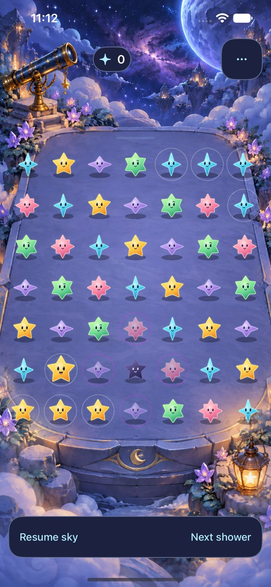
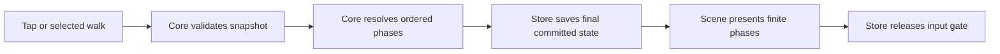

# Turn a magnetic collision into a temporary orbit

**Status:** Accepted for production; integration checks in progress · **Owner:** current implementer · **Updated:** 2026-10-17

Dusk suppresses neighboring growth and dissolves beside a clear; Opal joins a chosen color. Separate magnetic pairs create temporary holes when a legal clear opens their middle. A hole captures up to four occupied colored neighbors, rotates them between settled matching windows, and closes on a captive clear or after three windows. Empty cells are never reserved. Floor captures usually start with two stars.

The user requested adoption after merging [the isolated implementation](https://github.com/lbeezr/starfall/pull/42). The [production acceptance plan](GRAVITY_MECHANICS_PLAN.md#production-acceptance-2026-10-17) owns remaining checks. Human preference, actual VoiceOver acceptance, device performance and natural supply tuning remain unverified.

## Production ownership and supply

`FallingSky` commits collision/removal/settling/capture/rotation/release phases; `GravityFieldRules` owns topology and support compaction. The board owns captive IDs; `OrbitField` stores fixed occupied slots. `StarCast` supplies two bounded glyph materials for the board, flight and forecast. Input, saves and showers remain under the existing store's generation guards and single deadline.

New skies use saved generation `gravityOrbits`. The eighth calm wave of a twelve-wave cycle may supply a five-star setup: two magnets at equal low endpoint heights, one colored survivor above each, and a middle-family arrival. The middle must already contain a colored star at that height. Skip if a field/magnet remains, no eligible center exists, ordinary relief is needed, or the original forecast contains Dusk/Opal. There is no deferred spawn debt. A lone magnet dissolves beside a selected clear; only one field can exist.

The v5 normal archive reads v4 envelopes and v3 raw skies without rewriting their generation or preview. Same-sky replay retains that generation; New sky selects the current rules. Corrupt newer saves never fall back. First Light remains unchanged. Opal is never captured, but remains usable in matching clears/traces beside a field; selecting a captive through either input closes the field once.

The [historical trial evidence](../evidence/gravity-orbit-2026-10-17/README.md) applies only to its pinned export. Its duplicated transforms, alternate bundle/save envelope and player fixture menu are retired on adoption. The original analysis below remains decision history, not current implementation documentation.

## What the original code analysis established

Inspected committed runtime at `f35eba87311f5e9e56740b9677bceb699154e8ae`, plus the canonical trial fragments listed below. Working-tree differences at analysis start were the preceding research/register/navigation documents only.

| Boundary | Current implementation | Consequence for this design |
| --- | --- | --- |
| Identity / score | [FallingSky](../../Sources/StarfallCore/FallingSky.swift): `kind == nil` means Dusk; `value`, `starsLanded`, entity IDs and save conservation assume colored/dark arrivals. | A magnet or hole cannot be another nil-kind star. Add explicit lab identity and independent entity allocation/accounting. |
| Clear / gravity | `clear` removes the colored group and touching Dusks, then compacts every column from row zero. | Collision must see the new middle gap before compaction. Captive supports require a different, explicit settling operation. |
| Arrivals / restore | `letStarsFall` uses occupied count as height. `isValidSave` rejects every unsupported gap. | Pinned captives need highest-occupied landing and segment validation; changing rendering alone would corrupt the rule/save contract. |
| Clock / commits | [Store](../../App/FallingSkyStore.swift): one cancellable deadline, `rainDue`, generation guards, save before `animate`. | Retain this ownership. Orbit advances only inside an explicit shower event, never a timer/action callback of its own. |
| Presentation | [Scene](../../App/FallingSkyScene.swift): `cleared`, `settled` and `arrivals` describe one clear/settle/arrival sequence; nodes keyed by ID. | Keep stable IDs, but add ordered committed phases for collision, formation, orbit and release. A final board cannot explain all intermediate movement. |
| Native input | [View](../../App/FallingSkyView.swift) and [geometry](../../App/ObservatoryGeometry.swift) share projected cell mapping. | Keep the same cells/buttons; curved travel is transient and not a hittable moving target. |
| Trace candidate | [Trace intent](../../tools/mechanics/ConstellationTraceIntent.swift) checks full snapshot equality plus generation/sequence tickets. Production Core does not contain these trial methods. | Test ordinary taps first, then compose the canonical trace candidate deliberately. Every orbit/closure invalidates an in-progress walk. |
| White candidate | Original local white patch (`white-connector.patch`) adds optional light markers and guards nil-kind material/accessibility paths. | Do not edit or silently combine this parallel experiment. A future shared identity decision needs its selected source/contract. |
| Ranking / lab isolation | Original local `SkyRankingSession` and store eligibility rely on challenge/balance, not a gravity ruleset. original local white exporter (`prepare-white-connector-lab.py`) isolates bundle/defaults/save keys. | Lab must explicitly disable ranked result creation/delivery, not rely on its bundle or balance alone. Use strict exported patches, never production flags. |

Current production files examined are 277–336 lines each for Core, store and scene. They do not trigger the 1,200-line review threshold. New gravity responsibilities still belong in focused helpers; do not bulk up those owners or copy the generator into a second engine.

## What the player experiences

Two magnetic stars at the same row flank one colored star. Clearing the middle as part of a legal group makes the pair rush inward. Their collision leaves a hole; ordinary settling happens once, then the hole catches the ordinary colored neighbors actually present around its settled center.

**Concept — not a runnable fixture.** At floor row zero, magnets at columns 2 and 4 surround the middle star at column 3. Clearing a vertical group in column 3 opens the gap. Colored survivors above each magnet drop into their vacated floor cells, leaving two captives beside the new hole. The pair can swap sides on the next orbital step, changing their connections to the surrounding stars. Fixture work must prove both legal actions and the resulting choices.

One captive might join a useful group now. Clearing it closes the hole and releases all other captives. Waiting preserves the possibility of a different connection, but the next shower still brings pressure. No automatic match clearing or score multiplier follows a rotation.

**Inspected historical native reference — not gravity evidence.** iPhone 17e / iOS 27.0, isolated Observatory export; [source and limitations](../evidence/living-observatory-2026-10-17/README.md). It illustrates the existing perspective, Dusk shading and ready-group rings. It does not show magnets, a hole or captives. New markers must remain distinguishable from both existing rings and the white connector's link symbol. No new artwork is approved by this reference.

## Proposed first rule contract

### Dusk remains the local constraint

Keep zero starlight, four-neighbor growth suppression and one directly touching legal clear for removal. No shrink, matching lock, orbit, attraction, damage layers or dark-to-white transformation. First Light is unchanged. Compare occupancy-only Dusk separately after the gravity fixture question; do not change its cadence/severity inside that comparison.

### Magnetic precursors have one relationship

- Working identity is a separate magnetic star, zero starlight, no color match or growth. It falls normally. An adjacent legal colored clear can dissolve a stranded precursor, preventing a permanent wait for a partner.
- A collision requires two magnets at `(row, column-1)` and `(row, column+1)`. The middle must be empty **because of this committed legal clear**; no passive empty-gap or arrival-triggered collisions in v1. This tests player setup before natural spectacle.
- Candidate detection occurs after colored/Dusk removals but before precursor adjacency removal and settling. A selected pair survives that clear's adjacency effect and is consumed by collision instead. Other touched precursors dissolve. Show the selected collision in the input preview/hint.
- At most one collision and one hole per event/sky. If a hole existed at event start, no new hole forms during that clear, even if the old one closes. For competing pairs choose the first canonical middle `(row, column)`; preview it. No simultaneous chains or magnet polarity system.
- Consume two endpoints and insert one new hole at the middle, with no additional blast removal or collected light. Its visible explosion represents the collision. Settle once with ordinary gravity; the newborn hole may fall in its center column before capture. Preview the settled formation position, not just the collision point.

### Capture occupied positions; never manufacture captives

After formation settles, inspect the four orthogonal neighboring cells in fixed clockwise logical order: back `(r+1,c)`, right `(r,c+1)`, front `(r-1,c)`, left `(r,c-1)`. Capture only occupied ordinary colored cells. Skip out-of-bounds, empty, Dusk and precursor cells. Do not capture white in this trial.

Persist the hole ID, fixed center, fixed captured cells and their occupant IDs, and remaining windows. A floor hole has at most three eligible positions; the two-captive case is a readable two-way swap. There is no wrapping through the floor. A corner would permit two positions, but horizontal formation cannot create a center at column 0 or 6: test corner geometry as a helper case, not a naturally reachable v1 scenario.

With fewer than two captives, close the newborn hole immediately and settle again. This is finite collision relief, not a one-star “orbit.” Never pull extra stars from a distance or refill empty capture slots. Once active, all capture positions remain occupied until closure; stars permute among those positions, retaining their IDs, family and grown value.

### The hole and captives become explicit supports

The fixed center and captured cells anchor their occupied positions. On a clear elsewhere, split affected columns at these anchors and compact only the ordinary segments between them. For example, an anchor at row 3 separates rows 0–2 and rows 4–6. Lower stars may clear, leaving a gap below row 3; the anchor legitimately supports the upper segment.

An arrival enters above the highest occupied cell in its column; it never tunnels into a gap below an anchor. A matching exposed small colored top star may still grow under the normal Dusk rule, including a captive. Rotation preserves that updated grown value. Row-six blockage remains overflow. This keeps the cost visible: held stars can strand capacity beneath them until release.

With no active hole, settling and validation must reduce exactly to existing compact columns. A legal clear containing **any captive ID** removes its selected colored stars, closes the hole and releases all surviving captives, then settles normally. A touching clear that contains no captive does not close it. Tapping the hole does not clear it; explain the captive-clear condition. Existing Dusk removal uses the original selected colored cells, with no chain from hole closure.

### Three matching windows, tied to showers

Initial fixture lifetime is **three settled windows**, including formation. Creation sets `windowsRemaining = 3`. Before arrivals of each subsequent shower:

1. If one window remains, remove the hole, release captives and settle; do not perform a final invisible rotation.
2. Otherwise, rotate each captured occupant to the next captured position clockwise and decrement the count. Excluded positions remain excluded.
3. Apply forecast arrivals in their existing order. The resulting settled board is the next playable window.

Thus creation → rotation → rotation → closure supplies three windows. This refines the research's ambiguous “steps” into an exact event contract; later compare two/four **windows**. Clear actions do not tick lifetime. Pause alone does not move the orbit; manual Next shower advances the same rules. No second clock or catch-up queue. Rotation creates no light and does not auto-clear matches. On overflow, retain the committed field/board at failure and freeze all further steps.

## Ownership, saves and presentation

**Proposed ownership.** The renderer receives snapshots and entity moves; it never decides collision selection, capture, matching, closure, score or shower cadence. Cancellation jumps to the saved final board.

In the isolated export, keep `FallingSky` as the orchestrator and existing generator owner. Add a focused `GravityFieldRules` value helper for collision selection, occupied-slot topology, support settling and validation; an `OrbitField` record for the bounded active state; and small turn-phase value types. Share these between rule checks and the native export via one canonical patch/helper set. Avoid a parallel copied game engine or a general entity-component framework.

Replace nil-based special classification with explicit lab cases `.colored(Jewel)`, `.dusk`, `.magnet`, `.hole`. Keep access to an ordinary matching family narrowly defined. Audit every kind-nil, `isDark`, value, material, preview, label, hint, feedback and growth call site; a hole must never inherit Dusk's artwork or suppression. Do not reserve an implemented white case until the parallel work selects its contract.

Lab saves use a required ruleset/version envelope and a separate bundle, defaults suite and key; unknown versions are rejected before decoding the state. Proposed suite/key: `starfall.gravity.lab.v1`. Never read/write `starfall.accumulation.v3`, white saves or normal ranking sidecars. Keep initialization read-only, restore paused, and fixture loading explicit. Compatibility with production/retained real saves is an adoption gate, not an implicit v1 migration.

Allocate entity IDs independently of arrival mass; a new hole needs an ID without pretending another star fell. Preserve IDs and grown values through permutations. Track ordinary light, dark units and magnetic units separately. Required conservation includes `ordinaryLightArrived = score + remainingOrdinaryLight`, dark arrivals equal removed plus remaining Dusk, and magnetic arrivals equal remaining precursors plus twice active holes plus retired magnetic units. Collision transfers two magnetic units into one hole; expiry/dissolution retires them. Clear/orbit subphases never replace the announced forecast or draw randomness; subsequent normal forecast generation may differ because the board changed, as it already can after ordinary clears. Keep legacy accounting on the ordinary-only path and compare a documented legacy-state projection to baseline; the new envelope/identity encoding is not expected to be byte-identical to an old save.

Each phase records enough source/target snapshot and ID movement to render removal → collision → formation settling → capture, or orbit/closure → arrivals. Keep the total bounded to one field, four captives and one collision. Existing ordinary turns retain their animation path. Normal orbit travel curves around the center, then returns to exact mapped cell centers; input stays gated during travel. Captive tethers/arrow and a segmented lifetime marker carry the resting meaning. Reduce Motion/VoiceOver show committed positions and static state without changing rules.

## Acceptance and decision

- [ ] Floor collision, two-/three-/four-captive permutations, insufficient capture and elevated formation have exact predicted boards. A lower clear leaves a valid supported gap; closure restores packed columns. Corner topology is explicitly fixture-only.
- [ ] An authored trigger-now example and a defer/avoid example compare all legal alternatives, including ordinary taps. At least one orbit creates a useful connection and another removes one. No hidden future arrival is used to claim player foresight.
- [ ] Dusk, ordinary growth, preview/RNG, First Light and old-save continuation retain their specified contracts. Ordinary-only candidate replays equal the selected baseline; changed gravity states round-trip with exact continuation and reject malformed anchors, duplicate IDs and accounting.
- [ ] Store fake-clock/presenter checks cover due rain during clear/orbit, input gating, capture-clear closure, restart, fixture replacement, pause/menu/background, motion change and stale completions. No phase callback mutates rules.
- [ ] Native Debug/Release builds include every helper/resource. Inspect full-motion collision/orbit/release, floor projected taps, rapid input, win/loss/restart and restore. Verify maximum text, static non-color cues and system Reduce Motion; perform routine lightweight accessibility checks and reserve full actual VoiceOver for RC.
- [ ] Only after ordinary fixture comprehension, deliberately compose canonical selected tracing and verify cancellation/selected-set semantics. Keep white separate; combined behavior is future work.
- [ ] Observe whether players predict movement, identify a window and choose to trigger, preserve or close the hole. Adopt, revise or remove after the bounded comparison; no natural spawning or production flag without a separate decision.

**Material risk:** support-based gravity is more complexity than the original compact-board game. If players cannot explain why stars remain suspended or where arrivals land, prefer the research's one-time settleable vortex alternative or defer gravity. Do not disguise this as solved by artwork or passing tests. Magnetic identity and three-window lifetime are recommended draft choices, not user-approved final rules.

## Analysis verification

`swift test` passed **63 tests, zero failures**, on the inspected runtime and documentation-only working-tree differences, Apple Swift 6.4 / arm64 macOS. Raw log: `/tmp/starfall-gravity-design-core.log`. This establishes the existing package baseline, not any proposed mechanic. No candidate simulation, source change, simulator build, hosted/UI run, runtime animation, interruption, actual VoiceOver or physical-device validation was performed. Historical images were inspected; new Markdown was reviewed as source. Documentation hygiene/link checks are recorded in the [plan](GRAVITY_MECHANICS_PLAN.md).
