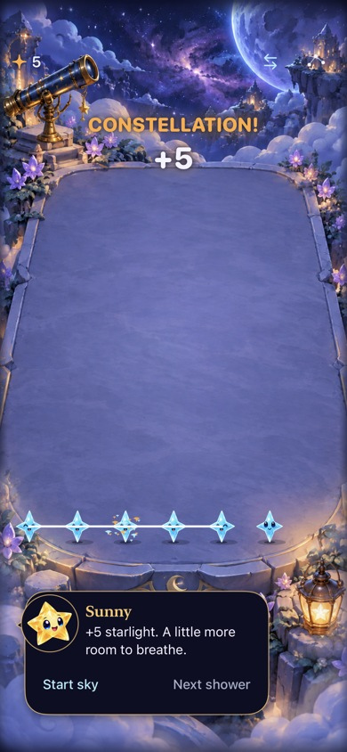

# Let the harvested stars own the celebration

**Status:** Implemented; partially verified development refinement · **Owner:** current implementer · **Updated:** October 18, 2026

Refine the existing collection effect: inherit each rewarding star's family, let actual awarded points control energy, and bring exceptional announcements into the central sky. The hypothesis is that a player can connect the harvested stars to the total and notice a bigger achievement without losing their next move. Human satisfaction and physical haptics require a phone comparison.

**Decision:** one coordinated release, collection and resolution. Keep scoring, recipes, relay classification, saves and input ownership unchanged. No new combo or multiplier. [Native checks and source-bound evidence](../evidence/harvest-feedback-2026-10-18/README.md) pass for the sampled development scope. Next: retain or tune the named weak beat after physical player review.

**Historical baseline:** inspected native capture at `6ae0542`, iPhone 17e / iOS 27.0; not evidence of this refinement. The title is high and the stream uses generic cyan/gold.

## Acceptance before implementation

- Capture immutable family and positive reward per contributor from the pre-clear board. Include rewarding Opal; exclude drained/zero-reward stars. Packet color must stay attached to its source even after gravity/another clear.
- Raise trail width, head size, release reach and counter resolution continuously with the committed award, with fixed packet/spark caps. Sample the whole selected set, not just its first six stars. Grown contributors carry more visual weight.
- Special titles appear around the central upper terrace, below header controls, with a fast entrance, readable hold and upward dissolving exit. Ordinary awards retain their local/sky treatment. Large text keeps native sizing and the existing below-terrace award fallback.
- Exceptional awards get one short translucent family-colored aurora, with no repeating flash. Keep board and native hit cells stationary; put impact recoil on decorative text only. Quiet modes remove travel, recoil, scale and ambient bloom.
- Preserve replacement, expiry, interruption, zero-award and old-save behavior. The overlay never receives touches or delays a shower/action. Run existing receipt/store checks plus focused contributor, intensity and central placement regressions; inspect small/large layouts and actual timed native rendering.

## Research and chosen application

Apple's [Practice audio haptic design](https://developer.apple.com/videos/play/wwdc2021/10278/) describes causality, sensory harmony and meaningful feedback. Here: source-family light connects cause to score; a coordinated impact/flight/arrival makes one event legible. Its simulator limitation means tactile acceptance remains physical-device work.

[Designing Game Feel: A Survey](https://arxiv.org/abs/2011.09201) distinguishes physicality, amplification and support. This is amplification of an existing committed result. Greater effect strength and the central title are design hypotheses, not empirically established enjoyment thresholds.

A whole-screen camera shake risks separating rendered stars from stationary native hit cells during rapid input. Use a central callout recoil and aurora first; evaluate stronger environmental response only if player comparison still finds exceptional awards weak. Unlike the earlier first trial, the user now explicitly requests more theater and central placement. This refinement supersedes its high callout/fixed cyan-gold choices.

## Lettering refinement — October 18

The user likes the central placement and family coloring, and requests more dramatic typography aligned with Starfall. [Three lettering concepts](celebration-lettering/README.md) compare bespoke title artwork; The user selected Crystal Burst as the lead, with interest in Comet Sweep and “Brilliant!” details; the next proposed blend is 70% crystal, 20% comet gesture and 10% luminous warmth. This is a separate visual design step. Existing runtime type remains unchanged until the selected treatment is authored and checked natively.
