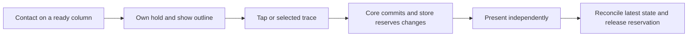

# Reliable taps during falling animations

**Status:** Accepted · **Owner:** Current implementer · **Updated:** October 18, 2026

A stationary star should remain responsive when another part of the sky moves. Replace the whole-board animation gate with reservations for columns changed by each committed turn, acknowledge contact immediately, and keep drifting ordinary taps from becoming unavailable traces.

**Decision:** Independent clears and ordinary arrivals may overlap. Gravity events that move stars across columns remain atomic. Keep the current selected-trace rules, analytic hit testing, hold tickets, dialogue, cadence, RNG and save archive.

**Next action:** Check physical finger/haptic feel on the next device build, using the source-bound [verification record](../evidence/responsive-input-2026-10-17/README.md). Actual VoiceOver remains a release-candidate check under the repository cadence.

## Behavior the player can observe

| Situation | Response |
| --- | --- |
| Touch a ready star | A static outline acknowledges contact; release on the same star activates its existing ordinary clear. |
| A shower or clear moves another column | Ready groups remain usable. A prospective clear must also avoid reserved dark-star columns it would dissolve. |
| Touch a changing column | “Stars settling…” explains the wait and disappears when ready. Input is not replayed on a later occupant. |
| Short ordinary drift | A contact that stays within 18 points and lifts in its original cell remains a tap unless it selected another star. Drawing preview starts at six points; selecting a neighbor or moving farther permanently claims drawing. |
| Draw an eligible constellation | Start anywhere in the eligible native star target; tap and drawing admission use the same inverse mapping. Analytic segment hit testing and forgiving prefix validation still select stars along the path. A visible outline and count indicate contact/readiness. |
| Release an incomplete trace or leave the board | A readable reason accompanies cancellation. A deliberate trace never falls back to clearing an ordinary group. |
| A shower deadline approaches during contact | The existing owned hold freezes the remaining clock. Release/cancellation resumes it; stale tickets cannot resume a newer contact. |
| Formation, rotation or release of an orbit | The changing board remains locked until its committed gravity sequence settles. |

Corrective feedback remains until another contact, board change or lifecycle interruption. The initial 1.6-second expiry was too easy to miss in native verification and was removed. Input corrections now use the existing bottom character dialogue, alongside ordinary-move guidance. There is no separate top status banner. The next contact clears input copy without leaving a mode to dismiss.

## Ownership and safety

Core still chooses the complete committed outcome. The store previews that outcome on a value copy to determine whether its changing columns intersect active reservations. Gravity phases reserve all seven columns; ordinary clears reserve cleared/dissolved columns and their gravity, and arrivals reserve their destinations. At most seven disjoint ordinary presentations can be active. Showers stay serial and retain a single due event.

Each presentation receives an identity and lifecycle epoch. Completion removes only its own reservation and reconciles those columns against the newest committed game. The renderer preserves independent flights and the live contact layer. When the last presentation ends it restores an exact quiet board. Older explicit clear completions cannot replace newer result dialogue; automatic phase announcements retain their existing noninterrupting policy.

The recognizer admits one contact before scroll arbitration, anchors taps to their origin cell, and always terminates on release/cancellation/reset. Preview movement and final action classification are separate: a small unselected wiggle remains a tap, while selecting a second star permanently prevents ordinary-clear fallback. Non-drawing starts retain the full tap tolerance before yielding to vertical scrolling. Core owns the shared start-eligibility query. A hold ticket and input generation reject stale work across settings, backgrounding, restart, resizing and scene detachment. Native cell buttons and add/release/cancel accessibility actions remain authoritative assistive controls. No coordinate queue, new clear rule, persisted gesture, schema migration, SDK or network behavior is introduced. [Current input refinement](../evidence/snappy-board-input-2026-10-18/README.md) records source-bound checks; physical contact-to-display latency remains unmeasured.

**Implemented ownership diagram:** presentation releases a reservation; it never decides a legal action or advances the shower schedule from node positions.

## Research and tradeoffs

PopCap's [Bejeweled Blitz strategy guide](https://images.popcap.com/www/images/product/extras/strategyguides/bejeweledblitz/1033/strategy-guide_english.pdf) encourages a second match before the first gems finish dropping. This supports considering concurrent play, without implying that every puzzle should permit every action during every animation.

The [Celeste developer explanation](https://maddymakesgames.com/articles/celeste_and_forgiveness/) describes buffering and wider timing/position windows. Starfall applies the tolerance principle to drifting taps. A blind coordinate buffer would be unsafe because gravity changes occupants; independent immediate actions and owned contact address the demonstrated failures first.

[Apple's button guidance](https://developer.apple.com/design/human-interface-guidelines/buttons) recommends custom press feedback and generally 44-point targets. [Response-time guidance](https://www.nngroup.com/articles/response-times-3-important-limits/) suggests about 100 ms for an immediate-feeling response. Our outline is synchronous with touch admission; physical contact-to-display latency remains unmeasured, particularly inside the large-text scroll container. Haptics remain optional complements to visual feedback under [Apple's guidance](https://developer.apple.com/design/human-interface-guidelines/playing-haptics).

## Acceptance

- Independent clears finish in either order without losing the newest game/save or replacing newer dialogue.
- A real clear overlaps an unrelated full-motion shower; changing/dark-adjacent columns and cross-column gravity reject conflicting actions.
- Real 16-point ordinary drifts work at normal and largest text sizes. Valid, incomplete and outside traces preserve selected-set/cancellation rules.
- Existing normal/rapid play, win/loss, replay, pause, settings dismissal, background/resume and Reduce Motion checks pass on the integrated source.
- Record core, hosted, native, visual/motion and physical evidence separately. Check Debug/Release and explicit target membership. Use the [screenshot practice](../SCREENSHOTS.md) for selected captures.

The implementation was adapted to GitHub production `49dcd0e` after the initial checkout proved outdated. Its newer save/trace/dialogue/gravity boundaries are retained. Earlier results on `f35eba8` are preliminary research, not acceptance of the integrated change.

## Native appearance

**Implemented, current for snapshot `7e2bdc3f5a56`:** iPhone 17e/iOS 27.0 Simulator, normal motion/default text, isolated reset fixture. [Source and checks](../evidence/responsive-input-2026-10-17/README.md). The explanation occupies existing space above the terrace and does not intercept touches. This still demonstrates placement, not animation or contact latency.
