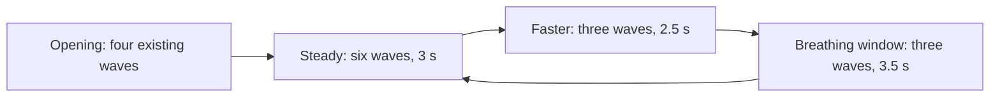

# Give Starfall a rhythm players can use

**Status:** Local technical trial ready; user comparison pending; B not adopted · **Owner:** current pacing implementer · **Updated:** October 17, 2026

Keep the beautiful empty-board cascade, establish a three-second baseline, then compare a small, announced timing cycle against it. Measure usable decision time before adding more stars or adaptive difficulty. The local combined trial is technically checked on the [recorded sources](../evidence/pacing-acceptance-2026-10-17/README.md); publication and human preference remain open.

**Decision:** Build on the existing deterministic rules and single-deadline clock. Test timing separately from wave composition. Reuse the existing phase work where applicable; introduce no general director framework, new phone app, progression or runtime AI model.

**Next action:** Run the [user-only comparison](PACING_PLAYTEST.md) against validated runtime/export `b42eba3`. [Task ownership and local completion](../PACING_WORK.md) record tasks 1–6 and technical limits. Remote publication remains pending; no phone or updater operation is part of this work.

## What the code actually supports

Inspection compared remote `origin/main` **ba348d758b2b2e5dcc63bf0f4fccf75bc357a7fc**, local `main` **f371256de09bac614e3f5b3bc5f434f99139d52c**, and this clean worktree **f49007d5245d6c988c79ce11a8dd5f04efece238**. Branch names can move; these hashes define the original findings. No device or simulator run was performed for that analysis. Subsequent implementation evidence is separate: baseline report at local8210cf6, Core15c1028 and Store1316f8 have been verified by their task owners; those historical task handoffs are now integrated locally, with later source-bound acceptance linked above. Remote adoption is not implied.

| Boundary | Finding | Design implication |
| --- | --- | --- |
| `Sources/StarfallCore/FallingSky.swift` | Seeded waves; weighted natural sizes `[1,2,2,3,3,3,5]`; shuffled column coverage; cohesive colors; first wave is three adjacent matching stars. | We already have authored randomness. A new generator is unnecessary for the first pacing test. |
| Same core, dry-board relief | When no ordinary tap group exists and a sufficiently low column exists, the next generated forecast becomes five stars, with three matching arrivals stacked in that column. | The game already responds to board state. Adding another rescue system could amplify this behavior. Relief tests ordinary tap groups, not every legal traced selection. |
| Same core, remote source | Orthogonal clears need three light; traced selections need five distinct same-family stars, with diagonal steps allowed. Grown stars count as two light but one traced star. Clears preserve the incoming forecast and RNG. | Measure tap and trace opportunities separately. Five connected stars do not automatically establish a worthwhile decision to wait. |
| `App/FallingSkyStore.swift` | One cancellable deadline, no catch-up queue. Clock starts the next interval when a shower commits. Input is gated during presentation; an overdue shower waits for presentation. A committed shower invalidates a trace snapshot. | Three seconds between shower starts is less than three seconds to think and act. A trace started near the deadline can be cancelled by incoming rain. |
| `App/FallingSkyScene.swift`, `FallingSkyMotion.swift` | Full-motion arrivals take `0.48 + 0.09 × (count−1) + 0.34` seconds; clear presentation takes 0.56 seconds. Quiet presentation gates for 0.15 seconds. | Preserve motion, measure its input cost, and avoid making the schedule depend on animation callbacks. |
| `StarfallBalance.swift` and opening changes | Inspected remote defaults to four seconds and has no opening marker. Local opening work defaults new skies to three seconds, first shower after 0.25 seconds, then three intervals of 1.8 seconds; old saves and First Light retain their cadence. | Integration is a prerequisite. The local adoption register alone does not prove remote delivery. See [opening evidence](../evidence/opening-cascade-2026-10-17/README.md). |
| Existing phase tools | [Shower phases](SHOWER_PHASES.md) already test nine preparation waves and three pressure waves; density variant forces five-star surges. | Do not build a duplicate phase system or silently adopt the old lab. Its earlier source, generator and save boundaries need explicit reconciliation with tracing. |

A full-motion five-star wave occupies about **1.18 seconds**. At a three-second interval, approximately **1.82 seconds** remain before the next due shower, before accounting for a clear or gesture. At the opening's 1.8-second intervals, that can shrink to **0.62 seconds**. These are source-derived timing estimates, not measured human reaction times or evidence that animation is too slow.

Natural weighted waves average **19/7 ≈ 2.71 stars** before opening and relief overrides: roughly **54 arrivals/minute** at three seconds, versus **41** at four. This is not clears per minute. Growth, dark stars, relief and retained groups change how incoming mass converts into actions. Increasing sizes and frequency together would obscure which change helped.

## What the player experiences

Start empty. Stars sweep into the board immediately, with the existing flight, trails and landing reactions. The first three-star match can be cleared between opening waves; the player need not wait for the entire introduction. The opening must also be tested with a deliberate trace once tracing and opening share a build.

After the opening, establish a steady beat. In the proposed timing comparison, a short cue announces an approaching faster passage, followed by a visibly calmer passage. The same seeded natural wave sizes remain in use. The player can still pause, clear manually and call a shower. First Light and existing saved skies keep their contracts.

No claim is made that holding a constellation is already rewarding. The selected-trace baseline (historical local commit `47bae90`; its evidence folder is outside this scoped pacing branch) found occasional follow-up differences, but did not establish rewarding holding or human preference. A separate mechanics workstream owns that question. Faster pacing cannot create strategic depth by itself.

## The smallest useful timing comparison

Compare two policies **after the same four-wave opening**, with identical generation rules and seeds:

| Policy | Post-opening interval sequence | Purpose |
| --- | --- | --- |
| A: steady baseline | 3 seconds throughout | Establish the intended shipping baseline. |
| B: announced cycle | Six waves at 3 seconds; three at 2.5 seconds; three at 3.5 seconds; repeat | Test whether temporal contrast creates preparation and breathing room. |

B averages three seconds per scheduled wave over a complete cycle: `6×3 + 3×2.5 + 3×3.5 = 36 seconds`. This controls nominal arrival frequency, not realized difficulty or throughput: busy deferrals and different player actions can still change delivered timing and forecasts. The numbers are **experimental starting values**, not research-established optima. Do not additionally force five-star showers, change dark frequency, or add a wave-size bag in this comparison.

Announce the faster passage one wave ahead using a small, non-color cue outside the board, using the existing phase presentation work as a starting point. Keep ordinary active-play announcements quiet. A slower interval is a **breathing window**, not a promise that the board becomes safe or empties. If players cannot identify a usable recovery opportunity, the cycle has failed its purpose even if timing tests pass.

**Proposed sequence, not runtime evidence.** Phase advances with committed showers. Clears and pauses do not advance it. Manual showers consume the same sequence.

## Ownership, input and saved games

Core owns the versioned cadence policy and its pure interval/phase calculation from committed shower count. Keep this a small value/type alongside the existing balance rules. Preserve generation and RNG behavior for this timing-only comparison. Store owns the one deadline and scheduling; scene owns presentation. Do not choose phases, waves or delays from frame rate, node position or animation completion.

Commit the next interval/phase before presenting it. New policy selection applies to a new test round. Missing policy markers retain historical cadence; old saves must not acquire new timing merely because a default changes. Restart-same preserves policy and seed. New-sky selection follows the explicitly adopted policy. A restored sky remains paused under the existing store contract; this proposal does not promise wall-clock replay across a quit.

Measure trace cancellation first. Retain current snapshot invalidation for the initial comparison; do not quietly pause rain whenever a finger is down. If deadline cancellation regularly prevents intentional clears, test a separate **bounded gesture grace**: at most one deferral per due shower, a fixed cap from trace start, cancellation on interruptions, and no accumulation. That needs its own input/save/replay decision and tests. Unlimited finger-down pauses would undermine pressure.

Match full and reduced-motion committed sequences under the same explicit action log. Real-time human inputs may differ because presentation gates differ; report this rather than asserting equivalent difficulty. A reproducible timed run needs seed, policy version and accepted actions with elapsed active-time offsets. Existing core snapshots alone do not reproduce human timing.

## Measure the experience we intend to improve

Use opt-in local test harness output under ignored artifacts, with a small durable summary. No analytics service or production event collection.

- **Opportunity:** time until first accepted clear; time input is enabled with neither a legal tap nor a legal trace; longest such gap, especially in the first 30 seconds. Distinguish no opportunity from a player deliberately waiting.
- **Agency:** accepted taps and traces per active minute, completed versus deadline-cancelled traces, presentation-gated time, and player explanations of clear-now versus wait. Exclude menus/background time; report paused/manual play separately.
- **Pressure:** highest column, headroom in incoming columns, dark-star blocking, and actual overflow/growth outcomes. Occupied count alone is insufficient: a full column can accept matching growth, and clearing can remove neighboring dark stars.
- **Rhythm:** scheduled versus delivered interval, overdue deferrals, and whether a player uses the slower passage to make an intentional clear. Report distributions and counterexamples, not only mean score or survival.

Do not set a universal moves-per-minute quota. Arrival supply currently limits sustained clearing; repeated taps, invalid taps and five-star traces are different actions. Start with observed successful play and ask whether the player is making satisfying decisions, then tune the rate.

Reuse bounded offline policies for largest-clear, height-safety and trace-oriented play, with explicit reaction/gesture durations and only visible information. Keep their actions separate from human observations. Match initial seeds; when actions diverge, board-dependent relief may also change future waves, so identical seed does not guarantee an identical incoming stream.

## Acceptance and adoption decision

- [ ] Combined opening/tracing baseline exists on the intended remote source; Debug and Release use one production route. Record exact source and save compatibility. No additional installed phone variant.
- [ ] Fixed-seed action logs preserve generation across timing policies; old saves, First Light, same-sky replay and terminal freezing retain their defined behavior.
- [ ] Test phase boundaries, manual calls, overdue presentation, trace crossing a deadline, rapid taps, pause, settings dismissal, background/resume and restart. No duplicate shower, queued catch-up or stale trace commit.
- [ ] Inspect normal-motion cascade and dense-board play on Apple tooling; verify clearing before opening ends and usable trace windows. Inspect system Reduce Motion, large text and native accessibility labels. Actual VoiceOver is a release-candidate check under the current development policy.
- [ ] Run the initial matched-seed comparison with the user alone, reversing policy order across seed pairs, as requested. Record cue understanding, deliberate actions in breathing windows, idle passages, cancellations and preference without claiming statistical proof. Unfamiliar-player comprehension remains unverified; a second participant is not required to start this initial session.
- [ ] Adopt B only if observed rhythm improves and input/interruption checks pass; otherwise retain A and remove the temporary comparison. If ambiguous, name one unresolved question and a bounded follow-up. No permanent pilot flag.

This design records the intended comparison; completion claims belong to exact-source task evidence. Some implementation gates have passed on local task branches; combined native acceptance and human preference remain open. The original code analysis was document/source inspection, not runtime evidence. The [experiment register](../EXPERIMENTS.md) records the proposed comparison separately from historical surge trials.

## Why this architecture fits the research

The Darkspore director used simple state measurements and tuned selection rather than a complicated player model; its designer emphasizes testing and tuning. That supports trying a small explicit policy here, without assuming Starfall needs hidden skill estimation. [Dan Kline's director account](https://dankline.wordpress.com/2011/06/29/the-ai-director-of-darkspore/).

Research on automated matching-game playtests uses different procedural personas and compares them with human traces. Borrow the multiple-playstyle approach for offline evaluation; it does not establish enjoyment or justify copying a moves-per-minute target into a different game. [Mugrai et al., Automated Playtesting of Matching Tile Games](https://ieee-cog.org/2019/papers/paper_127.pdf).

## What comes after this decision

If timing works but opportunity gaps persist, compare a versioned wave-size bag against current independent sampling, preserving long-run weights and measuring droughts. Account for existing column fairness and relief before adding another constraint. If timing feels good but players still cannot explain meaningful alternatives, return to the separate mechanics study. Consider board-aware adaptation only after a fixed policy's specific failure is demonstrated; define observable limits, replay and competition implications before implementing it.

## Local trial checkpoint

Tasks 1–6 are locally complete within the acceptance matrix; candidate B remains export-only and unadopted. The final presentation source is `b42eba357515793c834fec7d9125907ca106a22f`, reconciled with pinned main `b88fcfc`. Automated checks cannot establish deliberate tracing comfort during the accelerated opening or human preference. On the calibrated iPhone 17 profile, A uses the camera forecast while B’s reserved cue slot uses the header fallback; the user comparison includes that presentation difference as well as timing/cues. Keep this limitation in any preference interpretation.
