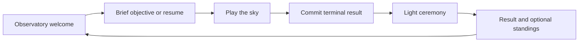

# Rankings and the ceremony of a sky

**Status:** Draft — research and interactive concept only · **Owner:** current implementer · **Updated:** October 17, 2026

Give each sky a deliberate welcome, a legible result and a warm invitation to play again. Prototype a small Observatory Cup to test the pleasure of taking and keeping first place. The user requires full offline play plus optional online competition. Recommend Apple Game Center for player identity and a first leaderboard, without a separate Starfall account. No campaign, unlock ladder, backend or runtime route is introduced here.

**Game Center decision:** User selected Game Center on October 17. The updated leaderboard concept replaces the fictional Cup as the first online direction with Friends / Global scopes and online, cached-offline, uncached-offline, signed-out, offline-and-signed-out, and empty-friends states. Sample data separates local best 46 from submitted best 42; no live service is connected. Browser interaction checks passed in installed Chrome through Playwright at 736px and 320px across all six states and both scopes, including play navigation, no runtime errors and no horizontal overflow. A narrow online screenshot was inspected. This is browser concept evidence only, not native Game Center or accessibility acceptance.

**Recommendation:** A brief gathering of light into a brass star trophy, followed by the committed result. Show rank movement after the result, with a clear gap to the next player. Celebrate taking first more strongly than retaining it; treat falling rank as information.

**Implementation follow-through:** Friends/Global rankings now have a separate [Game Center contract](GAME_CENTER.md) and [native evidence](../evidence/game-center-2026-10-17/README.md). The ceremony and custom Cup below remain concepts.

**Next action:** Compare the two interactive concepts with the user and their mother. Ask each to explain the objective, whose scores they see, why rank changed, and what the next button does. Choose the ceremony before native implementation. Personal records cannot establish whether social competition is satisfying.

## What exists and what changes

**Existing native reference — not this concept.** [Source, capture context and limits](../evidence/observatory-adoption-2026-10-17/README.md). Inspected alongside the earlier compact HUD capture. The proposed result keeps the Observatory, warm brass and quiet guide voice, and adds deliberate entry, clearer result hierarchy and optional records. The browser concept abstracts the scenery and trophy; it does not reproduce native materials or validate animation, haptics or gameplay quality.

The default is an accumulating sky, not level one. First Light is the one fixed 18-starlight challenge. Shower warnings/recovery are moment-to-moment phases, not completed levels; a phase change gets a small cue, never a result modal. Preserve the production rules while deciding presentation.

## Professional examples and what they suggest

Research checked October 17, 2026. Official documentation establishes event structure; exact transition timings below are our proposals, not measured competitor behavior. No competitor app or gameplay recording was inspected in this pass.

| Observed example | Implication for Starfall |
| --- | --- |
| [Royal Match Sky Race](https://dreamgames.helpshift.com/hc/en/3-royal-match/faq/113-sky-race/) has four opponents, an explicit Start screen, ranking by level-completion speed and a separate new race after the current one ends. | A bounded group and explicit invitation can make competition understandable. Use an objective briefing before starting rather than a forced cinematic. |
| [King’s Cup](https://dreamgames.helpshift.com/hc/en/3-royal-match/faq/107-king-s-cup-1721127793/) uses 49 opponents, cups earned after beating levels, end-of-event rank rewards and no cup carryover. | Separate session results, provisional rank and final awards. Do not award a permanent winner trophy merely for briefly leading. |
| [Royal Match Weekly Contest](https://dreamgames.helpshift.com/hc/en/3-royal-match/faq/120-weekly-contest/) uses nine opponents and a weekly progress metric. | A leaderboard needs a visible pool, scoring basis and time window. These are product rules, not decorative rows. |
| [Candy Crush All Stars rules](https://candycrushallstars.com/en/pages/all_stars_terms) use stage-end leaderboard results for advancement. | Communicate whether a position is live or final. Starfall need not copy elimination or tournament progression. |

These sources do not prove increased enjoyment, retention or an ideal pool size. A hands-on competitor motion study remains open if exact choreography needs comparison.

## The proposed loop

**Proposed flow, not implemented.** Entry lives in the world instead of adding a campaign map. Cold open shows Start sky and a secondary First Light choice. A saved active sky shows Resume sky; no automatic fresh level or replayed introduction. Return from background restores the existing interruption policy and never advances showers behind the briefing.

| Moment | Proposed choreography and copy | Next action |
| --- | --- | --- |
| New sky | Short in-world welcome. On Start, guide withdraws over about 300 ms; automatic deadline starts only when the store enters play. | Play; no countdown tax. |
| First Light entry | “Gather 18 starlight.” Objective remains readable until Begin. About 400 ms transition into the existing challenge. | Begin First Light. |
| Ordinary clear/growth | Existing physical reactions and score feedback. | Continue immediately; no trophy per move. |
| First Light win | Commit win, finish the bounded committed-turn presentation, draw light inward for 250 ms, form a luminous brass keepsake over 450 ms, settle over 300 ms. | Replay First Light / Observatory. No implied next level. |
| New personal best / take first | Result number stays readable; a single light-gathering flourish, then player row visibly moves into place over about 450 ms. Label “New personal best” or “First in your sky.” | Another sky / Observatory. |
| Retain first | Small warm gleam and “Still shining in first.” No repeated full trophy reveal. | Another sky. |
| Drop in rank | Slide to the new position once, preserve score, state “Now in second. Iris has 45; your best is 42.” | Optional another sky; no urgency alert. |
| Full sky / challenge failure | Stars settle; light softens without a red flash, broken trophy or sobbing mascot. “This sky is full. You gathered 31 starlight.” Existing best remains visible. | Replay this sky / New sky, or replay the challenge. |

Keep result actions available without waiting for the flourish; a deliberate action finishes cosmetic motion and navigates once. Input that caused the terminal turn must not activate the newly appearing action. No automatic next game. Optional sound: a soft intake, glassy chime and warm resolve; one light haptic at the reveal, controlled by saved preferences. These are proposed cues, not generated audio.

The keepsake is a visual acknowledgement of First Light, not a collectible economy. No inventory, random drops, rarity, XP or unlocks. For a future real Cup, distinguish the temporary leading emblem from a final trophy. A persistent trophy shelf would require a separate scope decision.

## An honest leaderboard

The interactive social concept uses five fictional players and invented scores, prominently labeled. It demonstrates taking first, holding first and dropping to second. Nothing changes while the mock is unattended; no fake competitors are proposed for the app.

**Candidate Cup rules, with grouping still unresolved:** five real participants; best score from a completed standard-balance sky within one fixed event window; improving your best replaces it rather than accumulating endless grinding points. Equal scores share rank, with the next ordinal skipped. Stable row ordering never breaks a tie competitively. Show event close time, scoring basis, last successful update and final/provisional status. A lower result never reduces your best. Compare rank changes against the last viewed standings, not each network response. Show a stale/offline state without inventing movement. Group assignment, authoritative scoring, fairness across seeds, event duration, finalization and identity are unresolved; this design does not authorize their implementation.

**Local candidate:** “Your records · on this device,” with session date and score, no invented people, no claim of a pool. Compare only identical rules/mode and balance settings. First Light is separate; replaying the same seed is identified, and any competitive entry policy must be settled before implementation. Preserve user controls but exclude custom balance from standard standings. Legacy saves cannot silently become ranked records without a compatibility decision. First run has a useful empty state: “Your first completed sky will appear here.”

A player's best session may remain first in local history, but cannot drop because someone else played. The online concept is therefore the only one testing the mother's specific motivation of defending a position against other people.

## Offline play and Apple identity

**User requirement, October 17:** the whole game must remain playable without a connection. Online features enrich play; authentication, service errors and score submission never gate starting, resuming, restarting, First Light, settings or local saving. Support available internet over cellular as well as Wi-Fi. No downloaded level or remote-config dependency is proposed.

**Recommendation:** use Game Center through Apple's GameKit for optional gaming identity and leaderboards. Do not build Starfall registration, passwords, email verification or a Sign in with Apple flow just to post scores. Game Center is a gaming identity service, not a general-purpose login service for a future custom backend. A player may need Apple's Game Center setup/sign-in; an Apple Account on the phone does not guarantee the game has an authenticated player. Declining or failing setup leaves the complete local game available.

Apple documents [Game Center initialization](https://developer.apple.com/documentation/gamekit/initializing-and-configuring-game-center), [player authentication](https://developer.apple.com/documentation/gamekit/authenticating-a-player) and [leaderboards](https://developer.apple.com/documentation/gamekit/encourage-progress-and-competition-with-leaderboards). These support using Apple's service for rankings without operating our own leaderboard server. They do not establish that the fictional five-player Cup maps directly to a standard leaderboard: recommend a friends/all-players leaderboard first, and keep custom cohort matchmaking out of the first integration. Check iOS 17 API availability when implementing.

| Situation | Player experience / proposed contract |
| --- | --- |
| First launch offline or signed out | Play immediately; save results locally. Rankings explains that connection and Game Center are needed. No repeated blocking sign-in prompt. |
| Authenticated player finishes offline | Save the result and eligible pending best locally, attributed to that Game Center player. Say “Saved on this device · waiting to submit.” |
| Connection returns | Authenticate as available, submit pending eligible best with bounded retries, then fetch standings. Mark submitted only on success; an available connection alone is insufficient. |
| Leaderboard opened offline | Show a cached snapshot labeled “Last updated … · offline,” or an honest unavailable state if no cache exists. Never fabricate current rank or rank drops. |
| Game Center account changes | Keep pending scores and cached standings separated by player identifier. Never submit one person's pending result as another person. Anonymous results stay local in the first version rather than being silently claimed. |
| Submission succeeds but refresh fails | Show score submitted and standings unavailable/stale separately. Rank is not confirmed until fetched. |

The local game/result is the immediate source of truth; the online leaderboard owns published standings. Use a small optional service boundary outside StarfallCore. Keep a bounded durable pending-best record per player/leaderboard/rules version, separate from the gameplay save. Repeated submission of a best must not create additive points or duplicate awards. Test termination between local commit, upload and acknowledgement. Do not assume GameKit automatically queues every offline result.

For the simplest first release, use an all-time best-score board with compatible standard rules. Offline scores can be submitted later without an event deadline dispute. Timed Cups require an explicit late-submission policy and trustworthy event attribution before adoption; device timestamps alone cannot prove a score was earned during an event. Offline score integrity is a deliberate trust tradeoff; no anti-cheat backend is proposed. Rule changes need leaderboard versioning, and custom balance stays outside the standard board.

Game Center does not by itself synchronize a resumable sky across devices. Keep local saving as the first requirement; cloud-save conflict handling is a separate feature. All necessary play assets remain packaged. This design introduces no ads: the current clean product remains free of ad/IAP SDKs and monetization UI. The user's willingness to tolerate offline ad avoidance is not a request to add ads.

**Additional acceptance:** airplane-mode cold launch and full play; declined authentication; cellular reconnection; failed upload and restart; repeated upload; stale standings; account switching; anonymous results; compatibility/version separation; no pending score loss or cross-account leakage. Actual Game Center, device and offline/reconnect checks remain unrun.

## Ownership and acceptance before native adoption

Core remains authoritative for terminal outcomes. A store-owned state transition commits an outcome once, then drives a cancellable presentation. Results/records must never depend on particle completion or node positions. Restart, dismissal, backgrounding and scene replacement cancel cosmetic tasks with the existing generation contract. A resumed completed result shows final state without re-awarding or replaying an unskippable ceremony. Any record schema needs invariant validation and old-save tests; no schema is changed by this design.

- [ ] Human comparison: each participant identifies objective, real versus sample/local scores, rank gap and next action unaided; record whether ceremony feels satisfying on repeated play.
- [ ] Native rules/save: win, loss, final-turn precedence where applicable, exactly-once result/record, tie handling, lower-score retention, mode/balance separation and old-save restoration.
- [ ] Interruption: rapid taps, restart during every motion stage, settings dismissal, background/resume and scene replacement yield no duplicate result, stale callback or catch-up shower.
- [ ] Accessibility: actual VoiceOver announces the result and rank once; focus reaches next actions; largest Dynamic Type reflows; meaning survives color and motion changes.
- [ ] Motion: inspect full-speed normal animation on Apple tooling; Reduce Motion shows stable trophy/result with a short crossfade, no travel/scale. Respect sound/haptic preferences.
- [ ] Visual: real taps, narrow phone/iPad, contrast, board dominance, no action overlap or unwanted result dismissal.
- [ ] Engineering: source changes require core tests, affected hosted/UI tests, simulator build, membership check and Release for routing/resource changes.

**Concept-stage verification:** Research, reference-image inspection and authored browser concepts only. No app source, rules, saves, assets or build settings changed. No simulator, physical-device, native animation, actual VoiceOver, haptic/audio or human preference validation performed. Browser runtime/layout validation is recorded separately in the conversation; generating a preview wrapper alone is not a visual pass.

**Decision point:** After the human concept comparison, select the entry/result direction and either commission a bounded native presentation trial or revise/remove the proposal. Offline and online support are now explicit product requirements. Choose Game Center leaderboard scope before implementation; custom Cup grouping remains a separate complexity decision. Personal records are useful but do not test social motivation.
