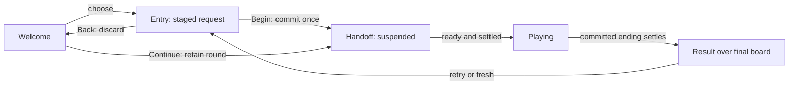
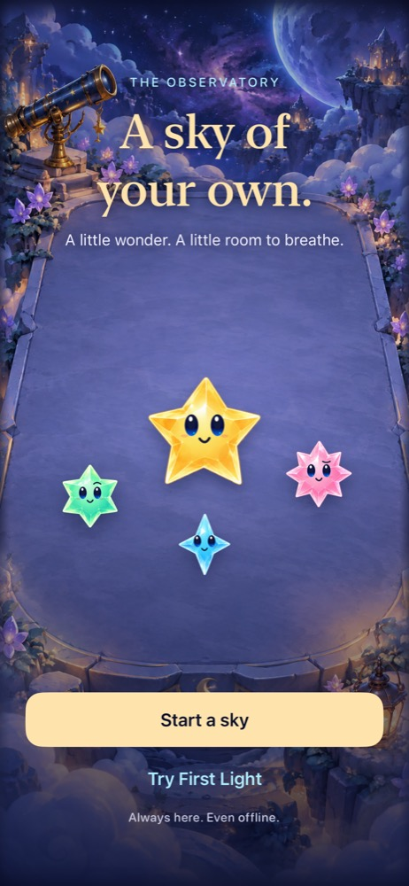

# Continuous screens with safe beginnings and understandable endings

**Status:** Accepted · **Owner:** Current implementer · **Updated:** 2026-10-17

Make launch, Welcome, Entry, gameplay and results feel like one continuous Observatory. Stage new-round choices until Begin, preserve intentional pause on return, and explain the committed outcome before offering another sky. Retain the selected overlapping cast reveal and existing core, renderer and single-deadline clock.

**Decision:** Use a small typed presentation state and one cancellable handoff, an explicit dark launch surface, and value snapshots for entry/result content. No campaign, fake loading progress, mandatory splash delay, rule/RNG change or core-save migration.

**Next action:** Follow the [remaining RC matrix](../SCREEN_FLOW_PLAN.md) before release. Launch, cancellation, handoff, result, bounded-arrival and home/preferences code is implemented and passed development candidate checks. This design extends the [adopted sky-flow contract](SKY_FLOW.md); implementation proceeds in verified batches; [current results](../evidence/screen-flow-polish-2026-10-17/README.md) distinguish delivered work from remaining proposals.

## What the player experiences

| Situation | Implemented behavior |
| --- | --- |
| Launch | A dark surface immediately precedes the Observatory; the first app frame is also opaque dark. Welcome becomes usable without an artificial wait. |
| Fresh Welcome | Starfall identity, short invitation, Start a sky, First Light, and a compact Settings/Help entry. |
| Existing round | Continue sky is primary, with mode, score and whether automatic showers will run. A finished sky gets View last sky as a secondary action and Start a sky as primary. |
| Choose a new round | Entry previews the requested mode without replacing the saved round. Back cancels the selection. Begin commits once. |
| Begin | The entry panel/cast yield to the actual board over a short handoff. Input and the clock stay suspended until the handoff is settled and the scene is attached with usable geometry. |
| Continue | Reopen the retained board; preserve its in-memory pause choice. A restored process starts paused under the existing contract, with visible Resume sky / Next shower controls. |
| Win | Finish the real final clear, retain visual continuity with the board, show First Light complete and collected/18, then the existing happy-cast celebration. |
| Overflow | Finish the real final arrival, retain the stars, identify the blocked column gently, and explain “No room for the next star.” First Light also shows collected/18 and a challenge-specific retry. |
| Replay / fresh sky | Stage Entry again; no replacement occurs until Begin. Replay retains existing seed/challenge/balance/generation behavior. Fresh sky uses the existing ordinary-new-sky behavior. |
| Interruption | Freeze play immediately, cancel stale presentation work, and show the settled destination on return. Never replay a flourish or accumulate missed showers. |

Suggested Entry copy: “Clear connected matching stars worth 3 or more. Showers arrive automatically; pause anytime.” First Light additionally states “Gather 18 starlight before a column overflows.” Use one small three-star example when space permits. At accessibility text sizes, meaningful copy/actions precede decorative cast content; no forced scroll through a 220-point illustration to reach Begin.

## Code analysis and the boundary to correct

Analysis uses source `f35eba87311f5e9e56740b9677bceb699154e8ae` and the [adversarial review](../evidence/screen-flow-review-2026-10-17/README.md). Only review documents were dirty when this design began.

| Existing owner | Finding | Proposed correction |
| --- | --- | --- |
| `Config/Clean.xcconfig`, `StarfallApp` | Empty generated launch dictionary; runtime dark preference starts later. | Explicit static launch storyboard and one named dark asset, plus an opaque app-root fallback. |
| `FallingSkyView.prepareSky` / `handleFlowAction` | New/replay/challenge mutate the store and save before Entry. | Stage a typed request; consume it only at Begin. Separate Continue from Begin. |
| `FallingSkyStore.restart` / `startFirstLight` | Already own reset, save, ranking session and presenter work coherently. | Keep these synchronous commit boundaries; call them once at Begin rather than duplicating their constructors in a preview. |
| `FallingSkyStore.setSuspended(false)` | Saves and arms the clock; it is activation, not just visual state. | Call only after the explicit start/continue handoff is safe. Browsing Entry/settings must not activate the store. |
| `SkyFlowCeremony` | Entry reads `store.game.challenge`; after staging that would describe the previous round. | Supply an entry snapshot derived from the staged request. Results and Welcome receive their own narrow snapshots. |
| `FallingSkyView.showingCeremony` | One Boolean both suppresses game controls and hides board stars. | Separate board visibility from interaction eligibility and overlay presentation. Results keep the board visible with gameplay controls removed. |
| `FallingSkyScene` | Already prewarms cast; `didMove`, size changes and `onLayout` settle presentation. | Reuse current prewarm. Add only a narrow scene attachment/layout readiness signal if needed for handoff; retain layout settlement/generation guards. |
| `FallingSky.blockedColumn` | Failure reason already exists in committed Codable state. | Read it for a result snapshot and projected highlight. No transient-node inference or added result persistence. |
| `FallingSkyMenu` / theme | Existing native preferences/help and shared styles. | Extract shared preference/help sections for a Welcome settings sheet; do not reuse gameplay restart controls there or duplicate preference storage. |
| `SkyRankingSession` | Sidecar digest binds eligibility and pending result to committed core bytes. | Entry cancellation leaves both save keys untouched. Begin uses existing ranking reset/delivery logic exactly once. |

### Presentation state and ownership

Introduce an app-local `SkyFlowState` value in a focused file. Keep it owned by `FallingSkyView`; deterministic gameplay remains in Core. It contains the route and, where relevant, a pending entry request or a handoff token. It admits legal events and returns narrow effects for the view to execute. This makes cancellation and duplicate Begin testable without adding a multipurpose coordinator or copying the store into navigation.

An entry request distinguishes initial unplayed sky, fresh ordinary sky, same-sky replay and First Light. It carries stable identity plus only the values needed to describe the objective and selected balance. While Entry is open, the committed round is suspended and unchanged. Preserve the initial seeded sky on first launch; do not silently replace that established opening with random selection. For replay, retain the existing stored seed/generation semantics rather than reconstructing an approximation in presentation code.

On accepted Begin: consume the request and lock further entry events synchronously; commit through the existing store API while suspended; increment the environment generation only if the round changed; begin the handoff. A second tap or stale token cannot commit again. No rollback is needed: Back is available before Begin; once Begin commits, interruptions preserve that new committed round.

**Implemented state flow.** Result/Home return goes to Welcome retaining the committed sky. Backgrounding suspends every route; foregrounding settles presentation without choosing a new round. Pending requests are memory-only: termination at Entry discards the request and restores the previous committed sky behind Welcome.

### Pause and clock semantics

Begin starts a new round's automatic clock only when the handoff releases suspension. Continue preserves `isPaused`: running in-memory rounds resume with their retained remainder; deliberately paused rounds stay paused. Relaunch uses the existing paused restore, so Continue opens manual controls rather than silently changing it. Persisting the old process's running preference is deliberately out of scope.

Use a single computed suspension predicate: inactive scene, visible modal, nonplaying route, or an unsettled/unready handoff. Do not call `setSuspended(false)` optimistically to dismiss a menu. Preserve `rainGeneration`, presentation generation, the retained deadline remainder, and no catch-up behavior. Audit `togglePauseFromMenu` alongside the new navigation paths; its existing temporary release must not bypass a nonplaying-route or handoff suspension.

### Launch and real readiness

Add `LaunchBackground.colorset` with one fixed dark value in all appearances. A minimal `LaunchScreen.storyboard` references it; `StarfallTheme` resolves the same named color for the app-root fallback. Set `UILaunchStoryboardName` in the shared configuration and remove the competing generated-launch declaration. Verify effective Debug/Release plists and compiled resources. The first batch kept launch detail-free. Following the reported black-screen feedback, the accepted refinement adds a static Starfall wordmark using the shared named ceremony gold. The system storyboard cannot animate; a spinner appears only for genuinely pending in-app readiness and is omitted in quiet modes. Signed simulator validation is required because SplashBoard rejected the unsigned validation resource in the reproduced black interval.

Keep the SpriteKit scene attached across routes, as it is today. For handoff readiness, scene attachment and nonzero current layout are presentation facts only; they must never advance Core. Coalesce size/attachment notifications and reject stale scene generations. Do not treat `onAppear`, a sleep, or a decorative animation callback as proof of renderer readiness. Frame capture remains the evidence that readiness maps to visible output.

Begin commits immediately; the clock remains suspended during a proposed 200–300 ms handoff, shorter than the existing cast entrance. That timing is a tuning hypothesis. Use one owned cancellable task/token and a declarative settled-state transition; no chain of independent delayed callbacks. On interruption or quiet-mode change, finish at the settled destination without replaying the handoff. Resume the clock only when active, modal-free and actually ready.

If readiness fails to arrive within a bounded diagnostic interval (initially two seconds), retain the opaque scenery, show “Preparing your sky…” and a safe Back action, and record a local debug diagnostic. This is a fallback, not a mandatory loading screen. Back retains the committed sky; a late ready signal cannot reopen play. If measurements show readiness is immediate in this architecture, keep the fast path and avoid unnecessary loading machinery.

### Results, visuals and accessibility

Build a `SkyResultSnapshot` from committed game values: outcome, mode, score, target, showers and blocked column. Keep it valid after restore. Reuse `ObservatoryGeometry` for any blocked-column highlight; do not add a second coordinate mapping. Show failure cause without color alone, with no flashing red or punishment animation. The last board remains visible under a localized contrast scrim. Reposition/reduce the decorative cast so it supports the result instead of replacing its evidence.

Keep decorative cast arrivals inside an explicit formation region: short upward drift, scale and opacity settling replace the clipped offscreen flight. One formation owns positions and poses; verify complete raster/shadow containment including spring overshoot and inspect native normal-motion frames.

Keep result actions immediately usable. A proposed brief board emphasis may overlap the result reveal; it must not add an unskippable delay. First Light failure defaults to Try First Light again; ordinary overflow uses Try this sky again. Win keeps Start another sky and Play First Light again. Do not add reward tallies, invented best-score claims or ranking waits to completion.

Welcome retains the existing scenic composition and gold primary action, adds restrained Starfall identity and a compact native settings/help affordance, and uses a snapshot for saved-round context. Share preferences through the existing authoritative keys, including `calmEffects`; a second settings surface must not initialize another store or reset defaults. Keep network/authentication isolated from launch readiness and local round navigation.

Own accessibility focus for each screen's heading and menu return. Coordinate the existing result announcement with focus movement to prevent duplicate speech. Structural removal continues to exclude hidden board buttons. Quiet modes reach the same committed destination immediately; larger text reflows actions ahead of optional decoration. Full actual VoiceOver acceptance belongs at RC, with lightweight semantic/reachability checks per batch.

| Current Welcome | Current full-sky result |
| --- | --- |
|  |  |

**Implemented references, not proposed mockups:** current-source Welcome is Debug / Compact HUD QA / iOS 27.0; full-sky capture is the earlier SE3 / iOS 27.0 flow evidence. [Provenance and limits](../evidence/screen-flow-review-2026-10-17/README.md). The proposal adds identity, safe entry, continuous handoffs and a visible explanatory final board. Neither image proves those changes.

## Alternatives considered

| Option | Benefit | Cost / disposition |
| --- | --- | --- |
| Stage choices until Begin | Back becomes safe; no save rollback; existing commit API retained | Recommended; Entry must read the staged objective rather than the current game |
| Confirmation before every new round | Small local mitigation | Adds friction and still makes Entry/Back misleading; use only if staging proves infeasible |
| Copy and restore old saves on Back | Appears to cancel | Can replay ranking effects and leave sidecars inconsistent; rejected |
| New async loading/coordinator framework | Centralizes all work | Unnecessary scope for a local game; rejected |
| Keep every screen and add more animation | Low structural change | Leaves save, pause and outcome defects; insufficient |

## Acceptance and material risks

- [x] Entry/Back/termination leaves both core-save and ranking-sidecar bytes unchanged; Begin commits exactly once, including rapid taps and stale callbacks.
- [x] Rules, seeded outcomes, old-save continuation, First Light target and replay generation behavior remain unchanged.
- [ ] Launch video shows no captured white/blank frame across the agreed matrix; report capture frame rate and never claim universal device coverage.
- [ ] Full-motion handoffs retain scenery, finish the final turn, explain failure and keep one usable action surface; quiet modes preserve outcomes.
- [x] Continue preserves in-memory pause choice; fresh-process restore remains paused; menus/background never accumulate showers.
- [ ] Help/preferences are available before Begin; home and both results remain readable on small screens, maximum text and tablet orientations.
- [ ] Native geometry taps, development accessibility checks, then RC VoiceOver/device checks meet the [plan](../SCREEN_FLOW_PLAN.md).

The main uncertainties are physical launch/capture behavior, whether the blocked-column highlight is comprehensible on the angled terrace, and the feel of a 200–300 ms handoff. Resolve these with native recordings and observed phone use, not additional decorative code. Keep the existing environment and cast assets; new artwork and sound are unnecessary for the first pass. No permanent pilot route is proposed. If a visual comparison is needed, bound it to matched recordings and decide adopt/revise/remove before integration.
