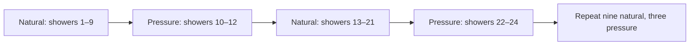

# Shower phases: preparation, pressure, recovery

**Status:** Extended isolated native comparison · **Owner:** Current implementer · **Updated:** October 17, 2026

**Recommendation:** Compare nine natural-only showers followed by three higher-column pressure showers against constant natural-only Shower Lab. Test whether an announced burst makes preparation and recovery more interesting.

**Decision already made:** The [offline comparison](../evidence/shower-phases-2026-10-17/README.md) supports one announced native trial. It found no substantial early-choice improvement; the proposed benefit is readable rhythm, which automated play cannot measure.

**Next action:** Compare the existing [Phase Lab](../evidence/shower-phases-native-2026-10-17/README.md) and [Surge Lab](../evidence/surge-native-2026-10-17/README.md), retain the [largest-text cue correction](../evidence/phase-cue-2026-10-17/README.md), and review threshold/growth instructions and remaining acceptance boundaries. An [agent-simulated comparison](../evidence/simulated-surge-playtest-2026-10-17/README.md) provisionally preferred Surge; human preference and actual VoiceOver remain unverified. These are isolated native trials, not production phases.

## What the player should experience

The isolated native trials present this sequence; production gameplay does not:

1. Natural showers give the player time to prepare. One shower before pressure starts, the HUD warns about the upcoming burst.
2. Showers 10–12 use the pressure selection rule. The HUD names the phase and shows how many pressure showers remain.
3. When the next forecast returns to natural showers, the HUD announces recovery. The sequence repeats: the next burst is showers 22–24.

Use words and a non-color signal outside the board; rings around stars are insufficient. Do not imply every pressure shower will hit a tall column. Keep the cue readable within the [compact HUD](../evidence/compact-hud-2026-10-17/README.md), which no longer shows the exact forecast strip.

**Scope:** One survival-round comparison. No campaign, unlocks, separate levels or event framework. First Light remains the only fixed objective and is unchanged.

## The HUD the trial must fit

**Existing native reference, not a phase mockup:** October 17 compact-HUD candidate, iPhone 17e / iOS 27.0 Simulator; [source and checks](../evidence/compact-hud-2026-10-17/README.md). There is no phase warning or count in this capture. The design task is to make those cues readable without crowding the board or rebuilding the removed forecast strip. The [Phase Lab captures](../evidence/shower-phases-native-2026-10-17/README.md) show warning/burst/recovery at their own tested source; they do not validate a later candidate or actual VoiceOver.

## Why test this approach?

| Option | Benefit | Cost or uncertainty | Disposition |
| --- | --- | --- | --- |
| Constant natural-only showers | Simple, established lead comparison | No deliberate pressure/recovery rhythm | Baseline |
| Constant higher-column pressure | More sampled choices involving tall columns | Cold-opening limitation; human preference unknown | Retain as comparison |
| Nine natural + three pressure | Bounded rhythm without the rejected broad-pairing survival extension | More HUD information; no demonstrated early-choice advantage | One announced native trial |

In the source-bound clear-all sample, multiple-choice decisions were 11.6% for natural-only, 12.0% for constant pressure and 11.5% for bursts. First-group play found a choice by shower twenty in 159/200 burst rounds versus 160/200 for both constant candidates. These figures justify testing comprehension and rhythm, not claiming better gameplay. See [the complete comparison and denominators](../evidence/shower-phases-2026-10-17/README.md).

## Schedule and ownership

**Candidate schedule:** Count committed showers, not elapsed time. Manual and automatic advances consume the same sequence; clears, pauses and wall-clock time do not advance it.

The candidate rule selects the phase when it generates the next preview. That committed preview retains its phase through clears and restoration. Presentation communicates the committed forecast; animation callbacks never choose the phase or advance the schedule.

Opening, dry-board relief, Dusk cadence and eligible-column limits retain their existing candidate behavior. Pressure selection falls back when no eligible column exists. Terminal states remain frozen; production and First Light outcomes stay unchanged.

**Save boundary:** The offline tool uses the same frozen baseline as the other shower labs. Its candidate marker does not distinguish their algorithms. Never import saves between labs. A native export needs its own isolated save suite and bundle. Existing continuation checks do not establish cross-candidate replay/new-round compatibility.

## Acceptance before deciding on adoption

Offline schedule/replay checks passed at the [recorded source](../evidence/shower-phases-2026-10-17/README.md). The following native-trial criteria remain open; those results cannot be inferred from the offline pass.

| Area | Observable acceptance and method |
| --- | --- |
| Rules and saves | Check boundaries 9/10, 12/13 and 21/22; clears and save/restore preserve committed previews. Existing baseline saves continue exactly; terminal states freeze. Production and First Light remain unchanged. Retain deterministic regression checks. |
| Input and interruption | Automatic deadline and manual advance commit each phase once. Exercise pause, Settings, background/resume and restart: no skipped phase, duplicate advance or catch-up burst; pending forecast identity survives applicable interruptions. |
| Cue comprehension | A player identifies the upcoming phase, one-shower warning, burst count and recovery. Cues describe the committed forecast without guaranteeing a tall-column hit. |
| Accessibility | Native labels expose phase, warning and count; actual VoiceOver announces transitions without chatter. Inspect largest Dynamic Type, non-color cues and full touch targets. |
| Visuals and motion | On a real simulator, inspect full-motion entry, pressure and recovery, plus system Reduce Motion. Dense boards remain readable; cues neither obscure input nor imply a phase change before the forecast changes. A still capture cannot close motion acceptance. |
| Observed play | Compare matched seeds in paused/manual explanation and normal automatic play. Ask whether the player prepared a different clear and whether recovery felt distinct. Record preference, counterexamples and failures; seed scores cannot establish enjoyment. |

Retain source, working-tree differences, commands/procedures, configuration, simulator/OS and results in a [report](../templates/REPORT.md). Distinguish simulator, actual VoiceOver and physical-device evidence. Physical-device phase behavior remains unverified and is part of the broader [shipping gates](../ROADMAP.md#shipping-gates--all-remain-open).

## Decision after the trial

**Adopt, remove, or extend for one named unresolved question.** The [experiment register](../EXPERIMENTS.md) owns the status. Do not promote the phase rule solely because it compiles or preserves replay.

- **Adopt:** If observed play supports preparation/recovery and the relevant acceptance checks pass, version or migrate the generation contract in the authoritative core and remove the temporary lab route.
- **Remove:** If the rhythm adds confusion or no useful distinction, remove the temporary native trial and record the result.
- **Extend:** Name the missing evidence, owner, bounded remaining work and next decision point. Do not keep a pilot indefinitely.

The main design risk is information overload: the current HUD intentionally removed forecast detail. Test the smallest readable warning and count before adding more indicators. Separate levels remain a later question, outside this trial.

## Pressure exposure question

Measure whether pressure actually changes delivered forecasts using a preparation counterfactual from the identical pre-generation state/RNG. Verify that observation preserves every sampled committed state and outcome. Count generated previews separately from delivered showers. A timed cue without a changed arrival pattern is insufficient evidence of a distinct phase.

If the original pressure rule rarely engages, compare one offline density variant: retain nine preparation showers, but generate five stars in each of the three pressure showers. Keep dry-board relief and First Light exclusions; do not change the opening or any already announced forecast. This tests whether a bounded increase in arrivals creates a measurable response opportunity without the broad-pairing candidate's excessive survival extension. Before any native export, compare delivered exposure, survival/censoring, choices and deterministic/save checks against the original burst and natural-only candidates. A changed forecast alone still does not establish interesting choices or enjoyment. Do not change the current native lab's save contract silently.

The [exposure comparison](../evidence/burst-exposure-2026-10-17/README.md) found a changed first-burst forecast in only 36/200 original-policy rounds versus 200/200 for the density variant. The latter also extended automated survival, so its next playable framing is a **star surge**, not a promise of higher difficulty. Native cue-flow validation of the original burst does not validate this new rule.
