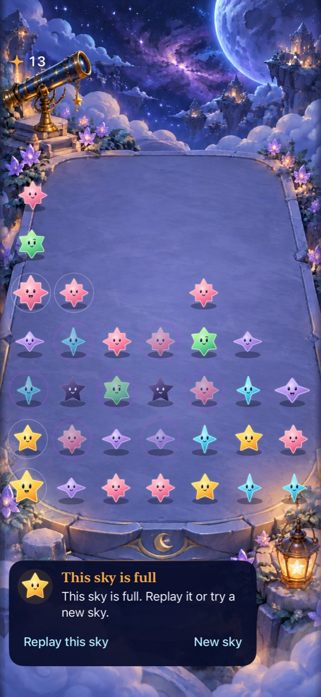

# An explicit beginning and ending for each sky

**Status:** Accepted · **Owner:** Current implementer · **Updated:** 2026-10-17

Implement the user-selected overlapping reveal in the existing Observatory. Welcome offers a new sky, First Light, and Resume when a valid local sky exists. Entry states the objective and waits for Begin. First Light wins celebrate gathered light; overflow ends gently. Replay preserves the seed/challenge; another sky opens an ordinary fresh sky. No campaign, currency, unlocks or new service work.

**Decision:** Decorative cast stars settle over roughly 650–850 ms; actions emerge after 360 ms, overlapping the final bounce. Reduced Motion, Calm effects and VoiceOver present the settled state immediately. Backgrounding settles the ceremony rather than replaying it.

**Next action:** Review physical-iPhone timing and complete RC VoiceOver acceptance. [Native results and limits](../evidence/sky-flow-2026-10-17/INTEGRATION.md) record the implemented flow.

## Ownership and acceptance

The view owns welcome/entry routing and decorative reveal state. The existing store owns the committed sky, save, clock and pause choice. Nonplaying screens suspend the store. Animation callbacks never start a shower or change a score. Existing Codable state/RNG remain unchanged; restored games start behind Welcome and cannot advance until Resume.

- Welcome/entry never advance showers; Begin/Resume is explicit and cannot double-start.
- Terminal presentation waits for the committed final turn to settle. Actions do not wait for the decorative flourish. Full skies never flash red or punish the cast.
- Replay/new/challenge from menu or ending return through Entry. Returning to Observatory retains the current sky.
- Background, dismissal and motion-preference changes cancel reveal work; old work cannot reveal controls on a replacement screen.
- Verify unchanged core/save tests, focused native routing/interruption tests, Debug and Release, normal/reduced motion, large text and semantic controls. Actual VoiceOver/device acceptance remains a release-candidate check.

Historical native reference: Observatory adoption capture; the new welcome and ceremony are not present in this image. New implementation evidence belongs in the sky-flow report.
