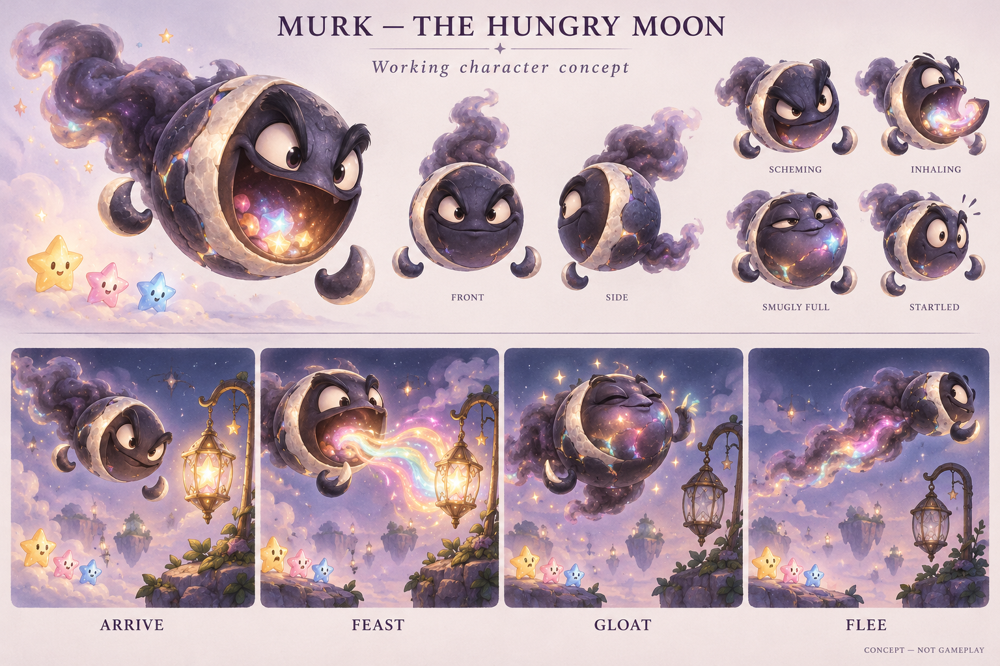

# Starfall — game bible

**Status:** Approved world and villain foundation; developed lore and story draft · **Owner:** Current implementer · **Updated:** October 19, 2026

**A journey to bring the light back.** Murk, the Hungry Moon, has swallowed the starlight from twelve little places. Help the star cast bring them back to life, follow his trail across the sky, and return the light he has hoarded.

The user approved **Murk as illustrated and all twelve map locations**. This rewrite develops their universe, relationships and story. New lore, character behavior and the ending below are authored proposals within that direction. Lantern Landing supplies First Light; Ribbon Crossing is the implemented second optional challenge, with verified development evidence and canonical installation. [Kite Harbor](kite-harbor-03/PRODUCTION_PLAN.md) is the implemented third bounded challenge, with [verified development evidence](../evidence/kite-harbor-2026-10-19/README.md); merge and canonical installation are verified. The other nine locations and map traversal remain concepts. This document remains the creative authority for the proposed universe and replaces the original crystal-puzzle premise.

**Read next:** [World atlas](WORLD_ATLAS.md) for each location’s life, appearance and distinction; [map explorer](world-01/index.html) for sixty restoration state notes; [restoration contract](STARLIGHT_RESTORATION.md) for the win and presentation boundary. **Delivered first slice:** [Lantern Landing](lantern-landing-01/README.md) restores through five states in First Light, with [native development evidence](../evidence/lantern-landing-2026-10-19/README.md) at source `8fb2e78`, runtime `dev.5afe4a3c23`. Merged in [PR #154](https://github.com/lbeezr/starfall/pull/154); the canonical updater verified installation of `dev.5afe4a3c23` from main `ab868b5` in the original `com.starfall.prototype` app on October 19 at 14:53:57 UTC. **Delivered second slice:** [Ribbon Crossing](ribbon-crossing-02/PRODUCTION_PLAN.md) is merged and installed in the original app. [Development evidence and receipt](../evidence/ribbon-crossing-2026-10-19/README.md) cover all fifteen inspected states, phone/tablet interaction, normal/quiet completion, final hosted/Release passes and canonical installation. Human satisfaction, Murk’s opening theft and the campaign story remain unverified proposals.

[Universe](#a-universe-on-a-neighborly-scale) · [Cast](#the-star-cast-carries-the-journey) · [Murk](#murk-the-hungry-moon) · [Journey](#the-twelve-location-journey) · [Story](#the-chapter-story) · [Puzzle](#the-puzzle-and-story-must-agree) · [Art and sound](#how-it-should-look-move-and-sound)

## The experience we promise

The player arrives somewhere that ought to be wonderful. A lantern cannot welcome anyone, a bridge cannot carry its neighbors, or an orchard cannot sing. The place still shows enough of its former life to make its absence felt. Stars tumble in, faces brighten, and each useful clear sends a little life back into the scene. At the end, something happens that could not happen at the beginning.

The pleasure has three parts: **I made a good puzzle choice. I helped these characters. I can see what my work accomplished.** A progress counter supports that feeling; the restored place makes it memorable.

| Pillar | What it asks of the game |
| --- | --- |
| Small places worth caring about | Give each realm a daily purpose, a recognizable landmark and evidence that someone belongs there. |
| Light shared through play | Connect committed puzzle progress to useful, legible environmental changes. Stars are willing helpers. |
| An achievement with an ending | Announce the job, let the player anticipate its finish, and complete it with a distinctive local event. |
| A playful journey through a coherent night | Keep the tactile cast, warm humor and readable miniature worlds together across changing materials and moods. |

The tone combines quiet wonder with comic adventure. Concentration can have stakes without becoming frantic or punitive. Gloom is a temporary loss of warmth and activity. Restored night remains night: moonlight, cool shadows and peaceful darkness are beautiful parts of this universe.

## What is settled and what this rewrite develops

| Status | Direction |
| --- | --- |
| **User selected** | Starlight restoration as the story and win direction; Murk’s existing Hungry Moon design; the map and all twelve locations; concise theatrical villain appearances; connected miniature realms. |
| **Existing approved cast** | Spark, Sunny, Pip, Twinkle, Nova and Dusk in their Crystal Glow identities. Production shapes and materials remain owned by the [cast contract](star-cast/README.md). |
| **Implemented first slice** | Lantern Landing in the existing First Light challenge: 18 starlight, five score-derived scenes and bespoke phone/tablet compositions. This adopts no campaign or new save schema. |
| **Implemented, development-verified and delivered second slice** | Ribbon Crossing uses the same seed-42 opening and 18-light rules. Source-bound evidence covers all fifteen scenes, phone/tablet interaction, normal/quiet completion and final hosted/Release passes. Canonical installation is verified. Open sky remains the default. |
| **Implemented, development-verified and delivered third slice** | Kite Harbor uses the same seed-42 opening and 18-light target. Boats and sails restore in five complete paintings per viewport family; the final fleet is buoyant and ready to leave. Actual world travel belongs to future user-generated clips, not this implementation. |
| **Developed here** | A lived-in neighborhood of stars; how light circulates; everyday culture; each cast member’s story role; Murk’s hoarding motive; four-act story and chapter ending. These details are proposals for continued development. |
| **Open** | A separate recurring hero, targets and pressure beyond First Light, campaign milestone pacing and scene timing, voice/music production and campaign save behavior. |

The user suggested that the destinations might be where the stars live. This bible develops that idea as **homes and shared places**: gardens, docks, crossings, workshops and gathering spaces belong to the same community. It does not assign an exclusive birthplace or level to each color family.

The earlier exploration of a non-celestial villain is superseded by the explicit choice of Murk. A separate hero remains possible; the ensemble can carry this chapter without waiting for another character design.

## A universe on a neighborly scale

### The sky is a place to live

Starfall’s sky is an archipelago of small inhabited realms suspended among cloud banks, moonstone and deep blue space. A realm is large enough to have a life of its own and small enough to recognize as a single silhouette. Distance feels like a journey between villages, gardens and harbors, even when the route crosses a sea of stars.

The map depicts one connected neighborhood within a larger universe. It does not need a named empire, a royal family or a cosmic creation myth. The places feel older than this particular adventure: a polished handrail, a repaired sail and a fruit basket tell us people have cared for them before.

The realms share gravity within their little landing places. Between them, stars can drift on local currents; boats, bridges and the ferry carry groups safely across longer gaps. Floating does not mean every traveler can instantly reach every destination. Murk’s comet-like flight lets him range ahead, while the cast restores the communal routes behind him. This is the fiction behind the journey, not a new movement simulation.

### What starlight does

Starlight is the warmth that lets this world express its character. In a lantern it welcomes; in a seed it encourages growth; in a mill it becomes useful motion; in a bell it becomes a voice. Materials guide it differently: cloth carries it along stitches, roots along veins, glass through reflections and copper along channels.

Living stars carry a small glow of their own and willingly share it. Matching gathers that glow into a useful release. A star that helps does not die, shatter into a soul or become fuel. Story animation should let the helper lift, tumble or drift out of the active space while its light travels onward. The current clear effects are implementation history; any new treatment requires its own motion proof.

Light circulates between inhabited places. Tending a garden, keeping a lamp or repairing a channel helps it continue. This is a simple story rule, not an economic or scientific system. Nobody pays light to enter a stage, buy a repair or maintain a home.

Murk removes the light already held in a place and interrupts its circulation. He leaves the underlying form intact but dormant: ribbons sag, color retreats, mechanisms fall still and living shapes curl inward. The stars retain enough personal glow to begin helping. Their work restarts each local place; the final return of Murk’s larger hoard reconnects the whole neighborhood. Earlier victories are complete and real before the finale.

### Darkness belongs here too

Murk’s wrongdoing is taking what others need and refusing to share it. His dark body is not proof of evil. Dusk belongs to the friendly cast; Night’s Edge is worth restoring without turning it into daylight. Quiet, shadow, winter and sleep have healthy places here.

Depict damage as understandable interruption. A loose seam, closed bud or stationary water thread gives the player a concrete job. Avoid devastated villages, frightened captives and residents whose distress punishes a failed attempt. The stars are disappointed and determined, then delighted by small successes.

### How the community lives

The stars gather in sheltered nooks beneath canopies, around warm lanterns and beside familiar workspaces. They use ribbons to mark routes, hang little lights at welcomes, send parcels by kite boat and recognize places by their sounds. A repaired object can remain charmingly patched; restoration does not erase its history.

Show inhabitants in small readable groups rather than filling every terrace with NPCs. A waiting traveler, a gardener checking a bud or two friends watching a ferry is enough. These are story and art roles, not quests, dialogue trees or collectible characters. The first chapter needs no new named supporting cast.

## The star cast carries the journey

**Existing native cast reference:** renderer export at source `6cc9efd`, iPhone 17e / iOS 27.0. [Verification limits](../evidence/crystal-glow-integration-2026-10-17/README.md). This establishes existing visual vocabulary, not new story animation. The personalities below extend the approved appearance cues as proposed writing direction.

| Character | Story personality and useful action | Comic vulnerability | A moment to develop |
| --- | --- | --- | --- |
| **Spark** | Curious, quick to notice an opening and eager to see what lies beyond it. Often looks toward the next destination first. | Starts moving before checking that everyone is ready. | In a future travel cutscene at Ribbon Crossing, leans toward the gap, waits, then takes the first step after the repair. |
| **Sunny** | Welcoming and encouraging. Makes a strange place approachable and notices when someone needs company. | Tries so hard to reassure everyone that a surprise catches the smile mid-sentence. | At Lantern Landing, invites the others into the first warm circle. |
| **Pip** | Practical and inquisitive. Examines how things fit, trying a small adjustment before a grand gesture. | Gets absorbed in a tiny detail while a large change unfolds behind them. | At Sunwheel Mill, follows a cold channel, then discovers the whole wheel moving. |
| **Twinkle** | Attentive to mood and beauty. Notices the first returning color or a neighbor’s small achievement. | Hangs back to admire something and has to hurry after the group. | At Silver Pools, sees the first reflection and draws the others close. |
| **Nova** | Unhurried and observant. Notices patterns after watching them settle. | Occasionally rests in exactly the spot everyone is about to use. | At Bell Choir, opens sleepy eyes just before the final chime answers. |
| **Dusk** | Mischievous and comfortable in shadow. A playful member of the same friendly group. | Enjoys a harmless surprise and sometimes startles themself. | At Aurora Falls, peeks from a dark arch, then joins the others beneath the colors. |

These behaviors should read without dialogue. They are not abilities, exclusive level solutions or bonuses. Any family can help any place. Avoid a single repetitive gag: Sunny can worry, Nova can act quickly and Dusk can be tender.

The names act as recognizable faces of the family ensemble. Board pieces need not each receive a biography, and repeated family appearances do not imply a cloning plot. If unique named story leads and background family members are distinguished in production, establish that visually before writing individual histories.

**Dusk and dark stars:** the existing obstruction is a puzzle rule, not evidence that Dusk serves Murk. Do not depict a neighboring clear as hurting a friendly character. The eventual restoration-story animation should show a safe departure or release; current retained Dusk rules remain unchanged. No redemption mechanic, family conversion or revised score is implied.

### Does Starfall need a separate hero?

A recurring traveler could give future games another point of view: someone who befriends the stars, notices local needs and has a recognizable approach to problems. Their personality should work away from this particular light crisis. A curious, generous helper would give Murk’s possessive appetite a useful counterpart.

For this chapter, the stars already have agency and the player’s choices cause restoration. A new hero could join later, but should earn a role before occupying every screen. No species, name, costume or hero artwork is selected. Keep Murk’s approved design intact while that separate question develops.

## Murk, the Hungry Moon

**User-approved character concept, October 18 — not a production rig or gameplay capture.** Preserve this design. The original [built-in image prompts](world-01/prompts.json) and image remain unchanged. The map cameo is a smaller, sharper interpretation; use this sheet for close performance and consistency.

### His desire and his mistake

Murk loves beautiful light. He thinks a beautiful thing becomes more satisfying when it belongs entirely to him. A glowing lantern delights him; then he notices the next glow and wants that too. He confuses collecting everything with having enough.

That motive supplies mischief without an elaborate tragic origin. He understands that he is taking something, and his furtive glance makes the theft intentional. He cares more about his next mouthful and grand appearance than the place he leaves behind. Keep him funny without making the harm invisible.

He becomes smugly larger as stolen colors collect within his moonstone body. At Hollow Crown, he has occupied an existing communal light reservoir and gathered excess light there. He treats its broken ring as a throne and its contents as his private treasure. He did not create the world or secretly build all twelve places.

### Preserve his recognizable shape

Keep the lopsided charcoal-violet orb, asymmetric pale crescent rim, detached crescent hands, strong brows, expressive eyes, greedy expandable mouth and soft smoky tail. His body feels solid; the tail supplies loose movement and traces his departure. Stolen colors inside him are the visual record of his behavior.

His scale can expand for a gloat or finale composition while the silhouette stays readable. Do not add a wizard costume, weapons or a monster transformation to make later scenes feel bigger. The existing face supports vanity, appetite, irritation and alarm.

The glowing shapes inside his mouth in the concept are light, not captive helpers. Production staging must make the source clear: the ribbon comes from a lamp, fruit or reservoir while the living cast remains visibly safe outside. This clarifies the acting without redesigning him.

### His performance vocabulary

| Beat | Character action | Variation across the journey |
| --- | --- | --- |
| **Arrive** | Glides in as though the place has been waiting for him; notices the most appealing glow. | A broad introduction; later a furtive peek or an attempt to arrive unnoticed. |
| **Feast** | Reaches, inhales and gathers light into his mouth with greedy concentration. | A lantern’s long ribbon; a tempting fruit; an interrupted attempt later. |
| **Gloat** | Closes his eyes, pats his bright belly or displays the glow as his accomplishment. | Satisfaction becomes irritation when repaired places shine behind him. |
| **Flee** | Leaves with a smoky flourish, spoiled by a backward glance or startled hiccup. | Confidence gives way to hurried attempts to hide the hoard. |

Communicate each scene in a few clear actions. Do not replay a complete theft everywhere. The user’s Kamek reference informs the brief entrance, unmistakable act and exit; our character, movement and setting remain original. [Reference provenance](STARLIGHT_RESTORATION.md#kamek-reference-a-brief-entrance-with-a-clear-consequence) distinguishes the user’s observation from source research.

Murk is absent during ordinary puzzle play in the first restoration comparison. No random sabotage, stolen player score or boss attack is implied. His presence comes from the trail, transition glimpses and comic responses to progress.

## The twelve-location journey

**User-approved world concept — not runtime map UI.** The illustration mostly shows restored destinations. Miniature helpers are placeholders; production uses the approved cast. Lantern Landing has five implemented artwork states in three viewport families; Ribbon Crossing also has five implemented states in three viewport families. Kite Harbor also has five implemented states in three viewport families, with source-bound development acceptance; canonical installation is verified. The other nine locations retain concept art and written storyboards. The [atlas](WORLD_ATLAS.md) develops the places; the [explorer](world-01/index.html) presents their written restoration sequence.

The map holds **twelve levels total**, grouped into four regions of three. Each region establishes a material and emotional language; every location has a different purpose and final action. This does not imply twelve larger worlds with additional unplanned level sets.

| Region | Locations, in route order | How the journey changes |
| --- | --- | --- |
| **Soft Skies** | 01 Lantern Landing → 02 Ribbon Crossing → 03 Kite Harbor | Find a welcome, reconnect neighbors and set out together. |
| **Wild Moons** | 04 Seed Moon → 05 Silver Pools → 06 Frostfruit Orchard | Discover that the loss reaches growing and living places. |
| **Clockwork Belt** | 07 Sunwheel Mill → 08 Bell Choir → 09 Starferry Station | Recovered places begin answering and supporting one another. |
| **Night’s Edge** | 10 Aurora Falls → 11 Petal Beacon → 12 Hollow Crown | Find the hoard, restore its circulation and complete the return home. |

The proposed route is linear and readable. A finished landmark lights its outgoing connection; the next destination follows from the local payoff. Clear reachable/in-progress/restored labels and shapes support color. An accessible location list mirrors the illustrated selection.

Completed places stay restored. The player may revisit the finished scene or explicitly replay its restoration as a reenactment. An unfinished attempt can resume committed progress; retry restarts that attempt without showing homes destroyed again. Campaign persistence and migration need specification before implementation; this is not an implemented save contract.

## The chapter story

### Opening — the light goes missing

Start close, at Lantern Landing. A few stars prepare an ordinary welcome: a lantern glows, a ribbon stirs and a traveler approaches. This small activity makes the loss legible without explaining the universe.

Murk appears above the lantern. He admires it, checks whether anyone is looking, and draws its glow into a colored ribbon. The lantern goes quiet; pennants hang. He savors the new colors, gives a self-satisfied glance and departs along a smoky arc. The stars remain safe beside the dim dock.

Sunny gathers the group. Spark notices a small glimmer still inside the lantern. The first shower brings helpers to the landing surface. The player sees one concrete job: **Bring the lantern back to life.** Entry waits for Begin; the first useful clear produces a small response. A lengthy prologue would weaken this connection.

### Act I — we can help

Lantern Landing teaches the emotional rule: the player’s actions bring warmth back. Ribbon Crossing turns warmth into connection. Its final seam reconnects the banks, making the next destination reachable in the story. A future generated travel clip can show the cast using that route; the current puzzle finishes with its restored image and normal result. At Kite Harbor, shared success makes departure possible: sails open and boats lift gently above their berths. The in-game final painting shows a buoyant fleet ready to leave; a future generated clip can carry the cast toward Wild Moons. No departure clip or traveler animation is implemented.

Murk catches sight of the fleet. He looks back at the light behind it, briefly confused that anything he drained could shine again. His composure returns, and he hurries ahead. The cast has both a reason to travel and evidence that its help works.

### Act II — these places are alive

Seed Moon changes the scale of care. A closed seed becomes shelter rather than another machine to switch on. Silver Pools connects individual successes into a continuous flow. Frostfruit Orchard brings back a winter community’s gentle sound and drifting seeds, preserving its cool identity.

The cast does not chase Murk past places that need help. It pauses, notices and restores them. That repeated choice defines the ensemble. At the orchard Murk tries for a newly glowing fruit; its returning chime surprises him into a hurried exit. His greed interferes with his dignity.

### Act III — the neighborhood answers

At Sunwheel Mill, restored motion sends a useful golden pulse onward. Bell Choir answers with a shared phrase. That answer wakes Starferry Station’s departure star. The next restoration then raises its canopy and completes the route across the wider gap.

This is the story’s turn: the stars are no longer a tiny group following a trail through isolated damage. Places they have helped are visibly connected. The ferry departure echoes the smaller kite launch through a broader silhouette, steadier motion and a view of lights behind them. It celebrates accumulated work without adding a second objective to the local win.

### Act IV — let the light go

Aurora Falls gives a breath after the ferry crossing. Movement returns to a wide curtain of color; restored night feels expansive and peaceful. Petal Beacon narrows that wonder into direction. Its opening lens reveals Hollow Crown and Murk’s hoard.

Murk tries to conceal the glow behind his round body, then realizes it escapes around him. The joke communicates the situation immediately. He retreats into the reservoir, clutching at everything he has gathered.

At Hollow Crown the player does what the journey has taught: restore a place so it can work. The final task repairs the reservoir’s ring and circulation. Murk’s defeat follows from that restoration; it introduces no combat system.

### Finale — a complete return

The proposed ending has six readable beats:

1. **The final clear commits the win.** Showers stop and the last missing segment settles. The player already succeeded.
2. **The reservoir opens.** Trapped colors separate into outward streams. The light belongs to the whole scene, not a score fountain.
3. **Murk loses his hoard.** As the stored glow returns to circulation, his inflated posture subsides. He tries to keep one last wisp and hiccups it free. He remains the same recognizable moon.
4. **The map answers.** Briefly echo the actual places: moving vanes, answering bells, fruit lanterns, sails and the welcoming dock. Prior repairs remain intact.
5. **The cast gathers.** Return the emotional focus to Lantern Landing, where the welcome can now happen. A few arrivals or shared looks complete the opening’s interrupted activity.
6. **The player can stay.** Settle on the restored map with revisit and replay available. Let a final quiet image breathe.

Recommended last Murk beat: he drifts away looking back, embarrassed, with a faint hiccup in his smoky trail. His escape takes no light from the restored map. This closes the conflict while leaving his personality available for another story; a sequel cliffhanger is unnecessary.

His redemption is not required. Nor must he be destroyed or revealed as secretly good. The chapter ends because the neighborhood has its light back and the player can see the result.

### Vignette plan

| Placement | Essential story information | Scale |
| --- | --- | --- |
| Before 01 | Murk steals; the cast chooses to help. | Full introductory four-beat theft. |
| After 03 | Their work succeeds; Murk notices. | Brief reaction during departure. |
| At 06’s completion | Life returns; greed makes him comic. | Failed snatch and startled retreat. |
| After 08, optional | The world becomes cheerful behind him. | Irritated listening reaction; omit if pacing feels crowded. |
| At 11’s completion | The hoard and destination are revealed. | One attempt to hide it. |
| After 12 | The light returns and the journey is complete. | Short authored finale and settled endpoint. |

Exact durations need animatic testing. Ordinary entries use a local need and a cast reaction; they do not all require Murk footage. Skipping or quiet presentation reaches the same stage, objective and completion. Replays enter promptly. No story callback awards points, unlocks a stage or advances showers.

## The puzzle and story must agree

The proposed level objective is **collect the announced amount of starlight to complete this place’s restoration before the playable space overflows**. Pause/manual play remains supported in the first comparison. Author exact goals and pacing after demonstrating useful choices; First Light’s existing target of 18 is not a universal campaign target.

Progress is one truthful value. A clear contributes to the goal; the environment presents it. The player does not spend earned light on separate repairs, tap every prop, fill hidden sub-meters or empty the board to claim a win. A large finishing clear may pass several visual checkpoints; excess score must not invalidate success.

The five review states are **need → response → change → near-completion → purpose restored**. The explorer labels them 0/25/50/75/100%; these are storyboard checkpoints, not locked numeric gates. Life should return between major events. The final event remains worth reaching after the middle is already attractive.

| Layer | Role in the experience |
| --- | --- |
| Puzzle choice | Creates a committed result: light gained, room made or a useful configuration preserved. |
| Immediate response | A clear, expression and restrained light transfer make the action responsive. |
| Restoration | A seam joins, a root reconnects or a mechanism moves as the job advances. |
| Completion | The location performs its distinctive final action, then stays satisfying at rest. |
| Journey | The completed place and connection remain visible on the map. |

Restoration cannot supply strategy missing from the puzzle. Assess whether players understand a choice, anticipate the finishing clear and want another round. Simulated balance samples and passing builds are not evidence of satisfaction.

### Current implementation is a separate baseline

The app remains the falling-sky prototype with accumulating stars, automatic showers, pause/manual advance, matching growth, Opal, storms and local settings. Automatic aging is disabled; historical Dusk rounds retain their rules. Open sky stays the default, and its five native nightscapes remain separate from the future story map. First Light revives Lantern Landing through five scene states; Ribbon Crossing is the second directly selectable challenge. All three retain seed 42, the fixed 18-light goal and existing overflow rule, with no campaign or unlocks. Ribbon has source-bound development acceptance for its scenes, phone/tablet interaction, completion, builds and canonical installation. Kite Harbor extends that same boundary as the implemented, development-verified third optional challenge; merge and canonical installation are verified. The original 7×7, 70-jewel/18-move puzzle remains Debug material; its move limit and shard terminology do not define this journey. [Current product instructions](../../README.md), [mechanics adoption status](../EXPERIMENTS.md) and [validation](../VALIDATION.md) own live implementation facts.

Constellation tracing, swaps, recipes and other current mechanics follow their own adoption evidence. A location’s purpose does not automatically add gardening, musical timing, water routing or boss attacks. This rewrite changes no source, build configuration, saves or app resources.

## How it should look, move and sound

### Shared visual language

Use the approved map’s miniature composition: clear silhouettes, solid rounded structures, hand-finished details, soft cloud supports and luminous materials against spacious blue-violet sky. Keep one coherent light and camera language. A realm needs a readable outer shape before decorative detail.

The actual Crystal Glow cast supplies a sharper, brighter focal point than most scenery. Test its real silhouettes early. Background star ornaments should not resemble selectable pieces at the same scale. The board remains dominant and controls readable from the darkest state onward.

Architecture uses recognizable tasks and domestic scale: a dock to wait on, a bridge to cross, a sheltered place to sit. Avoid interchangeable glowing temples. Hollow Crown can be grand because smaller places establish what its light supports.

| Region | Material and light | Characteristic motion and sound |
| --- | --- | --- |
| Soft Skies | Cream ceramic, rosewood, lavender cloth; honey-colored welcomes in cloud space. | Unfurling ribbons, lifting sails, soft fabric and warm wooden contacts. |
| Wild Moons | Rooted moonstone, mint water, translucent frost; light inside living or flowing forms. | Growth, connected streams, fruit sways; water and sparse glass-like chimes. |
| Clockwork Belt | Rounded copper, slate, timber and golden glass; light follows useful routes. | Turning, answering and departure; a slow mechanical pulse and rounded bells. |
| Night’s Edge | Dark glass, pale petals, silver stone and restrained prismatic color; healthy darkness remains. | Flowing curtains, opening forms and outward release; spacious air and a quiet musical return. |

These are creative sound and motion roles, not generated assets. The [atlas](WORLD_ATLAS.md) makes individual differences concrete; [current nightscape production](environments/night-production-09/README.md) owns the existing native scenery contract.

### Restoration changes behavior

Do not apply one saturation slider to every stage. At 0%, purpose is interrupted. At the first milestone, a small action becomes possible. The middle changes relationships or motion. Near the end, a remaining gap makes the finish understandable. At 100%, life continues beyond the celebration.

An orchard remains wintry; a pool remains cool; night remains dark enough to admire the stars. Completion returns function and character, not maximum brightness. The map should show different kinds of success.

### Animation and audio

**World travel is reserved for future generated clips/cutscenes.** The user removed the tiny walking characters from Ribbon Crossing; no travel clips are implemented. Its current finish uses the existing light packets, crossfade to the joined-seam image and normal result ceremony. Board stars and the usual ceremony cast keep their established roles. Other proposed travel scenes below and elsewhere in the story are future cinematic beats, not runtime requirements.

Keep weight in landings, readable faces and generous pauses between gestures. Murk’s floating hands and loose tail exaggerate intent; the stars’ compact bodies retain their shapes. Selective movement makes a scene inhabited without everything bobbing at once.

One clear has a coherent sound response, not one competing sound per star. Build from the existing warm contact direction; regional ambience adds identity at low density. A common short melodic idea could return in different materials and resolve in the finale. This is a composition brief, not a music system or recorded soundtrack.

Silence is complete. Every chime, warning, restoration beat and villain joke needs a visible equivalent. Calm effects and Reduce Motion retain the information and settled rewards with less travel and oscillation. Full animation in ordinary play remains part of acceptance; stills cannot establish it.

## Language and storytelling rules

Use concrete verbs and short invitations: **Light the lantern. Mend the crossing. Wake the seed. Let the water flow.** Pair local purpose with the measurable goal. Names should be memorable enough for a child to say and specific enough for an artist to picture.

Possible completion lines are “The crossing is open,” “The orchard sings again” and “The light is home.” These are proposed copy, not current UI strings. Avoid announcing the whole universe restored at the end of an early level.

Character sounds can be expressive breaths, delighted notes and small grumbles. Dialogue, if used, adds personality rather than explains what is already visible. The action should survive without dialogue; essential instructions and outcomes still require readable text and native accessibility semantics.

| Term | Meaning in this bible |
| --- | --- |
| **Star / star cast** | Living helpers and familiar families. “Starshard” belongs to the old crystal-puzzle premise. |
| **Starlight** | Shared light and the round’s progress; not currency, a soul or consumable inventory. |
| **Restoration** | Returning a location’s useful life through one completed puzzle objective. |
| **Realm / location** | One small place and one level in this chapter. |
| **Region** | Three related locations with shared atmosphere and pacing. |
| **Murk** | The Hungry Moon; he/him in this draft. Preserve the user’s final spelling and chosen design. |
| **Hollow Crown** | An existing communal reservoir occupied by Murk, not a hidden thirteenth location. |

## Production decisions and checks

This is a complete creative rewrite for the chosen foundation, not a declaration that all lore or production assets are approved. The first slice is implemented and development-verified; observe it in human play with the journey in view, and revise what does not work.

| Next deliverable | What it must answer |
| --- | --- |
| Observe delivered Kite Harbor | Its [bounded production plan](kite-harbor-03/PRODUCTION_PLAN.md) records development acceptance and canonical installation. Observe physical play and portrait contrast before RC accessibility acceptance. No traveler animation or campaign. |
| Observe the delivered restoration rounds | Ribbon Crossing’s [production plan](ribbon-crossing-02/PRODUCTION_PLAN.md) records bounded development acceptance and canonical installation. Observe physical play and dense-fixture interaction; complete actual VoiceOver acceptance at RC. |
| Observe the implemented Lantern Landing slice | Native scene/motion checks pass; can a player identify the need, distinguish useful middle changes and anticipate the final welcome? Physical play and RC VoiceOver remain unverified. |
| Opening theft and completion animatic | Do Murk’s intent, the stars’ safety and the player’s role read without dialogue? Is the approved design consistent? |
| Human play of First Light’s restoration | Is the target understandable, the finish earned and replay pleasant? Can the player explain a useful choice? Passing native checks do not answer these questions. |
| Regional comparison after that proof | Do silhouette, materials, motion and reward distinguish twelve places without twelve new rule systems? |
| Finale animatic | Does returning the hoard preserve earlier wins, resolve the story and leave a satisfying map? |

Choose hero involvement before scripting hero-dependent shots; settle save/retry semantics before campaign implementation; set targets after observable puzzle choices; match the map cameo to the approved sheet when making the first Murk production asset. The current implementer owns these follow-ups with user review of creative results.

Implementation must satisfy [restoration acceptance](STARLIGHT_RESTORATION.md#acceptance-and-decision-points) and the [current environment contract](environments/night-production-09/README.md): deterministic outcomes and saves, interruption safety, sparse/dense readability, native interaction, full/reduced motion and release-stage accessibility. No campaign, backend, purchases or monetization code is introduced by this bible.

## Authority and revision record

- **This bible:** current premise, lore, cast writing, Murk and story arc.
- **[World atlas](WORLD_ATLAS.md):** each place’s daily life, art direction and distinctive payoff.
- **[World data](world-01/world-data.js):** the explorer’s ordered records and exact five-state notes; update this owner when revising those notes.
- **[Restoration contract](STARLIGHT_RESTORATION.md):** progress, win, replay and runtime boundaries.
- **[Art package](world-01/README.md):** original images, provenance and explorer review.
- **[Roadmap](../ROADMAP.md) and [experiments](../EXPERIMENTS.md):** implementation priorities and adoption status.

October 18: the user approved Murk as made and all twelve locations, then requested this full lore, universe and story rewrite. The [October 16 mini bible](STARFALL_GAME_BIBLE-original-puzzle-2026-10-16.md) is preserved unchanged for its original puzzle and art references. Its prohibition on maps and its starshard/move-limit premise are superseded for this creative direction; current app behavior remains separately documented.

**Evidence boundary:** the map, Murk sheet and existing cast export were visually inspected. New lore, stage prose and scenes are design work; no new native build, gameplay, animation, actual VoiceOver, device or human-play acceptance is claimed. Documentation/link/hygiene results are recorded with the [concept package](world-01/README.md#verification).
