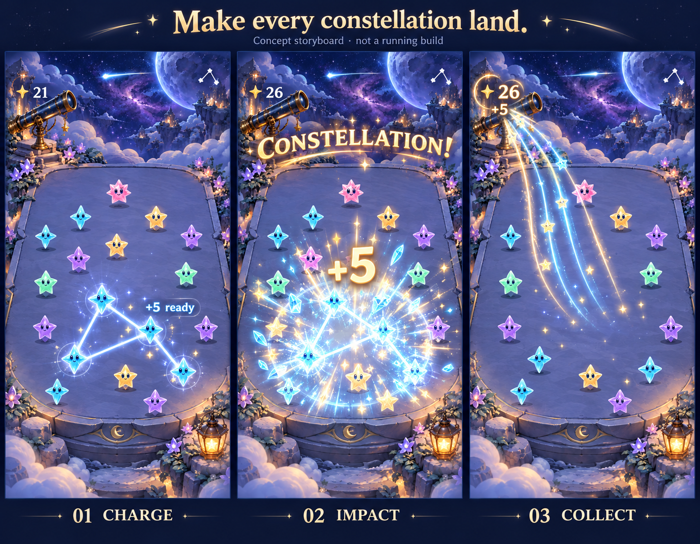
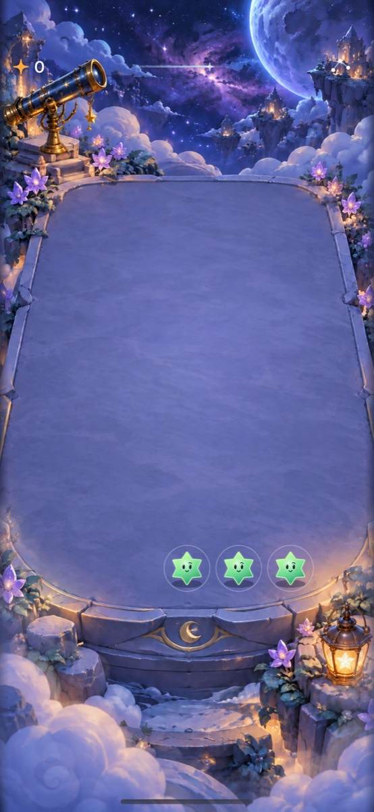

# Make collected starlight feel earned

**Status:** Mock approved; implemented for development verification · **Owner:** current implementer · **Updated:** October 18, 2026

Make a successful clear feel like **charge → impact → collection → celebration**. The player should see where the points came from, feel the release, and notice the total grow. Reserve the biggest response for a deliberately drawn constellation or exceptional clear. Keep the selected compact header and open playfield between events.

**Recommendation:** first compare richer feedback for existing scoring and the isolated constellation mechanic. Do not attach new multipliers, recipes or time pressure to that comparison. “Bam, pow, kaboom” describes the desired energy; crystalline impact, warm light and expressive stars can deliver it in Starfall's own voice.

**Next action:** review the implemented normal-motion candidate on iPhone and tune its timing against the approved storyboard. The shared presentation supports production ordinary/large clears and the existing isolated constellation lab; constellation rules remain isolated. Scores and saves are unchanged. [Development evidence](../evidence/starlight-celebrations-2026-10-18/README.md) separates compilation, behavioral checks, native motion and remaining device/preference acceptance.

**Concept — not implementation evidence.** User approved October 18. Built-in ImageGen used the existing Observatory and Crystal Glow native references. Brief: three continuous charge/impact/collection frames, five-point award with total 21 → 26, the player's actual outline, warm gold/cyan local impact, transparent single-row header, no multipliers or progression. The full generation prompt is in this task's image-generation call. The runtime uses native drawing and the existing cast, not this flattened image.

## What is missing today

Source inspected at `f35eba8`, starting with a clean working tree:

| Observation | Consequence |
| --- | --- |
| `FallingSkyScene.animate` shows a white `+N` at the centroid of all removed cells, moving and fading over 0.32 seconds. Dark removals are included in that centroid. | The award is brief and disconnected from the persistent counter; its location can be pulled away from the scoring stars. |
| `FallingSkyView.compactHeader` reads the committed total directly. It has no collection response. | Points change correctly, but accumulation receives little emphasis. |
| `GameFeedback.collected` receives preferences, with no clear value or achievement category. It requests the same sound family and soft impact for every clear. `QuietTuckPlayer` rotates four selected takes with one audible voice. | Small and exceptional actions have essentially the same audible/tactile weight. |
| The constellation lab has a glowing path, distinct-star haptic steps, and a finite release outline/rings/sparks. | Anticipation exists; the result still needs an award, a stronger finish and a visible connection to the total. |
| Ordinary clears score summed star value; grown stars count two, dark stars zero. Lab tracing selects at least five distinct matching stars. | A bigger award can be celebrated honestly without changing balance. Five traced stars need not mean exactly five points. |

There is no current scored combo, multiplier or recipe system in the inspected production clear or selected-trace paths. These observations cover those paths and the shared feedback/audio owners; they are not a native timing measurement or a whole-app audit. The historical sound exploration deliberately favored quiet contacts. The user's new request justifies comparing stronger event feedback, while retaining those selected contacts as the ordinary-clear baseline.

**Existing native reference, not a celebration mock:** October 17 Observatory trail refinement, iPhone 17e / iOS 27.0 Simulator. [Source and limits](../evidence/observatory-adoption-2026-10-17/README.md). The counter's separation from the cleared stars motivates a brief collection trail; this capture does not demonstrate current-build parity or proposed motion. An animated candidate capture is still needed.

## Give each action a distinct weight

The values and timings below are starting hypotheses for the comparison, not accepted balance or measured perceptual thresholds.

| Event | Visual response | Sound and touch | Words |
| --- | --- | --- | --- |
| Ordinary clear | Clear-point `+N`, crisp star release, short light trail into the total; counter briefly brightens and settles | Existing dry tuck and single impact, aligned to release | Exact award only |
| Large clear: provisional 8+ collected | Larger award, stronger gather/release, wider local ring and brighter collection finish | Fuller attack and short resolution; firmer bounded impact | “BRILLIANT!” |
| Valid traced constellation | Hold the actual drawn outline briefly at release, then break it into light that travels toward the total | Charged steps resolve into a clear two-part impact and sparkling finish | “CONSTELLATION!” plus exact `+N` |
| Dark stars removed alongside a clear | Dark stars crack/dissolve as a secondary accent; award stays anchored to scoring stars | Fold the accent into the same event rather than playing another competing celebration | In the persistent result summary, state darkness removed; no fictitious points |
| First Light completed | Existing completion ceremony takes priority after the clear; let the collection resolve into that ending | One resolved success phrase | Existing explicit completion result |

A large constellation gets one combined constellation treatment, not two banners or overlapping sounds. Start with these few tiers; tune the 8-point boundary after sampling reachable ordinary and grown-star actions. Do not use “SUPER NOVA” for a decorative tier while Supernova names a different parked mechanic.

The score can have a little more numeric weight and a brief warm bloom when it changes. Keep the one-row header; no permanent second meter or mascot speech panel. Do not make a routine shower compete with a player-earned clear.

## A concrete constellation moment

Example: the player deliberately traces five small matching stars. Their total is 21; the committed award is 5; the new total is 26.

| Time from valid release | Proposed experience |
| --- | --- |
| 0–90 ms | Stars draw inward slightly; the completed path tightens and shines. No extra rule delay. |
| Around 90 ms | **BAM:** sharp crystalline release, a strong local expanding ring, synchronized impact, and a legible `+5`. The authoritative total already reads 26. |
| 90–450 ms | **POW:** a few bright packets sweep from the scoring stars toward the counter. The actual path outline dissolves; surviving stars retain readable positions. |
| 450–650 ms | **KABOOM:** the counter gives one warm overshoot/settle and a short sonic resolution. “CONSTELLATION!” occupies available space above the terrace, clear of controls. |
| By roughly 1 second | The callout fades; the resting board is quiet. The next playable action never waits for the decorative tail. |

Keep `+5` readable for roughly 0.8–1.0 seconds rather than immediately fading it. On crowded layouts, prefer a single award near the header to text over active stars. A new clear replaces the prior decorative tail and shows its own exact award. First Light ending presentation outranks leftover callouts.

These are relative presentation beats. They must align with the existing clear/gravity choreography, not add sleeps to gameplay or move the automatic shower deadline. Keep the counter authoritative immediately: flying light confirms an already committed award. Avoid a second animated counter that temporarily disagrees with the save, accessibility label or ending.

## What “combos” and “recipes” could mean

**First pass: celebrate accomplishments the game already recognizes.** “CONSTELLATION!” names a valid trace. “BRILLIANT!” names a large committed award. These are presentation classifications, with no score bonus. A trace preview can show its current starlight value and clear readiness so the player anticipates the payoff; it must remain visibly unbanked until release.

**Possible next experiment: consecutive clears between showers.** A second and third valid clear before the next committed shower could earn “GREAT CHAIN!” and “AMAZING CHAIN!” with rising musical resolution. This is a proposal, not an existing combo. Count only committed clears; invalid taps do not advance it. A shower or new round ends it; pause/settings should not silently erase an earned sequence. No expiring countdown or multiplier. Compare it separately because it may encourage clearing immediately and undermine holding stars for a better constellation.

**Recipes need an actual rule design before hype can name them.** A closed loop, a particular star-family arrangement or a mixed-family pattern is not automatically a recognized recipe today. Avoid promising “ORION!” or “RECIPE COMPLETE!” for an arbitrary trace. If shape recognition later earns its own experiment, specify the accepted shapes, rotation/reflection handling, overlap, preview, exact reward and accessible construction before adding names. An illustrated recipe book, collection checklist, unlocks and campaign are outside this proposal.

For now, the drawn shape itself is the personal creation worth celebrating. Show the player's real line, not a stock constellation substituted over it.

## Keep drama readable and reliable

Use a sharp attack, contrast between quiet and impact, and a short coordinated finish. Increasing volume, particle count and screen coverage together would make different awards harder to distinguish. No repeated full-screen flashes or camera shake in the first comparison. Stars can briefly open their eyes or brighten at release using the existing cast expressions; a new mascot animation system is unnecessary.

Apple recommends succinct motion tied to successful actions and cautions about large surrounding movement; its haptic guidance emphasizes meaningful, consistent feedback. Those principles support a localized impact with coordinated modalities. The proposed tiers and timings are our design judgment, not proof of enjoyment. Sources: [Motion](https://developer.apple.com/design/human-interface-guidelines/motion), [Playing haptics](https://developer.apple.com/design/human-interface-guidelines/playing-haptics), [Practice audio haptic design](https://developer.apple.com/videos/play/wwdc2021/10278/).

Sound off still delivers a complete visible award. Haptics off stays off. Calm effects and Reduce Motion keep the exact award and readable callout with static emphasis instead of travel, overshoot or bursts. VoiceOver receives one concise committed result, such as “Constellation. Five starlight. Total twenty-six.” Decorative labels are hidden from exploration to avoid duplicate speech. Automatic showers stay quiet. No spoken announcer or new paid audio generation is needed for this investigation.

## Implementation boundaries for the trial

Core retains all scoring, selected-star validation, RNG and saved outcomes. Derive a small immutable presentation value from the committed turn, old board and new score: award, scoring-star anchors, dark removal count, event category and generation ticket. The trace input supplies its validated action kind; visual paths never decide that a constellation happened.

Extend the existing narrow feedback boundary to distinguish award categories. Keep one audio owner and one bounded audible cue, with preloaded resources outside per-frame work. Reuse the selected local tucks first; do not build a music engine. If they cannot produce an adequate larger resolution, record that as an audition need rather than quietly adding paid assets or stacking unrelated sounds.

The store owns the event lifecycle; the scene presents the local release and the view presents the counter/callout. Map board anchors and the actual HUD destination through an explicit scene/view coordinate conversion. Do not hardcode a phone-specific flight endpoint. A geometry change cancels the decorative flight and shows the committed result; no geometry change is needed for this trial.

Keep one current celebration, one callout, at most six traveling light packets and a fixed finite spark budget. Reuse the existing bounded lab burst rather than layering a second full emitter over it. All presentation work is main-actor owned and generation guarded. Restart, menu, background, scene replacement and motion-mode changes cancel visual/audio tails; resuming never replays an award. Repeated callback delivery cannot celebrate the same event twice. Score, save, input availability and showers never depend on effect completion.

## Acceptance and decision

Compare identical prepared ordinary, grown-star, 8+-point, constellation and dark-removal actions against baseline; include a First Light final clear. The hypothesis is that players notice points accumulating and recognize a constellation as the bigger accomplishment without losing sight of the next move.

- [ ] **Comprehension and preference:** on iPhone, the player can state the gained value and new total after an ordinary clear and a constellation, distinguishes their weight, and compares satisfaction and distraction against baseline. Record their words and counterexamples; automated success cannot establish enjoyment.
- [ ] **Rules and saves:** replay produces identical board IDs, score, preview and RNG; restore after interruption contains the award exactly once. Core tests and focused event-classification/store checks cover ordinary/grown/dark/trace overlap, invalid input and repeated delivery.
- [ ] **Interaction:** rapid taps, trace cancellation, next clear during a tail, automatic shower, win/loss, restart, settings Done/swipe, background/resume and scene/size replacement leave no stale feedback or additional input gate. Use bounded native checks.
- [ ] **Visual and motion:** inspect normal-motion video and screenshots on small and large iPhones, plus largest Dynamic Type. Award remains readable, total and callout avoid the trail/menu, faces and future moves stay visible, particles clear, and input agrees with rendered cells. Inspect actual flight endpoint mapping after resize.
- [ ] **Accessibility:** lightweight development checks cover Reduce Motion, Calm effects, silent/haptic-off operation, non-color recognition, native labels and layout. Full actual VoiceOver acceptance remains an RC gate under the existing cadence.
- [ ] **Sound/haptics:** audition synchronized onset and tier contrast on a physical iPhone; check mute, interruptions and unplugged output. Simulator capture cannot accept tactile feel. Ten minutes of repeated clears must not become tiring or accumulate voices/effects; profile only if a reproducible issue appears.
- [ ] **Build:** repository hygiene, diff check, `swift test`, affected hosted/UI tests and simulator build; Release if resources/routing change. Record exact source, differences, device/OS and separate evidence categories.

After this bounded comparison, retain the choreography if points and exceptional actions read clearly and the player prefers it; revise a named weak beat or remove the trial otherwise. Production adoption and constellation integration remain explicit decisions. Sequential combos and recipe recognition need their own comparison before being combined with this feedback.

**Implementation details:** the receipt is store-owned and lasts at most 1.15 seconds, independently of the existing 0.56-second clear gate. The overlay uses live score/board anchors, at most six traveling packets and 24 glints. A native text award/callout sits above the terrace; the counter gives a delayed 1.14× settle. The shared scene retains its existing gather, cast expressions and survivor motion; the duplicate lab release burst was removed. VoiceOver summary adds total and event category without exposing decorative copies. Two original local synthesized WAV resolutions accompany large/constellation clears, using the existing single-voice audio cancellation owner; ordinary contacts retain the four selected tucks. Physical listening and haptic preference require iPhone review.

**Scope:** ordinary/large celebrations are integrated in the main app; constellation celebration extends the existing isolated drawing lab. Sequential combos, recipe recognition and scoring bonuses remain proposals. The original investigation at `f35eba8` was documentation-only; later development evidence is linked above.
