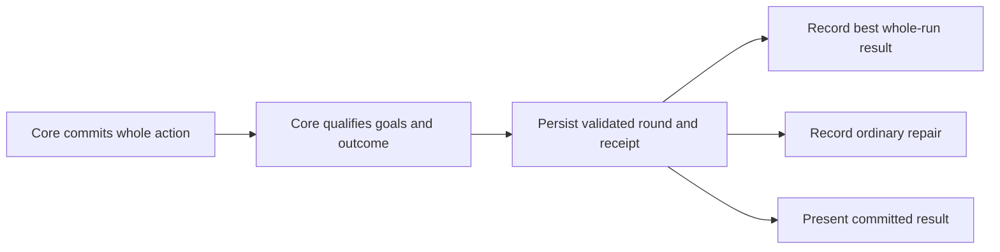

# Optional Story mastery and replay records

**Status:** Ready for implementation planning; proposed behavior, not implemented · **Owner:** Current implementer / factory coordinator · **Updated:** October 22, 2026 · **Design leaf:** [#253](https://github.com/lbeezr/starfall/issues/253)

Keep every earned repair a complete success, then offer two understandable accomplishments for replay. Recommend **collecting a grown star** and **making one automatic clear lead into another** for Lantern Landing's revision-4 rules. Record the best result from one completed run; never combine accomplishments from separate runs or make mastery a condition of access.

This contract defines qualification, version identity and interruption behavior. It adds no runtime tracker, schema, ratings UI or claim about enjoyment. Current four-star lines remain a [phone trial](../evidence/four-star-lines-2026-10-22/README.md). Resolver examples establish mechanical capability. [Production-route research](../evidence/story-mastery-feasibility-2026-10-22/README.md) now proves joint earning in one real revision-4 Lantern win, but later-chain recovery after declining its opening remains unproved.

**Next action:** Construct a later-chain winning route after the named declined opening; prove missed-first-growth recovery, ordinary completion alternatives and winning-action cases before the smallest Core qualification/save slice. The bounded plan-reuse search is exhausted, not evidence of impossibility. The design can proceed alongside [player observation #206](https://github.com/lbeezr/starfall/issues/206); no new human approval stage is introduced.

## The player promise

Before Begin, Lantern names its normal restoration objective and both optional goals. Pause shows the same goals and this run's progress. Restoration remains the main HUD measure. A brief acknowledgement may show an accomplishment without hiding the board; it does not award a permanent rating until the place is restored.

| Completed run | Result | Consequence |
| --- | --- | --- |
| Neither goal | ★ | Full repair, normal ending and next ready destination unlocked. |
| Goal A or goal B | ★★ | The same repair and access, with one optional accomplishment. |
| Both goals | ★★★ | Both were demonstrated in this one successful run. |
| Still playing or lost | No completed-run rating | Current-run progress may be explained; prior best and earned repairs remain intact. |

One star must read as success. After the first Lantern repair, a gentle replay invitation can explain the extra accomplishments; incidental first-attempt qualification counts. No star totals, currency, XP, speed, gesture count, no-pause rule or final-score overshoot affect access or rating. There is no extra action after an earned finish to complete a goal.

These stars and their formula are Starfall proposals from the [Story gameplay plan](../STORY_MODE_GAMEPLAY_PLAN.md#three-stars-reward-accomplishments). Historical manual tap/trace examples in that plan are not current-pattern requirements.

## Exactly which rules and goals apply

The first implementation slice targets **Lantern Landing / `firstLight` / content revision 4 / goal-set revision 1**, subject to the existing trial's retain/revise/remove decision. Goal-set revision 1 is a proposed semantic identity, not an existing saved field. If that trial changes, choose an explicit new content revision and re-prove the goals rather than editing a retained definition in place.

| Saved Story definition | Current behavior | Mastery treatment in this first slice |
| --- | --- | --- |
| Revision 0 / missing content marker | Original 18-light rules, including historical manual clears. | Completion only; retain rules, score scale and replay. |
| Revision 1 | Authored 150,000/220,000-point objectives with manual clears. | Completion only. |
| Revision 2 | Automatic square/cross cascades plus retained manual clears and original supply. | Completion only; a manual initiating phase cannot be relabeled as the proposed current goal. |
| Revision 3 | Automatic patterns only; straight lines require seven actual stars. | Completion only in this slice; same-round replay retains revision 3. |
| Revision 4 | Automatic squares, crosses and straight lines of at least four actual matching stars; unchanged first-pair openings, supply, targets and cadence. | Eligible only when a new run starts with this exact supported goal contract. |

The other five ready restoration locations keep their original 18-light definitions and completion semantics. No goals are inferred for them. Open Sky, disposable Tutorial practice and Debug review fixtures cannot submit mastery records.

An identity consists logically of **location/challenge + content revision + goal-set revision**. Content revision selects the opening, supply, target, score, cadence and recipe rules; goal-set revision selects goal IDs, predicates and rating meaning. Cosmetic wording need not change a predicate's identity; a changed threshold, eligible event source or earning rule does. Records from different identities remain distinguishable and are never maximized together. If future variable seeds or variants exist, their scenario identity must also be explicit before comparing records.

## Two committed-event predicates

Proposed player wording is illustrative; final strings belong in the existing dialogue catalogue. The Core predicates below own the award.

### A · Collect a grown star

Qualify once when a committed automatic recipe phase clears at least one ordinary colored ingredient whose **`grown` is true in that phase's `before` board**. Read that ingredient through the phase's cleared cells and identity. Its value is two physical light units; bonus points do not substitute for it.

The goal latches for the run. Growth without collection, moving a grown star, inspecting it, a forecasted match and a large all-small-star award do not qualify. A grown star in two overlapping recipes is one ingredient in the cleared union; repeated presentation of the same committed event cannot award anything again.

### B · Make one clear lead straight into another

Qualify once when **one committed board action** resolves at least two consecutive, nonempty automatic recipe phases. The later phase must use surviving stars after the preceding clear and settling: `later.before == earlier.settled`, later ingredients are distinct surviving identities, and settling genuinely creates the later recipe. All ready recipes clear together in the earlier phase, so a recipe already present there is not a surviving second phase.

Both a legal exchange and a fully landed shower may initiate the transaction. Scheduled and manually advanced showers qualify identically. This recognizes the committed board consequence without attempting to infer intent or grade an input method. Two unrelated clears, two simultaneous recipes in one phase, animation pop/fall callbacks, a score multiplier label or App relay feedback do not establish this goal.

The existing resolver establishes causal phase order and spends at least four actual stars per automatic phase. A goal tracker must consume that authority; it must not rediscover patterns from scene nodes or group separate `FallingSkyTurn` values into a chain. One action can qualify both A and B.

### Winning-action order

Resolve the complete existing atomic transaction, qualify its phases, then finalize the completed-run result from the committed outcome. All phases in that winning transaction count, including a later causal phase when an earlier phase already crossed the target. This follows today's whole-transaction resolution; it adds no post-win input or extra shower. A blocked shower that never starts recipe resolution cannot earn a new recipe goal from partially landed stars.

## Positive and rejection examples

Rows marked **source fixture** are inspected existing assertions, not newly executed tests or authored Story routes. Rows marked **contract case** specify future acceptance.

| Example | Expected qualification | Evidence boundary |
| --- | --- | --- |
| Four grown matching stars form one automatic line. Four actual stars yield eight physical light and 9,000 points. | A yes, B no. | Source fixture: [`testThreeGrownStarsGapsMixedFamiliesAndDiagonalsDoNotBecomeLines`](../../Tests/StarfallCoreTests/StoryFourStarLineTests.swift). It proves a recipe can collect grown ingredients, not their natural availability in a complete Story run. |
| Three grown matching stars, a gap, a mixed-family row or a diagonal. | No line and no goal from that non-clear. | The same source fixture rejects those false patterns; doubled light never replaces the actual-star threshold. |
| Board rows `RRAAA..`, `RR.....`, `AA.....` resolve a rose square, then falling aqua survivors form a five-star line. Phases have depths `[1, 2]`, awards `[5,000, 14,000]` and linked settled/before boards. | B yes; A no because these ingredients are small. | Source fixture: [`testFallingSurvivorsCompleteFiveStarLineAtTheUnchangedCausalDepth`](../../Tests/StarfallCoreTests/StoryFourStarLineTests.swift). This hand-authored resolver board is not a valid Story-supply witness by itself. |
| Overlapping lines and a square clear their eight-ingredient union in one phase. | B no. A depends only on actual grown ingredients in that union. | Source fixture: [`testOverlappingFourStarLinesAndSquareSpendTheirUnionOnce`](../../Tests/StarfallCoreTests/StoryFourStarLineTests.swift). Three shape labels are not three phases. |
| An arrival grows a top star; it remains on the board. A later automatic pattern actually collects it. | A remains false after growth; becomes true on collection. | Contract case; real current-supply route required. |
| Two separate single-phase exchanges clear two patterns. | B no; neither action created a second phase. | Contract case; preserve action boundaries even while paused. |
| A goal-bearing legal transaction begins below the target and ends won. Its final phase collects a grown ingredient and/or is the second causal recipe phase. | Include the final phase; award ★★ or ★★★ from the completed run's latched goals. | Contract case; use an invariant-valid Core fixture and a real completion witness. Do not create a surplus action after `.won`. |
| The winning exchange resolves both a grown-containing first recipe and a survivor-created second recipe. | Both goals may be earned by that one action; ★★★. | Contract case; joint feasibility must be demonstrated, not inferred from the two isolated source fixtures. |
| A shower overflows during ordered arrivals before automatic resolution. | No new recipe qualification from that shower; lost runs never update best. | Existing `letStarsFall()` skips resolution when blocked. Earlier run flags may explain what happened but do not turn loss into a completed result. |

### A missed opening must leave a useful later chance

Do not make B depend on memorizing one opening swap or A on waiting indefinitely for one family. Before runtime adoption, record one bounded ordinary Lantern path which declines the earliest relevant opportunity, stays alive under the unchanged announced supply, and earns each goal later before its target. Also record one legal **single winning run earning both**, and a neighboring action order that completes normally without being forced into that script.

Witnesses must list the actual revision, actions, phase ingredient identities, before/settled boards, score/outcome and save validity after each commitment. Include the point where the opening was missed and the later opportunity became useful. They may use legal exchanges and manual shower advance; they may not edit a production board, delay an already earned win, insert arrivals, retarget a preview or treat solver speed as human comprehension. A solver is feasibility evidence only.

If current supply lacks a reasonable later opportunity or joint win, change the proposed goal or author explicitly versioned content; do not weaken the detector, silently add relief supply or ship an impossible three-star promise. This is an implementation prerequisite that agents can verify autonomously, not an extra human approval gate.

### Ribbon generalization

Use the same two predicate meanings for a separate **`ribbonCrossing` / chosen content revision / goal-set revision** identity only after its own source witnesses. Its 220,000-point target and four-second cadence do not add a speed requirement. Do not assume Lantern's route proves Ribbon's growth access, later recovery or joint completion. A future Ribbon-specific goal can replace one candidate through a new goal-set revision; the old manual trace-across-components goal is incompatible with current automatic-only clears.

## One completed run owns the best record

A run begins at committed Begin, Replay or Retry, with a stable logical run identity, eligible goal contract and empty qualification state. Continue/resume preserves that identity and state. Replay/Retry reset current-run goals; the earlier completed best stays earned. An enrolled run's replay retains its goal-set revision. An unenrolled v4 round stays completion-only on same-round Replay/Retry; its absent goal contract is retained. Explicit New visit can select the first supported goal contract, disclosed before Begin, and later incompatible goal-set upgrades also require a New visit. Earlier attempts remain unrated. Preview/cancel cannot create a run or change records.

The completed-run result contains its exact identity, run identity, won outcome and that run's goal set. Its rank is `1 + numberOfQualifiedGoals`, bounded to 1–3. Retain **one whole result** for the greatest rank under the same exact identity. A lower rank does not replace it. On an equal rank, keep the first valid recorded result; a later two-star run can show its own different accomplishment on its result screen without unioning it into the saved best.

Thus A-only on run 1 followed by B-only on run 2 remains a two-star best. A later run with both promotes it to three. Reprocessing the same completion is idempotent. No wall-clock timestamp, animation completion, displayed score overshoot or separate-run achievement collection decides promotion. Independently persistent accomplishment stamps would be a different design, not a fallback interpretation of these records.

Keep repaired/access state independent of this revision-specific best. A historically repaired place remains repaired when its newest definition has no rating yet. Present that distinction as “repaired” plus “no result for these optional goals,” rather than displaying a fabricated one-star current-revision record. Completing a goal-enrolled current run with neither optional goal does earn its real one-star record.

## Authority and persistence

| Existing owner | Future responsibility under this proposal |
| --- | --- |
| [`StoryChallengeDefinition`](../../Sources/StarfallCore/StoryChallenge.swift) | Select the supported location/content contract; preserve all retained definitions. Goal-set selection must be explicit and must not default a missing marker to newest. |
| [`SkyRecipeResolution` / `SkyResolutionPhase`](../../Sources/StarfallCore/SkyResolutionPhase.swift) | Supply committed ingredient boards, unioned clears and causal phase order. |
| [`FallingSky`](../../Sources/StarfallCore/FallingSky.swift) and [`StoryScoreLedger`](../../Sources/StarfallCore/StoryScore.swift) | Own qualifications, eligible-run identity, valid completion and bounded proof. Current score receipts already distinguish physical light, cleared-star counts and causal tiers. Prefer deriving these two predicates from those receipts **if Core tests prove equivalence** for enrolled automatic-only rounds; do not add a generic achievement engine or growing event log. UI flags are not authoritative. |
| [`SkySaveArchive`](../../App/SkySaveArchive.swift) | Encode/decode a deliberately versioned future round envelope, validate Core state and goal-contract compatibility, retain old readers and rejected bytes. The present v13 schema has no mastery contract. This leaf does not select its replacement JSON layout or key. |
| [`FallingSkyStore`](../../App/FallingSkyStore.swift) | Coordinate the committed save before presentation, then independently project valid completion into best records and world repairs. Tutorial/Debug exclusions remain effective. |
| [`WorldJourney`](../../Sources/StarfallCore/WorldJourney.swift) / [`WorldJourneyStore`](../../App/WorldJourneyStore.swift) | Continue recording every valid registered win as a repair, preserving current unlock/access behavior. Keep the existing completion envelope separate from the proposed revision-specific best record. |

For an enrolled v4 run, the event meaning of A is equivalent in principle to collected physical light exceeding distinct collected-star count; B corresponds to an earned automatic tier after depth one. These are proposed derivations to prove against per-phase cases, not new public APIs or permission to infer old records. Bonus points alone establish neither. Scope equivalence to the exact supported definition; retained manual, Dusk, white or gravity contexts must not accidentally qualify.

**Proposed flow:** optional-record failure must not prevent a successfully saved win from unlocking its next place. Save the winning round and its bounded qualification receipt first. Best and repair writes must be independently idempotent, with restore able to repair interrupted projection from that valid receipt. Preserve the existing round-first repair recovery. Never write a permanent best from an unsaved transient UI event. A replay requested after a failed permanent-result write must not discard the only recoverable completion receipt; finish/retry that write or retain a separate bounded pending receipt before replacing the round.

### Validation, migration and rejection decisions

These semantic decisions precede a physical schema. A future implementation must name its exact envelope migration, failure handling and bounded receipt representation in the code change; no wholesale save rewrite is authorized by this design leaf.

| Input / fault | Required treatment |
| --- | --- |
| Valid old round or world save without any mastery enrollment, including an existing revision-4 round/win | Preserve its normal round/repair/access. Do not invent earlier goal flags or rate an attempt whose goal tracking was absent at its start. Only an explicit supported New visit can enroll; same-round Replay/Retry retains absence. |
| Enrolled supported playing run restored | Validate identity and bounded qualifications; preserve them exactly. Missing or false goals cannot be filled from the final scene, App relay or unversioned historical totals. |
| Historical content revision or wrong location paired with the new goal-set identity | Reject that mastery claim. Do not reinterpret manual clears or import Lantern evidence into Ribbon. Independently valid ordinary completion stays earned. |
| Unknown future content revision or invalid Core board/score/forecast/invariant | Follow the archive's strict invalid-round rejection/preservation policy. Optional mastery cannot make invalid game state playable; do not fall back to an older save just because a newer present archive fails. |
| Valid known Core round with missing, unknown or invalid optional goal metadata | The schema must define an isolated validation boundary: preserve independent valid round/repair data, quarantine the bad optional claim and resume completion-only. Never silently turn malformed metadata into a valid three-star result. If this separation cannot be proven by the envelope reader, reject/preserve that envelope under the normal archive policy instead of guessing. |
| Permanent result with rank outside 1–3, unsupported goal IDs, rank/flags mismatch, wrong revision, non-win or receipt mismatch | Reject/preserve that result; do not demote an existing valid best or remove a repair. Bounded values and supported identities are required even when JSON decodes. |
| Duplicate completion projection after relaunch | Same logical run is harmless; best is unchanged and ordinary repair remains idempotent. |
| Best write fails after valid winning-round save | Keep earned world repair independent. Report persistence failure through the existing owner, retain recoverable receipt and retry idempotently; do not claim the optional best persisted. |
| Repair write is interrupted after valid winning-round save | Existing `WorldJourneyStore` recovery still records that win. Best recovery cannot suppress it. |

Local semantic validation follows the existing score/save model; this is not an anti-cheat or cryptographic replay-log project. Only Core-owned, contract-enrolled receipts can authorize a record. An implementation must prove that its chosen minimal aggregate evidence cannot accept a goal inconsistent with the supported round invariants.

## Interruption and replay acceptance

The following matrix is required future behavior, not a report of tests run for this document.

| Boundary | Observable acceptance |
| --- | --- |
| Entry before Begin; Back/cancel; map selection | Correct supported goals are readable before commitment. Cancel preserves the existing round, selected destination/origin, best and repairs. Locked/unbuilt destinations promise no playable mastery. |
| Pause/read/settings/menu | No qualification change and no pending-goal timeout. Legal paused board actions follow the same Core predicates. Equivalent normal input routes yield the same result. |
| Background during goal-bearing or winning animation | Restore the saved committed action once, paused under the existing contract; no replayed collection, duplicated best or lost final-phase goal. |
| Terminate after round save but between best/repair projections | Recover both independently from a valid receipt. Terminate before a successful round save cannot manufacture a permanent award. |
| Loss then Retry | Keep old best/repairs; start empty current-run goals and a fresh logical run under the retried saved definition. An unfinished/lost run's A cannot combine with retry's B. |
| Same-round Replay of supported current content | Retain the exact saved content, opening and supply; retain an enrolled goal definition; an unenrolled round remains completion-only. Reset run qualification. A weaker win leaves a stronger best intact. |
| Same-round Replay of retained v3/manual history | Preserve its old rules and completion-only behavior. Action-capability adoption does not silently upgrade content or add new goals. |
| Explicit New visit | Select the current supported content and corresponding goal contract only at Begin. Do not reuse flags or alter the retained round merely by opening its preview. |
| New incompatible content/goal revision | Separate result identity; earlier achievement remains attributable to its revision. No combined rating, fabricated mastery or loss of ordinary unlocks. |
| Normal/reduced motion, default phone/largest tablet text | Same qualifications and best. Goal reading, Begin/cancel, pause and result/Replay controls remain usable; visuals and animation are separate evidence from Core correctness. |

## Bounded implementation and adoption

1. **Core feasibility and contract:** preserve the selected content; prove both individual goals, a joint winning run, later legitimate opportunities after a missed opening, adjacent ordinary-completion paths and the rejection/winning-action cases above. Compare the minimal ledger derivation against phase predicates and cover old/current/wrong-contract saves. Keep source/version/actions and actual test results.
2. **Persistence and one native Lantern slice:** implement enrollment and whole-run best without changing WorldJourney unlocks. Exercise save failure, interrupted projection, restore, loss/retry, equal/lower/better replay and new visit. Then show the two goals through existing Entry/pause/results owners and catalogue, using default phone and largest-text tablet flows. Reuse disposable native fixtures; do not build a second game or comparison framework.
3. **Adopt, revise or remove:** inspect normal/quiet acknowledgements and final result readability, then use the existing Story observation packet to ask whether the goals were understood, a missed opening felt recoverable and optional replay was inviting. Agent/Core/native evidence can justify correct development integration; it cannot establish player preference. At the first bounded Lantern comparison, retain useful goals, revise their meaning/version or remove the feature rather than scale unexplained ratings across the map. Ribbon follows only its own proved opportunities.

A concern about the current four-line trial does not freeze parallel design or unrelated experience work. Its next phone comparison remains the existing retain/revise/remove point. This contract does not authorize balance changes, new obstacles, extra rounds, new platform features or mandatory player-study approval before every merge. Actual VoiceOver remains deferred under the current queue; no VoiceOver acceptance is claimed or required to finish this design leaf.

## Source bounds and remaining concerns

Source inspected at main **`93ae893a034ab30e48d3cf55d306d7d1567150f4`**, with runtime baseline **`c9763dc502a3f8d46ef215451b1365059c9a3cbe`**. Inspected owners include the linked Core definition/resolver/score/outcome, archive, store and WorldJourney; [four-line trial evidence](../evidence/four-star-lines-2026-10-22/README.md) retains its own executed commands and source. Existing fixture assertions above were read, not rerun for this documentation leaf. The new document's fourteen local link occurrences resolve and its whitespace/final-newline check passes; Markdown source was reviewed, rendered-document inspection was not run. No App/Core/schema, native, simulator or compilation changes are part of this document.

| Remaining concern | Owner and resolving evidence |
| --- | --- |
| Joint earning is verified on one real Lantern v4 win; only its opening earns B. Later-chain winning recovery, missed-first-growth recovery and ordinary alternatives remain unproved. | Core/level designer: [the bounded research packet](../evidence/story-mastery-feasibility-2026-10-22/README.md) names an irreversible declined opening and the exhausted coordinate-plan search. Construct a state-aware later-chain completion route before promising recoverability; do not infer impossibility or change retained supply from this narrow negative result. |
| The current four-star line trial may be retained, revised or removed. | Current trial owner: existing phone comparison; preserve v4 and choose a new content identity for incompatible changes. Re-prove only affected goal/content assumptions. |
| The smallest validated ledger/enrollment representation and crash-safe pending receipt have not been selected or implemented. | Core/save implementer: explicit new-envelope contract, equivalence tests, old-save rejection cases and fault-injected independent best/repair recovery. Keep this out of `WorldJourney` completion semantics. |
| A correct three-star system may still discourage an otherwise satisfying first clear or replay. | Game designer / user researcher: bounded native comparison and separately reported player observations; no solver or scripted gesture establishes motivation. |

Closing [#253](https://github.com/lbeezr/starfall/issues/253) completes this proposed design contract. It does not complete mastery runtime, migration, native presentation, real Story witnesses or player evidence.
