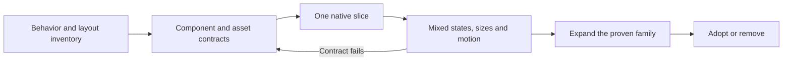
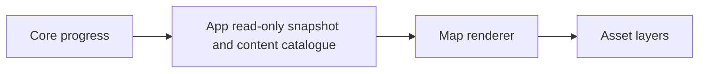

# From UI concept to native components

**Status:** Current production workflow · **Updated:** October 24, 2026

An approved mock establishes visual direction. Production must establish reusable components, independent states and layouts that survive real content and input. The [game UI system](GAME_UI_SYSTEM.md#2-authored-production-assets) already excludes complete screen paintings and baked labels from runtime controls. The missing step was enforcing that distinction through a working native slice before expanding the asset set: the map moved from an attractive concept to whole-map plates before proving independent restoration states and responsive composition.

Use the workflow below for Starfall screens, HUDs and interactive scenery. Reuse `StarfallTheme`, `ObservatoryArtwork`, existing native controls, stores and navigation owners. A bounded renderer and development harness are appropriate when they make composition and state behavior reliable. This adds no approval gate or requirement for a separate app or generic framework.

## Make one complete slice before expanding

1. **Inventory behavior and constraints.** List affected screens, entry/exit routes, state owners and actual content. Include the states that can coexist: selection, lock/unavailable, retained progress, disabled/focus, long labels and pending/error states where relevant. Record safe edges, minimum targets, wrapping, compact/large-text fallback and interruption behavior. Define observable acceptance before producing assets.
2. **Decompose by responsibility.** Separate native text/input from decoration. Split artwork when pieces need independent placement, state, motion or loading; keep other art cohesive. Map each changed element to an official component and its intended role in the [system roster](GAME_UI_SYSTEM.md#3-shared-native-components). If a needed role or state is missing, design and register it in the shared owner before use. An official menu component is not automatically suitable for active play. A mock's pixels do not define touch bounds, gameplay geometry or responsive constraints. Write the small contract below before generating a family.
3. **Build one native slice.** Implement one representative component in its real normal-app screen, with the existing state owner and navigation. A slice includes its input, content, art, state changes and return path. A development harness uses those same production components and deterministic reset-only/Debug fixtures in the existing target; it may expose state, layout and motion combinations without becoming a player route. A browser specimen is supporting evidence. Keep the initial asset roster small enough to revise.
4. **Inspect combinations in context.** Exercise actual taps and cancellation, then inspect captures at compact/default/largest text and relevant tablet orientations. Compare the complete native screen with the approved direction using the [separate visual review](#decide-visual-acceptance-separately) below. Put different repair/access states beside each other; include selected+locked, selected+pressed and focused/disabled combinations where meaningful. Check bright/dark backdrops, safe areas, alpha edges and real normal/quiet motion, including background/resume. Physically pan scroll surfaces through blank painted padding as well as text; passive decoration cannot supply the interactive viewport contract. Correct the owner or contract when it fails; do not obtain acceptance by shrinking text, hiding a required state or substituting existence-only assertions.
5. **Expand the proven family.** Generate/export the remaining necessary art and integrate sibling screens through the same component. Retain source bytes, reproducible export steps and measurements. Verify each variant against its contract; independently generated state images need actual registration checks. Revisit the native slice whenever the contract changes.
6. **Adopt or remove.** Use the existing [verification matrix](../ENGINEERING.md#verification-by-change) and [experiment register](../EXPERIMENTS.md). Record source-bound interaction, inspected visuals, motion and resource results separately from actual VoiceOver and physical play. A failed visual review prevents adoption and completion of that goal; correct it before advancing the stack. Remove superseded runtime assets/routes; preserve useful provenance and document specific remaining acceptance. Passing builds or fixed-seed tests do not establish intuitive use or enjoyment.

## Decide visual acceptance separately

Before merging a visual change, the implementer and an independent reviewer inspect the source-bound native captures against the approved reference. Give the reviewer the reference, captures, component roles and acceptance criteria; ask for a verdict before presenting the implementer's conclusion. This is internal verification, not a new user approval stage. Review at actual device scale and as a whole viewport; zoomed details alone cannot establish composition.

| Question | Reject when |
| --- | --- |
| Does attention follow gameplay importance? | Optional inspection or other secondary controls become headline-sized menu panels, or the header visually overwhelms the stars. |
| Does the screen form one composition? | A disconnected header shelf, avoidable blank band or abrupt scenic boundary separates the instruments from play. |
| Does every element use the correct official role? | A component is unregistered, locally restyled, or borrowed from a context with the wrong hierarchy; missing roles must be designed in the shared system. |
| Does reflow preserve the design at default and largest text? | Legibility is achieved through clipping/shrinking, unnecessary ornament consumes the viewport, or full targets and readable content cannot coexist. |
| Does the evidence support the verdict? | Only fit assertions, a crop, a mock or a passing build is supplied, or a visible failure is deferred to a later goal. |

Record **mechanical result** and **visual verdict** separately, with source/capture IDs, the comparison reference, reviewer and concrete findings. Capture parity means the image depicts that source; it does not mean the design is accepted. Disagreement or a failed criterion requires correction and another review of the affected state. Automated geometry checks support this judgment; they cannot certify aesthetic quality. Actual VoiceOver, motion and physical reading remain their separate evidence scopes.

The [October 24 HUD rejection](../evidence/hud-stack-2026-10-24/README.md) is a retained counterexample: native targets and interactions passed, while the oversized optional action and disconnected header violated the existing active-play brief. The failure was the acceptance judgment, not an absence of design guidance.

## Small asset contract

Record only applicable fields; mark unknown measurements as pending and distinguish proposed values from verified ones. The [Observatory handoff](../../Artwork/ObservatoryUI/INTEGRATION.md) is the existing detailed example.

| Contract | Record |
| --- | --- |
| Identity and role | Stable semantic ID, owner, decorative/interactive purpose, intended screens and native behavior supplied separately |
| Geometry | Logical point dimensions/range, export pixel dimensions and density, aspect/crop rule, coordinate origin and optical/attachment anchors |
| Alpha and placement | Opaque or transparent intent, color profile, transparent padding/body bounds, layer order and clipping behavior |
| Content and input | Safe content insets, readable label area, excluded ornament, minimum touch bounds and any required hit projection |
| Resizing | Fixed caps and stretch rectangle/axes where appropriate; preserve landmarks, glyphs and corner shapes |
| State coverage | Required states/combinations, source of each state, shared canvas/anchor invariants, normal/quiet treatment and fallback |
| Provenance | Source/export paths and SHA-256 hashes, exact generation/edit prompts or authoring source, reference identity and export recipe |
| Resource budget | Encoded bytes, decoded pixel roster, simultaneously resident variants, masks/atlases where used, cache/lifetime owner and native measurement limits |

Hash equality verifies byte identity, not alignment or appearance. A component's visual bounds, content bounds and hit bounds may differ deliberately; all must be explicit enough to reproduce.

## Two concrete applications

**Interactive world map.** Build the sky/cloud background, independently placeable landmark islands with registered repair variants, connectors or bounded accents as needed, and native markers/labels/card. First prove one island with damaged/restored state plus its real marker and selection/Entry/Back flow; add a neighboring island early to test simultaneous different states and overlap. The finished screen needs ready, restored, locked and unavailable inspection without moving the wrong landmark or revealing its repaired neighbor. The approved composition guides placement and materials; the rejected whole-map-plate approach remains reference material until a working modular slice establishes the replacement. Generate islands for registered production locations; keep unavailable atlas identities in the native Places view until their content is ready. The catalogue must cover every ready location, and odd/even row counts must retain coherent routes.

Keep renderer responsibility explicit:

The renderer owns composition, resource lifetime and presentation; input emits intents to the app's existing owners. It does not determine legality, unlocks or saves. Build the map-specific renderer and harness needed for these contracts, with shared geometry for visible placement, hits and accessibility. Choose the rendering mechanism from the demonstrated requirements; do not turn this into a speculative general-purpose engine.

**HUD action.** Start with the existing native `Button`, `StarfallGameButtonStyle`, Observatory glyph and theme. Keep the label/glyph, full target and viewport anchor native. Add a skin only when the role needs painted material, with measured fixed caps and content clearance. Prove short/long labels, press/release/cancel, disabled/focus, bright scenery and large-text reflow in the actual HUD. Share that behavior across pause/settings/menu uses; generate no separate screenshot or state bitmap per screen.

Layering is a response to independent behavior, not a requirement for every visual. Complete restoration gameplay paintings remain legitimate under the [level-design kit](level-design-kit/README.md): their continuous composition and milestone transitions have a different purpose from independently selectable map landmarks and UI controls.

## Supporting mechanisms

This workflow is a Starfall production decision. Unity's [layout guide](https://docs.unity.com/en-us/engine/7000.0/manual/best-practice-guides/bpg-uiad-index/layouts) illustrates decomposing mocks into visual elements, constrained responsive layout, reusable templates and checking the target runtime view. It supports the approach without prescribing a new engine.

Apple's [texture-atlas guidance](https://developer.apple.com/documentation/spritekit/about-texture-atlases) relates grouping to textures used together and memory use; choose grouping from the renderer's actual loading needs. Its [`centerRect` documentation](https://developer.apple.com/documentation/spritekit/skspritenode/centerrect) describes nine-part scaling with unstretched corners. These support specific resource and resizing contracts, not a requirement to atlas or slice every asset.
