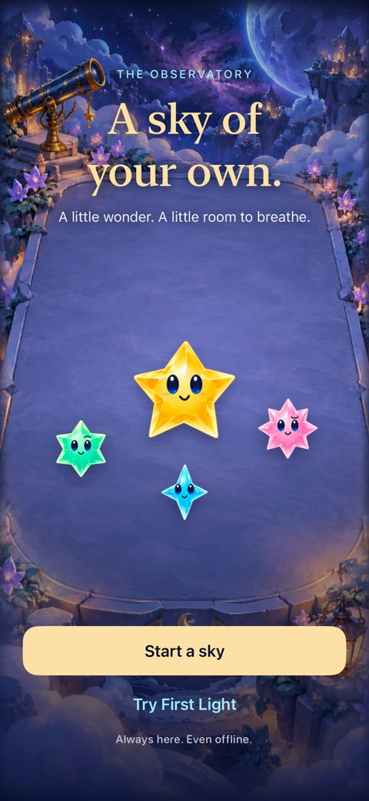
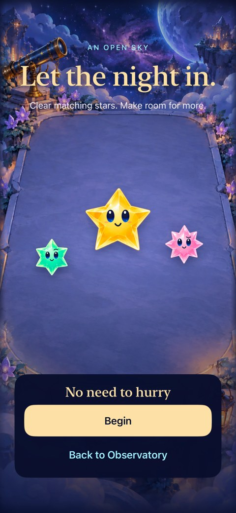

# Starfall visual reference

**Adopted nightscapes:** [Moonwake, Nebula Cradle, Shatterlight Reach, Night Garden and Ringdrift](../evidence/nightscapes-2026-10-18/README.md) now have native phone/iPad evidence. Five separately controlled planes surround a centered playfield; sixteen alpha assets replace the platform paintings. [Production design](environments/night-production-09/README.md) owns composition and asset provenance. Publication/device status is recorded in the evidence report.

The [approved scene kits](environments/scene-kits-07/README.md) and [painted night keys](environments/night-keys-08/README.md) remain concept references. Earlier celestial boards and Skysea are historical, superseded directions.

**Status:** Reference · **Updated:** October 18, 2026

Selected icon, screens and six-star cast, with links to their sources. **Source-bound references, not current-build certification:** check the linked source before drawing conclusions about current UI. Native composition and sampled normal motion are inspected for the nightscapes; actual VoiceOver, physical comfort and release acceptance remain separate checks. Follow [screenshot retention](../SCREENSHOTS.md) when replacing a visual.

[Icon](#adopted-app-icon) · [Screens](#welcome-and-entry) · [Cast](#current-crystal-glow-cast)

**Environment redesign references:** The [five celestial homes](environments/celestial-worlds-04/README.md) propose a new astronomical setting roster around the crystal cast. They retain the accepted [living-worlds template](environments/living-worlds-03/README.md), whose earlier setting roster is superseded. The [Hearthstone study](environments/hearthstone-study/README.md) supplies the research. These are concept/reference artifacts, not runtime evidence or replacements for the source-bound captures below.

## Capture index

Status follows [the screenshot practice](../SCREENSHOTS.md). These legacy filenames retain their original provenance. Recipe controls and relay feedback were inspected against the builds linked below; the other entries retain their separate refresh limits. Use the linked reports for captured sources and environments; the next implementer touching each surface owns its refresh.

| Surface | Status | Selected evidence / next check |
| --- | --- | --- |
| Crystal-depth celebrations | Current for protected awards in the centered nightscape layout | [Final nightscape integration](../evidence/nightscapes-2026-10-18/README.md#final-integration-checks), source `1c624cb`, runtime `dev.235ece3931`. [Earlier board-clarity evidence](../evidence/board-clarity-2026-10-18/README.md) retains its separate source. Named/ordinary awards use the sky above playable rows; compact native type preserves legibility; maximum text stays below. [Prior central placement](../evidence/crystal-depth-native-2026-10-18/INTEGRATION.md) is historical for layout. Physical comfort and RC VoiceOver remain open. |
| Committed action feedback | Current for sampled normal-motion Square result in Moonwake | [Consequence feedback](../evidence/consequence-feedback-2026-10-18/README.md), integrated source `0842a61`, runtime `dev.bf4ade9d68`. Guide and protected award agree on the exact clear; the next match remains visible. Physical comprehension and actual VoiceOver remain open. |
| Edge-swipe feedback | Current for sampled default phone rejection | [Four-edge native acceptance](../evidence/edge-feedback-2026-10-18/README.md), runtime `dev.3be5031c35`, snapshot `e516aad66176`. Exact direction explanation remains below the unchanged board; the following tap succeeds. Physical comprehension remains open. |
| Forecast timing | Current for quiet approach on sampled phone | [Monotonic forecast](../evidence/shower-forecast-2026-10-18/README.md#inspected-native-forecast), clean `ce00692`, runtime `dev.9020625ab7`. Approach precedes commitment; physical camera fit remains open. |
| Interactive Help examples | Current for sampled square entry and largest-text completion | [Setup discovery](../evidence/setup-discovery-2026-10-18/README.md#inspected-appearance), clean runtime `774cf98`, `dev.14bd6d9ce3`. Explicit move cue and scrolling result inspected; physical learning and actual VoiceOver remain open. |
| Crystal lettering alphabet pack | Current for exported assets and offline browser viewer | [Complete character/angle sheets](../../Artwork/CrystalComet/README.md) and [source-bound browser capture](../evidence/crystal-comet-sprites-2026-10-18/README.md). User-selected depth, 106 characters, 45 views; this row describes the offline master, with native evidence listed above. |
| Crystal lettering motion study | Historical — crystal depth selected | [Relay! / +128 matched-angle browser specimen](celebration-lettering/motion-specimen-01/README.md), snapshot `0d28c50-wip-12b3777c44a1`. Retained to explain flat tilt versus shallow geometric edges; full alphabet production is owned by the subsequent package. |
| Hold-to-draw armed cue | Current for sampled default phone armed state; physical feel open | [Inspected native game capture](../evidence/hold-feedback-2026-10-18/README.md#inspected-native-presentation), runtime `dev.0f08b779a9`, iPhone 16 Pro Max / iOS 27.0 Simulator. Eight open rays distinguish armed drawing; quiet transition checked in native host. |
| Follow-up acknowledgment | Needs full-game/phone capture; isolated native cue inspected | [Bounded source corners and direction arrow](../evidence/follow-up-input-2026-10-18/README.md#visual-and-timing-limits), runtime `dev.677341325c`, native SpriteKit host on iPhone 16 Pro Max / iOS 27.0 Simulator. The arrow clears the star's face. This scene-only render does not establish Observatory contrast or physical timing. |
| Welcome | Needs refresh for the new nightscape background; previous control evidence remains source-bound | [Inspected third-pass captures](../evidence/debt-third-pass-2026-10-18/README.md#3-scrollable-ceremony-control-clearance). Previous references: [Inspected tablet captures and native hit correction](../evidence/debt-followup-2026-10-18/README.md#2-tablet-welcome-hit-semantics). Earlier reference: [Sky-flow welcome](../evidence/sky-flow-2026-10-17/welcome.jpg), [source report](../evidence/sky-flow-2026-10-17/README.md); wording changed in the [copy rewrite](../evidence/copy-rewrite-2026-10-18/README.md); capture the rewritten welcome before relying on current parity |
| Entry | Current for sampled replay entry; other entry variants retain prior evidence | [Replay explanation](../evidence/ending-replay-2026-10-19/README.md#inspected-native-appearance), clean `d9a0b59`, dev.07b4062290, full-size phone. Native compact/largest/system Reduce Motion entry and cancellation pass. [Prior general Entry evidence](../evidence/debt-third-pass-2026-10-18/README.md#3-scrollable-ceremony-control-clearance) retains its older background. |
| Active play | Current for all five nightscapes on phone/wide iPad, corrected mini centering, fresh phone opening and exact large score | [Inspected native nightscapes](../evidence/nightscapes-2026-10-18/README.md#inspected-native-appearance): Final native phone/mini inspection at `1c624cb` includes protected awards and the higher header. Earlier `f40be2e` wide images retain their previous header position. Historical Dusk fixture is labeled separately from fresh rules. Existing crystal-depth award/gesture evidence above remains source-bound. Actual VoiceOver, sustained performance and physical comfort remain open. |

| Recipe input during rain | Historical — Arrange mode removed | [Earlier automatic setup acceptance](../evidence/calibration-timing-and-arrange-2026-10-18/AUTOMATIC_SETUPS.md) retains its source-bound selected-square/control evidence; current recipe selection uses direct traces. |
| Save notices | Current for sampled phone default/maximum-text states | [Inspected rejection read-through and write-failure captures](../evidence/debt-followup-2026-10-18/README.md#6-visible-save-recovery-and-failure-notices); native Done/restore/background checks passed; actual VoiceOver remains RC work. |
| Settings | Needs retained capture of the new five-location selector; native selection/dismissal passed; actual VoiceOver open | [Inspected hold/direction Help](../evidence/immediate-swipes-2026-10-18/README.md#inspected-native-presentation) retains its prior runtime source. [Contextual Help and inspected capture](../evidence/debt-followup-2026-10-18/README.md#5-rule-aware-help). Earlier reference: [Inspected pressure paragraph and complete Help verification](../evidence/critical-mass-2026-10-18/README.md), clean `fe5d954`, iPhone 17e/iOS 27.0. Done stays reachable, the final paragraph is reached, and dismissal preserves the round and shower input. The [pre-pressure full review](../evidence/calibration-timing-and-arrange-2026-10-18/HELP_ACCESSIBILITY.md) retains its `1ed6290` source. Actual VoiceOver remains RC work. |
| Outcomes | Current for sampled compact/full-size overflow and largest-text result | [Ending/replay acceptance](../evidence/ending-replay-2026-10-19/README.md#inspected-native-appearance), clean `d9a0b59`, dev.07b4062290. Truthful blocked-arrival heading, exact score/reason, reachable actions and maximum-text scrolling; native First Light win/replay/restore passed. Earlier result captures retain their own historical source. Physical comprehension and actual VoiceOver remain open. |

## Current nightscapes

**Native `1c624cb`, iPad mini A17 Pro / iOS 27.0 Simulator, default text, paused historical review fixture.** [All five destinations, fresh phone opening, large score and corrected mini capture](../evidence/nightscapes-2026-10-18/README.md#inspected-native-appearance) retain hashes and test context. This still establishes appearance; normal-motion evidence is separately described in that report.

## Adopted app icon

**Packaged asset — Playful Tumble.** This is the current app-icon PNG, not a screenshot. The [editable source and export instructions](../../scripts/README-app-icon.md) and [native adoption record](../evidence/playful-tumble-icon-2026-10-17/README.md) explain provenance and validation. iOS applies the rounded mask.

## Character chat and script studio

| Active chat | Debug authoring studio |
| --- | --- |
|  |  |

**Source-bound native captures — October 17 character-chat follow-up, 17e / iOS 27.0 Simulator.** [Source hashes, later accessibility correction, small/large-phone checks and limits](../evidence/character-chat-2026-10-17/README.md). [Portrait sources/prompts](../../Artwork/Dialogue/README.md) retain the six generated masters; [authoring guide](../../App/DialogueScripts/README.md) explains future scripts. These captures establish sampled appearance, not actual VoiceOver, physical-device acceptance or parity with the newer storm phone branch.

## Welcome and entry

| Welcome | Entry |
| --- | --- |
|  |  |

**Selected native flow captures:** iPhone 17e / iOS 27.0 Simulator, normal motion, Calm effects off. [Sky-flow source hashes, checks and limits](../evidence/sky-flow-2026-10-17/README.md). Inspected October 17, 2026; these are recorded implementation frames, not a fresh capture of HEAD. Still frames do not verify the reveal animation.

**Earlier natural-orbit state:** [The natural orbit choice](../evidence/gravity-opportunities-2026-10-17/README.md) has an inspected integrated-board capture and source hashes. The [compact-HUD opening and gameplay captures](../evidence/compact-hud-2026-10-17/README.md) predate later art and flow work. Use that report to investigate historical HUD behavior; use the source-bound orbit capture for its sampled state.

**Launch screen:** A static dark storyboard and opaque app root share a named color. [Batch 1 native launch recordings and limits](../evidence/screen-flow-polish-2026-10-17/README.md) show the tested phone sequences; the opening board above remains gameplay, not a splash capture.

## Current Crystal Glow cast

**Native renderer export — source `6cc9efd`, iPhone 17e / iOS 27.0.** The user approved the Crystal Glow masters; [integration evidence](../evidence/crystal-glow-integration-2026-10-17/README.md) separates final material/interaction/motion checks from baseline accessibility failures and unverified device acceptance. The older cast exports below remain historical references.

## Historical cast comparisons

Crystal Glow supersedes the older body rendering. The [motion-candidate sheets](../evidence/star-cast-motion-2026-10-17/README.md) and [luminous revision](../evidence/star-cast-luminous-2026-10-17/README.md) remain historical comparison evidence; do not use them as the current cast reference. Their source and unresolved checks stay with those reports.

The [production cast contract](star-cast/README.md) owns names and recognition cues; the [runtime factory](../../App/StarCast.swift) owns rendering. Normal stars are worth 1, grown stars 2, dark stars 0. A contact sheet shows poses; it cannot demonstrate falling or turning motion.

## Reuse these visuals

Embed the existing file where it helps a decision; link this page for the full catalog. Keep paths relative, dimensions modest and proportions intact. Retain alt text, the asset/capture/concept distinction and a nearby evidence link. For the protocol and folder coverage rules, see [the writing process](../WRITING.md).

## Attraction field and gravity hole

**Packaged production artwork — October 17, 2026.** Built-in imagegen sources and exact prompts are retained in [StarCast artwork](../../Artwork/StarCast/README.md#magnetic-crystal-and-gravity-hole). The field supersedes the solid magnetic crystal; [runtime evidence](../evidence/gravity-art-2026-10-17/README.md) separately covers small-size materials, native play and full/reduced motion.
