# Starfall visual reference

**Measured practice awards — Current for the inspected slice:** [Cohesion goal 10](../evidence/cohesion-goal-10-integrated-review-2026-10-23/README.md) retains the full Square +5,000 and 2 CHAIN +15,000 from the actual lesson, native normal-speed comparison and three-size hosted renderings. First production source `0c65bc22`, integration source `f2ed225c`, bundle `dev.local`; prior captures keep their original source. Earlier clipped award placement is Historical. Small-window scrolling, long worked text and AX quiet visibility have separate interaction/capture scopes.

**Forecast columns and whole ceiling warnings — Current for the inspected slice:** [Depth goal 5](../evidence/depth-goal-05-forecast-columns-2026-10-23/README.md) adds ordered family/destination pairs beside the existing trail. Clean code `9027076` includes current score-focus integration; `d01ac54` retains compact and complete AX3XL Calm warning samples. The clear opens column 2 for the unchanged next shower; the contrasting actual loss names column 2. Earlier header captures are Historical for the added forecast row; old ceiling geometry remains unchanged. Sources, initial failures and visual limits stay explicit.

**Collection score boundary — Current for the inspected sensory slice:** [Goal 9](../evidence/cohesion-goal-09-score-focus-2026-10-23/README.md), clean `a72d541` / `dev.local`, retains normal Story-square before/after clips, score-arrival frames, AX3XL Calm completion and normal Ribbon restoration contrast. Earlier packet-over-score behavior is Historical; material palette/flight paths remain unchanged. [Goal10](../evidence/cohesion-goal-10-integrated-review-2026-10-23/README.md) supersedes its clipped compact practice placement with a measured receipt row; the source-bound before still remains Historical for that placement.

**Ribbon damaged map — Current for the inspected travel slice:** [Cohesion goal 8](../evidence/cohesion-goal-08-travel-identity-2026-10-23/README.md) shows a legible torn bridge at clean `c69f47a` and integrated `fb76f713`, bundle `dev.local`. Earlier intact damaged Ribbon map art is Historical. Native cancellation/saved return, current Begin and contrasting repaired states retain separate evidence. Entry/play/result paintings are unchanged; restored-world → fresh damaged Revisit is intentional.

**Full Board revision 6 — Current for the inspected round slice:** [Depth goal 4](../evidence/depth-goal-04-full-board-round-arc-2026-10-23/README.md) retains the earned 156,000-point phone result, AX3XL Calm tablet restore at 34,000, retained-v5 Replay and sampled final-cascade frames. Integrated source `cb55318` / bundle `dev.local` includes the current tablet midpoint art. Earlier Full Board boards/scores retain historical revision-5 scope; the ceiling geometry remains independently current. Native checks and sampled still chronology do not certify continuous smoothness, landscape visual fit or human preference.

**Lantern tablet midpoint — Current for the corrected art slice:** [Cohesion goal 7](../evidence/cohesion-goal-07-cumulative-light-2026-10-23/README.md), clean source `76b52f23` / local label `dev.local`, preserves earned light in both 50% paintings. Matched native stills/landscape recording, corrected portrait recording and actual49-star samples retain original registration. Earlier 50% tablet fittings are Historical; phone and other stages retain their existing art scope.

**Survivor comparison — Current for the inspected practice slice:** [Depth goal 3](../evidence/depth-goal-03-survivor-cascades-2026-10-23/README.md) retains the actual 15,000-point survivor chain, 13,000-point simultaneous comparison and largest-text calm tablet reading end. Source `ffdf28ee` plus snapshot `60e369301a55`, bundle `dev.local`, is app-equivalent to `66c747d`; later Silver integration retains these Lantern demonstrations. Native input/disposal and general Tutorial continuation are checked separately.

**Full Board advice — Current for the inspected default phone viewport:** [Depth goal 4](../evidence/depth-goal-04-full-board-round-arc-2026-10-23/captures.json), source `cb55318` / `dev.local`, includes Compare clears, the optional first line and fixed Return. Lower options and revealed swipes are exercised natively; the screenshot does not display the whole scrolling page. [Goal 2’s retained-v5 largest-text setup sample](../evidence/depth-goal-02-visible-choices-2026-10-23/README.md) keeps its original source and version scope.

**Mode-practice surfaces — current basic Full Board refreshed:** [The depth goal 1 record](../evidence/depth-goal-01-mode-discoveries-2026-10-23/README.md) owns the new Entry “Try this mode” action and optional mode-specific tutorial surfaces. [Four inspected captures](../evidence/depth-goal-01-mode-discoveries-2026-10-23/captures.json) cover Entry, ceiling practice and historical revision-5 Full Board practice/AX3XL hint. [Goal 4’s default phone sample](../evidence/depth-goal-04-full-board-round-arc-2026-10-23/captures.json) now shows revision 6’s 15,000-point refill completion; deeper Compare clears retains revision 5. Earlier largest-text Full Board hints retain their original version scope. Earlier Entry captures predate this action; use the source-bound record for parity and limits. Gameplay scenery/materials remain unchanged.

**Lantern/Ribbon gameplay refresh:** New versioned visits and six-digit scoring have [source-bound native evidence](../evidence/story-first-pair-2026-10-20/README.md) at `eba7d4a` / `dev.22c1ff436d`, with test-only follow-up `92830c6`. Seven inspected captures cover default Lantern entry/play/win, largest-text Ribbon score/scrolled entry, and hosted 7,000/10,000 awards. Older small-score captures remain historical for those surfaces; compact/tablet variants and actual VoiceOver retain separate acceptance.

**Selected UI reference:** The [Observatory parity refinement](../evidence/observatory-ui-parity-2026-10-20/README.md) follows the [game UI system](GAME_UI_SYSTEM.md) with a quieter HUD, one authored menu frame and rendered utility icons. Its [ten inspected native stills](../evidence/observatory-ui-parity-2026-10-20/captures.json) span `dev.e5980859cf`, `dev.93ae37d0b8`, `dev.beb612a874` and `dev.22a4a0f991`; source snapshots and subsequent changes are explicit. These samples do not certify every atlas state or the final source. Release, publication, motion and physical acceptance remain separate. The [initial native integration](../evidence/observatory-ui-native-2026-10-19/README.md) retains its own delivery history; replaced menu, HUD and reading-surface chrome is historical.

**Modular map — selected cards refreshed:** [Exact Map/Places goals](../evidence/map-goals-2026-10-22/README.md) supplies inspected default/XL phone and AX3XL tablet cards at snapshot `07d5cea32c27` / `dev.c9772c178b`. The [modular renderer](world-01/production/layered-2026-10-20/README.md) stays unchanged. [Goal 8’s revised damaged Ribbon](../evidence/cohesion-goal-08-travel-identity-2026-10-23/README.md) supersedes that island in earlier map stills; the other artwork keeps its recorded scope. Earlier [map-state captures](../evidence/ui-adversarial-2026-10-20/current-main-captures.json) retain `6f24b689` / `dev.c8ef40bcdc` and their original limits; their selected-card appearance is historical. Native reading/save checks, still appearance, human comprehension and actual VoiceOver remain distinct.

**Gameplay artwork:** [Living starlight](../evidence/living-starlight-2026-10-20/README.md) documents seven distinct shell/orb forms with one responsive inner light and matching cached forecasts, computed input fingerprint `dev.e2b265734e` (simulator app label `dev.local`), snapshot `756c0353`. Traditional Crystal Glow characters remain in dialogue, map and ceremonies. Grown pieces retain one enlarged body and one diffuse aura. Current selected stills and sampled motion have source-bound checks; [previous static-shard captures](../evidence/gameplay-shards-2026-10-20/README.md) retain their historical material scope.

**Current authoring guidance:** [Level-design kit](level-design-kit/README.md) preserves Lantern Landing / Ribbon Crossing’s substantial connected scenes, with native layout templates, camera and scale references. The Sunwheel refresh embeds the current authored SkyPieceSunny shell at source-derived ordinary/grown sizing, omits native living-light fill/shader and exports compiled geometry for its offline reviewer. These are design overlays, not native evidence. Silver Pools is development-verified; its initial sparse direction was rejected and the richer garden approved.

**Sunwheel delivery:** [PR #194](https://github.com/lbeezr/starfall/pull/194) is merged. The [canonical receipt](../evidence/sunwheel-mill-2026-10-20/delivery.json) verifies `dev.6fa54c5e65` installed from main `ec1d5d1` through `scripts/device-update.py`. The development checks retain their recorded sources; installation does not establish physical play, measured contrast or actual VoiceOver.

**Sunwheel Mill — adopted for development; delivery verified:** The [package](sunwheel-mill-07/README.md) supplies fifteen paintings with a copper flower-wheel, connected workshop terraces and a closed-at-75% / open-at-100% outlet. [Original board evidence](../evidence/sunwheel-mill-2026-10-20/README.md) records inspected phone/tablet/compact appearances and sampled normal completion at `d057696` / `dev.a15832d0fd`. The three retained native stills below are Current for that source. [Latest map-integration verification](../evidence/sunwheel-mill-2026-10-20/MAP_INTEGRATION.md) at `49d54fc` / `dev.6fa54c5e65` separately records 53 inspected stills; the retained `d057696` images are not relabeled as that newer source. Publication and canonical installation are verified in the [delivery receipt](../evidence/sunwheel-mill-2026-10-20/delivery.json). These checks do not establish measured contrast, physical play, actual VoiceOver or continuous-playback performance.

**Silver Pools:** The fifth optional challenge has [development evidence](../evidence/silver-pools-2026-10-19/README.md) for all fifteen native states, dense 49-star input, phone/tablet/compact interaction, largest text/system Reduce Motion, normal-motion finish and Release. Source `aabd673` (native-equivalent `84ae918`), runtime `dev.98f8ba82e6`. The early pool cue is muted beneath the phone/portrait HUD; lower white controls remain readable but cross brighter scenery. [PR #178](https://github.com/lbeezr/starfall/pull/178) is merged; the [canonical receipt](../evidence/silver-pools-2026-10-19/delivery.json) verifies installation of `dev.98f8ba82e6` from main `47ff6ba` at 20:00:30 UTC. Main CI was pending; physical play, measured contrast and actual VoiceOver remain separate.

**Seed Moon — Current for the cohesion scenery slice:** [Fifteen-state native review and full-board samples](../evidence/cohesion-goal-05-seed-place-2026-10-23/README.md), clean source`f7487ebd`, replace the isolated October19 scenery with connected mineral architecture. The original delivery remains historical. All source/normal-motion limits and the forecast/pause contrast follow-up are recorded separately.

**Lantern Landing in First Light:** [Native acceptance](../evidence/lantern-landing-2026-10-19/README.md) verifies the implemented continuous phone/tablet scenes, all fifteen state captures and sampled normal-motion completion. Latest verified source: `8fb2e78`, runtime `dev.5afe4a3c23`. Merged in [PR #154](https://github.com/lbeezr/starfall/pull/154); the canonical updater verified installation of `dev.5afe4a3c23` from main `ab868b5` in the original `com.starfall.prototype` app on October 19 at 14:53:57 UTC. The [comparison viewer](lantern-landing-01/board.html) remains an offline concept tool.

**Ribbon Crossing:** The [second optional 18-light challenge](ribbon-crossing-02/README.md) has three bespoke artwork families and shared score-derived restoration. [Native acceptance](../evidence/ribbon-crossing-2026-10-19/README.md) covers all fifteen paintings, normal-motion completion without bridge traversal, compact win/replay, tablet rotation/input and largest-text/Reduce Motion. Final runtime: `dev.453e081fb5`. The canonical updater verified installation from main `c40aad5` at 16:25:49 UTC ([receipt](../evidence/ribbon-crossing-2026-10-19/delivery.json)); GitHub CI was pending. These captures predate the full-page world map; free-roaming traversal remains a concept.

**Kite Harbor:** The third optional 18-light challenge has [inspected native captures of all fifteen phone/tablet scene states](../evidence/kite-harbor-2026-10-19/README.md), at `c89ea67` / `1bb2b51`, runtime `dev.b05d0b243e`. The report separately records actual clears, rotation, win/restore/replay, largest text/Reduce Motion and one normal-motion finish. The portrait HUD partly covers the lead sail/star, and lower controls have weaker contrast over bright clouds; both remain readable in the inspected captures. [Follow-up](../ENGINEERING.md#active-debt-and-next-actions--october-18-2026) covers physical contrast and finish recognition. [Source art and provenance](kite-harbor-03/README.md) remain separate from native evidence; the canonical updater verified installation from main `1c2682c` at 17:20:45 UTC ([receipt](../evidence/kite-harbor-2026-10-19/delivery.json)). Main CI was pending at installation. Actual VoiceOver and physical play remain separate acceptance.

**Historical nightscapes:** [Moonwake, Nebula Cradle, Shatterlight Reach, Night Garden and Ringdrift](../evidence/nightscapes-2026-10-18/README.md) retain source-bound native phone/iPad evidence. Their runtime selector and sixteen exclusive assets are retired by official world integration. [Production design](environments/night-production-09/README.md) owns composition and asset provenance. Publication/device status is recorded in the evidence report.

The [approved scene kits](environments/scene-kits-07/README.md) and [painted night keys](environments/night-keys-08/README.md) remain concept references. Earlier celestial boards and Skysea are historical, superseded directions.

**Status:** Reference · **Updated:** October 20, 2026

Selected icon, screens, gameplay pieces and story cast, with links to their sources. **Source-bound references, not current-build certification:** check the linked source before drawing conclusions about current UI. Native composition and sampled normal motion are inspected for the nightscapes; actual VoiceOver, physical comfort and release acceptance remain separate checks. Follow [screenshot retention](../SCREENSHOTS.md) when replacing a visual.

[Icon](#adopted-app-icon) · [Current UI](#observatory-native-ui) · [Historical screens](#historical-welcome-and-entry) · [Gameplay pieces](#faceless-gameplay-pieces) · [Story cast](#current-crystal-glow-cast)

**Environment redesign references:** The [five celestial homes](environments/celestial-worlds-04/README.md) propose a new astronomical setting roster around the crystal cast. They retain the accepted [living-worlds template](environments/living-worlds-03/README.md), whose earlier setting roster is superseded. The [Hearthstone study](environments/hearthstone-study/README.md) supplies the research. These are concept/reference artifacts, not runtime evidence or replacements for the source-bound captures below.

## Observatory native UI

**Compact-action craftsmanship — Current for the inspected slice:** [Native Match before/after, held press/cancel and largest-text controls](../evidence/cohesion-goal-04-compact-actions-2026-10-23/README.md), clean source `8c52334e` / `dev.8895bb79c7`, distinguish rounded action enamel from passive reading fittings. Disabled/long-label specimens are native component renders, separately labeled. Earlier compact action chrome is Historical; primary/utility skins retain their prior source-bound limits.

**HUD hierarchy — Current for the inspected composition slice:** [Phone/tablet default and AX3XL before/after stills](../evidence/cohesion-goal-03-hud-hierarchy-2026-10-23/README.md), snapshot `19529984a3d0` / `dev.21d62cc22f`, distinguish primary earned totals from supporting targets and give accessibility-size forecast its own row. Earlier header hierarchy is Historical; stills do not certify motion or physical reading.

**Opening motion — Current for the scoped handoff:** [Native Ribbon recordings and measured all-family arrival control](../evidence/cohesion-goal-06-flight-handoff-2026-10-23/README.md) at`882ac0d0`/`8e10ce7a`, parity-checked against combined`365ca5e5`, finish short-flight body/light responses at actual landing. Earlier flight material stills retain color/silhouette scope; timing/smoothness has its own limits.

**Collection-light coherence — Current for the inspected material slice:** [Warm Lantern and cool Ribbon before/after clips and frames](../evidence/cohesion-goal-02-living-collection-2026-10-23/README.md), snapshot `787039fc3544` / `dev.d33057befd`, show pale packet centers with family surrounds. Ordinary/grown bodies and cached forecasts are unchanged. Earlier finite-flight colors are Historical; the record separates native frame inspection from continuous smoothness, physical play and human preference.

**Current navigation return samples — October 21:** [Five inspected phone/tablet captures](../evidence/map-mode-2026-10-21/captures.json) at `7a6dee86` plus snapshot `da0057a7` show preserved Map/Places choices after canceling Entry and the mandatory largest-text Places fallback. [Native before/after evidence](../evidence/map-mode-2026-10-21/README.md) covers the navigation correction. Artwork and geometry are unchanged; earlier captures retain their source-bound appearance scope.

| Paused sky | Compact settings |
| --- | --- |
| 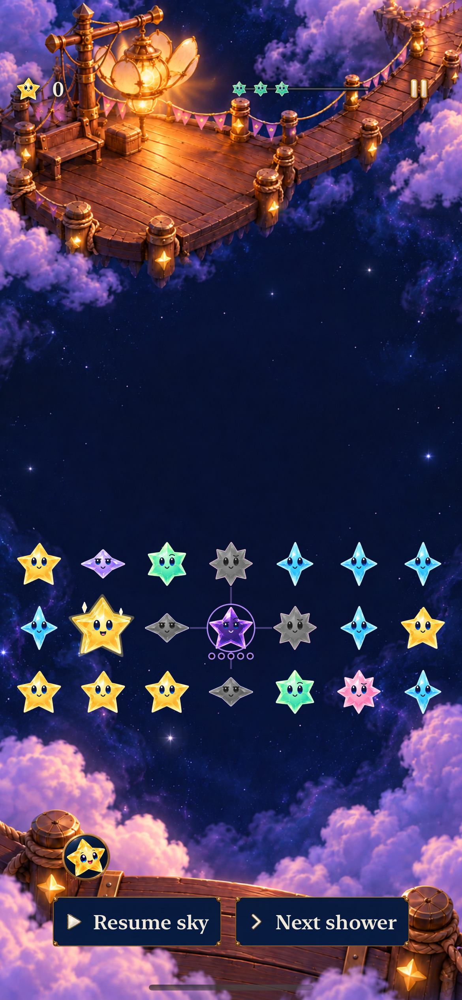 | 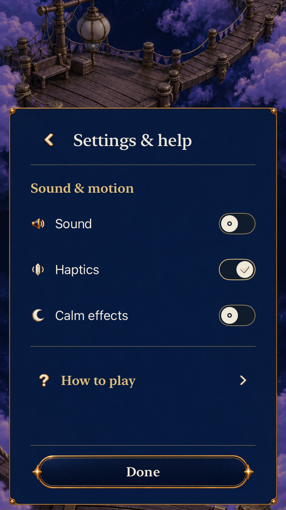 |

**Inspected Debug stills — base `d0dfcc1` plus recorded dirty inputs, runtimes `dev.e5980859cf` / `dev.93ae37d0b8`, iPhone 17e / iPhone SE (3rd generation), iOS 27.0 Simulator, default text.** The [capture index](../evidence/observatory-ui-parity-2026-10-20/captures.json) also identifies phone menu, scrolled balance, XXXL reading end, tutorial completion, full-sky result, tablet portrait menu, landscape home and corrected XXXL Studio. [The report](../evidence/observatory-ui-parity-2026-10-20/README.md#inspected-native-appearance) separates these appearance samples from passing interactions, failed checks, later source differences and unpictured variants. The XXXL reading sample uses a historical Dusk review fixture; fresh survival rules are unchanged. The prior [native UI captures](../evidence/observatory-ui-native-2026-10-19/captures.json) remain historical for replaced controls.

## Sunwheel Mill native board

| Phone at 75% | Dense iPad landscape at 75% | iPad portrait restored |
| --- | --- | --- |
| 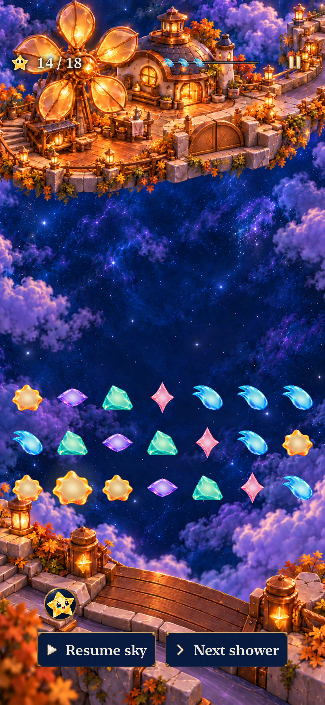 | 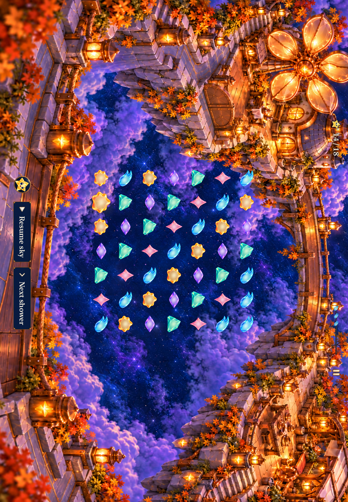 | 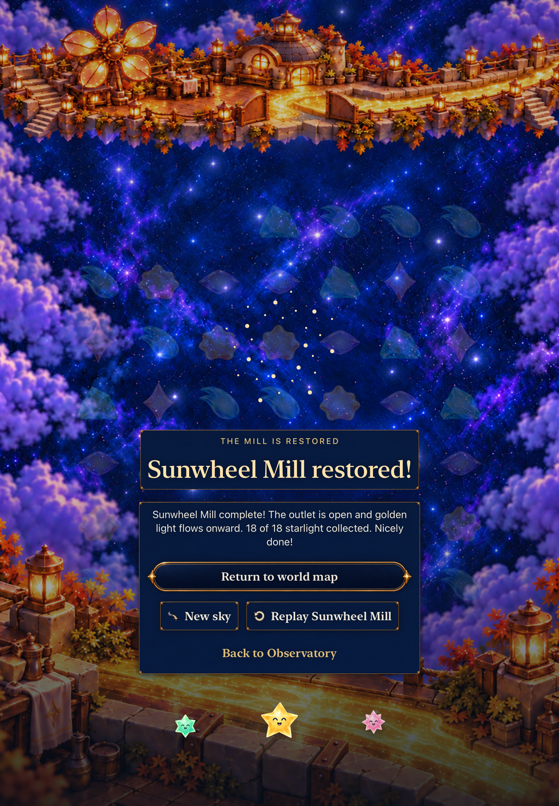 |

**Current inspected native stills — source `d057696`, runtime input fingerprint `dev.a15832d0fd` (literal simulator label `dev.local`), Debug, iOS 27.0 Simulator, default text, normal-motion setting.** Phone is iPhone 17e; both tablets are iPad Air 11-inch. The closed outlet remains distinct beside the restored wheel at 75%; the portrait result leaves the open outlet and golden flow visible. [Capture hashes and source boundaries](../evidence/sunwheel-mill-2026-10-20/captures.json) identify the exact originals. These three stills sample native appearance; they do not establish animation, measured contrast, physical play or actual VoiceOver. [Verification and delivery status](../evidence/sunwheel-mill-2026-10-20/README.md) remain separate.

## Official world map

The [October 20 adversarial review](../evidence/ui-adversarial-2026-10-20/README.md) led to independent island artwork, visible native destination controls and a pinned selected-place card. The generated concept remains design guidance. The native samples below use the combined source `6f24b689` / `dev.c8ef40bcdc`; subsequent dialogue/Studio fixes leave the map renderer unchanged.

| Fresh tablet journey | Tablet with mixed repairs |
| --- | --- |
| 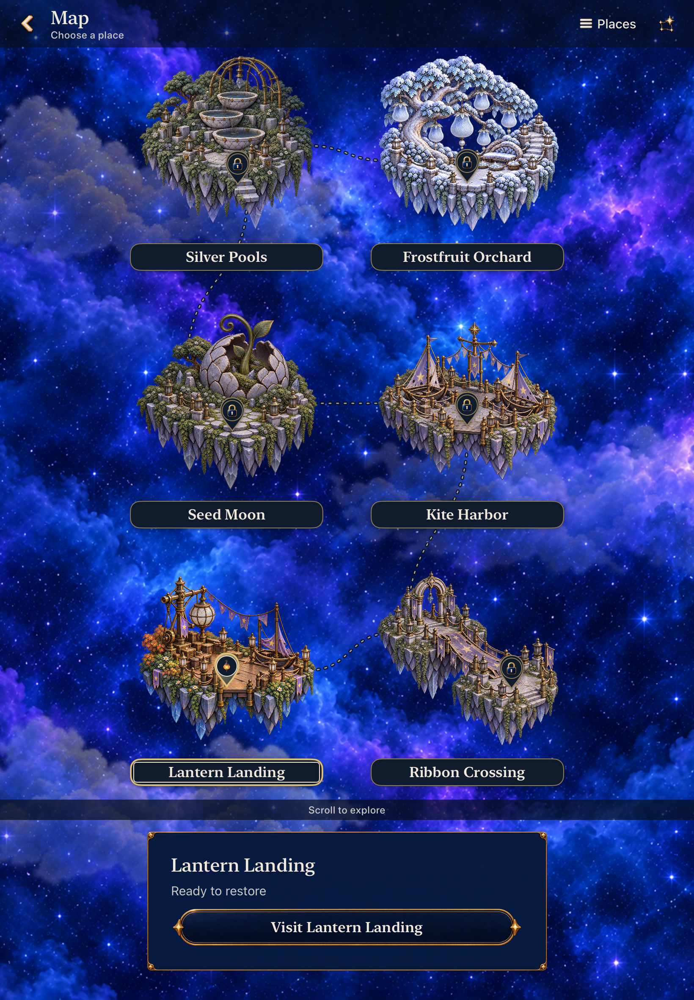 | 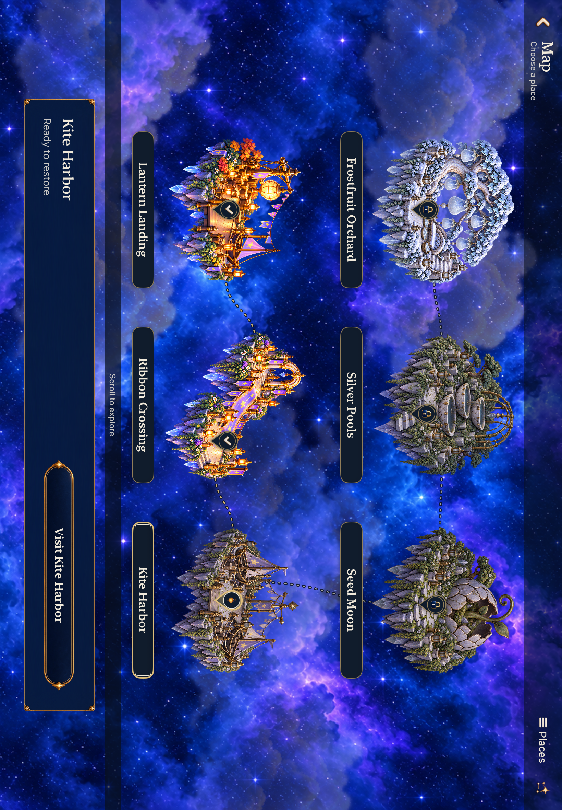 |

**Inspected Debug stills — computed fingerprint `dev.c8ef40bcdc`, displayed build `dev.local`, iPad Air 11-inch (M3), iOS 27.0 Simulator, default text.** The [current capture index](../evidence/ui-adversarial-2026-10-20/current-main-captures.json) also retains all-ready and recovery tablet maps, compact Lantern entry and the pre-correction clipped-dialogue discovery. [Validation](../evidence/ui-adversarial-2026-10-20/current-main-validation.json) separates native interactions and inspected appearance; the clipped dialogue is corrected in the following evidence. Nonselected content may extend beyond the scroll viewport with the visible cue. These stills do not establish every text-size variant, animation, actual VoiceOver or physical-device acceptance.

**Earlier source-bound appearances:** [Seven six-island captures](../evidence/ui-adversarial-2026-10-20/expanded-captures.json), `dev.e9657b05ce`, retain compact fresh/restored/locked Frostfruit, extra-large recovery and largest-text Places samples. Their 14-tablet/22-phone inspection and original failures remain in the [implementation record](../evidence/ui-adversarial-2026-10-20/IMPLEMENTATION.md). [Five-island samples](../evidence/ui-adversarial-2026-10-20/modular-captures.json), [painted-map evidence](../evidence/official-world-2026-10-19/README.md) and rejected whole-map prototypes remain historical.

## Dialogue reading

**Cohesion benchmark — Current for the inspected slice, October 23:** [Matched Lantern startup/recovery and maximum-text reading](../evidence/cohesion-goal-01-benchmark-2026-10-23/README.md) compare clean `c496576b` with snapshot `c0cb3a85494d` / `dev.0b9dfde7bb`. Dialogue now has shallow enamel depth and rounded corners. The older backing below is Historical for chrome; its reader/interaction findings remain source-bound. [Hashes and scoped results](../evidence/cohesion-goal-01-benchmark-2026-10-23/verification.json) separate stills from motion, human and device acceptance.

| Compact gameplay body | Largest-text Studio reading end |
| --- | --- |
| 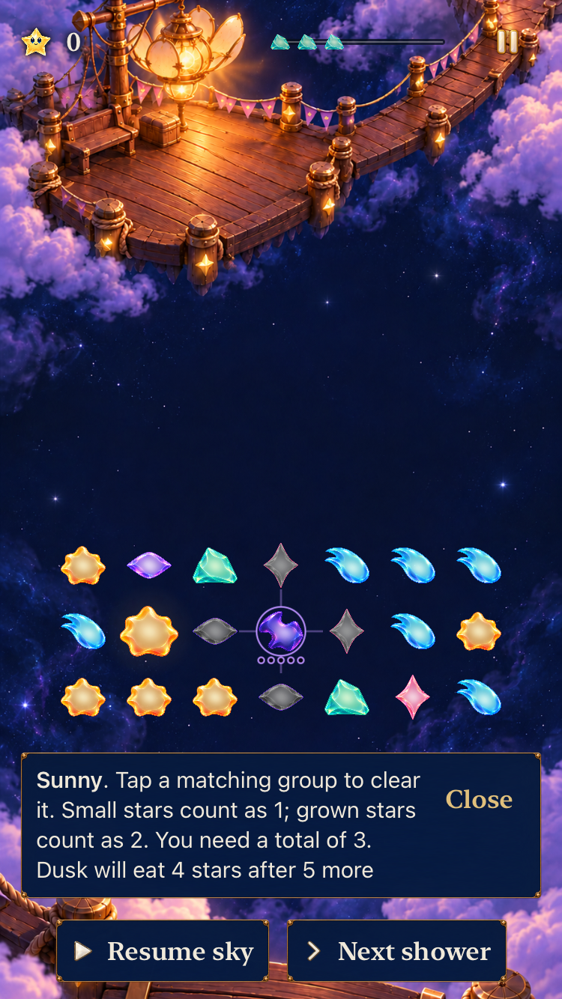 | 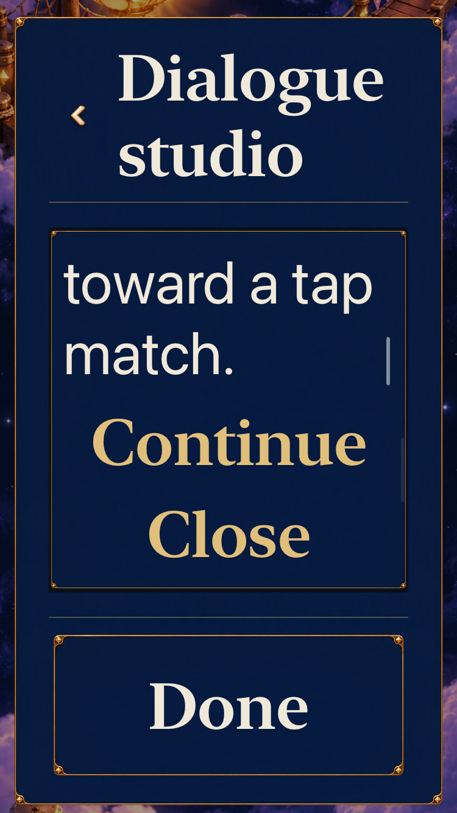 |

**Inspected Debug stills — iPhone SE (3rd generation), iOS 27.0 Simulator; displayed build `dev.local`.** The compact gameplay body uses fingerprint `dev.0cfffbde47` and is unchanged by the final Studio-only correction. The largest-text Studio view uses `dev.d4ba8a7698`, matched to commit `9472691` by [clean-export identity](../evidence/ui-adversarial-2026-10-20/publication-commit-identity.json). [Capture sources and hashes](../evidence/ui-adversarial-2026-10-20/dialogue-fit-captures.json) include reading beginnings/ends and the intermediate 26.5-point Studio failure. [Scoped verification](../evidence/ui-adversarial-2026-10-20/dialogue-fit-validation.json) preserves both failed follow-up runs, final read-through and pinned-control checks. Long text scrolls; a single still does not show the whole message. Actual VoiceOver and physical reading comfort remain separate.

## Capture index

Status follows [the screenshot practice](../SCREENSHOTS.md). These legacy filenames retain their original provenance. Recipe controls and relay feedback were inspected against the builds linked below; the other entries retain their separate refresh limits. Use the linked reports for captured sources and environments; the next implementer touching each surface owns its refresh.

| Surface | Status | Selected evidence / next check |
| --- | --- | --- |
| Ceiling and Lantern board comparison | Ceiling remains Current within its named source; Full Board opening/scores are Historical revision 5 | [Five source-bound captures](../evidence/ceiling-lantern-refill-2026-10-23/captures.json) and [native verification](../evidence/ceiling-lantern-refill-2026-10-23/README.md) show the exact ceiling, numbered near/full columns, default phone Entry and Full Board, and AX3XL tablet ceiling/landscape. Compact largest-text interaction passes separately; actual VoiceOver, physical comfort and player preference remain open. |
| Kite headroom encounter | Current scoped post-#296/#297 development captures | [Inspected phone comparison/result and AX3XL quiet tablet Help/onward](../evidence/kite-headroom-2026-10-23/README.md), computed source fingerprints `dev.ac2d935006`, `dev.556659fb9f` and final HUD-integrated `dev.dbc86ddbaf` (bundle label `dev.local`), with per-capture source limits. New 17,000-point Entry and two opening choices use existing art/geometry; historical Kite0 painting samples retain their original 18-light scope. Human/physical/actual VoiceOver acceptance remains open. |
| Seed ingredient encounter | Current scoped integrated development captures | [Seed 11,000-point Entry, grown ingredient, comparison/result and largest-text review](../evidence/seed-ingredient-2026-10-23/README.md), sources `dev.a7fb00d69e` and `26124268` / `dev.596d285373` retain earlier passes; final `8bc0ebf6` / `dev.495b77cd3c` refreshes actual-clock result, ceiling and phone/tablet integration (bundle `dev.local`). Historical Seed0 paintings retain their original 18-light evidence. |
| Help → Tutorial coherence | Current for `447320e` / `dev.976d4838a7` | [Goal 10 before/after and AX3XL reading end](../evidence/game-goal-10-coherent-game-2026-10-23/README.md) show the actual Story-first promise, scrollable safety sentence and preserved historical 9/18 return. Native four-mode assertions are separate from stills and human learning. |
| Ribbon identity guidance | Current for `4218cc2` / `dev.a591c1b9bb` | [Goal 7 before/after](../evidence/game-goal-07-ribbon-identity-2026-10-23/README.md) inspects ordinary Entry/live-guide/chain and AX3XL Entry reading end/receipt. The initial AX3XL live viewport prioritizes the board; full live-guide reading and human comprehension are separate. |
| Lantern earned payoff | Current for product `8da83d9` / `dev.60afb687d3` | [Goal 6 native milestone/payoff review](../evidence/game-goal-06-lantern-payoff-2026-10-22/README.md) separates30 unchanged-source sparse/full painting samples from earned repairs and the named onward action. Default/AX3XL primary controls fit; terminal stars remain intentionally dimmed/noninteractive. The two tablet midpoint fittings are corrected in the October 23 cohesion record above; the older preview retains its historical source. |
| Story pressure and recovery | Historical boundary appearance; retained text/recovery evidence at `01c1a32` / `dev.64151f9500` | [Goal 5 native comparison](../evidence/game-goal-05-pressure-recovery-2026-10-22/README.md) inspects the separate full-column status and exact committed recovery, ordinary/AX3XL layouts and manual controls. Human recognition and physical contrast remain separate. |
| Causal cascade sequence | Current for `ae772448` / `dev.0587678fcf` | [Goal 4 sampled normal-play recording](../evidence/game-goal-04-causal-cascades-2026-10-22/README.md) shows Aqua pop, survivor-created Rose square and next pop; stills support sampled chronology, with native ordering/quiet/reset checks separately recorded. No continuous-smoothness or human-comprehension claim. |
| Current Story setup practice | Current for inspected snapshot `9f588ce0b663`, fingerprint `dev.384efe43c5` | [Goal 3 native clue/completion](../evidence/game-goal-03-setup-discovery-2026-10-22/README.md) spans phone default/AX3XL and tablet completion. Hint answer and safe retry/return are tested; human discovery and full largest-text hint-detail reading remain separate. |
| Short Story swipe correction | Current for inspected snapshot `75cb5b40c3f2`, fingerprint `dev.3671aba5cf` | [Goal 2 comparison and captures](../evidence/game-goal-02-movement-trust-2026-10-22/README.md) retain identical native short-release before/after, ordinary/largest text and separate next-move/lifecycle checks. Physical intent/feel and actual VoiceOver remain unverified. |
| Current Story startup | Current for inspected snapshot `b6da26761e94`, computed identity `dev.0acb9d128e`; Simulator label `dev.local` | [Goal 1 source-bound captures and checks](../evidence/game-goal-01-first-minute-2026-10-22/README.md) show the saved objective/action at ordinary Begin on phone/tablet, with the AX3XL reading end and reachable Close. Phone default is a bounded initial viewport with the final survivor hint below it; tablet default shows the whole message. Native counts/state checks remain separate from stills and unperformed human/physical/VoiceOver acceptance. |
| Four-star-line guidance and clear | Current for inspected source `ea2d020e`, input fingerprint `dev.38fb093b7f` | [Three original phone/tablet captures](../evidence/four-star-lines-2026-10-22/captures.json) show the natural four-Violet setup, committed clear and largest-text Ribbon Entry. Native interaction/full-round checks are separate; physical feel and actual VoiceOver remain open. |
| Storm practice instruction | Current for inspected snapshot `eb10a82d3ac4`, base `a46a0f48`; default iPhone 17e Simulator | [Source-bound capture](../evidence/storm-practice-guidance-2026-10-22/capture.json) shows the complete instruction and reachable Next shower action. [Native practice](../evidence/storm-practice-guidance-2026-10-22/README.md) separately verifies all five arrival consequences, completion and retained Story/world state. No new largest-text/tablet, physical learning or actual VoiceOver claim. |
| Tutorial rule-scope introduction | Historical wording, superseded by Goal 3; inspected snapshot `514a81aa673a`, base `7a825e4c`; iPhone 17e Simulator | [Default and AX3XL beginning/end captures](../evidence/factory-tutorial-scope-2026-10-22/captures.json) show the shared introduction before chapters and its scrollable reading path with pinned Done. [Native phone/tablet journeys](../evidence/factory-tutorial-scope-2026-10-22/README.md) preserve the exact Story round and world state; physical learning/comfort are unobserved. Actual VoiceOver is deferred. |
| Fall-back move explanation | Current for inspected snapshot `be34749f3481`, base `f07091c1`; iPhone 17e Simulator | [Default and AX3XL source-bound captures](../evidence/factory-move-feedback-2026-10-22/captures.json) show the complete explanation, with bounded scroll at largest text. [Selected phone/tablet checks](../evidence/factory-move-feedback-2026-10-22/README.md) separately verify next movement/clear and the existing full up/fall animation. Physical comfort remains unobserved; actual VoiceOver is deferred. |
| Current Story growth guidance | Historical for retained revision 3; revision-4 growth wording needs a refreshed frame. Prior inspected snapshot `ff001f5ce36a`, computed input identity `dev.1299a00cca`; Simulator label `dev.local` | [Source-bound phone/tablet captures](../evidence/factory-gameplay-2026-10-22/captures.json) show default presentation and AX3XL read-through endpoints with reachable paused controls. [Checks and earlier expiry failure](../evidence/factory-gameplay-2026-10-22/README.md) distinguish sampled appearance from actual VoiceOver, physical reading comfort and human learning. Prior tap-match growth text is historical for current Lantern/Ribbon and retained for manual-clear rounds. |
| Gameplay pieces | Current for inspected snapshot `756c0353`, computed input fingerprint `dev.e2b265734e` (simulator app label `dev.local`) | [Living-light evidence](../evidence/living-starlight-2026-10-20/README.md) and [capture hashes/context](../evidence/living-starlight-2026-10-20/captures.json) bind seven-family 24/36/44-point materials, native/forecast parity and a [49-piece Frostfruit fixture](../evidence/living-starlight-2026-10-20/dev-d94903b-wip-756c0353__frostfruit-dense-49__iphone-17e__normal-motion.png). Native interactions and sampled normal video are recorded separately; physical recognition/performance, minimum OS and actual VoiceOver remain open. Prior `9e0732a` static-shard appearance is historical. |
| Sunwheel Mill | Current for inspected `d057696` / `dev.a15832d0fd` | [Three retained native captures](../evidence/sunwheel-mill-2026-10-20/captures.json) show phone 75%, a 49-piece tablet landscape at 75%, and the restored tablet portrait result. The [report](../evidence/sunwheel-mill-2026-10-20/README.md) owns broader all-state checks and sampled motion. Publication and installation are verified. The offline reviewer omits native living-light fill, aura, motion, controls and hit testing. |
| Frostfruit Orchard | Historical gameplay bodies; scenery retained at recorded source | [Development evidence](../evidence/frostfruit-orchard-2026-10-20/README.md) and [capture index](../evidence/frostfruit-orchard-2026-10-20/captures.json) separate combined Observatory/Frostfruit inputs `6aee65e` / `dev.bd94e46b80` from pre-integration `bede49c` / `f7b5c71` captures. The source paintings are unchanged; fresh checks own combined HUD, icons, menus and adaptive results. Actual VoiceOver, full RC and physical gameplay remain separate. |
| Observatory UI | Needs refresh for final-source certification; inspected candidate samples retained | [Parity evidence](../evidence/observatory-ui-parity-2026-10-20/README.md) and [ten capture sources/hashes](../evidence/observatory-ui-parity-2026-10-20/captures.json) cover HUD, settings, tutorial, reading, result and tablet home at four recorded runtimes. Later changes, Help and unpictured variants require their own comparison. No still certifies motion or device acceptance. |
| Home / welcome | Current for sampled tablet landscape composition; other variants need refresh | [Three-mode home](../evidence/observatory-ui-parity-2026-10-20/dev-beb612a874__home__ipad-air11__landscape.png), `dev.beb612a874`, base `d0dfcc1` plus recorded inputs, iPad Air 11-inch (M3) / iOS 27.0 Simulator. The captured home composition was unchanged at the original parity review; this does not certify the integrated source or phone variants. |
| HUD / reading | Current for cohesion snapshot `c0cb3a85494d`; older dialogue chrome Historical; other variants need refresh | [Lantern before/after and AX3XL reading](../evidence/cohesion-goal-01-benchmark-2026-10-23/README.md) show shallow enamel at `dev.0b9dfde7bb`. [Grouped story HUD](../evidence/story-first-pair-2026-10-20/captures.json) retains its score source. [Earlier compact/Studio reader checks](../evidence/ui-adversarial-2026-10-20/dialogue-fit-validation.json) retain behavior findings and intermediate failures, with Historical backing artwork. |
| Settings / balance | Needs refresh for complete variants; inspected compact/phone/tablet samples | [Preferences, menu and scrolled balance](../evidence/observatory-ui-parity-2026-10-20/captures.json) use one authored frame and rendered icons. Selected stills do not show every page, scroll position or text size. Earlier settings chrome below is historical. |
| Tutorial / outcomes | Needs refresh for all states; selected completion/result samples | [Shower tutorial completion and full-sky result](../evidence/observatory-ui-parity-2026-10-20/captures.json), `dev.e5980859cf` / `dev.beb612a874`. The footer/result hierarchy is visible; full behavioral coverage and later source differences remain in the report. |
| World map / Places | Damaged Ribbon superseded by Goal 8; other goal-card scope current for inspected snapshot `07d5cea32c27`, runtime `dev.c9772c178b`; earlier card frames Historical | [New native cards and preservation checks](../evidence/map-goals-2026-10-22/README.md) cover default Map/Places, XL illustrated-map actions and AX3XL tablet historical/current targets. [Capture hashes](../evidence/map-goals-2026-10-22/captures.json) bind four selected stills. Earlier [combined-source map states](../evidence/ui-adversarial-2026-10-20/current-main-captures.json) retain their recorded scenery/interaction evidence; they do not show the new goal card. Physical comprehension and actual VoiceOver remain separate. |
| Tutorial trace completion / returned index | Current integration interaction checks pass; earlier inspected stills retained | [Combined-source native checks](../evidence/ui-adversarial-2026-10-20/current-main-validation.json) cover real Tutorial actions/return and the covered map at `dev.c8ef40bcdc`. [Three inspected captures](../evidence/ui-adversarial-2026-10-20/final-input-captures.json) retain the earlier `dev.96f4131f5d` appearance: exactly-five completion and the visible returned chapter. Their displayed build is `dev.local`; [clean export identity](../evidence/ui-adversarial-2026-10-20/final-commit-identity.json) identifies that checkpoint. Largest-text practice remains scrollable. Actual VoiceOver and physical play remain separate. |
| Tutorial compact completion | Historical defect evidence at `d0dfcc1`; corrected presentation has separate parity evidence | [Baseline Match completion](../evidence/ui-adversarial-2026-10-20/README.md) records T5 before the shared tutorial correction. [Parity tutorial outcomes](../evidence/observatory-ui-parity-2026-10-20/README.md#tutorial-corrections) record the later footer/layout checks; combined-source and physical acceptance remain separate. |
| Silver Pools | Current artwork; historical interface and result ordering | [Native evidence, nine retained captures and motion](../evidence/silver-pools-2026-10-19/README.md), `aabd673` / native-equivalent `84ae918`, `dev.98f8ba82e6`. Dense49-star clears, rotation, named win/restore/replay, compact and largest-text/system Reduce Motion checked. Early pool cue and lower control contrast retain physical-play limits. |
| Welcome / Sky menu | Historical navigation and chrome; see Observatory UI | [Inspected scrolled phone captures](../evidence/silver-pools-2026-10-19/captures.json), `aabd673` native inputs / `dev.98f8ba82e6`. Full five-location roster visible; upper content intentionally outside viewport. |
| Seed Moon | Current at cohesion source`f7487ebd`; earlier paintings Historical | [Native family and full49-star phone/tablet review](../evidence/cohesion-goal-05-seed-place-2026-10-23/README.md) retains five cumulative states and connected mineral scenery.100% is a dimmed result, not active density. Forecast/pause contrast review remains for goal10; physical play and VoiceOver are unmeasured. |
| Kite Harbor | Current artwork; historical interface and result ordering | [Native evidence and seven retained captures](../evidence/kite-harbor-2026-10-19/README.md), `c89ea67` / `1bb2b51`, runtime `dev.b05d0b243e`. All states inspected; real clears/rotation, named win/restore/replay, largest text/Reduce Motion and a sampled normal-motion finish are recorded separately. Readable portrait HUD overlap and cloud/control contrast remain development tradeoffs; actual VoiceOver and physical play remain open. |
| Ribbon Crossing | Current for revised largest-text entry/HUD; other UI variants need refresh | [Revised first-pair captures](../evidence/story-first-pair-2026-10-20/captures.json), `eba7d4a` / `dev.22c1ff436d`, show 220,000-point entry and the 7,000 native clear. Older evidence retains its artwork scope.  [Native acceptance and captures](../evidence/ribbon-crossing-2026-10-19/README.md): all fifteen paintings inspected; final `4dff983` / `15fbdf6`, runtime `dev.453e081fb5`, remove bridge traversal. Compact win/replay, real tablet clears/rotation, largest text/Reduce Motion and a 49-star visual sample pass. Actual VoiceOver, physical play and dense-board input remain separate. |
| CI portrait capture recovery | Current for sampled compact portrait and ready entry captures | [Portrait recovery](../evidence/ci-recovery-2026-10-19/README.md#batch-3-native-input-readiness-and-portrait-captures) removes the black crop. [Entry readiness](../evidence/ci-recovery-2026-10-19/README.md#batch-10-complete-local-matrix-and-entry-capture-readiness), `618e2c8` + test snapshot `60a02f54`, shows the revealed Begin panel on 17e; SE3 and largest-text views scroll to Begin. No app artwork/layout change; full remote CI, animation quality and physical play remain separate. |
| Lantern Landing / First Light | Current for revised default-phone entry/play/win; other UI variants need refresh | [Revised first-pair captures](../evidence/story-first-pair-2026-10-20/captures.json), `eba7d4a` / `dev.22c1ff436d`, show the 150,000 target and earned 151,000 win. Older evidence retains its artwork scope.  [Native captures and motion record](../evidence/lantern-landing-2026-10-19/README.md#visual-and-motion-evidence): fifteen milestones, tablet rotation/clears, compact-phone landscape and corrected largest text. Source `8fb2e78`, runtime `dev.5afe4a3c23`; retained stills identify their earlier unchanged-artwork sources. The original delivery retains its 40-star and rapid-input scope. The October 23 cohesion record above supersedes its two 50% fitting paintings and supplies actual49-star tablet review. Physical play and RC VoiceOver remain separate. |
| Crystal-depth celebrations | Current for hosted 7,000/10,000 normal/quiet samples; complete game variants need refresh | [Inspected grouped awards](../evidence/story-first-pair-2026-10-20/README.md#results-and-inspected-appearance), hosted test source `92830c6`, same runtime `dev.22c1ff436d`.  [Final nightscape integration](../evidence/nightscapes-2026-10-18/README.md#final-integration-checks), source `1c624cb`, runtime `dev.235ece3931`. [Earlier board-clarity evidence](../evidence/board-clarity-2026-10-18/README.md) retains its separate source. Named/ordinary awards use the sky above playable rows; compact native type preserves legibility; maximum text stays below. [Prior central placement](../evidence/crystal-depth-native-2026-10-18/INTEGRATION.md) is historical for layout. Physical comfort and RC VoiceOver remain open. |
| Committed action feedback | Historical guide chrome; source-bound committed-feedback reference | [Consequence feedback](../evidence/consequence-feedback-2026-10-18/README.md), integrated source `0842a61`, runtime `dev.bf4ade9d68`. Guide and protected award agree on the exact clear; the next match remains visible. Physical comprehension and actual VoiceOver remain open. |
| Edge-swipe feedback | Historical guide chrome; source-bound rejection reference | [Four-edge native acceptance](../evidence/edge-feedback-2026-10-18/README.md), runtime `dev.3be5031c35`, snapshot `e516aad66176`. Exact direction explanation remains below the unchanged board; the following tap succeeds. Physical comprehension remains open. |
| Forecast timing | Historical HUD chrome; source-bound timing reference | [Monotonic forecast](../evidence/shower-forecast-2026-10-18/README.md#inspected-native-forecast), clean `ce00692`, runtime `dev.9020625ab7`. Approach precedes commitment; physical camera fit remains open. |
| Painted world map and real-board tutorial | Historical control chrome; current UI validation tracked separately | [Official-world integration](../evidence/official-world-2026-10-19/README.md) retains its map and practice evidence; the [Observatory native record](../evidence/observatory-ui-native-2026-10-19/README.md) owns subsequent UI validation. Source paintings alone do not establish native appearance. |
| Interactive Help examples | Historical — replaced by real-board practice | [Setup discovery](../evidence/setup-discovery-2026-10-18/README.md#inspected-appearance), clean runtime `774cf98`, `dev.14bd6d9ce3`. Explicit move cue and scrolling result inspected; physical learning and actual VoiceOver remain open. |
| Crystal lettering alphabet pack | Current for exported assets and offline browser viewer | [Complete character/angle sheets](../../Artwork/CrystalComet/README.md) and [source-bound browser capture](../evidence/crystal-comet-sprites-2026-10-18/README.md). User-selected depth, 106 characters, 45 views; this row describes the offline master, with native evidence listed above. |
| Crystal lettering motion study | Historical — crystal depth selected | [Relay! / +128 matched-angle browser specimen](celebration-lettering/motion-specimen-01/README.md), snapshot `0d28c50-wip-12b3777c44a1`. Retained to explain flat tilt versus shallow geometric edges; full alphabet production is owned by the subsequent package. |
| Hold-to-draw armed cue | Current for sampled default phone armed state; physical feel open | [Inspected native game capture](../evidence/hold-feedback-2026-10-18/README.md#inspected-native-presentation), runtime `dev.0f08b779a9`, iPhone 16 Pro Max / iOS 27.0 Simulator. Eight open rays distinguish armed drawing; quiet transition checked in native host. |
| Follow-up acknowledgment | Needs full-game/phone capture; isolated native cue inspected | [Bounded source corners and direction arrow](../evidence/follow-up-input-2026-10-18/README.md#visual-and-timing-limits), runtime `dev.677341325c`, native SpriteKit host on iPhone 16 Pro Max / iOS 27.0 Simulator. The arrow clears the star's face. This scene-only render does not establish Observatory contrast or physical timing. |
| Welcome | Historical — replaced by the three-mode Observatory home | [Four-choice Welcome](../evidence/seed-moon-2026-10-19/dev-b77a100__welcome-four-challenges__iphone-17e__scrolled.jpg), `b77a100`, runtime `dev.545382e6f6`, iPhone 17e / iOS 27.0 Simulator. All choices and Settings & help are readable together; the upper title is outside the deliberate scroll viewport. [Earlier one-choice capture](../evidence/sky-flow-2026-10-17/welcome.jpg) is Historical. Other sizes retain their separate evidence. |
| Entry | Historical UI chrome; scene and save-boundary evidence retained | [Seed entry over a retained Kite round](../evidence/seed-moon-2026-10-19/dev-a0c7360__seed-entry-over-kite__iphone-17e__default-text.png), `a0c7360`, runtime `dev.017575ea43`, iPhone 17e. Title, 18-light objective and all entry actions are readable. [Native tests](../evidence/seed-moon-2026-10-19/README.md) separately verify cancellation over all three prior challenges and replacement only at Begin. [Earlier Kite entry](../evidence/kite-harbor-2026-10-19/dev-c89ea67__kite-entry__iphone-17e__retained-ribbon.png) and [replay explanation](../evidence/ending-replay-2026-10-19/README.md#inspected-native-appearance) retain their own sources. |
| Active play | Historical UI chrome and retired nightscape layouts | [Inspected native nightscapes](../evidence/nightscapes-2026-10-18/README.md#inspected-native-appearance): Final native phone/mini inspection at `1c624cb` includes protected awards and the higher header. Earlier `f40be2e` wide images retain their previous header position. Historical Dusk fixture is labeled separately from fresh rules. Existing crystal-depth award/gesture evidence above remains source-bound. Actual VoiceOver, sustained performance and physical comfort remain open. |

| Recipe input during rain | Historical — Arrange mode removed | [Earlier automatic setup acceptance](../evidence/calibration-timing-and-arrange-2026-10-18/AUTOMATIC_SETUPS.md) retains its source-bound selected-square/control evidence; current recipe selection uses direct traces. |
| Save notices | Current for sampled phone default/maximum-text states | [Inspected rejection read-through and write-failure captures](../evidence/debt-followup-2026-10-18/README.md#6-visible-save-recovery-and-failure-notices); native Done/restore/background checks passed; actual VoiceOver remains RC work. |
| Settings / Sky menu | Historical navigation and chrome; see Observatory UI | [Four-choice Sky menu](../evidence/seed-moon-2026-10-19/dev-b77a100__sky-menu-four-challenges__iphone-17e__scrolled.jpg), `b77a100`, runtime `dev.545382e6f6`, iPhone 17e. Done, sound/motion controls and all four 18-light choices are readable. This viewport does not establish all settings or Help coverage. [Prior contextual Help](../evidence/debt-followup-2026-10-18/README.md#5-rule-aware-help) and [hold/direction Help](../evidence/immediate-swipes-2026-10-18/README.md#inspected-native-presentation) retain their sources; earlier menu captures are Historical for the choice roster. Actual VoiceOver remains open. |
| Outcomes | Current sampled Frostfruit/compact Lantern results; earlier result controls Historical | [Combined Frostfruit result captures and native checks](../evidence/frostfruit-orchard-2026-10-20/README.md) show local reading surfaces and actions before decorative cast at `6aee65e` / `dev.bd94e46b80`, retaining Observatory’s adaptive scenic/compact/scroll presentation. Compact, largest text/Reduce Motion, overflow and tablet final Home action checks pass. The earlier `f7b5c71` correction remains pre-integration history. Other retained result samples below preserve their original appearance.  [Native Seed win](../evidence/seed-moon-2026-10-19/dev-a0c7360__seed-100__iphone-17e__native-win.png) and [scrolled AX3XL/Reduce Motion result](../evidence/seed-moon-2026-10-19/dev-a0c7360__seed-100__iphone-17e__ax3xl-reduce-motion-scrolled.png) use `a0c7360`; [zero-score overflow](../evidence/seed-moon-2026-10-19/dev-b77a100__seed-overflow-000__iphone-17e__default-text.jpg) uses `b77a100`. [Compact Seed result](../evidence/seed-moon-2026-10-19/dev-124fd21__seed-100__iphone-se3__native-win-scrolled.png) uses `124fd21` with the unchanged `dev.545382e6f6` runtime. [Evidence](../evidence/seed-moon-2026-10-19/README.md) separates stills, interactions and motion. [Kite](../evidence/kite-harbor-2026-10-19/README.md) and [earlier general ending/replay](../evidence/ending-replay-2026-10-19/README.md#inspected-native-appearance) keep their separate sources. Physical comprehension and actual VoiceOver remain open. |

## Silver Pools

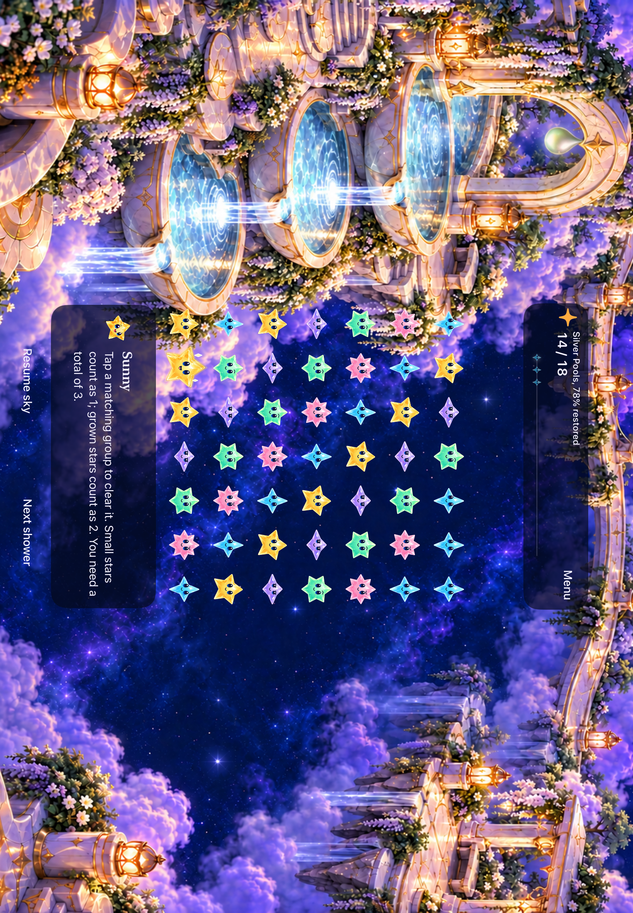

**Native `aabd673` inputs, runtime `dev.98f8ba82e6`, iPad Air 11-inch (M3) / iOS 27.0 Simulator, normal motion enabled.** The arch holds its droplet above a clear gap; the [actual winning result](../evidence/silver-pools-2026-10-19/dev-aabd673__silver-100__ipad-air11-m3__landscape-native-win.png) shows the released thread. [All fifteen state reviews, captures and limitations](../evidence/silver-pools-2026-10-19/README.md) distinguish appearance, input and sampled animation from physical/RC acceptance.

## Seed Moon

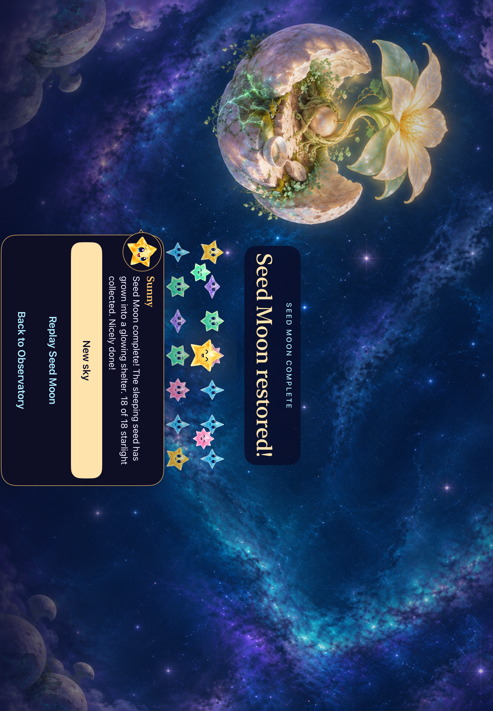

**Native `a0c7360`, runtime `dev.017575ea43`, iPad Air 11-inch (M3) / iOS 27.0 Simulator, default text with normal motion enabled.** The open flower follows the closed 75% bud in the same continuous scene. Compare [tablet portrait 50%](../evidence/seed-moon-2026-10-19/dev-a0c7360__seed-050__ipad-air-11-m3__portrait.png), [phone 75%](../evidence/seed-moon-2026-10-19/dev-a0c7360__seed-075__iphone-17e__default-text.png) and the [native phone winning result](../evidence/seed-moon-2026-10-19/dev-a0c7360__seed-100__iphone-17e__native-win.png). The [corrected phone 50% dense scene](../evidence/seed-moon-2026-10-19/dev-b77a100__seed-050__iphone-17e__49-stars.jpg) uses `b77a100` / `dev.545382e6f6`: its thin shoot now rises above the HUD. Earlier phone 50% captures are Historical. A [compact Seed winning result](../evidence/seed-moon-2026-10-19/dev-124fd21__seed-100__iphone-se3__native-win-scrolled.png) at `124fd21` / the same runtime shows the two-line heading, full dialogue and Replay after scrolling on iPhone SE (3rd generation); Back to Observatory continues below that viewport. All fifteen states are inspected; [the evidence report](../evidence/seed-moon-2026-10-19/README.md) separately records input and motion, with physical play and actual VoiceOver still open.

## Kite Harbor

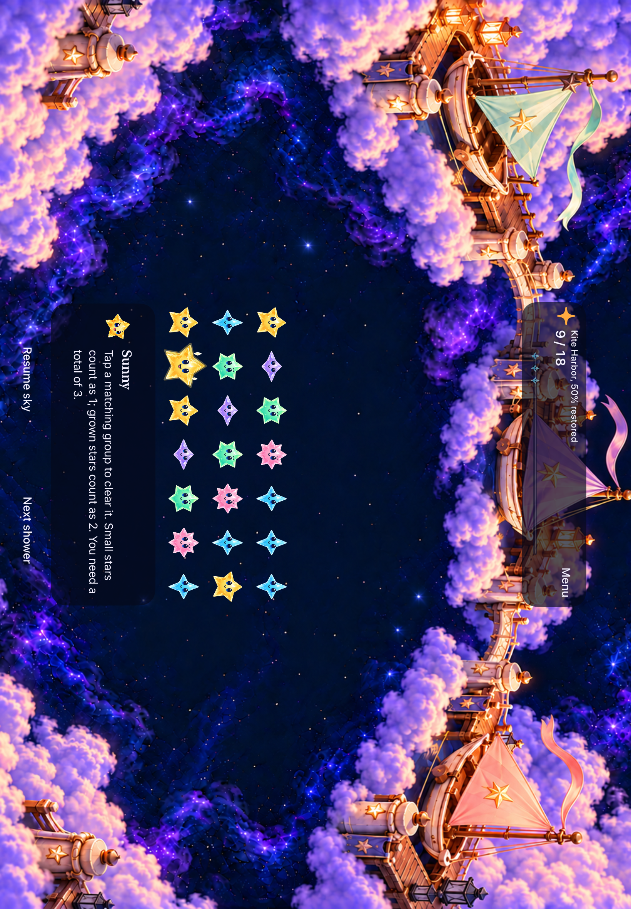

**Native `1bb2b51`, runtime `dev.b05d0b243e`, iPad Air 11-inch (M3) / iOS 27.0 Simulator, default text and normal motion enabled.** The continuous painting restores sails and mooring lights around the playable stars. Compare the [same 50% tablet portrait](../evidence/kite-harbor-2026-10-19/dev-1bb2b51__kite-050__ipad-air11-m3__portrait.png) and phone [75% scene](../evidence/kite-harbor-2026-10-19/dev-c89ea67__kite-075__iphone-17e__default-text.png) / [native winning result](../evidence/kite-harbor-2026-10-19/dev-c89ea67__kite-100__iphone-17e__native-win.png); the phone captures use `c89ea67` with the same runtime. All fifteen native states were inspected. [Evidence and limitations](../evidence/kite-harbor-2026-10-19/README.md) distinguish stills, actual input and sampled motion; these images do not establish physical play or actual VoiceOver.

## Ribbon Crossing

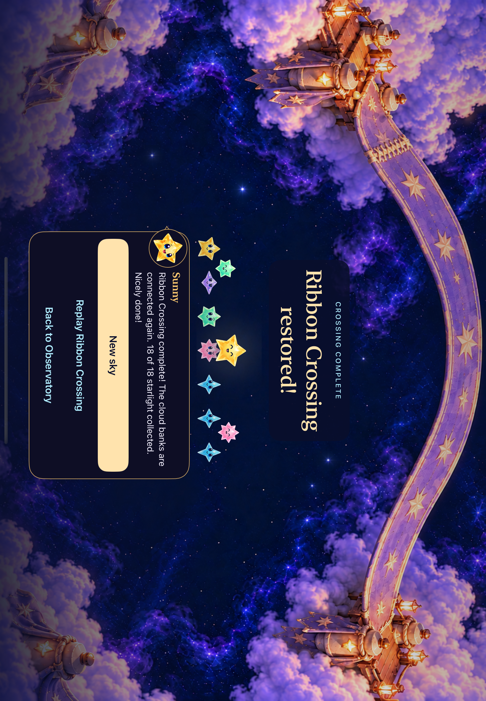

**Native `15fbdf6`, runtime `dev.453e081fb5`, iPad Air 11-inch (M3) / iOS 27.0 Simulator, default text and normal motion.** The bridge is restored with no traveling characters. [Phone, portrait, state and motion evidence](../evidence/ribbon-crossing-2026-10-19/README.md) records separate sources and limitations.

## Lantern Landing in First Light

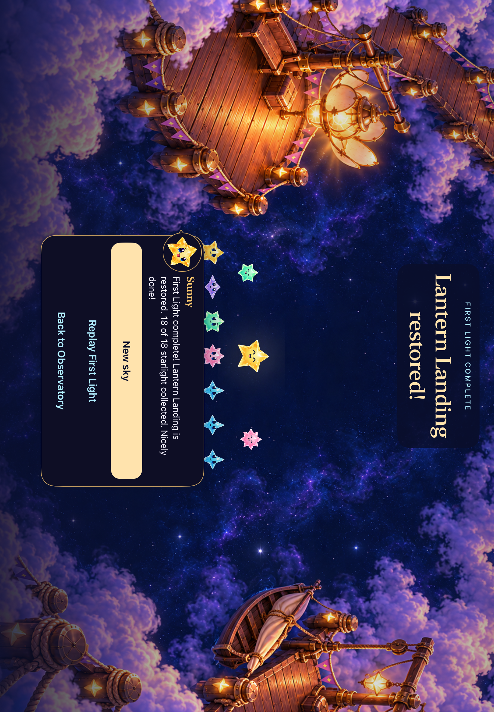

**Native `caa0c5f`, runtime `dev.4239835f1c`, iPad Air 11-inch (M3) / iOS 27.0 Simulator, default text.** The retained image shows the continuous wide composition; artwork is unchanged in the later verified source. [The acceptance record](../evidence/lantern-landing-2026-10-19/README.md) separately covers motion, the accessibility header correction and delivery status. This still does not establish physical play or actual VoiceOver.

## Historical nightscapes

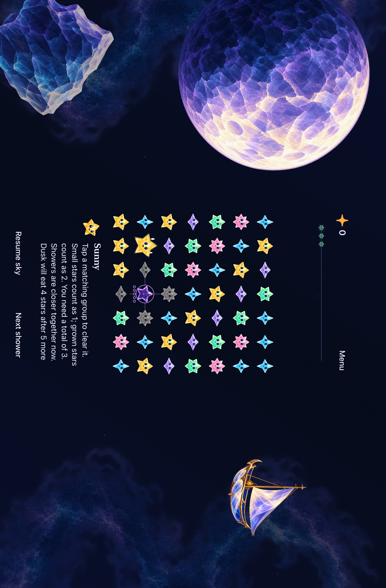

**Native `1c624cb`, iPad mini A17 Pro / iOS 27.0 Simulator, default text, paused historical review fixture.** [All five destinations, fresh phone opening, large score and corrected mini capture](../evidence/nightscapes-2026-10-18/README.md#inspected-native-appearance) retain hashes and test context. This still establishes appearance; normal-motion evidence is separately described in that report.

## Adopted app icon

**Packaged asset — Playful Tumble.** This is the current app-icon PNG, not a screenshot. The [editable source and export instructions](../../scripts/README-app-icon.md) and [native adoption record](../evidence/playful-tumble-icon-2026-10-17/README.md) explain provenance and validation. iOS applies the rounded mask.

## Character chat and script studio

| Active chat | Debug authoring studio |
| --- | --- |
| 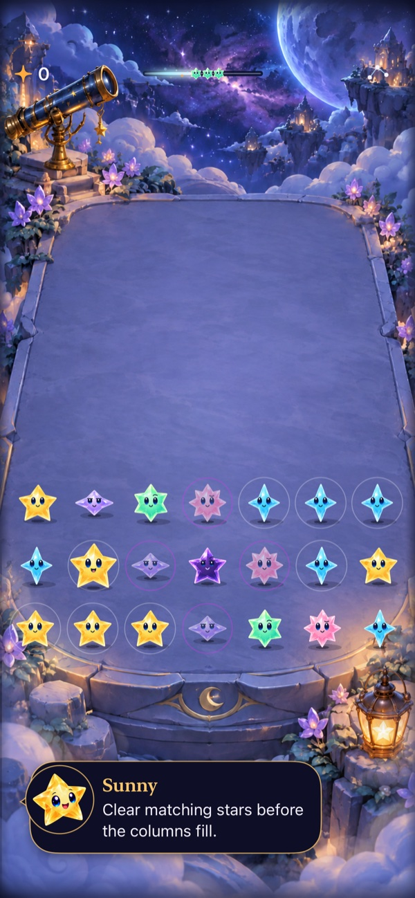 | 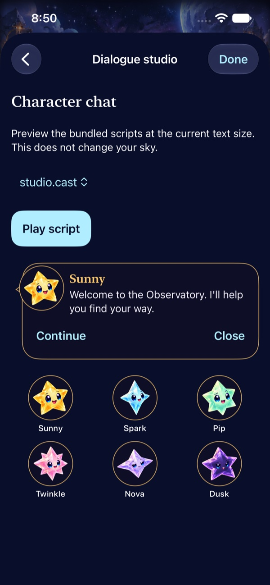 |

**Historical dialogue chrome — source-bound native captures, October 17 character-chat follow-up, 17e / iOS 27.0 Simulator.** [Source hashes, later accessibility correction, small/large-phone checks and limits](../evidence/character-chat-2026-10-17/README.md). [Portrait sources/prompts](../../Artwork/Dialogue/README.md) retain the six generated masters; [authoring guide](../../App/DialogueScripts/README.md) explains future scripts. These captures establish sampled appearance, not actual VoiceOver, physical-device acceptance or parity with the newer storm phone branch.

## Historical welcome and entry

| Welcome, scrolled | Sky menu, scrolled |
| --- | --- |
| 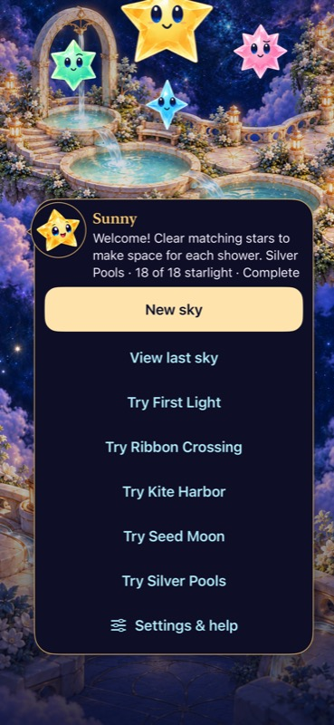 | 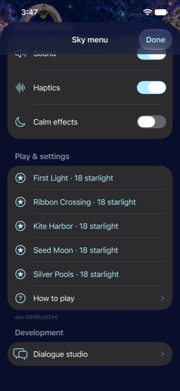 |

**Historical UI — native `aabd673` inputs / native-equivalent `84ae918`, runtime `dev.98f8ba82e6`, iPhone 17e / iOS 27.0 Simulator, default text.** These five-choice menus were replaced by the painted world journey and then the three-mode Observatory home. Scrolling exposes the old choices; upper content is intentionally outside each viewport. [Capture metadata](../evidence/silver-pools-2026-10-19/captures.json) and [entry/Begin interaction evidence](../evidence/silver-pools-2026-10-19/verification.json) retain their original source scope. Earlier [four-choice Welcome/menu](../evidence/seed-moon-2026-10-19/captures.json) and [October 17 Welcome/Entry](../evidence/sky-flow-2026-10-17/README.md) are also historical for navigation and chrome. Use the [parity capture index](../evidence/observatory-ui-parity-2026-10-20/captures.json) for selected new UI references and their source limits. Stills do not establish actual VoiceOver or physical readability.

**Earlier natural-orbit state:** [The natural orbit choice](../evidence/gravity-opportunities-2026-10-17/README.md) has an inspected integrated-board capture and source hashes. The [compact-HUD opening and gameplay captures](../evidence/compact-hud-2026-10-17/README.md) predate later art and flow work. Use that report to investigate historical HUD behavior; use the source-bound orbit capture for its sampled state.

**Launch screen:** A static dark storyboard and opaque app root share a named color. [Batch 1 native launch recordings and limits](../evidence/screen-flow-polish-2026-10-17/README.md) show the tested phone sequences; the opening board above remains gameplay, not a splash capture.

## Faceless gameplay pieces

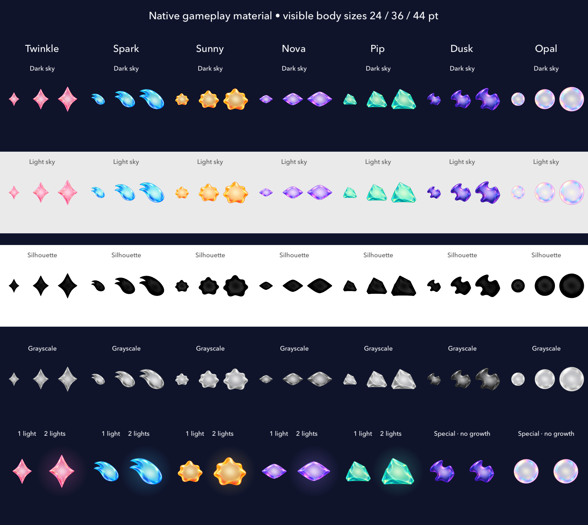

**Inspected native SpriteKit export — base `d94903b` plus snapshot `756c0353`, [source record](../evidence/living-starlight-2026-10-20/source.json), computed input fingerprint `dev.e2b265734e` (simulator app label `dev.local`), iPhone 17e / iOS 27.0 Simulator.** Seven faceless contours stay distinct with continuous inner light and no visible rim spill in these stills. Native and cached forecast materials visually agree; Dusk keeps its notches and Opal its colored rim. The bottom row compares ordinary and grown bodies with one aura, while special roles stay ordinary-sized. The [full 49-piece board and sampled motion](../evidence/living-starlight-2026-10-20/README.md#inspected-appearance) have separate fixture/source limits; physical and RC acceptance remain open.

## Current Crystal Glow cast

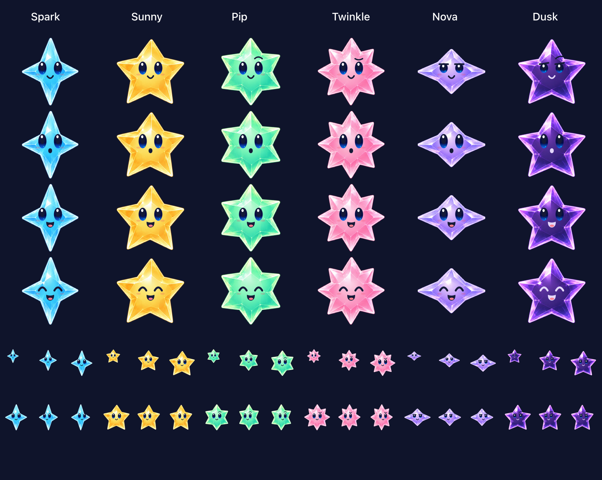

**Retained story-character reference — native renderer export, source `6cc9efd`, iPhone 17e / iOS 27.0.** The user approved the Crystal Glow masters; these faced characters remain in dialogue, map and ceremonies. [Original integration evidence](../evidence/crystal-glow-integration-2026-10-17/README.md) retains its source-bound material/interaction/motion checks, baseline accessibility failures and unverified device acceptance. Its former gameplay routing is superseded by the faceless pieces above.

## Historical cast comparisons

Crystal Glow supersedes the older body rendering. The [motion-candidate sheets](../evidence/star-cast-motion-2026-10-17/README.md) and [luminous revision](../evidence/star-cast-luminous-2026-10-17/README.md) remain historical comparison evidence; do not use them as the current cast reference. Their source and unresolved checks stay with those reports.

The [production cast contract](star-cast/README.md) owns names and recognition cues. [StarCast](../../App/StarCast.swift) owns story materials; [SkyPiece](../../App/SkyPiece.swift) owns the faceless forecast, flight and board materials. Normal pieces carry 1 light, grown pieces 2, dark pieces 0. Revised first-pair stages display 1,000 points per light plus their earned clear-size bonus; historical rounds retain their original score scale. A contact sheet shows poses; it cannot demonstrate falling or turning motion.

## Reuse these visuals

Embed the existing file where it helps a decision; link this page for the full catalog. Keep paths relative, dimensions modest and proportions intact. Retain alt text, the asset/capture/concept distinction and a nearby evidence link. For the protocol and folder coverage rules, see [the writing process](../WRITING.md).

## Attraction field and gravity hole

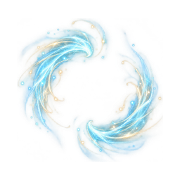

**Packaged production artwork — October 17, 2026.** Built-in imagegen sources and exact prompts are retained in [StarCast artwork](../../Artwork/StarCast/README.md#magnetic-crystal-and-gravity-hole). The field supersedes the solid magnetic crystal; [runtime evidence](../evidence/gravity-art-2026-10-17/README.md) separately covers small-size materials, native play and full/reduced motion.

## Lantern/Ribbon cascade revision

[Inspected revision-two rain and chain samples](../evidence/story-cascades-2026-10-20/README.md) are current for the first-pair entry/clear sequence at runtime `dev.181bb2c16e`. The revision-one gameplay captures remain historical for replaced openings and clear rules; unchanged location paintings retain their original source-bound artwork evidence. Phone play and actual VoiceOver remain open.
