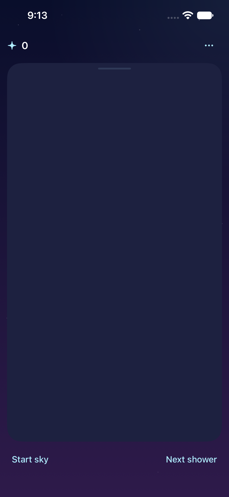
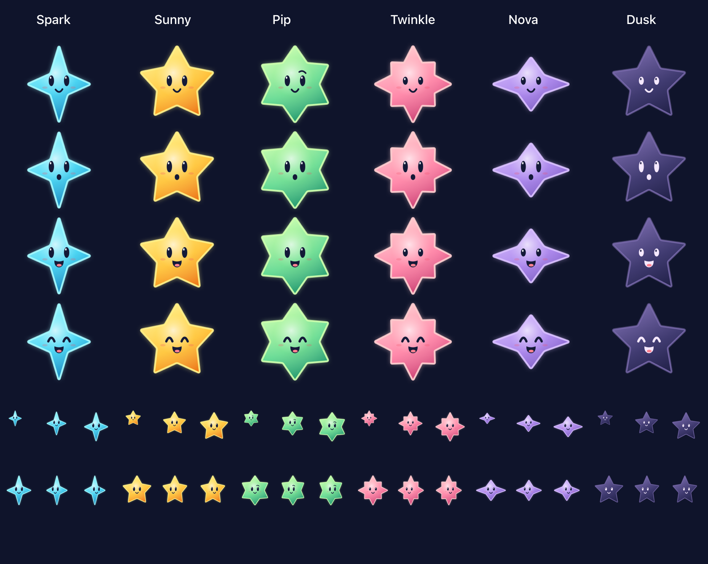

# Starfall visual reference

**Status:** Reference · **Updated:** October 17, 2026

The existing icon, screens and six-star cast, with links to their sources. **These are reference assets and historical native exports:** current-build parity, final art/motion approval, actual VoiceOver and device acceptance remain open.

[Icon](#adopted-app-icon) · [Screens](#opening-screen-and-active-play) · [Cast](#meet-the-cast)

## Adopted app icon

**Packaged asset — Playful Tumble.** This is the current app-icon PNG, not a screenshot. The [editable source and export instructions](../../scripts/README-app-icon.md) and [native adoption record](../evidence/playful-tumble-icon-2026-10-17/README.md) explain provenance and validation. iOS applies the rounded mask.

## Opening screen and active play

| Opening | Active play |
| --- | --- |
|  |  |

**Native captures:** October 17 compact-HUD candidate, iPhone 17e / iOS 27.0 Simulator. [Source hashes, checks and limits](../evidence/compact-hud-2026-10-17/README.md). Select a capture to inspect the full-size file; these screens do not prove parity with later builds.

**Splash screen:** No authored image is checked in. The app uses [automatic launch-screen generation](../../Config/Clean.xcconfig); the opening board above is gameplay, not a splash. Add an authored concept or native launch capture here when one exists, labeled accordingly.

## Current Crystal Glow cast

**Native renderer export — source `6cc9efd`, iPhone 17e / iOS 27.0.** The user approved the Crystal Glow masters; [integration evidence](../evidence/crystal-glow-integration-2026-10-17/README.md) separates final material/interaction/motion checks from baseline accessibility failures and unverified device acceptance. The older cast exports below remain historical references.

## Meet the cast

**Native renderer export — October 17 motion candidate.** Columns identify the six families; rows show idle, landing, grown and clearing expressions, followed by size samples. [Source and verification](../evidence/star-cast-motion-2026-10-17/README.md). The [runtime factory](../../App/StarCast.swift) is authoritative; this sheet is a review artifact, not a separately loaded atlas.

| Character / sheet | Recognition |
| --- | --- |
| [**Spark** · aqua](../evidence/star-cast-motion-2026-10-17/Spark.png) | Tall four-point star; curious eyes |
| [**Sunny** · amber](../evidence/star-cast-motion-2026-10-17/Sunny.png) | Balanced five-point star; friendly face |
| [**Pip** · mint](../evidence/star-cast-motion-2026-10-17/Pip.png) | Compact six-point star; raised eyebrow |
| [**Twinkle** · rose](../evidence/star-cast-motion-2026-10-17/Twinkle.png) | Eight alternating rays; quiet oval eyes |
| [**Nova** · violet](../evidence/star-cast-motion-2026-10-17/Nova.png) | Wide four-point star; sleepy face |
| [**Dusk** · dark](../evidence/star-cast-motion-2026-10-17/Dusk.png) | Concave five-point star; lilac rim, dark interior |

Reading the full motion sheets

Each linked character sheet has four expression rows (idle, landing, grown, clearing) and three facing columns (front, left, right). Open an individual sheet to inspect expression and turn details at full resolution. The overview above gives the family comparison without repeating all twelve poses in each table row.

Point counts and names are presentation cues, not scoring rules. Normal stars are worth 1, grown stars 2, dark stars 0. See the [production cast contract](star-cast/README.md), [motion source and verification](../evidence/star-cast-motion-2026-10-17/README.md), and [luminous revision](../evidence/star-cast-luminous-2026-10-17/README.md). A contact sheet shows poses; it cannot demonstrate falling or turning motion.

## Reuse these visuals

Embed the existing file where it helps a decision; link this page for the full catalog. Keep paths relative, dimensions modest and proportions intact. Retain alt text, the asset/capture/concept distinction and a nearby evidence link. For the protocol and folder coverage rules, see [the writing process](../WRITING.md).
