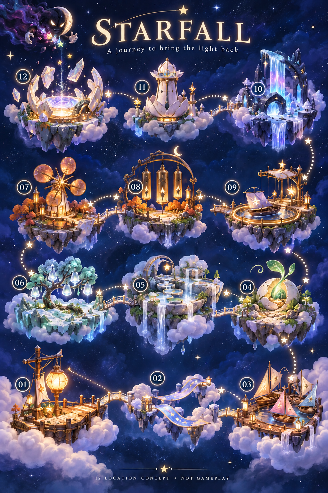

# The twelve places of Starfall

**Status:** Approved map and location direction; developed lore and production proposals · **Owner:** Current implementer · **Updated:** October 20, 2026

These twelve connected places form a lived-in corner of the universe: gathering spaces, gardens, workshops and routes that the stars share. Murk has taken their ambient starlight. Restoring each place brings back a particular piece of daily life, so a win means something different at every stop.

The user approved **Murk and all twelve map locations**. This atlas develops their purpose, appearance and relationships within that direction; the new lore details remain proposals. Lantern Landing is delivered in First Light; Ribbon Crossing is the implemented second optional challenge, with source-bound development verification and canonical installation. [Kite Harbor](kite-harbor-03/PRODUCTION_PLAN.md) is the implemented third bounded challenge, with [verified development evidence](../evidence/kite-harbor-2026-10-19/README.md); merge and canonical installation are verified. [Seed Moon](seed-moon-04/PRODUCTION_PLAN.md) is implemented as the fourth optional challenge with [verified development acceptance](../evidence/seed-moon-2026-10-19/README.md). [Silver Pools](silver-pools-05/PRODUCTION_PLAN.md) is implemented as the fifth optional challenge; [development verification and canonical delivery](../evidence/silver-pools-2026-10-19/README.md) are complete. [Frostfruit Orchard](frostfruit-orchard-06/README.md) is adopted as the sixth ready location with fifteen packaged paintings; [development evidence](../evidence/frostfruit-orchard-2026-10-20/README.md) records validation separately from verified publication and installation. It follows a committed Silver Pools repair in the existing local journey. The other six playable locations remain unbuilt. The [official integration](../OFFICIAL_LOCATIONS_AND_TUTORIAL_PLAN.md) now supplies painted map selection, local repair progression and a real-board tutorial. The [game bible](STARFALL_GAME_BIBLE.md) owns the story and canon. [world-data.js](world-01/world-data.js) owns the exact order and five restoration-state notes used by the [concept explorer](world-01/index.html).

**First slice:** [Lantern Landing](lantern-landing-01/README.md) is implemented and development-verified in the existing First Light challenge, with five states and three bespoke viewport compositions. [Native evidence](../evidence/lantern-landing-2026-10-19/README.md) records source `8fb2e78`, runtime `dev.5afe4a3c23`; merged in [PR #154](https://github.com/lbeezr/starfall/pull/154); the canonical updater verified installation of `dev.5afe4a3c23` from main `ab868b5` in the original `com.starfall.prototype` app on October 19 at 14:53:57 UTC. **Second slice delivered:** [Ribbon Crossing](ribbon-crossing-02/PRODUCTION_PLAN.md) is merged and installed in the original app. Its [development evidence and receipt](../evidence/ribbon-crossing-2026-10-19/README.md) cover all fifteen inspected states, real phone/tablet interaction, recorded normal completion, final hosted/Release passes and canonical installation. Human satisfaction and the wider journey remain separate questions.

## A small universe with a daily life

**Approved generated concept — not gameplay or implementation evidence.** Source: [original map package and prompts](world-01/README.md), October 18, 2026. The image establishes the twelve destinations, their silhouettes and the connected journey. It mostly shows restored places. Lantern Landing has five implemented states in three viewport families; Ribbon Crossing also has five implemented states in three viewport families. Kite Harbor also has five implemented states in three viewport families with recorded development acceptance; canonical installation is verified. Seed Moon has five implemented states in three viewport families; source-art review and bounded native checks are recorded; development acceptance is complete; merge and canonical installation are verified. Silver Pools has five implemented states in three viewport families; [development verification and canonical delivery](../evidence/silver-pools-2026-10-19/README.md) are complete. Frostfruit Orchard's fifteen paintings are adopted for development, with publication and installation verified; the other six places retain concept art and written storyboards. Use the [Murk character sheet](world-01/murk-v1.png) for his approved appearance; the small map cameo is an illustrative variation. The unfamiliar helper group near 01–02 has been removed at the user’s request; any future traveler uses the [approved star cast](VISUAL_REFERENCE.md#current-crystal-glow-cast).

The map is a view of one connected community at several scales. Stars can live nearby, visit friends, tend an orchard, repair a kite or take a ferry. A location can feel inhabited without filling it with houses. A bench under the canopy, a repaired mooring knot or a watering scoop left by a basin can imply a whole routine. Keep these details legible in an entry view and subordinate during play.

The suggestion that these are places where the stars live is developed here as **shared neighborhoods and common places**. Do not assign one star family to each region or imply that body color determines occupation or birthplace. Different members of the cast should be welcome throughout the route. The current six cast identities remain recognizable.

Starlight supports life and useful motion, but the world does not turn into a blank ruin when it is missing. It becomes sleepy, slack and unable to finish its familiar routines. Residents wait, improvise and help one another. Show care that has outlasted the theft: a tied ribbon, a swept dock, a neatly folded sail. The mood is temporarily interrupted happiness. Avoid presenting deprivation, injury or a destroyed home as a decorative obstacle.

Stars lend and share their light. They are never fuel, ammunition or food. A successful puzzle action helps the place; it does not sacrifice its inhabitants. Murk consumes ambient starlight. Dark-looking places, winter and Dusk are not moral categories.

## Four regions with different kinds of recovery

| Region | Shared visual language | Everyday life | Emotional movement | Connection out |
| --- | --- | --- | --- | --- |
| **Soft Skies · 01–03** | Cream ceramic, rosewood, cloud cloth, lavender ribbons; open curves and low platforms | Welcoming visitors, crossing between neighbors, preparing little craft | An isolated arrival becomes a shared departure | The kite fleet carries the cast to Seed Moon |
| **Wild Moons · 04–06** | Leafy moonstone, soft roots, mint water, opal frost; nested bowls and branching forms | Shelter, tending, water and seasonal growth | Notice a small sign of life, then restore a connected living landscape | A drifting orchard seed lights the route to the Clockwork Belt |
| **Clockwork Belt · 07–09** | Rounded copper, slate, warm timber and golden glass; wheels, arches and hanging forms | Craft, public music and regular travel | Individual repairs begin to help the next place directly | The star ferry crosses the dark gap to Aurora Falls |
| **Night’s Edge · 10–12** | Dark glass, silver moonstone, pale petals and restrained aurora; taller silhouettes and clear openings | Watching the sky and keeping shared light circulating | Quiet discovery becomes a confident final act of generosity | Restored connections answer across the whole map |

**Soft Skies** should be close and easy to read. Lower landmarks leave generous sky around the cast. Cloth takes broad bends; wood looks handled and cared for. Amber light belongs inside lanterns and fittings rather than washing the entire scene orange. A gentle breeze becomes perceptible through specific objects returning to use. Each destination has a distinct spatial gesture: a gathering circle, a crossing span and a fan of sails.

**Wild Moons** slows the pace and draws attention to small changes. Forms can be irregular, but their main function must read clearly: seed, water bowls, fruit tree. Light travels through translucent veins and water rather than through identical sockets in every scene. The region includes a cool winter place that remains cool when restored. Healthy nature does not always mean green leaves or spring sunshine.

**Clockwork Belt** introduces the pleasure of things fitting and moving together. Mechanisms are friendly, graspable and rounded, with room for residents to work beside them. The mill, chimes and launch rail share copper fittings, but their movements differ: rotation, a brief answering sway and departure. Mechanism detail is concentrated at the landmark; the playable surface stays visually quiet.

**Night’s Edge** increases scale and distance without making interaction harder to see. Darkness gives pale structures and flowing color space to appear. Keep enough reflected light to read each place at 0%. Aurora Falls supplies broad flowing motion, Petal Beacon a controlled opening and narrow beam, and Hollow Crown a circular release that connects the entire journey. The final region can feel solemn for a moment, but never becomes a different, frightening game.

## What distinguishes every stop

| Stop | Landmark silhouette | Main material or light behavior | The thing the player gives back | Motion reserved for the payoff |
| --- | --- | --- | --- | --- |
| 01 · Lantern Landing | One lantern above a low dock | Warm light through cream lantern panels onto wood | A safe place to gather | Lantern opens; cast gathers |
| 02 · Ribbon Crossing | A broad suspended S-curve | Light follows stitched ribbon patterns | A route between neighbors | Final seam joins; the path reconnects |
| 03 · Kite Harbor | A fan of folded sails | Colored cloth catches moving air | The freedom to set out | Fleet lifts together |
| 04 · Seed Moon | Split round shell and one rising shoot | Light follows roots into a canopy | Shelter | Central bud opens |
| 05 · Silver Pools | Stepped bowls beneath a water arch | Reflections link separate pools | Continuous flow | Upper water thread releases |
| 06 · Frostfruit Orchard | A branching crown of hanging bell fruit | Frost turns translucent from within | A living winter rhythm | Fruit chimes and releases seeds |
| 07 · Sunwheel Mill | Broad copper wheel over a little mill | Channels carry a golden pulse | Useful work | Outlet opens and sends light onward |
| 08 · Bell Choir | Three unequal hanging chimes | Visible answering pulses in golden glass | A shared voice | One short ensemble phrase |
| 09 · Starferry Station | Circular rail and one canopied ferry | Platform lights trace a departure path | Connection across distance | Ferry traces a short arc |
| 10 · Aurora Falls | Tall arch and one hanging curtain | Separate color bands become continuous | The movement of the sky | Aurora falls as one ribbon |
| 11 · Petal Beacon | Closed flower tower around a lens | Soft reflected light resolves into one beam | A way forward | Final petals part |
| 12 · Hollow Crown | Open ring around a reservoir | Trapped color separates and circulates | Shared light returned to everyone | Reservoir opens; map answers |

These are twelve different dramatic rewards, not twelve new puzzle systems. The puzzle questions and five-state sequence remain in [world-data.js](world-01/world-data.js). Art should make those existing beats concrete rather than adding a second task for opening a gate, playing a tune or steering a craft.

## 01 · Lantern Landing — a light that means welcome

Lantern Landing is the place where a traveler can stop looking for somewhere safe to land. The dock is modest: broad planks, rounded posts, a gangway and one generous lantern that reaches farther than the structure beneath it. In ordinary life, stars gather under its light to greet arrivals, share news and decide where to go next. A little seat and a neatly coiled mooring line make this a cared-for place rather than an empty tutorial platform.

Keep the lantern high enough to be unmistakable but close enough to feel approachable. Cream panels hold a warm center; rosewood takes its reflection in a broad, readable patch. The dock’s star-shaped fittings echo the cast without looking like captive characters. The lantern’s hinge and upper chamber should make its final opening physically understandable. Avoid scattering many smaller lamps that would weaken this first landmark.

After Murk’s introductory theft, the mast leans, pennants hang still and the dock feels cold. Its structure remains recognizable. Restoration moves from a single wick to reconnected fittings, a straightened mast and finally the upper chamber opening. The achievement is hospitality: the cast gathers inside the welcoming circle. A small wooden creak and softened lantern resonance can accompany this, while the open shape and shared pose communicate it with sound off.

The completed light reveals Ribbon Crossing beyond the gangway. In a playable composition, keep the mast and lantern beside or above the board and use the low dock as an edge framing element. Even a dense board must remain separate from the brightest reflection. This is the implemented first production slice in First Light. Its [production plan](lantern-landing-01/PRODUCTION_PLAN.md) owns the bounded scope and verified behavior; the broader neighborhood story and route beyond the gangway remain proposed.

## 02 · Ribbon Crossing — neighbors can reach each other

Ribbon Crossing is a small piece of public generosity: two cloud banks joined by a span that has clearly been mended and decorated over time. Stars use it to carry parcels, meet a friend or reach the harbor. The proposed stitched patterns can vary in stitch size and spacing to suggest different hands contributing, without introducing named makers or a new craft culture that the story must explain.

Its silhouette is long and yielding, a broad S-curve that contrasts with Lantern Landing’s upright mast. The main ribbon needs a visible top surface and a clear edge so it reads as a route. Lavender cloth, pale stitching and ceramic anchors tie it to Soft Skies. The material should bend like substantial woven cloth, with rounded folds rather than a thin glowing laser path. Light reconnects the stitched star pattern as the crossing regains its shape.

At first, the route hangs loose with an obvious gap. The important late-stage image is almost-complete connection: the banks are close enough to make the loose middle seam conspicuous. The final seam joins and the two banks become connected again. The emotional reward is access. During gameplay, the existing light transfer, complete-scene crossfade and normal result communicate that achievement; no tiny characters walk the bridge and no separate ripple is required.

Murk’s trail leads onward without another full theft scene. The repaired ribbon reaches Kite Harbor; its repeated cloth treatment anticipates the sails. During play, frame the gap at the board’s edge or in a separate scenic plane. A diagonal decorative route must never be mistaken for a valid matching direction or interactive lane. Character travel through this world belongs to future generated clips/cutscenes. Those clips are not implemented, and travel animation is not a condition of the level win.

The [production plan](ribbon-crossing-02/PRODUCTION_PLAN.md) now applies this identity to the second directly selectable 18-light challenge. It shares First Light’s fixed opening and existing rules, with three continuous viewport families and actual playable stars kept separate from the scenery. [Development verification](../evidence/ribbon-crossing-2026-10-19/README.md) covers all fifteen scene states, phone/tablet interaction, recorded normal completion and final hosted/Release passes and verified canonical installation. The fictional route to Kite Harbor does not implement map traversal or an unlock.

## 03 · Kite Harbor — a departure made possible

Kite Harbor is a workshop and gathering place for small paper-kite boats. In daily life, travelers fold sails, check knots and load light parcels before taking advantage of the sky’s gentle currents. Give each boat a modest difference in fold or rigging so the fleet feels collectively maintained. Their shared construction should remain clear enough that the player recognizes them as one local tradition.

The harbor opens outward in a fan of sails. Rosewood docks and cream ceramic moorings maintain the region’s material family, while pale sail colors introduce movement over a wider area. The boats must read as light craft that can lift, with broad kite-like planes and slender hulls. The approved map’s elegant sailing forms are the directional anchor; production should preserve their welcoming silhouettes while simplifying rigging at phone size.

Without starlight, boats sit folded, sails droop and mooring stars are dark. Recovery gives the air a visible effect: one sail lifts, several unfold and flags take long curves. The last unlit mast star focuses anticipation on a single lead boat. When it catches light, the fleet lifts gently together. Cloth lift and a soft wooden release can convey departure without an engine roar or an explosive launch.

Murk’s double take at the returning fleet gives his mischief a comic consequence. In future user-generated travel clips, the boats can carry the cast toward Seed Moon, turning the first region’s recovered mobility into the next region’s arrival. No clip or traveler animation is implemented. The [Kite production plan](kite-harbor-03/PRODUCTION_PLAN.md) uses complete paintings to show the boats and sails waking: the final mast lights and the fleet becomes buoyant just above its berths, ready to depart. Existing light feedback, whole-image crossfade and the normal result present that finish. During play, peripheral flags and clear mooring silhouettes frame the board; dense ropes behind it would create false connections between puzzle pieces. The third challenge keeps seed 42 and the existing 18-light rules. Its [development evidence](../evidence/kite-harbor-2026-10-19/README.md) covers all fifteen scene states, phone/tablet/compact interaction, one 49-star clear, normal completion and Release; merge and canonical installation are verified.

## 04 · Seed Moon — enough light to make shelter

Seed Moon is a little moon with an improbably large capacity for life. A curled seed sits inside its cracked shell, and the shared space around it suggests patient tending: a small scoop, carefully placed stones and a sheltered resting ledge. The developed lore is that stars visit to care for new growth and pause beneath it once it opens. It is not established as the birthplace of the cast or a source of new collectible characters.

The split round shell is the landmark. Give it pale mineral weight and softly worn edges; the seed’s translucent skin and emerging green shoot provide the contrast. Roots follow existing seams rather than shattering the moon. The approved map shows a bright shoot and open shell; the final canopy should grow from that same form, retaining the round base as the location’s recognizable anchor.

At 0%, the tightly curled seed appears asleep, with faint root patterns to make its potential visible. Restoration starts at one root tip, connects the underground roots and raises the shoot before unfolding leaves around the central bud. The final opening creates a little protected space. The protected nook makes the reward tangible: the player has made shelter. A future user-generated clip may show a star settling beneath it; the current implementation adds no scenery inhabitants or travel animation.

This arrival lets the cast notice a quiet sign of life without another villain interruption. Awakened roots guide the route toward Silver Pools; they imply connection without becoming a literal puzzle network. Place the shoot and canopy around the playfield’s perimeter. Its leaves must not hide incoming stars, and its internal glow should remain softer than the cast’s identifying highlights. A single unfolding sound remains a future presentation proposal, not an implemented audio feature.

The [production plan](seed-moon-04/PRODUCTION_PLAN.md) applies these beats to the fourth optional seed-42, 18-light challenge. The existing light transfer lands at the pearl seed on phone and tablet landscape, and at the visible mint root seam below the HUD on tablet portrait. A separate focal region protects the upper bud/canopy through image fitting. Whole-image restoration and the normal result supply completion. All fifteen paintings are packaged. Source-art review, hosted checks, phone flow/accessibility/preview, tablet rotation/clears and final phone dense input/motion are recorded. Development acceptance and canonical installation are verified in the [evidence record](../evidence/seed-moon-2026-10-19/README.md).

## 05 · Silver Pools — one flow through the whole place

Silver Pools is a terraced common garden where small basins share water rather than each owning a separate supply. Stars pause beside the pools, tend nearby plants and use lily-shaped steps to reach the upper terraces. The terrain should suggest comfortable paths and resting edges, not an obstacle course. The water is a shared daily presence whose absence is immediately understandable.

Build the silhouette from descending bowls beneath one high arch. Pale stone rims, mint reflections and silver water threads distinguish the location from Seed Moon’s enclosed shell. Dry tide marks are especially useful: they show where water belongs before any restoration occurs. Keep each basin’s rim readable, and concentrate transparent effects in the water itself rather than making every structure glass-like.

The first returning basin creates a small patch of color. A thin stream then connects the second pool, and lily steps lift as the place regains its familiar arrangement. Near completion, the upper arch holds one unmistakably motionless droplet. Releasing that thread completes an uninterrupted cascade through every pool. The reward is continuity: a change at the top now reaches the bottom. A short sound traveling downward can support the visible sequence, but must not imply a timed input or required listening task.

A few stolen-color flecks hint that Murk passed this way. The stream points toward Frostfruit Orchard, making this region feel like one connected landscape. Use a stable, low-detail water value behind any active board area. Reflections, falling droplets and lily edges belong outside the silhouettes of playable stars. The continuous final flow can settle into a restrained loop; it should not keep demanding attention after the restoration has been understood.

The [Silver Pools production plan](silver-pools-05/PRODUCTION_PLAN.md) applies this story to the fifth optional seed-42, 18-light challenge. Rich connected terraces and foreground garden channels preserve the approved direction of the first two boards. Three bespoke five-state families use the existing light transfer, whole-image restoration and named result; no water simulation, traveler animation or separate audio system is added. [Development evidence](../evidence/silver-pools-2026-10-19/README.md) owns native acceptance and shipping status. The [level-design kit](level-design-kit/README.md) owns reusable composition, camera and dimensional guidance.

## 06 · Frostfruit Orchard — winter comes alive

**Production development-verified and delivered:** The [sixth-location plan](frostfruit-orchard-06/PRODUCTION_PLAN.md) and [art brief](frostfruit-orchard-06/BRIEF.md) adopt five paintings for phone and both iPad orientations. The existing journey unlocks it after a committed Silver Pools repair; archive v9 and world envelope v1 are unchanged. [Development evidence](../evidence/frostfruit-orchard-2026-10-20/README.md) owns native scope; publication and canonical installation are verified. The final painting depicts the crown opening and released seeds; chime performance, Murk scenes and seed animation below remain story proposals.

Frostfruit Orchard is a winter gathering place whose fruit resembles hanging glass bells. Stars tend the branches and collect the luminous seeds that drift when the fruit opens. A little path beneath the tree invites neighbors to walk through and listen. Nothing in the fiction requires the fruit to be eaten, sold or traded; its present role is a seasonal source of light, beauty and new growth.

Preserve the approved tree’s spreading, irregular crown and translucent hanging forms. Opal bark, frosted branches and soft blue-white snow distinguish the orchard from Seed Moon. The winter palette is an identity to recover, not a problem to erase. Keep snow readable at 0%, and show lost light through opaque fruit and muted veins rather than a blanket of dirty gray.

One fruit becoming translucent is the first sign of life. Light then travels along the branches, and a few fruit lanterns sway. The high central cluster remains closed until the final beat, when it opens with a gentle chime and releases luminous seeds. Their motion should be sparse enough to recognize individual drifting points without confusing them with incoming puzzle stars. The reward is a living winter landscape, still cold, delicate and welcoming.

Murk briefly tries to take the newly glowing fruit. The returning chime startles him away, giving the orchard a satisfying local response without turning its fruit into a weapon. One drifting seed lights the path toward Sunwheel Mill. If an authored dark-star obstruction is used here, its rules remain independent of this fiction. Dusk is not a spoiled fruit, a villain servant or a defect that needs curing.

## 07 · Sunwheel Mill — useful work starts again

Sunwheel Mill is where the community gives circulating light a useful direction. Its rounded vanes gather the local flow and pass a warm pulse through the mill’s channels. This is a proposed everyday function, not a new energy economy or resource-processing mechanic. Stars can inspect the bearing, polish a vane or wait beside the outlet to see its familiar rhythm return.

The wheel makes the silhouette immediately distinct: broad copper blades above a low, warm building, with enough space between them to read their slow turn. Slate and timber provide quiet mass beneath the golden glass inserts. Preserve the approved map’s friendly, flower-like wheel proportions. Exposed teeth, dense belts and narrow hazards would shift the feeling toward a dangerous factory and obscure the simple promise of restored motion.

At first the vanes hang still and the light channels are empty. The center bearing glows, one vane twitches and then the wheel completes a slow turn. Its steady rotation at 75% sets up the still-dark outlet as the remaining job. Completion opens that outlet and sends one golden pulse along the route. A low wooden-copper turn and a soft release can establish weight without continuous mechanical chatter.

That pulse reaches Bell Choir. This is the first especially direct demonstration that one restored place helps another, widening the meaning of a local victory. It does not automatically score the next stage or start its showers. Place the wheel beyond the board’s outer edge, with its silhouette separate from active stars even on a dense board. Rotation should never create an apparent moving boundary for play or require the player to wait for a particular vane position.

## 08 · Bell Choir — voices answering one another

Bell Choir is a small public music space centered on three unequal hanging chimes. Stars gather beneath them for short shared performances, or simply wait for a familiar phrase while passing through. The proposed daily-life detail is participation rather than expertise: a resident can answer a note with a gesture, and the group’s response matters more than a virtuoso performer.

Three long chime bodies and their rounded supporting arch define the silhouette. Golden glass and copper fittings connect the place to Sunwheel Mill, while the suspended vertical forms give it a different rhythm. The star-shaped clappers should look like made objects, clearly distinct from the living cast. Broad highlights and a few internal light paths will read better than fine etched ornament at phone scale.

Initially the frame sits slightly out of alignment and the chimes have lost their glow. The smallest settles first; a second answers with a visible pulse as the frame relaxes into place. The last large chime waits while the other two share a restrained rhythm. On completion it answers, and all three perform one short phrase before settling. Their poses and timed light pulses communicate the ensemble with sound off. The player is never required to identify a pitch or tap to the beat.

Murk can listen from the edge, irritated that the world is becoming cheerful behind him. This small reaction gives him presence without interrupting the entire round. The shared pulse wakes Starferry Station’s departure star. Keep the chimes above or beside the playable area and avoid continuous swinging behind the board. Their final phrase should resolve into quiet rather than becoming a looping celebration that competes with the next choice.

## 09 · Starferry Station — choosing to cross the gap

Starferry Station is the community’s dependable answer to a distance too large for a ribbon bridge. Its circular rail holds one small canopied ferry, with a waiting platform arranged so stars can gather without crowding the craft. A bench, an orderly mooring and a simple departure light suggest regular service. The ferry is a shared conveyance, not a private reward to purchase or upgrade.

The round launch rail differentiates the station from Kite Harbor’s spreading docks. Copper posts, golden glass lamps and warm timber keep it in the Clockwork Belt. The canopy gives the ferry a recognizable profile while leaving the cast visible beneath it. Night’s Edge can appear in the distance as a darker, taller group of forms, making the journey ahead tangible before departure.

The unlit rail and still canopy initially leave the boat waiting in place. Platform lights return, the ferry rises a little, the canopy opens and the circular rail begins to glow. At 75%, the departure beacon is the one clear missing element. Its final light cues a short luminous departure arc. The important feeling is readiness becoming action. Keep the arc gentle and readable, with no speed challenge or additional launch input after the restoration win.

Murk’s trail remains visible across the gap, and the cast chooses to follow it. The ferry arrives at Aurora Falls. This can be a compact regional transition rather than a new travel mode. During active play, show the station’s circular geometry outside the board and keep any animated rail light restrained. If the ferry carries multiple cast members in the completion shot, preserve their individual silhouettes and avoid reducing them to anonymous glowing dots.

## 10 · Aurora Falls — the sky moves again

Aurora Falls is where the community comes to watch slow color travel through the night. The falls are sky, not another water supply: a luminous curtain hanging from a dark glass arch above a sheltered outlook. Stars might sit quietly along its edge or follow the changing bands with their eyes. This gives the final region a moment of attentive wonder after the ferry’s departure.

Keep the approved map’s tall mass, open arch and cascading silhouette. Dark glass holds pale edge reflections, while the aurora carries aqua, violet and a restrained rose. These bands should remain broad and separated enough to understand their motion. Snow or pale mineral ledges can ground the structure, but the chief material contrast is solid dark arch against soft hanging light.

At 0%, the curtain is still and its colors faint rather than invisible. One aqua patch moves; separate bands begin traveling; then the nearly connected flow gathers beneath the remaining knot at the top. Completion releases one continuous ribbon. This is a large visual reward achieved through smooth movement, not a flash, camera shake or sudden exposure change. A quiet airy swell can support the release without making silence feel incomplete.

The moving curtain reveals a glimpse of Murk’s hoard and then the way to Petal Beacon. That discovery gives the cast a clearer destination without a lore speech. Keep this round visually calm: the earlier capstone has already supplied pressure. The aurora should frame the playfield or move in a distant plane. Its darkness must never lower star identification or control contrast, and its bands must not resemble selectable rows or paths.

## 11 · Petal Beacon — the way becomes visible

Petal Beacon is a shared landmark built to help travelers see through the dark reaches beyond the familiar route. Its tower closes around a central lens like a flower protecting its center. Stars tend the lens and use the surrounding platform as a lookout. Its proposed history can remain as simple as a structure the community has cared for over time; no vanished civilization, priesthood or prophecy is needed to explain why it matters.

Preserve the approved map’s pale upright petals, warm inner fittings and distinct central lens. This is a made flower form rather than a second living seed. Silver moonstone and softly reflective ceramic give the petals weight; golden supports connect it visually to the community’s other useful structures. The lens is the focal point even while the tower is closed.

Restoration begins with lower petals brightening and parting. Half the tower opens and catches a small reflection, then the lens gathers light behind one final ring. When that ring opens, a narrow beam reveals the route to Hollow Crown. The emotional payoff is certainty: the player has made the final destination reachable and understandable. The beam is a guide, not a weapon, and its direction should resolve cleanly into the map connection.

Murk briefly tries to hide his hoard behind his body, then retreats when the light finds it. His size and timing should make this a vain, unsuccessful disguise. During play, keep the vertical tower outside the active star field; the final beam belongs to the completion presentation. A closed lens must remain visually distinguishable from an interactive button, and the opened petals must not crowd the HUD or incoming shower area.

## 12 · Hollow Crown — the light belongs everywhere

Hollow Crown is an old shared light reservoir that Murk has occupied as a hoard. Its circular shape once allowed light to gather, circulate and return along the connected routes. “Crown” describes the ring of rising forms; it does not establish a royal institution. Murk only treats the broken ring as his own makeshift throne. The final location matters because it serves every place the player has restored.

The approved map’s broken crown of pale mineral pieces surrounds an open luminous center. Preserve that open silhouette and the visible gaps between segments. Silver moonstone, dark glass supports and separated streams of stolen color distinguish the reservoir from the warm machinery below. Avoid turning it into a fortress covered in weapons or an arena that suggests a separate combat game. Murk’s inflated self-importance supplies the antagonist presence.

At first, light is trapped and crowded. One repaired segment permits a small circulating current; several segments then join as trapped colors separate into readable streams. The last gap remains obvious at 75%. Closing it opens the reservoir and releases what Murk hoarded. He deflates with a startled hiccup while the light travels back through the map. The accomplishment is return, not destruction: all twelve places answer, and the cast can enjoy the world they helped mend.

The announced restoration target is the complete objective. There is no second health bar, timed final gesture or surprise task after 100%. In the playable composition, the reservoir’s brightest interior stays outside the stars’ identifying silhouettes. Save the largest circulation and map-wide response for the ending, with a settled equivalent for reduced motion. The restored map remains available afterward; the ending should leave room to look, not immediately hurry the player into another demand.

## Composition and restoration rules for production

Each location needs one unmistakable landmark, one everyday purpose and one final action that completes that purpose. Secondary props should support those three things. A design that needs a caption to explain its main transformation needs another visual pass.

Use the map as the destination view, not as a background plate dropped behind the board. Its many fine details and bright landmarks suit an overview illustration. The playable composition needs a quieter central area, restrained contrast behind stars and enough peripheral space for a meaningful restoration change. Keep the landmark in a stable place across all five states so progress is perceived as change to the same environment.

Review both an almost empty board and a dense board. At low density, scenery can accidentally look like playable objects; at high density, it can erode silhouette separation. Inspect incoming showers, large groups, dark stars and the last required clear against the same environment. Treat native board geometry and hit mapping as existing contracts, not variables to bend around an illustration.

At 0%, use slackness, interrupted paths, opaque materials and missing movement to show the problem. Preserve readable forms and enough ambient light to play. At 25% and 50%, direct attention to a local response rather than brightening every object equally. At 75%, one clear unfinished feature creates anticipation. At 100%, complete the landmark’s purpose. Human-scale world-travel responses such as crossing or departure belong to future generated clips/cutscenes; current gameplay communicates restoration through its artwork, light feedback and normal result. The exact five-state notes remain in the linked data owner.

Never require the player to wait for a decorative animation to earn progress. Restoration reflects committed game state. Sound, motion and color reinforce that information; each must have a readable equivalent when unavailable or reduced. Replays and interrupted rounds follow the [restoration contract](STARLIGHT_RESTORATION.md), including the distinction between a partial attempt and a permanently restored map location.

## What the first production slice must establish

- **Recognizable place:** At phone size, a viewer can identify Lantern Landing's lantern and dock, describe what is missing at 0%, and explain what has changed at 100% without reading a paragraph.
- **Readable progression:** All five states retain one camera and landmark position. The late dark chamber remains apparent, and completion visibly makes the gathering place usable.
- **Playable composition:** Sparse and dense native boards retain clear star silhouettes, arrival visibility and control separation. An illustrative mockup alone cannot verify this.
- **Accessible meaning:** The restoration is understandable with sound off and reduced motion. Proposed spoken state descriptions need actual VoiceOver validation at the appropriate build stage.
- **Reusable production method:** The environment can supply distinct intermediate states without duplicating rule logic or depending on animation callbacks for a win. Record the actual asset, memory and rendering cost before extrapolating to twelve locations.

**Consequential unknowns:** Lantern Landing establishes continuous whole-image rendering and three native viewport compositions. Its native dense-board checks cover 40 stars; Ribbon’s completion, fifteen-state review and 49-star native visual sample are verified within their recorded scope; dense-fixture interaction was not confirmed. Kite Harbor now verifies one native 49-star clear as well as its sparse scenes. Sustained physical-device cost and the asset budget remain follow-ups as Frostfruit expands the registered roster to six; six later places are still unbuilt. Difficulty targets and journey pacing require authored rounds and human play; region order and attractive scenery do not prove a satisfying campaign. Detailed residence assignments, named local residents and additional side stories can wait until they serve a visible moment.

**Evidence boundary:** This atlas follows inspection of the approved map image, the existing cast reference and the twelve location records. It adds no game code, assets, rules or save behavior. Verified runtime claims are limited to the linked First Light, [Ribbon](../evidence/ribbon-crossing-2026-10-19/README.md), [Kite](../evidence/kite-harbor-2026-10-19/README.md), [Seed Moon](../evidence/seed-moon-2026-10-19/README.md) and [Silver Pools evidence](../evidence/silver-pools-2026-10-19/README.md). Ribbon’s canonical installation is verified; Kite Harbor’s canonical installation is verified, Seed Moon’s development acceptance is complete and merge and canonical installation are verified, while [Silver Pools development verification and canonical delivery](../evidence/silver-pools-2026-10-19/README.md) are complete. Frostfruit Orchard has [bounded development evidence](../evidence/frostfruit-orchard-2026-10-20/README.md) for its adopted fifteen paintings and native presentation, with publication and installation verified; the other six locations remain unbuilt. Actual VoiceOver, physical-device performance and human satisfaction remain separate checks.
