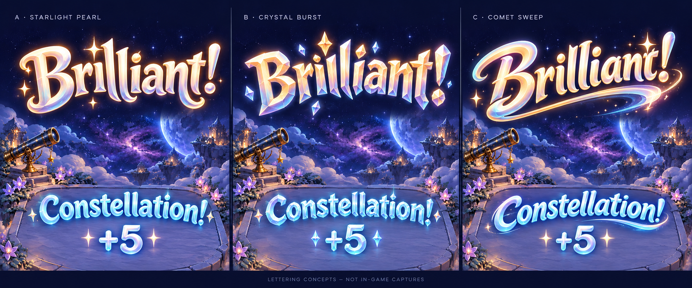

# Give celebrations their own lettering

**Status:** User-selected Crystal Comet direction integrated · **Owner:** current implementer · **Updated:** October 18, 2026

**User direction:** Crystal Burst is the preferred style. The user also likes the comet and “Brilliant!” elements and requested a dominant/supporting/accent ratio, then asked for the complete design set. Interpret “comment” as Comet Sweep; the precise “Brilliant!” detail is not yet isolated, since all three panels show that word. Propose **70% Crystal Burst / 20% Comet Sweep / 10% soft luminous warmth**. The earlier A recommendation is superseded; no runtime artwork changes in this study.

**Next action:** review physical feel and dense-board readability for the approved [Crystal Comet integration](crystal-comet-01/INTEGRATION.md). The user approved the [complete concept set](crystal-comet-01/README.md) and requested production integration. [Native evidence](../../evidence/crystal-comet-integration-2026-10-18/README.md) records the implemented PNG material and companion glyphs; no SVG or font-file authorship is claimed.

**Concept — not implementation evidence.** Generated with the built-in ImageGen tool from the [actual central-callout capture](../../evidence/harvest-feedback-2026-10-18/README.md) and [historical Soft Landing/Soft Bloom study](../branding/round-02/README.md). Backgrounds are illustrative reinterpretations. This is a raster comparison sheet, not editable SVG, a new font or packaged assets. Exact prompt and provenance: [generation.json](generation.json).

## Compared directions and current roles

| Treatment | Character | Tradeoff |
| --- | --- | --- |
| A · Starlight Pearl | Warm sculpted curves, flared terminals, luminous pearl face and jewel-colored edges | Earlier implementer recommendation, superseded by the user’s Crystal Burst preference. Small warmth/highlight accents remain a possible supporting influence. |
| B · Crystal Burst | Angular carved facets and crisp crystal accents | User-selected dominant direction. Keep readable broad facets and avoid dense fractures on long words. |
| C · Comet Sweep | Inclined expressive letters with tapered tails and a sweeping finish | Supporting influence: modest lean, a sweeping initial/terminal and motion rhythm. Keep long swashes subordinate to the crystal letter bodies. |

The lead style is the user’s preference; the proposed proportions and implementation choices remain design judgments. The generated lettering does not exactly extend the existing lowercase wordmark paths; it explores a related but distinct celebration voice. Preserve the warm silhouettes and clear counters required by the [art-direction brief](../branding/ART_DIRECTION.md), then author the selected master deliberately.

## Proposed dominant/supporting/accent recipe

- **70% Crystal Burst:** the letter skeletons, broad facets, jewel depth and strong silhouette establish the identity.
- **20% Comet Sweep:** a modest forward lean, one deliberate sweeping terminal and a sweep-led entrance give the crystal letters gesture. Do not turn the whole word into cursive or add a large underline to every event.
- **10% luminous warmth:** softened transitions, a few pearl highlights and restrained star glints keep the result welcoming. This is a proposed supporting detail, not confirmation that the user selected the Pearl panel.

These percentages express visual hierarchy, not literal pixel areas, separate fonts or the frequency of different announcements. Use one lettering family. A small clear keeps fewer facets/glints and a short motion; a major existing event can expand the same vocabulary.

The user may be recalling **60/30/10**, commonly described as dominant/secondary/accent color balance. Sabrina Claman’s first-person [animation character-design article](https://tongal.com/blog/community-guest-post/tips-for-beginning-character-design-in-animation) describes that color rule. This research did not verify a universal historical studio formula for mixing styles. Our 70/20/10 style blend is a deliberate adaptation that keeps the user’s preferred Crystal Burst clearly dominant, not a historical attribution.

## Recommended asset and text boundary

Keep the current central placement and event classifications. Use a small family of custom title illustrations for fixed words such as “Brilliant!”, “Constellation!”, “Square!”, “Cross!” and “Relay!”. Editable SVG paths can own the silhouettes and separable face/bevel/depth layers. The app packaging format should follow the existing artwork boundary when this is implemented; this study adds no loader or rendering dependency.

Keep the exact award and changing relay count separate from the title illustration. Give live numerals a compatible readable treatment; do not bake particular values, totals or multipliers into a reward image. If native numerals cannot match the chosen art, compare a bounded original digit/plus glyph set before deciding a whole custom font is needed. Fonts offer flexible strings/localization; fixed word art offers greater control of silhouette and individual letter rhythm. Begin with the few fixed announcement words rather than designing a full alphabet speculatively.

Use a bright, nearly pearl face with the harvested family concentrated on rim, bevel, glints and collection light. Separate these layers so aqua/amber/rose/mint/violet do not require five unrelated drawings of every word. Keep letters legible with glow removed. Small/ordinary awards stay quieter; reserve the fullest treatment for the existing major events. No banner plate, new permanent meter or progression.

The generated “+5” is illustrative only. Production still uses the committed award, immediate authoritative total, existing replacement/expiry/cancellation and quiet-mode semantics. Preserve native accessible score/result information and avoid duplicate announcements. Static large-text fallbacks and localized words need their own fit checks; generated English letter art does not solve those requirements.

## Acceptance for the next production step

- Preserve exact title spellings as independently inspectable masters. The [production format decision](crystal-comet-01/INTEGRATION.md) supersedes the earlier SVG proposal with the selected PNG illustration; native text remains the correctness/accessibility fallback.
- Inspect the short “Square!”, long “Constellation!” and composed relay count at real phone widths over sparse, dense and danger boards. Confirm pearl faces remain readable in every family color and with glow removed.
- Retain current central placement, accurate awards, input mapping and bounded lifecycle. Letter motion should support the established entrance/hold/dissolve; quiet modes show a static result.
- Verify native rendering, large-text fallback, accessibility semantics and source/resource membership when assets enter the app. Actual VoiceOver follows the existing RC cadence. Human readability/preference and motion still need observed play.

**Historical comparison scope:** the original comparison changed design documents and one concept image only. Visual inspection confirms the three intended styles, requested spellings and distinct silhouettes; the lower examples demonstrate composition, not measured phone-size readability. No Core, Swift source, app resources, saves or build settings changed; Swift/native tests are inapplicable to this design-only study. Hygiene and local links are checked separately. Review the comparison, develop the preferred treatment, and retire rejected directions as design history without new app variants or pilot flags.
