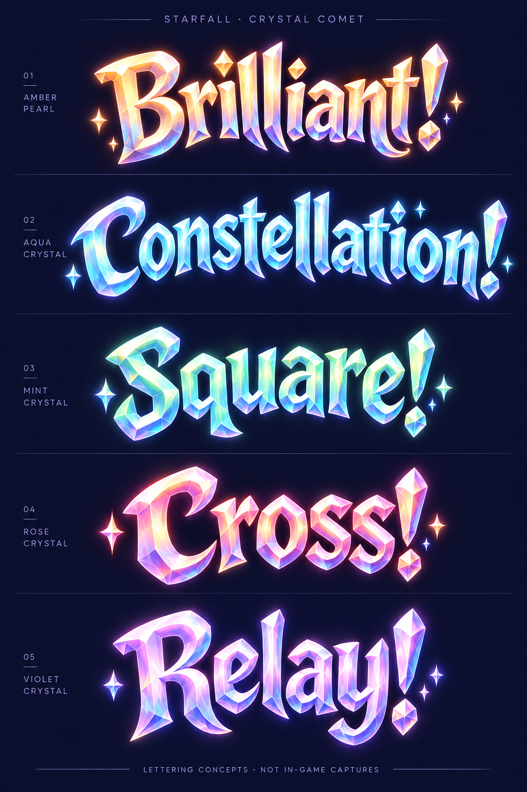
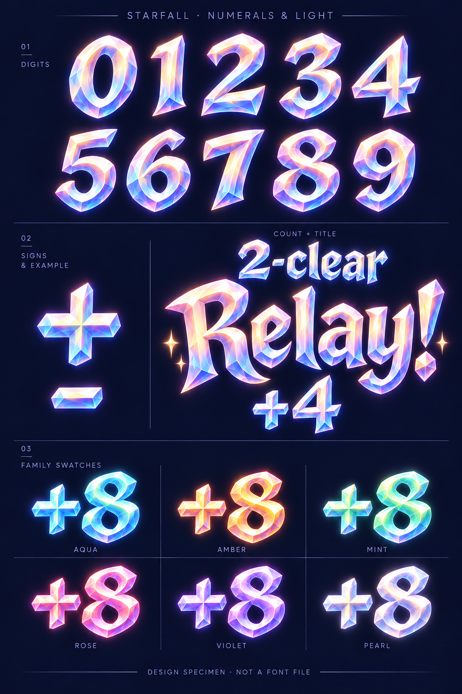
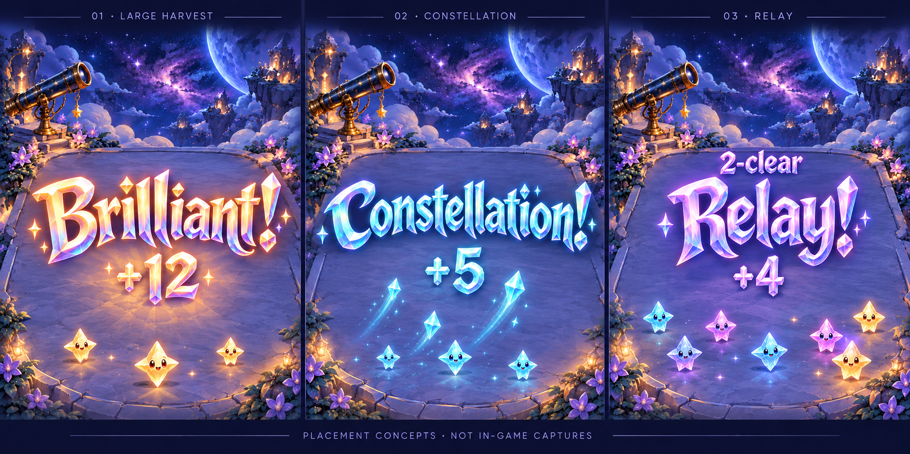

# Crystal Burst lettering family

**Status:** User-approved design; integrated in the normal game · **Owner:** current implementer · **Date:** October 18, 2026

The user selected Crystal Burst and requested all designs using the discussed **70% crystal / 20% comet gesture / 10% luminous warmth** blend. The three sheets below cover all five current celebration words, companion digits/signs, six family-color treatments and central placement examples. They were generated with the built-in ImageGen tool and visually inspected. The original design pass changed no app source or resource; subsequent production work is recorded in [Integration](INTEGRATION.md).

**Next action:** review the integrated result on phone at the next physical/RC pass; [native evidence and remaining physical/RC checks](../../../evidence/crystal-comet-integration-2026-10-18/README.md) distinguish implementation from the concepts below. The long “Constellation!” needs particular attention to width and facet detail. These are raster concept sheets, not SVGs, font files, final sprite atlases or evidence of implemented effects.

## Five announcement words

**Concept — not runtime evidence.** All five requested words are present with the intended spelling and distinct crystal silhouettes. Broad facets dominate; capitals and terminals carry the smaller sweeping influence. Colors are representative material examples, not permanent colors assigned to those achievements: production must continue to inherit the actual harvested stars' color. The existing event categories remain unchanged.

## Digits, relay composition and material colors

**Concept — not a font file.** Visual inspection confirms 0–9, plus and hyphen, a separate count/title composition and all six material samples. The neutral digits have pronounced facets; simplify if those details obscure small numerals in native review. “2-clear”, “Relay!” and “+4” illustrate separate composable parts. No baked-in award, multiplier or score change is proposed. The hyphen is for the relay count, not negative score awards.

## Central placement examples

**Concept — not in-game captures.** Illustrative examples show a large harvest, constellation and relay at a shared central placement. They communicate material, scale and hierarchy; they are not native layout or animation acceptance. Characters, scenery and collection streaks are generated interpretations and must not replace canonical `StarCast`, the registered terrace, committed award anchors or the existing flight destination. The right panel is more occupied than the others, but does not test a fully crowded/danger board. Exact example awards are illustrative, not a new reward schedule or inferred from the shown characters.

## Original design-study acceptance and handoff

| Requested scope | Observed result / limit |
| --- | --- |
| All five titles | Brilliant!, Constellation!, Square!, Cross!, Relay! present and inspected. One shared crystal-dominant family; illustration varies individual curves and facets. Exact final path consistency remains authoring work. |
| Digits/signs and dynamic composition | 0–9, plus, hyphen and count/title/award example present. These are images of designs, not reusable encoded glyph metrics. |
| Material palette | Aqua, amber, mint, rose, violet and pearl samples present. Preserve bright highlights without washing out the harvested family; opacity/contrast require native checks. |
| In-context readability | Three labeled board-only examples present. Long title fits its concept panel; real phone size, dense/danger layout, full chrome and largest-text fallback remain unverified. |
| Runtime, accessibility and rules | No Core, Swift, save, resource or build setting changes. Existing scores and input untouched. No native/Swift tests run for this design-only batch; native motion, reduced motion, localized fallback and accessibility acceptance belong to implementation. |

Scope was defined before generation: five current words, digits/signs, family colors and placement concepts, with exact copy, recognizable facets, readable counters and restrained sweeps. The results above satisfy the visual exploration scope while leaving production authoring and native verification explicit. No new achievements, app variants, pilot flags or progression.

All three images were created using built-in `image_gen.imagegen`, with no raster post-processing. [Generation records](generation.json) retain exact prompts, reference roles, original output paths and saved-image hashes. The [prior comparison](../README.md) records the selected lead and ratio rationale. The source was clean `4ea37cd` before these design-only additions. Local links, generation JSON, tracked-file hygiene and `git diff --check` are checked; native tests are inapplicable until app inputs change.
