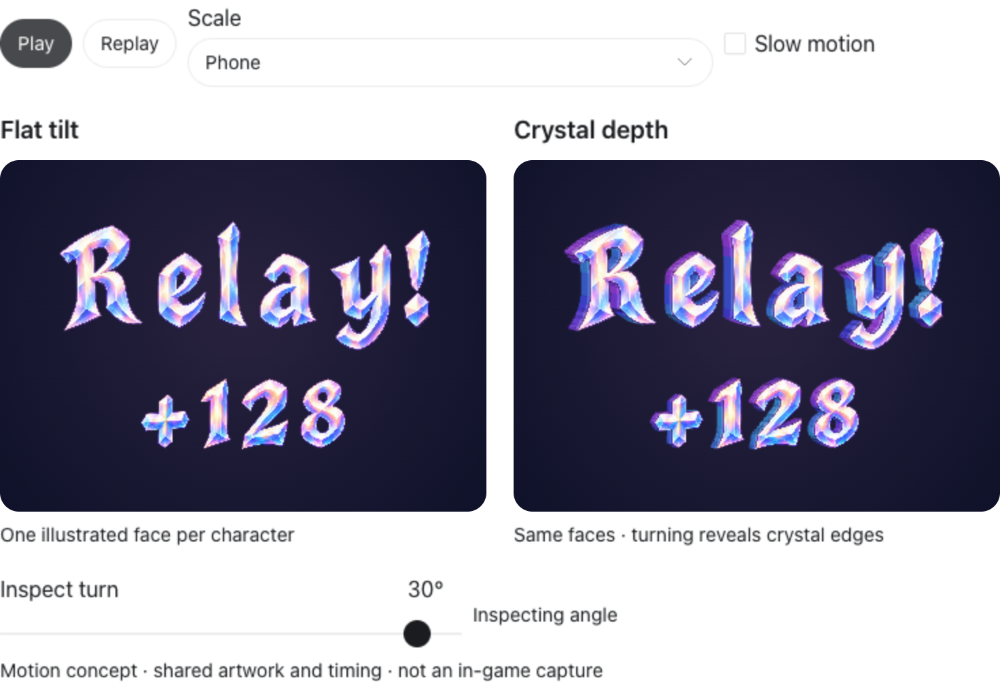

# Compare flat tilt with crystal depth

**Status:** Closed comparison — user selected crystal depth · **Owner:** current implementer · **Updated:** October 18, 2026

Compare the exact strings `Relay!` and `+128` using individual Crystal Comet glyphs. Both treatments share their front artwork, layout, camera angles and timing. The baseline tilts flat illustrated faces; the candidate adds shallow faceted depth so turning reveals actual edges. This is a design specimen, not a Starfall build or a font.

**Hypothesis:** a small amount of visible crystal depth makes the callout feel more tactile without making the letters harder to read at phone scale.

**Decision:** the user selected crystal depth and requested the full alphabet, numerals and punctuation. The subsequent [sprite package](../../../../Artwork/CrystalComet/README.md) owns that expansion. The original comparison and its source-bound results below remain historical evidence; it contains no production integration.

**Existing concept — not runtime evidence.** The approved material supplies the pearl, warm/cool facets and legible counters. New separated glyphs must retain this direction; they are not exact vector reconstructions of the existing word illustration.

## Specimen and verification

**Browser concept capture — not native gameplay evidence.** Chrome 155.0.8059.85, 768 CSS-pixel viewport, 2× raster scale, phone-size callouts and a matched +30° turn. Source: clean base `0d28c50` plus the study files fingerprinted in [verification.json](verification.json), snapshot `12b3777c44a1`. The capture shows added edges; the separate playback check confirms changing frames and a bounded stop, not subjective motion quality.

The interactive specimen presents the two treatments together, with Replay, Pause, slow motion, phone/detail scale and a keyboard-accessible ±35° inspection slider. Normal playback runs once for 6.2 seconds; reduced motion starts at the static settled pose. `+128` is specimen text, not a new scoring reward or rule.

- **Passed:** exact ten-glyph registration, open counters, distinct matched-angle renders, changing animation frames, pause/resume and completed replay.
- **Passed:** 18 angle/size/viewport combinations (−35°, 0°, +35°; phone/detail; 768/390/320 CSS pixels) with populated canvases, no artwork at the canvas boundary and no horizontal overflow. The final 768-pixel capture was visually inspected; the full matrix is automated layout/render evidence.
- **Passed:** reduced-motion static start, manual angle inspection, keyboard slider control and no browser JavaScript errors. No actual VoiceOver claim.
- **Passed:** repository hygiene and whitespace checks. Core, hosted/UI, simulator, Release and device tests are inapplicable: the application and its resources are unchanged.

Initial browser launch was blocked by the execution sandbox; the authorized headless run succeeded outside it. An initial enlarged-layout inspection identified a possible short-canvas crop; the final renderer bounds artwork by both width and height, and the 18-case matrix passes. Raw checks remain disposable in `/tmp/starfall-motion-checks.json`.

## Source and reproduction

- [glyph-master.png](glyph-master.png) is the unchanged built-in ImageGen output. [generation.json](generation.json) records its full prompt and reference roles. Generation did not produce a uniform cell grid; connected alpha components supply exact glyph registrations instead.
- [registration.json](registration.json) owns the source rectangles, contours and master hash. `!` includes both disconnected pieces; `R`, `e`, `a` and `8` preserve their counters.
- [prepare.cjs](prepare.cjs) derives those registrations and embeds a compact WebP copy with alpha into [specimen.template.html](specimen.template.html). Both treatments use the same clipped front texture. The candidate adds deterministic shallow contour extrusion, bevel strips and directional side lighting. Projection is orthographic; it is not a physically refractive 3D material or a pre-rendered multi-angle sprite pack.
- Rebuild with `NODE_PATH=<bundled node_modules> node prepare.cjs <absolute-output.html>` from this folder. `sharp` is build tooling from the existing workspace runtime; the resulting interactive fragment has no external script, network call or app dependency. Render it for browser inspection using the visualization skill's `scripts/render.py`.

The generated inline fragment is 381 KB. The image master, source template and registration remain here so the comparison can be reproduced. No full alphabet, font file, shipping asset replacement or permanent game route was added.

## Acceptance before expanding

- Exact `Relay!` and `+128`, independently positioned glyphs and shared scale/timing in both treatments.
- Animated entrance/settle plus an angle inspection control; flat faces and changing crystal edges must be distinguishable.
- Stable shape identity, open counters, consistent pivots and no clipped glyphs at the tested angles.
- Inspect at a roughly 300-point callout width and a larger detail size. The browser sample does not establish native phone readability or GPU performance.
- Pause/replay and reduced-motion behavior; keyboard labels and a static readable text alternative. No per-frame screen-reader announcements.
- Browser rendering and interaction checks, repository hygiene and whitespace checks. Native build/core/save/VoiceOver checks are inapplicable because no app source, resources, rules, saves or runtime route change.

## Boundaries and remaining risk

Front facets are painted artwork. The shallow depth candidate is a coherent geometric interpretation, not a physically accurate refractive crystal model. The subsequent sprite pack follows the user's depth selection; native production cost, dense-board fit and physical motion comfort remain unverified by this browser comparison.
