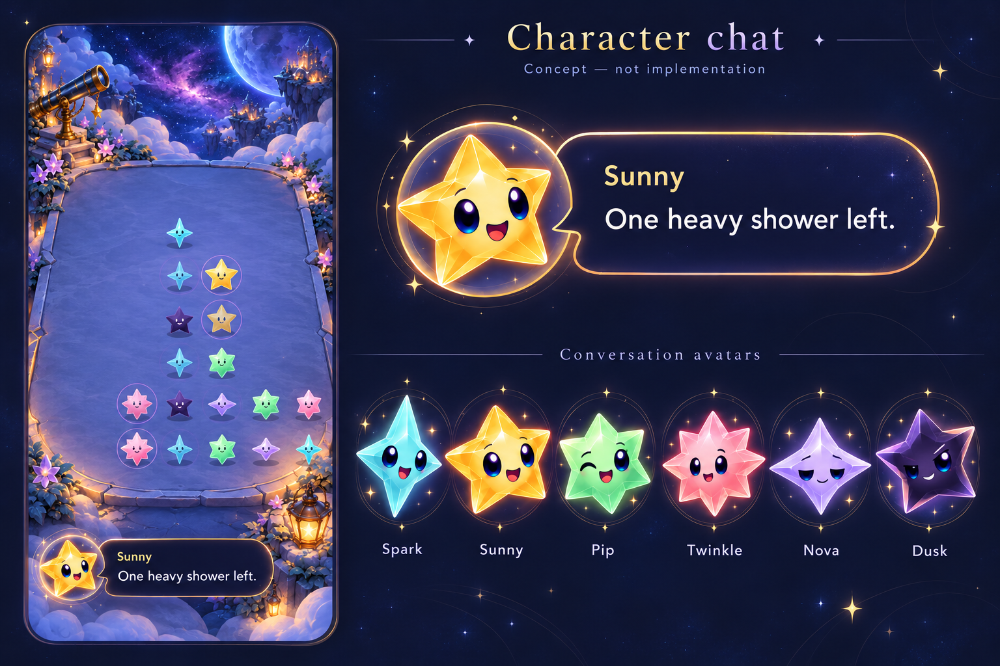

# Character chat art direction

**Status:** User-selected visual direction · **Updated:** October 17, 2026. Six production portraits and the native bubble are implemented; see the [development evidence](../../evidence/character-chat-2026-10-17/README.md).

A compact dialogue bubble and dedicated portraits for the existing six-star cast. Start with the [behavior, speaker contract and acceptance plan](../CHARACTER_CHAT_AND_TRAIL.md). Sunny is the first speaker; all characters share one bubble design.

**Generated concept — not implementation evidence.** Built-in image generation, October 17, 2026, based on the approved Sunny Crystal Glow master and a historical native Observatory screen. [Exact prompt and input paths](prompt.md). The existing source artwork remains unchanged; this folder is outside the app target.

The inspected concept shows the intended brass-edged midnight bubble, readable message and speaker name, expressive medallion portraits, and a compact placement below the board. It retains recognizable family colors and differing silhouettes. Some generated silhouette/pose details, especially Dusk's concavity and the ray shapes, require comparison and cleanup against the approved masters. Decorative sparkles and glow should be reduced if they compete with text. The phone inset omits functional header elements and transforms gameplay art; it cannot specify native geometry, layout or hit targets.

[Six separate transparent portraits](../../../Artwork/Dialogue/README.md) now implement this direction, with one authored expression per speaker. Keep bubble geometry and text native and resizable; do not rasterize the message or bake the bubble into a portrait. The Debug Dialogue studio previews the six characters through the same native component; its [authoring guide](../../../App/DialogueScripts/README.md) explains changes and scenario hooks. Preserve point counts and dark-star contrast. This concept sheet remains a design reference, not a runtime atlas or native acceptance image. The delivery evidence separately records packaging, layout, interaction and motion checks; actual VoiceOver/device acceptance remains separate. The user selected this direction on October 17 (“that’s way better”); use native review to refine its execution. No new runtime pilot route exists.
