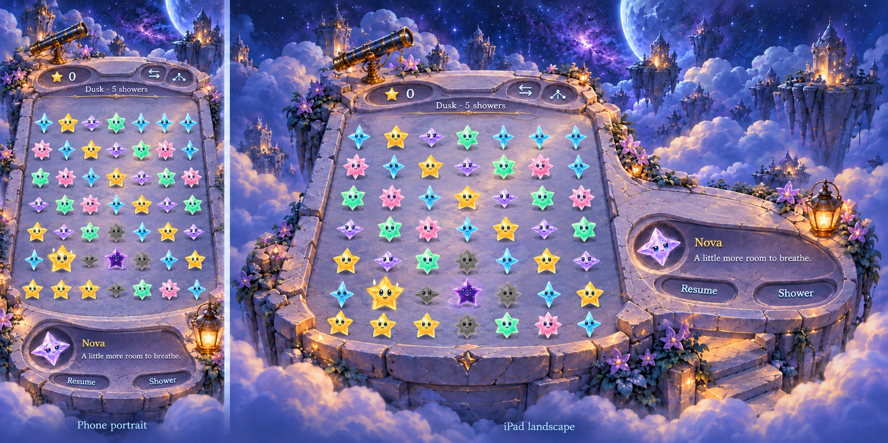
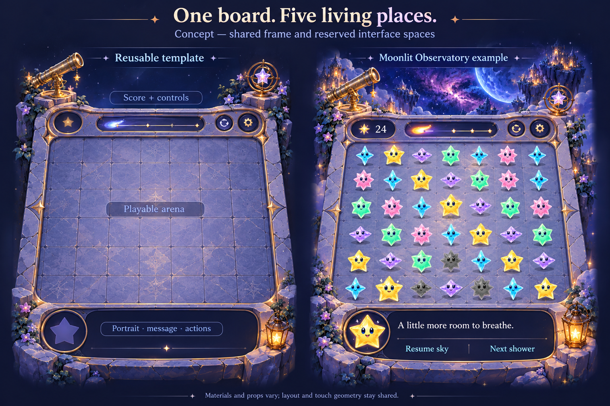

# One shared board for five places

**Status:** Implemented; development verification recorded · **Owner:** current implementer · **Updated:** October 18, 2026

Use one physical board template with a top control rail, a clearly bounded playable terrace and a bottom communication recess. Each location supplies matching materials, scenery and interactive props around those reserved spaces. This responds to the user’s suggestion of prebuilt grooves and Hearthstone’s physical board treatment.

**Decision:** Physical recesses belong to the illustrated environment. Five empty architecture plates now supply a connected upper rail, open floor and communication apron. Native score, forecast, menu, dialogue and actions register inside those spaces; gameplay chrome is removed from the embedded dialogue variant. This replaces the earlier floating-panel treatment. Shape and material remain open to human refinement.

**Next action:** Review the [native implementation and verification](../../evidence/environment-grooves-2026-10-18/README.md), including phone/tablet and text-size limits. No gameplay, save or progression changes.

**Corrected concept — generated illustration, not runtime evidence.** The physical material, bevels, shadows and continuous stone joins show the intended environmental fitting. Phone communication is in the front apron; iPad communication is in a connected side wing. Native captures from `7ddc837` plus tested snapshot `6ae29cfa` supplied the current art references. Scores, labels, stars and exact dimensions here are illustrative; production assets must contain no baked-in UI or game pieces. [Generation source and exact prompts](integrated-grooves-concept.json).

### Earlier rigid exploration

**Concept — generated illustration, not runtime evidence.** Built-in image generation used the reconciled `ac6aeb3` native Observatory capture as a style reference. The pictured cell count, grid lines, decorative floor marks, controls and text are illustrative. Implementation retains exact 7×7 shared geometry, an open floor without square cell backgrounds, current native controls and accessible text. Original source: `exec-6144eac5-007b-49a9-8178-7be2667e7ece.png` in the session’s generated-image folder.

## What the player experiences

The score and controls sit within a shallow groove painted into the board’s upper ledge, with shared stone/brass material, light, physical thickness and cast shadows. Character dialogue, guidance and notifications use a consistent lower area with a portrait position, readable message area and stable actions. The central arena has one continuous boundary aligned with actual taps. Props remain discoverable around the board and never sit behind score text or message controls.

The top rail must also reserve current Dusk/phase cues and input feedback. The lower recess is part of the platform’s front apron, or a connected side wing on wide layouts. It shares presentation space, not gameplay state or notification ownership. `SkyDialogueBubble` already owns a portrait, text, actions and bounded overflow; reuse it and keep its lifecycle/session boundary. Decorative artwork does not contain text or define button geometry.

## Boundaries and acceptance

- One measured layout owns top content, 49 cell polygons, lower content and prop exclusion regions. Rendering, tracing, swaps, native/accessibility cells and celebration anchors use it.
- Theme materials and replaceable art dress those regions; no per-location copy of chat layout or gameplay rules.
- Keep score/menu readable over all five materials and leave each prop hittable without intercepting cells.
- Check empty, sparse and dense boards; long dialogue/notifications; score growth; pause, Dusk and input cues; supported sizes/orientations; largest text and quiet motion.
- Normal animations and actual native coordinate taps must pass. Full actual VoiceOver stays at RC; physical-device feel remains separately unverified.
- No rule, RNG, save schema, campaign or progression changes.

## Reference

Blizzard’s [Naxxramas announcement](https://news.blizzard.com/en-us/article/13665269/beware-the-curse-of-naxxramas) describes themed boards with interactive corners. Its physical stage/interface relationship informs this proposal; Starfall keeps its own art, portrait layout and game interaction.

## Responsive stage and scenery extensions

The user proposed seams for attaching extra background around different screen shapes. Use one stable playable stage plus matching scenery extensions and soft blend zones. Reserve horizontal, vertical and corner overlap in low-detail clouds, mist, water and distant scenery. Do not tile gameplay platforms, duplicate distinctive landmarks or stretch the stars to cover spare screen area.

The interactive comparison explores the same three framing treatments on phone/iPad proportions, with portrait/landscape controls, longer messages and visible blend edges. These are layout concepts using packaged art; the comparison’s soft wallpaper is a blurred-art stand-in. Native development now uses separately generated wallpaper plates; the browser comparison does not establish native acceptance. A portrait arrangement keeps communication below the terrace. A landscape arrangement places communication alongside the terrace so the exact 7×7 board and full native targets can keep useful size. Native geometry, tracing, controls and accessibility must share measured stage bounds after adoption.

The first generated sheet is retained above as an early concept. Its rigid frame is not approved. The implemented materials use curved, irregular edges rather than adopting that first rigid sheet.

The landscape sketches adapt camera registration and communication placement to demonstrate the proposed responsive contract. They do not claim parity with the current native landscape renderer. Normal portrait comparison keeps the source-bound central projection as a reference; all proposed landscape geometry still requires implementation and native tap/accessibility verification.

## Native responsive foundation in development

Acceptance before integration: all five outer scenery plates decode separately; the shared projection retains 44-point cells at 320-point portrait and 667×375 / 852×393 landscape canvases; the arena outline is the union of the same native polygons; all ten props retain aspect and stay outside cells and communication controls. Verify real coordinate clears and rotation on phone, both orientation directions, persisted selection, largest text, interruptions, normal animations and Debug/Release resource inclusion.

The compact landscape arrangement uses a shallow square terrace at the left and communication at the right. It requires a companion empty floor plate per place rather than stretching the portrait platform. Wide tablet windows also use the companion wing; portrait tablet windows retain the centered stage with wallpaper filling spare space. Short narrow windows and accessibility text use a scrolling canvas and sibling header/message areas. These functional layout choices do not adopt the unapproved rigid frame concept.

## Correction: environmental UI fittings are required

The October 18 responsive implementation solved background coverage and target layout, but retained the opaque `SkyDialogueBubble` and floating controls. The user identified that mismatch. Those captures remain valid evidence of that implementation; they are not evidence that the physical groove design was delivered.

The implemented art/runtime pass is checked against these observable criteria:

- With native text, icons and portrait hidden, empty recesses remain visibly carved into the environment. Their material and physical joins continue into the platform; they cannot read as independent software cards.
- The upper groove reserves score, forecast/menu and phase feedback. The lower apron reserves portrait, text and actions; a wide composition may use a connected side wing. Recesses stay outside the exact 49-cell arena and interactive props.
- Native text and controls fit the recess interiors through shared measured registration. Decorative artwork contains no baked-in labels, scores or button semantics. Message state/timing stays in the existing dialogue component; its floating bubble chrome is removed when seated in the environment.
- Long messages, large text and reduced motion retain full readable content and touch targets. The physical surface extends or scrolls with the content rather than clipping text into a fixed illustrated hole.
- Each setting uses its own platform material and lighting. Soft wallpaper seams remain outside the gameplay/UI architecture. The first rigid frame and the responsive overlay implementation do not accept this requirement.

A generated phone/iPad concept illustrates physical construction only. Exact geometry, glyphs, text, motion and native input must be verified in implementation; illustration alone cannot establish those results.

## Physical implementation

`LandingGeometry` owns crown, floor, apron, content and prop frames as well as the 49 native cell polygons. Three adjacent source bands from each single transparent architecture plate form the joined surface. In wide layouts the floor extends beneath the side apron; quiet wallpaper fills outside it. Stars and prop cutouts preserve aspect independently of material resizing. At accessibility sizes, the upper rail grows and the communication apron becomes a scrolling sibling, preserving full-size controls. `SkyDialogueBubble` keeps its existing state, overflow and actions and suppresses its separate bubble background only when embedded. Ceremonies and the script studio retain their existing presentation.

[Exact production prompts and source paths](production-set/architecture.json) preserve the generated masters. This is integrated into the regular app with remembered Location selection, not a separate experiment route.
