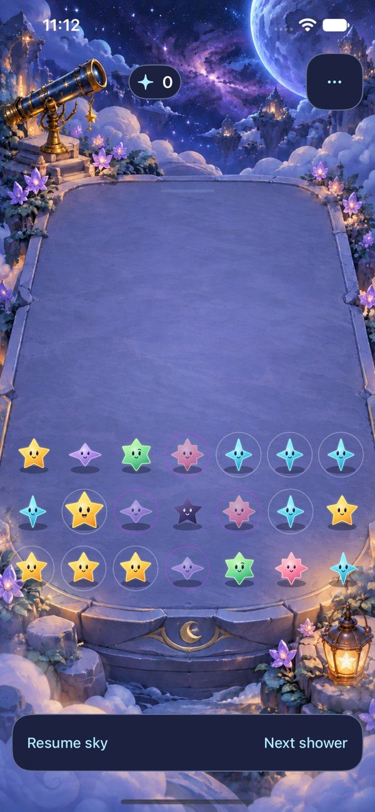

# Environment art direction and production

**Status:** Five-place development integration; native acceptance pending · **Owner:** Current implementer, with the user reviewing art direction · **Updated:** October 18, 2026, Eastern time

Starfall's environments should feel like places the stars visit: tactile, layered, gently alive and responsive to curiosity. Build five carefully finished locations around the real star cast and a shared playable surface. Moonlit Observatory remains the default; the October 18 integration adds the other four places behind a remembered Location choice. Native acceptance is pending; see the [implementation and check record](production-set/README.md).

**Next action:** Review the [shared responsive board template and scenery-extension options](BOARD_TEMPLATE.md), then complete tablet and remaining acceptance. Native SE3/17e integration checks now run after simulator recovery without a shared-service restart. Current code/build checks and limits are tracked in the [five-place integration](production-set/README.md). Actual VoiceOver remains a release-candidate check under the [development cadence](../../DEVELOPMENT_BUILDS.md#accessibility-checks-by-build-stage).

**Art approval is not release acceptance.** On October 17 the user reported tapping the lantern and telescope, confirmed their reactions met the intended experience, and endorsed the direction as something they would be proud to ship. This is direct qualitative evidence from the art-direction reviewer; the exact build they tapped was not independently pinned. It does not establish broad player preference, actual VoiceOver or physical-device performance.

**Native implementation proof:** full-screen place with the actual cast. [Sparse/dense comparison, source and verification limits](../../evidence/living-observatory-2026-10-17/README.md). The still establishes composition, not motion quality.

## October 18 review: establish the arena before multiplying places

The user requested expansion and reaffirmed that every place needs objects that respond to taps. The inventory is **one implemented environment and four concept settings**, not five additional levels. These remain settings for the existing game, without campaign or unlock progression. Next order: Observatory boundary refinement → Cloudsea → Comet Hearth → Prism Tide Grotto → Eventide Archive.

Source inspection at `f35eba8` found that `LandingGeometry` already registers artwork, rendered centers, native cell polygons and prop targets. Its playable area uses normalized top/bottom values `0.245`/`0.735` and straight tapered sides; the illustration has curved rims and rounded corners. Shared render/input coordinates therefore do not by themselves establish agreement with the painted surface. Historical sparse/dense captures suggest a corner-clearance risk; this is a presentation diagnosis to verify against a fresh native capture, not a reproduced current-build tap defect.

**Historical native reference — October 17 Observatory adoption.** Inspected alongside the earlier dense capture. The painted rim supplies the intended arena boundary; this sparse view cannot establish clearance for every occupied corner or current-source alignment. [Source and limits](../../evidence/observatory-adoption-2026-10-17/README.md).

**Recommended correction:** Author the landing surface around the registered seven-by-seven footprint. Give it a continuous readable rim, a quiet usable interior and enough inset for the widest/grown star, contact shadow and full native targets. Keep decorative ledges and props outside that footprint. Where the existing plate disagrees, revise the platform artwork or its registered geometry together; do not add independent scene/input offsets or shrink stars and touch targets to hide the mismatch. Rounded outer masonry may frame the arena, but must not suggest that usable cells extend into scenery.

Before implementing that correction, use these observable acceptance cases:

- Empty, sparse and full boards communicate the same near/far/side limits. The reviewer can point to where play begins and ends without a debug overlay. No square cell backgrounds are added.
- All edge and corner cells, including grown stars and Dusk, sit inside the usable surface with readable contact shadows. A temporary diagnostic overlay compares the projected perimeter against the rim at phone, compact-phone, largest-text and tablet portrait/landscape sizes; it is removed from normal play.
- Fresh native taps on corners, adjacent cell boundaries and both props match rendering after resize. Full targets stay reachable; props and the rim do not intercept cells. Capture source-bound dense screenshots as well as checking coordinates.
- Normal arrivals, clearing and settling remain grounded in motion. Repeat rapid taps, restart, settings dismissal, background/resume and quiet modes; retain save/RNG continuation. Run core, affected hosted/UI, Debug/Release simulator and hygiene checks for implementation. Actual VoiceOver and physical performance remain separate acceptance evidence.

Every new place must ship **two independently tappable signature props**, separated from the base plate, with native button semantics and visible feedback in quiet modes. Cloudsea: wind harp sways/plucks and dew catcher glints/ripples; Hearth: kiln brightens and kettle rocks/puffs; Grotto: shell water-thread pulses and pearl glows; Archive: orrery turns and sandglass glows. These response identities now have layered native implementations; their motion/visual acceptance is pending. Repeated taps replace bounded responses; settings, backgrounding and scene replacement cancel them. Scenery cannot alter score, board state or shower timing. Reuse the existing lifecycle boundary when the second implementation demonstrates the common responsibility.

**Review limits:** Repository, existing artwork and historical captures inspected; no new app execution, native interaction, animation, accessibility or device profiling performed for this planning update. Remaining concepts contain placeholder stars and need clean plates, independent prop/ambient layers and registration before native integration.

## What makes a place feel like Starfall

The [five-place bible](landing-places-01/README.md) owns each location's identity, materials, props and scenery. The [cast factory and visual reference](../VISUAL_REFERENCE.md#meet-the-cast) own the characters. [StarfallTheme](../../../App/StarfallTheme.swift) owns shared UI roles. Avoid duplicating those contracts in individual scene briefs.

Every location needs:

- **A recognizable place.** A clear silhouette and material language, an understandable purpose, and a few specific objects that suggest someone lives or works there. Identity must survive grayscale and thumbnail viewing.
- **A generous playable surface.** The stars remain the focal point. Quiet center, readable near/far rows, full-screen scenery and controls placed around the composition. Props and decorative stars never look like legal pieces or cover touch targets.
- **Depth with hierarchy.** Far sky/void, distant landmark, atmospheric middle distance, rear dressing, landing surface/gameplay, foreground framing. The composition establishes distance before motion is added; every plane need not be a new texture.
- **Small, meaningful responses.** Start with two signature props. Their material and purpose determine the response: telescope tilt/glint, lantern warmth, wind-harp movement or a shell's water ripple. Responses are optional delight, never a requirement for a clear, score or objective.
- **A coherent cast and light.** Use the actual six characters early, including grown stars and Dusk. Preserve family silhouettes, faces, non-color cues, upright aspect and stable identities. Tune environment light/contact shadows before redesigning the cast to match a mock.

The references are complementary: Hearthstone informs tactile peripheral scenes and restrained play surfaces; Paper Mario informs constructed softness and readable silhouettes; Fountain of Dreams informs luminous dreamlike atmosphere. [Research and source limits](landing-places-01/README.md#research-and-interpretation) stay with the location bible. They are aesthetic markers, not assets to reproduce.

## The repeatable production loop

| Stage | Concrete deliverable | Exit condition |
| --- | --- | --- |
| Brief | One [location brief](LOCATION_BRIEF.md) with mood, material, landmark, two prop responses, layout risk and acceptance cases. | The location has a distinct purpose and silhouette; one uncertainty is chosen for the next comparison. |
| Compose | A phone-sized concept plus empty, sparse and nearly-full compositions using the real cast. Review grayscale, HUD zones and largest text. | Mood is recognizable and gameplay remains readable; layout decisions are visible before detailed polish. Generated concepts stay labeled. |
| Separate | Clean background, independent moving/interactive layers, alpha/registration data, source prompts or editable art, and provenance. | No baked gameplay pieces, UI, old contact shadows or trails; layers register at native scale; props match their hit targets. |
| Integrate | One isolated native scene using existing rules, material factory, shared geometry and lifecycle boundaries. | Actual taps, arrivals, clears, growth, dark stars, restart and settings/background behavior work; save/RNG continuation remains unchanged or an explicit migration is tested. |
| Review in motion | Captured full-motion play and quiet modes, human observation, accessibility review and a reproducible device scenario. | Effects add perceived depth without distracting from decisions; supported layouts remain usable; test and performance results are source-bound. |
| Adopt | A scoped integration with membership, tests, evidence, migration decisions and updated experiment status. | Shipping owners contain the verified behavior; temporary route/fixture/duplicate assets are removed. Remaining limitations have a trigger and verification task. |

An accepted concept may still fail a later gate. Return to the stage that owns the problem: unreadable stars → lighting/composition; wrong taps → shared mapping; stale prop response → lifecycle ownership. Do not conceal a structural problem with scene-specific offsets, retries or an opaque overlay that defeats the approved composition.

## Reuse deliberately

The Observatory provides a working reference for clean art, upright StarCast sprites, projection/inverse geometry, native prop buttons, a bounded environmental clock and cancellable responses. See [native implementation and evidence](landing-native-01/README.md) and [lab tools](../../../tools/environments/README.md).

One shared mapping must own artwork crop, rendered centers, hit polygons and accessibility frames. One lifecycle boundary must freeze ambient time and cancel responses when inactive or modal. Core rules own outcomes. Environment code receives narrow values/capabilities and cannot schedule showers, alter saves or consume gameplay RNG.

Reuse the verified camera and lifecycle for the second location. Extract a small shared component only when those two implementations demonstrate the same responsibility. Keep location-specific props and response choreography local. A generic environment engine, editor, plugin system or automatic content generator is not part of this roadmap.

Build final plates for the actual viewport/camera; don't rely on a concept screenshot as a runtime background. Keep asset resolution, decoded memory, node counts and concurrent effects bounded. Record measured device budgets after profiling the baseline; estimates and a smooth simulator are not device acceptance. Retain source art and exact generation prompts so targeted revisions are possible.

## Roadmap for the five places

These are completion gates, not promised dates. On October 18 the user explicitly requested all four remaining places be created and integrated. All five now share one runtime implementation; each still needs its own native visual/interaction acceptance before being called verified.

| Batch | Deliverable | Main question / done when |
| --- | --- | --- |
| **Integrated — Observatory** | Full-screen native place, real cast, shared projection, telescope/lantern responses and gentle fog. | Default game now owns the scenery, geometry and responses; the duplicate lab route is retired. Finish current-source interaction/layout/motion evidence and distinguish it from the earlier concept/lab. |
| **Next — Observatory arena and shipping pass** | Visible platform/playfield agreement, supported-layout art/camera, final HUD, normal/quiet modes, device profile and clean Release candidate with actual VoiceOver acceptance. | The release bar below is met; confirm the integrated location meets its remaining release bar. Palette picker/lab templates are retired and old cosmetic preferences are inert. No broad rewrite waits on unrelated mechanics trials. |
| **Integrated; checks pending — Cloudsea Conservatory** | Second place with dawn, ceramic, wind harp and dew catcher. | The same runtime boundaries support a distinctly lighter material/atmosphere. Real stars remain legible. This proves reuse beyond one scene. |
| **Integrated; checks pending — Comet Hearth** | Warm basalt/copper workshop, kiln and kettle responses, restrained smoke. | Warm light preserves every family and Dusk; ambient fire/smoke does not compete with arrivals or add unbounded work. |
| **Integrated; checks pending — Prism Tide Grotto** | Cool shellstone/sea-glass setting, water-thread and pearl responses. | Water/glints are clearly decorative, preserve contrast and quiet modes, and meet the measured device budget. |
| **Integrated; checks pending — Eventide Archive** | Slate/ivory archive, orrery and bookmark/sandglass response, remote event horizon. | Its quiet, reverent mood feels distinct from Observatory; the bright landmark stays outside gameplay/HUD and motion remains comfortable. |

A second native location is not required to ship the first. Conversely, a second attractive screenshot does not prove the pipeline transfers. Every location gets its own acceptance record. No sixth location is planned until these five are coherent and their upkeep is manageable.

## The release bar for each environment

- **Look and feel:** Reviewer accepts the place with the actual cast in empty, sparse and dense play. Inspect normal motion, arrivals/impact, clears, grown/dark stars, props and near/far occlusion. A screenshot cannot accept animation.
- **Interaction and interruption:** Native corner/boundary/resized taps agree with rendering; full targets remain usable. Rapid taps, repeated prop taps, opening/dismissing settings, background/resume, scene replacement and restart reject stale completions. Environment interaction never changes the committed board.
- **Accessibility and layout:** Actual VoiceOver round and focus return; family identification without color; largest Dynamic Type; system Reduce Motion, Calm effects, Increased Contrast and Reduce Transparency. Quiet modes retain feedback and identical outcomes. Verify minimum-supported phone/OS and iPad orientations separately.
- **Rules and retained data:** Deterministic replay, old-save preview/RNG continuation, challenge outcomes and preference restoration. Appearance preference migrations are explicit. Fixtures remain isolated from normal data.
- **Engineering and device cost:** Required core/hosted/UI checks, Debug and Release simulator build, membership/hygiene; then a defined repeated-round/prop scenario on a supported device. Record frame pacing, responsiveness, memory trend and interruptions before optimizing.
- **Evidence and integration:** Exact source, configuration, toolchain, device/OS, results, skips and limits. A clean export or declared working-tree differences. One scoped integration; no unrelated Xcode/artwork edits swept in.

## Keep enriching the five without endless churn

After each adopted location, and before a release candidate, review one short normal-play recording and one quiet-mode round. Log concrete observations in that location's evidence record: distracting fog, an ambiguous boundary, a prop response that feels disconnected, a repeated asset seam, or a character lost in warm light. Human observations and reproducible failures outrank adding decorative volume.

For each improvement, write the intended perceptual benefit, the smallest change, and the comparison that could reject it. Ship verified refinements in small batches. Stop a polish pass when its acceptance cases pass and no material issue remains from that review; keep optional ideas in a short backlog rather than adding permanent pilot flags. This is a review habit, not a scheduled automation or a promise of endless new locations.

[EXPERIMENTS.md](../../EXPERIMENTS.md) owns adoption decisions. [ENGINEERING.md](../../ENGINEERING.md) owns unresolved technical risks. [The main roadmap](../../ROADMAP.md) coordinates this art track alongside the independent gameplay work.
