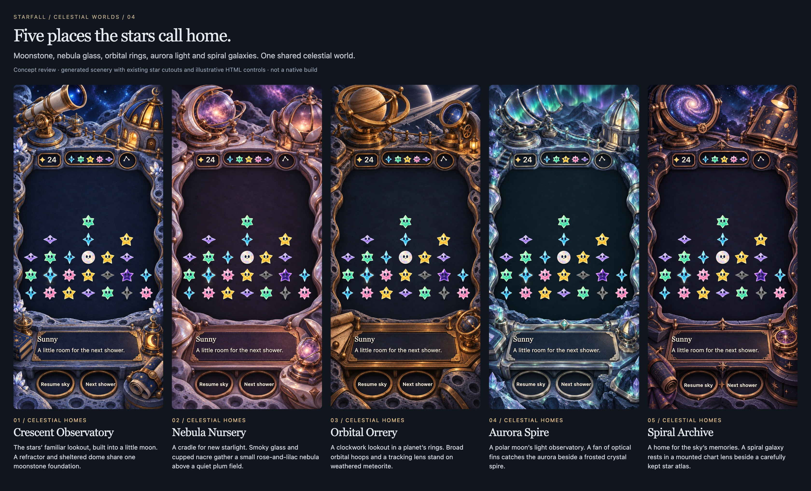

# Five places the stars call home

**Status:** Implemented locally; rollout held for design revision · **Owner:** current implementer · **Updated:** October 18, 2026

**October 18 revision:** The user reopened the platform metaphor and iPad centering. Continue with [open-sky concepts and centered composition](../open-skies-05/README.md). The previous implementation is preserved locally; its GitHub push failed before publication and no celestial build was installed.

Give Starfall one coherent celestial world. The user accepted the [previous board template](../living-worlds-03/README.md), then requested four or five new locations centered on astronomy, observatories and galaxies, with palettes that support the crystal cast. This set keeps that structure and replaces the earlier mix of terrestrial gardens, hearths and tidal scenery.

**Recommendation:** Develop Crescent Observatory, Nebula Nursery, Orbital Orrery, Aurora Spire and Spiral Archive. Each is a place that observes, tends or remembers starlight, with its own large instrument, materials and peripheral response.

**Production:** The user approved all five and requested shipping. [Native acceptance](../../../evidence/celestial-boards-2026-10-18/README.md) and the [implementation contract](IMPLEMENTATION.md) describe the packaged portrait/landscape art, native registration and bounded optical responses. The concepts below preserve the art-direction decision; they are separate from runtime evidence.

**Concept — not implementation evidence.** Built-in Imagegen paintings, existing packaged crystal bodies, and illustrative HTML faces and controls. Compare the large silhouettes and quiet central colors. [Open the interactive review](index.html) to inspect each world, all 49 positions, empty/sparse boards, layout guides and expanded reading content.

## Five locations within one world

| Location | What belongs here | Distinctive construction | Proposed tactile response |
| --- | --- | --- | --- |
| **Crescent Observatory** | A familiar lookout where the stars watch incoming showers | Moonstone court, crescent buttress, mounted refractor and sheltered dome; a moonphase lantern on the near shelf | Telescope iris opens at its mount; lantern shutter reveals one moon phase |
| **Nebula Nursery** | A gentle place for gathering young starlight | Cupped nacre, smoky nebula collector, petal dome and rounded ceramic ledge | Dome petals open slightly; a small vessel releases a contained glimmer |
| **Orbital Orrery** | A lookout among the rings of a distant planet | Broad tilted orbital hoops, tracking lens and gimbal bolted into rounded meteorite and muted metal | Planet model turns a short arc; small orbital dial tilts and settles |
| **Aurora Spire** | A polar moon observatory that studies bands of light | Fan of optical fins, faceted glass spire and thick reading bridge on dark polar rock | One fin pivots; a prism shutter reveals a narrow band of color |
| **Spiral Archive** | A cartographer's home for the sky's memories | Mounted spiral-galaxy lens, star atlas and hinged compass in a curved mineral cabinet | Galaxy lens tilts at its fork; compass lid opens and returns |

These are proposed environmental stories. They suggest the cast's home without adding new character rules, a campaign, travel progression or unlocks. All seven existing crystal families can inhabit every location; colors are not assigned to exclusive home boards.

The locations differ at a glance: telescope and crescent, soft collector and petals, globe and broad rings, fan and spire, spiral lens and atlas. Their shared rounded craftsmanship, mineral foundations and small cared-for instruments make them feel related.

## Let the characters carry the strongest color

**Existing native renderer export — source `6cc9efd`, iPhone 17e / iOS 27.0.** This is the palette and silhouette reference, not a capture of the new settings. [Original evidence](../../../evidence/crystal-glow-integration-2026-10-17/README.md).

| Location | Quiet playing surface | Supporting material colors | Small peripheral accents |
| --- | --- | --- | --- |
| Crescent | Ink navy, target `#141C32` | Dusty blue moonstone, pewter | Antique brass, amber windows |
| Nebula | Smoky plum, target `#211C2D` | Dusty mauve, gray nacre | Rose metal, contained pink/lilac cloud |
| Orbital | Midnight charcoal, target `#171D29` | Slate, weathered umber | Muted champagne metal |
| Aurora | Dark petrol, target `#15262D` | Blue-gray glass, silver | Narrow mint and violet reflections |
| Spiral | Ink plum, target `#1C1B2A` | Violet slate, rose bronze | Small pearl galaxy core |

These hex values are art-direction targets, not sampled-color or contrast measurements. Scenery borrows muted relatives of the cast's colors. Cyan, yellow, mint, pink and lavender remain clearest in the actual crystals. Dusk needs enough distinction from the plum surfaces, and drained gray pieces need separation from dark stone. Both are included in the composition sample alongside Opal and a grown star.

Keep cosmic spectacle in a mounted lens, a collector or a narrow glimpse above the court. The play surface remains low contrast and still. A galaxy painted behind every piece would make the scene less readable and weaken the sense that the characters occupy a real place.

## Preserve the accepted template

The upper instruments, three small HUD recesses, broad central court, lower reading shelf and two action wells retain the established composition. The near prop has a physical support outside the reading area. Native text and buttons will remain separate from scenery.

The review reuses the previous viewer's geometry and cast renderer rather than introducing another mapping. Its default remains the **proposed portrait fit** at 393 × 852, with seven columns and rows over 28.5–67% of canvas height. The **current app mapping** option retains the earlier source-bound 26–70.5% range. Neither option changes app code. See the [geometry and native acceptance contract](../living-worlds-03/README.md#the-real-cast-stays-authoritative).

The enlarged reading toggle is a plain HTML flow demonstration. It does not certify Dynamic Type or supply finished extended art. Landscape still needs an authored arrangement with a connected side reading surface. Production must separate static foundations, moving prop parts, shadows and native content; a flattened painting is only the composition reference.

Ambient motion should be confined to one or two peripheral motifs. Touch responses need a visible hinge, pivot or shutter and a short return to rest. Normal gameplay retains full arrival and clear animations. Calm effects and Reduce Motion preserve the same outcomes; environment animation never owns rules, saves, input or shower timing. The existing [production and interruption boundaries](../living-worlds-03/README.md#build-from-a-composition-then-separate-its-responsibilities) apply unchanged.

## Acceptance and evidence

This exercise is complete when five distinct celestial paintings are inspectable with the same cast and layout, their proposed objects and color roles are documented, and the offline review loads and exposes empty/sparse/dense comparisons. New location approval and native adoption are separate decisions.

- [x] Five new paintings, individual compositions and a common overview inspected.
- [x] All 49 positions, grown/Dusk/Opal/drained examples and control recesses reviewed in each painting.
- [x] Offline loading, world selection, layout comparison, density/geometry/reading controls and mobile page width checked in Chromium.
- [ ] Native registration, minimum touch targets, tablet landscape and actual Dynamic Type checked before adoption.
- [ ] Layered motion, rapid taps, outcomes, restart, background/resume, Reduce Motion and settings dismissal checked after implementation.

There are no app source, asset-catalog, rule or save changes. Core tests, simulator builds, native interaction, actual VoiceOver and device checks are not run for this concept-only batch. Browser evidence cannot establish those results. The final five dense compositions, overview and 390-point-wide review page were visually inspected. The initial comparison let short reading copy run below its painted inset and placed Spiral’s action labels left of their wells; local anchors were corrected and recaptured. Shared viewer configuration preserves the previous five-world composition pixel for pixel in the checked Chromium comparison. The current implementer owns the first native proof before rollout; human enjoyment and motion quality remain unverified.

## Files and reproduction

- [Interactive review](index.html): open from this repository so the shared viewer and cast assets resolve. It makes no network requests.
- `worlds.js` and `review.css`: location descriptions and painting anchors. Geometry, cast composition and base styling are shared with `living-worlds-03`.
- `<location>-concept.png`: selected generated backgrounds. `<location>-composition.jpg` and `five-worlds.jpg`: Chromium concept captures, not simulator screenshots.
- [Exact prompts and provenance](prompts.json): structural reference, prompts, selected source paths and hashes. Images were created with the built-in Imagegen tool; no Hearthstone art is included in the new paintings.
- `capture-review.cjs`: wrapper around the shared Chromium review checks; it requires the local bundled Playwright runtime and Google Chrome. [Review results](review-checks.json) record the inspected source and limits.

The [Hearthstone study](../hearthstone-study/README.md) remains the compositional research. The [previous five worlds](../living-worlds-03/README.md) retain the accepted structural template and superseded setting roster.
