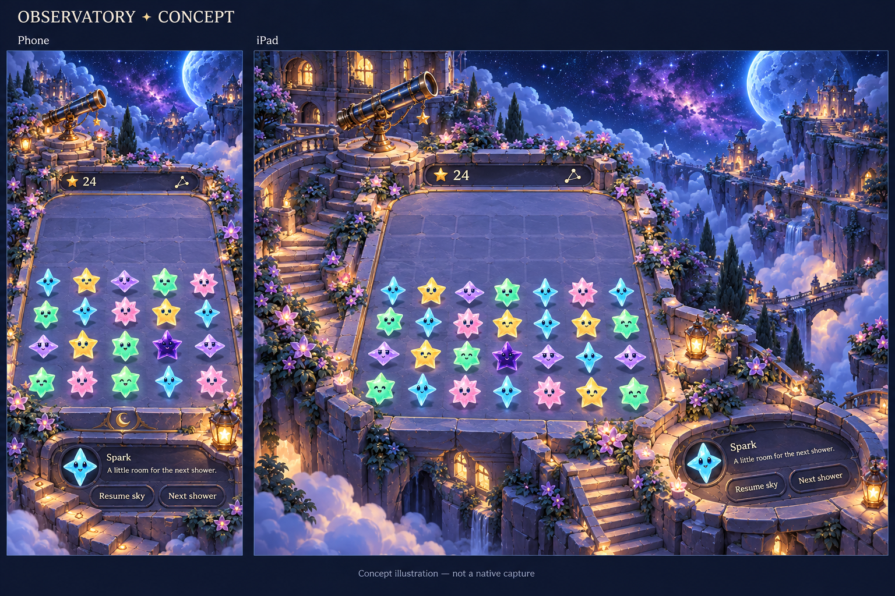
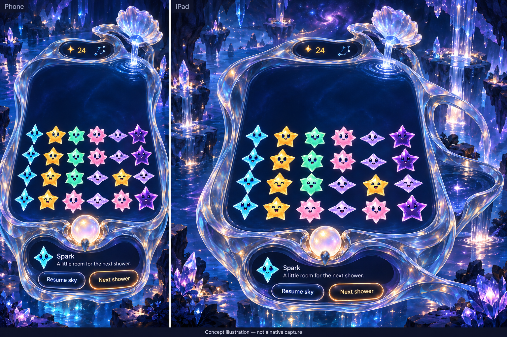

# Connected terrain and luminous vessels

**Status:** Superseded material exploration · **Owner:** current implementer · **Updated:** October 18, 2026

Replace the disconnected Observatory with a connected cliffside observatory; give Prism Tide a contrasting transparent vessel. The prior five-place implementation is useful interaction infrastructure, but its art direction is not accepted. These concepts explore substantial improvement, not approval or runtime evidence.

**Decision:** Author complete scenes around the authoritative 49-cell projection. Put native score and dialogue into dark physical recesses; ground each interactive prop through a connected mount, contact shadow and consistent light. Preserve the current cast, rules, input, saves and shared dialogue lifecycle. Do not turn the remaining three locations into reskins of one new frame.

**Direction changed after user review:** The user requested a broad Hearthstone board study before further production. The [study and revised brief](../hearthstone-study/README.md) now lead this work: move closer, simplify the play surface, enlarge and physically mount key props, and design the control recesses around real native content. These concepts are not ready for integration.

**Next action:** Follow the [five-world reimagining](../living-worlds-03/README.md), requested after the Hearthstone review. That set replaces this two-scene brief; these images remain historical material references.

## Two material directions

**Concept — not implementation evidence.** Built-in Imagegen, based on the original Observatory and current Crystal Glow cast. Phone column count and some masonry lines are illustrative errors, not proposed rule or grid changes. Native geometry and the current stars remain authoritative. The telescope mount, lower retaining walls and connected side alcove are the useful architectural references.

**Concept — not implementation evidence.** Built-in Imagegen. The revised quiet interior removes the generated lattice. Illustrated piece counts are not exact; stars, controls and text will be native. Thick transparent walls and restrained peripheral refraction distinguish this from stone terrain. This is a material reference, not adoption of system glass cards or an iOS 26 dependency.

## Acceptance before implementation

- The playable boundary encloses exactly the current 49 native polygons. Rendering, inverse mapping, trace/swap acquisition and star aspect remain unchanged; no ordinary-star rings or square cell backgrounds.
- Both scenes show connected physical supports, coherent light and prop contact in phone/tablet portrait and landscape. Every prop responds independently; rapid taps replace responses and settings/background/restart cancel them.
- Score, forecast, menu, dialogue and actions sit in the authored hollows. Long dialogue retains existing overflow/timing. Large text reflows and scrolls without hiding actionable content or shrinking labels.
- Empty/sparse/dense samples keep stars readable. Inspect full normal animation, reduced motion, corner taps, rotation, outcome/replay and interruption. Builds and screenshots alone do not establish gameplay quality.
- Core tests, affected hosted/UI checks, Debug/Release simulator builds, membership and hygiene pass. Record source identity and failures. Actual VoiceOver remains deferred to RC; physical-device acceptance is separate.

## Source and scope

Started from environment branch `861133e`, reconciled with fetched main `9b0f9d3` at `b7e9760`. Its newer help and input checks are preserved. Source-bound [prior native captures](../../../evidence/environment-grooves-2026-10-18/README.md) establish the reproduction: an unsupported telescope, near-fullscreen slab and a visible landscape apron join. [Current cast](../../../evidence/crystal-glow-integration-2026-10-17/materials.png) supplied the character reference. Exact generation prompts and original source paths are retained in `generation.json`.

The bounded first batch changes two environments and their art registration only. The remaining locations retain their current behavior while their distinct terrain/container directions await a later art pass. Human visual acceptance is open.
