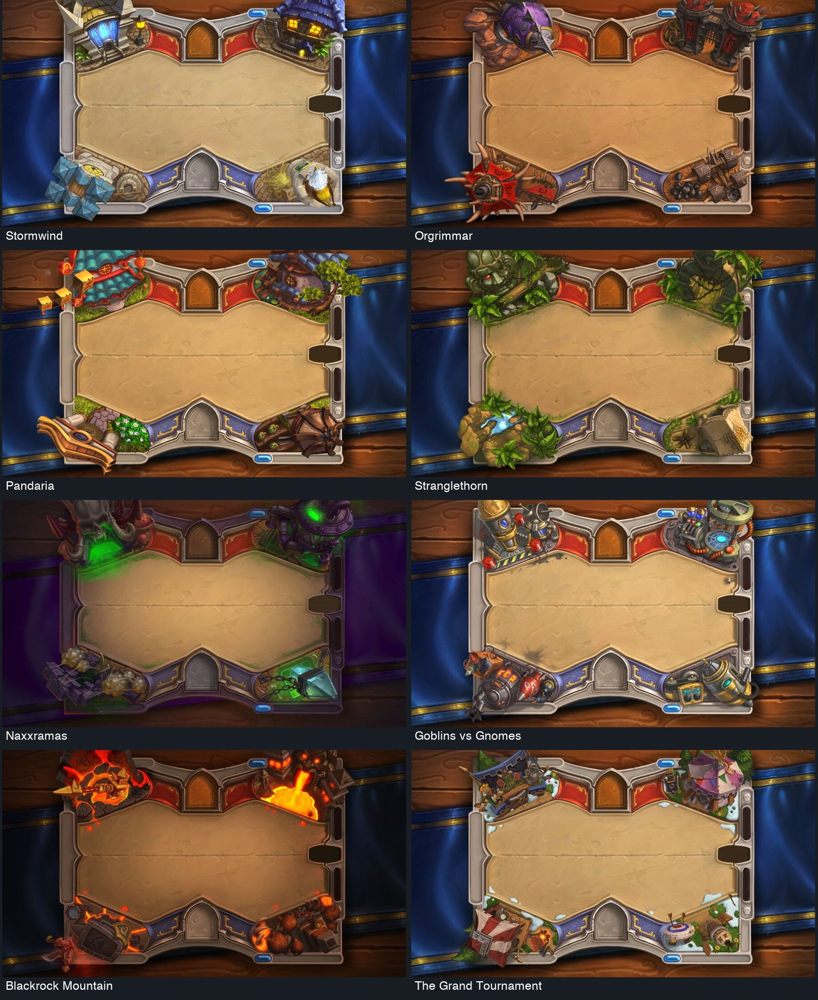
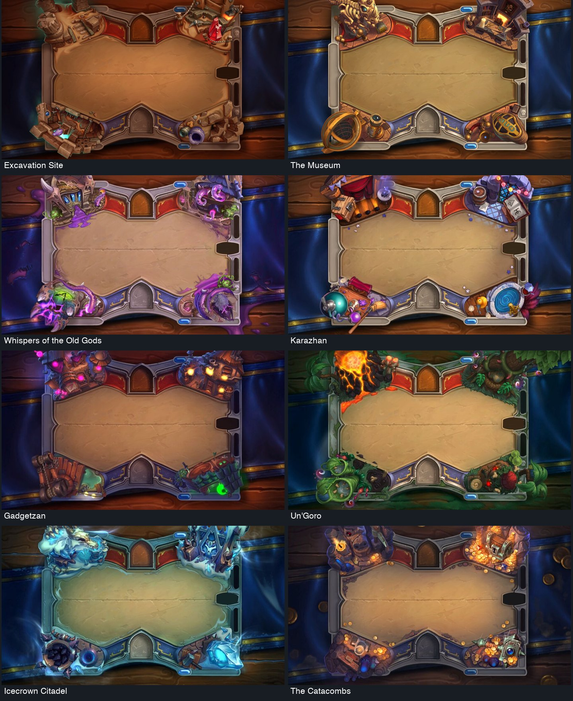
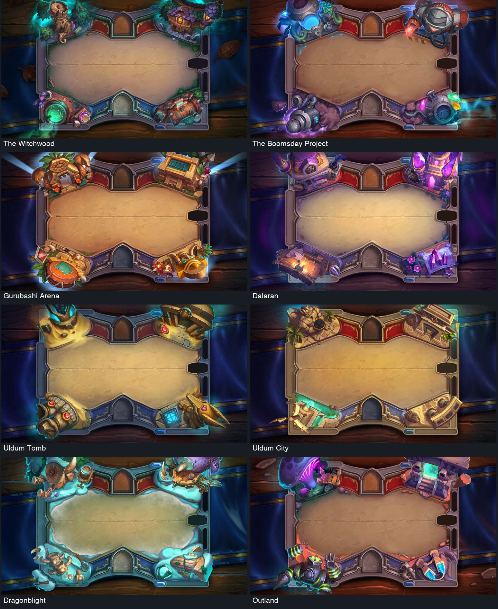
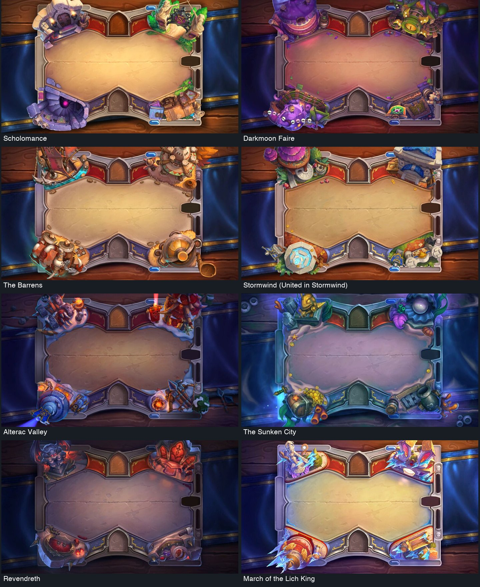
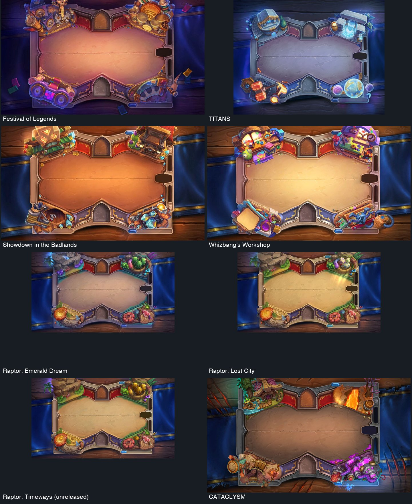
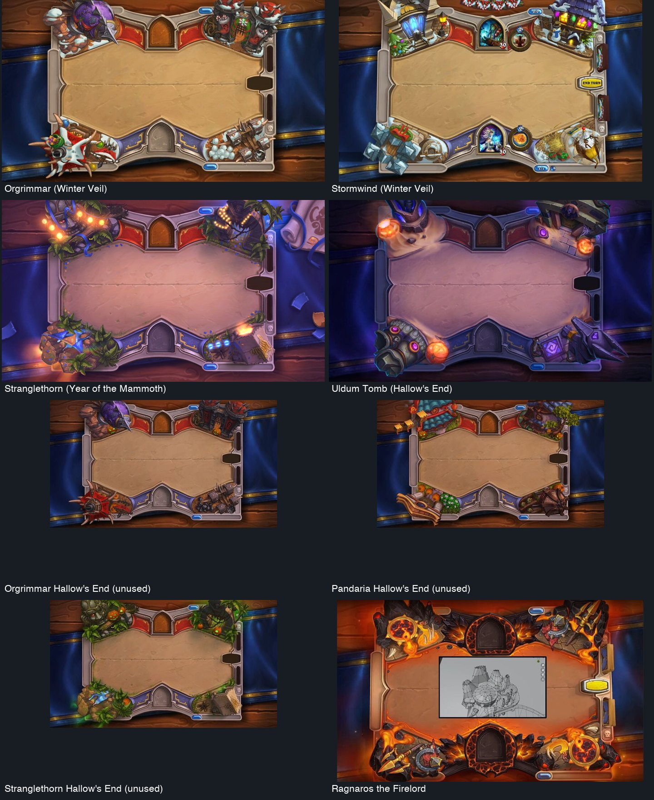
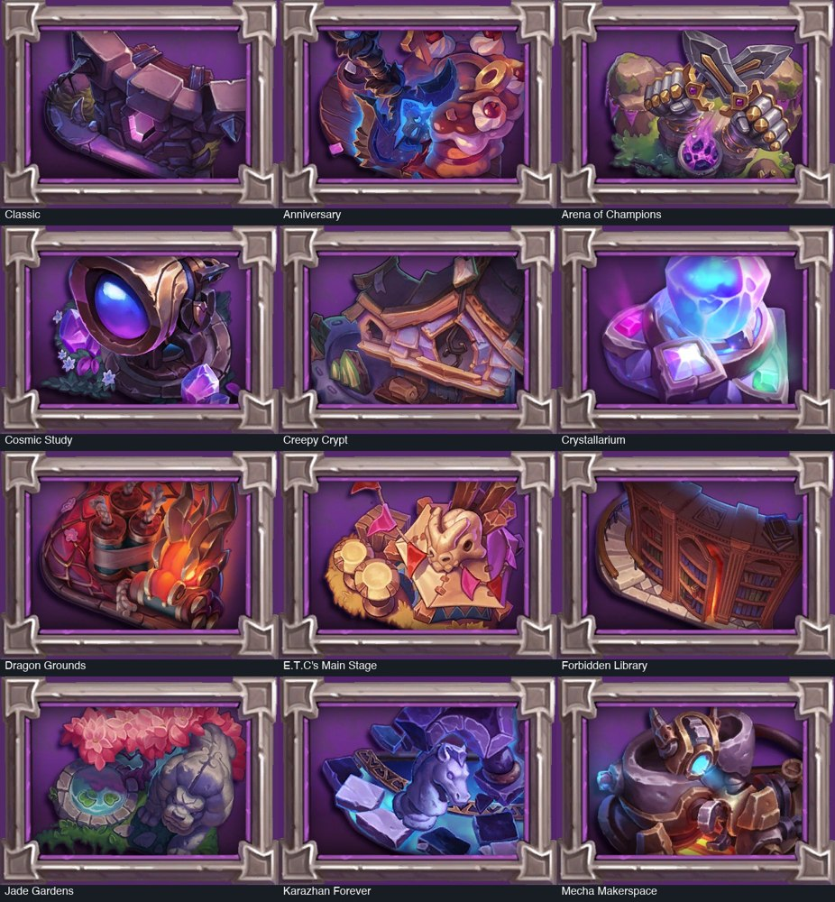
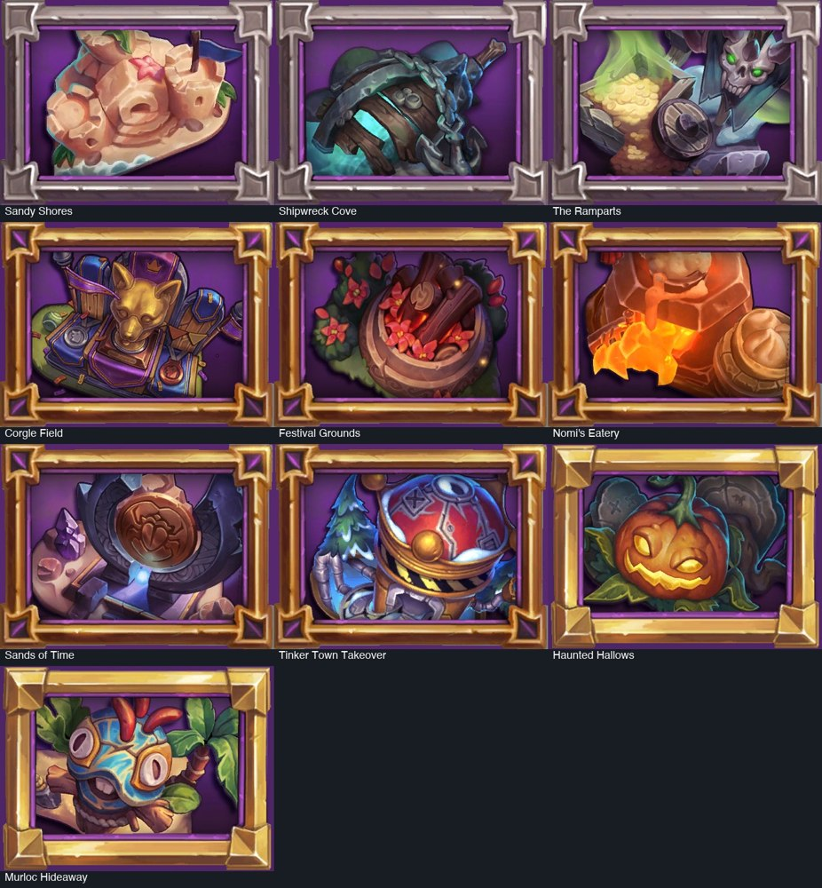
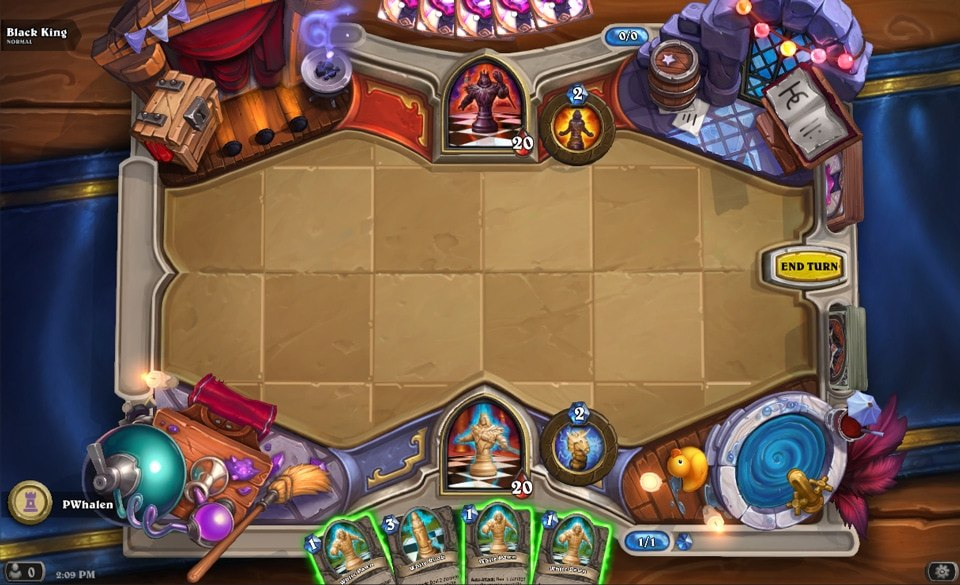
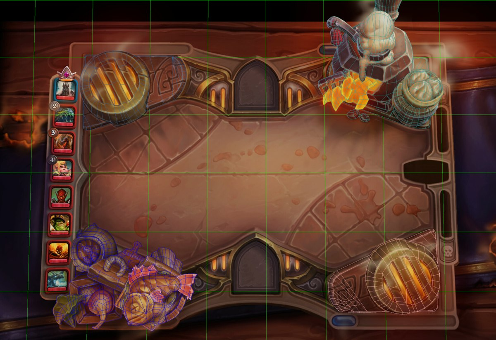

# Hearthstone board coverage

**Inspected October 18, 2026.** This ledger separates whole-board observations from partial references. It is a snapshot of the public catalogs found, not a guarantee that every client variant is represented.

The main catalog supplied **48 full-board images**: 38 named main-board families, two additional Year of the Raptor states, four seasonal boards, three unused seasonal variants and one Ragnaros board reference. One Raptor state is itself listed as unreleased. The Karazhan chess image is an additional reference. Board names and source images come from the [main battlefield catalog](https://hearthstone.wiki.gg/wiki/Battlefield); the short design observations below are this study's visual analysis.

## Main board comparisons

| Board / source image | What to inspect |
| --- | --- |
| [Stormwind](https://hearthstone.wiki.gg/images/thumb/Battlefield_-_Stormwind.jpg/900px-Battlefield_-_Stormwind.jpg?29f281) | Blue roofs, stone steps and warm windows create four readable miniature places. |
| [Orgrimmar](https://hearthstone.wiki.gg/images/thumb/Battlefield_-_Orgrimmar.jpg/900px-Battlefield_-_Orgrimmar.jpg?480a44) | Spikes, hides and siege machinery establish a heavy, angular material family. |
| [Pandaria](https://hearthstone.wiki.gg/images/thumb/Hearthstone_Pandaria.png/900px-Hearthstone_Pandaria.png?92c879) | Curved roofs, garden and camp provide different corner silhouettes in one setting. |
| [Stranglethorn](https://hearthstone.wiki.gg/images/thumb/Gameboard-stranglethornvale-medium.jpg/900px-Gameboard-stranglethornvale-medium.jpg?74e0de) | Roots, ruins and water soften the perimeter without covering the central field. |
| [Naxxramas](https://hearthstone.wiki.gg/images/thumb/Battlefield_-_Naxxramas.jpg/900px-Battlefield_-_Naxxramas.jpg?d3dfe2) | Green openings and purple stone darken the edges around a comparatively lit center. |
| [Goblins vs Gnomes](https://hearthstone.wiki.gg/images/thumb/Battlefield_-_Goblins_vs_Gnomes.jpg/900px-Battlefield_-_Goblins_vs_Gnomes.jpg?48e840) | Large machine assemblies give each corner a distinct mechanical silhouette. |
| [Blackrock Mountain](https://hearthstone.wiki.gg/images/thumb/Battlefield_-_Blackrock_Mountain.jpg/900px-Battlefield_-_Blackrock_Mountain.jpg?5c667f) | Hot openings contrast with heavy dark metal; most intensity stays at the perimeter. |
| [The Grand Tournament](https://hearthstone.wiki.gg/images/thumb/Battlefield_-_The_Grand_Tournament.jpg/900px-Battlefield_-_The_Grand_Tournament.jpg?363fcf) | Tents, banners and rounded fairground props feel lighter than the surrounding metal rim. |
| [Excavation Site](https://hearthstone.wiki.gg/images/thumb/Battlefield_-_Excavation.png/900px-Battlefield_-_Excavation.png?69946d) | Carved sandstone and excavation equipment share a warm, dusty palette. |
| [The Museum](https://hearthstone.wiki.gg/images/thumb/Battlefield_-_The_Hall_of_Explorers.png/900px-Battlefield_-_The_Hall_of_Explorers.png?51406c) | Large brass artifacts give the corners the character of display exhibits. |
| [Whispers of the Old Gods](https://hearthstone.wiki.gg/images/thumb/Battlefield_-_Whispers_of_the_Old_Gods.jpg/900px-Battlefield_-_Whispers_of_the_Old_Gods.jpg?4c3807) | Purple growth deforms recognizable Stormwind features and spreads beyond the rim. |
| [Karazhan](https://hearthstone.wiki.gg/images/thumb/Battlefield_-_One_Night_in_Karazhan.jpg/900px-Battlefield_-_One_Night_in_Karazhan.jpg?dbebd7) | A stage, party furniture and magical objects communicate an inhabited event. |
| [Gadgetzan](https://hearthstone.wiki.gg/images/thumb/Battlefield_-_Mean_Streets_of_Gadgetzan.jpg/900px-Battlefield_-_Mean_Streets_of_Gadgetzan.jpg?a8b257) | Dense urban corner buildings use different warm and colored light sources. |
| [Un'Goro](https://hearthstone.wiki.gg/images/thumb/Battlefield_-_Journey_to_Un%27Goro.jpg/900px-Battlefield_-_Journey_to_Un%27Goro.jpg?5684f2) | Volcano, jungle growth and eggs communicate a biome through large local objects. |
| [Icecrown Citadel](https://hearthstone.wiki.gg/images/thumb/Battlefield_-_Knights_of_the_Frozen_Throne.jpg/900px-Battlefield_-_Knights_of_the_Frozen_Throne.jpg?9f31d5) | Hard icy silhouettes and cool emissive details frame a restrained center. |
| [The Catacombs](https://hearthstone.wiki.gg/images/thumb/Battlefield_-_Kobolds_and_Catacombs.jpg/900px-Battlefield_-_Kobolds_and_Catacombs.jpg?cc7170) | Coin piles and candlelit treasure cluster near the edges, leaving room for cards. |
| [The Witchwood](https://hearthstone.wiki.gg/images/thumb/Battlefield_-_The_Witchwood.jpg/900px-Battlefield_-_The_Witchwood.jpg?dbd4ea) | Bent architecture and green magical light establish a more organic, uneasy silhouette. |
| [The Boomsday Project](https://hearthstone.wiki.gg/images/thumb/Battlefield_-_The_Boomsday_Project.jpg/900px-Battlefield_-_The_Boomsday_Project.jpg?d77ace) | Bulky chambers and machinery extend beyond the frame with few large shapes. |
| [Gurubashi Arena](https://hearthstone.wiki.gg/images/thumb/Battlefield_-_Rastakhan%27s_Rumble.jpg/900px-Battlefield_-_Rastakhan%27s_Rumble.jpg?41b379) | Gold, teal and broad carved forms turn the corners into arena architecture. |
| [Dalaran](https://hearthstone.wiki.gg/images/thumb/Battlefield_-_Rise_of_Shadows.jpg/900px-Battlefield_-_Rise_of_Shadows.jpg?e4372e) | Purple roofs, large crystals and warm windows repeat an arcane-city vocabulary. |
| [Uldum Tomb](https://hearthstone.wiki.gg/images/thumb/Battlefield_-_Saviors_of_Uldum.jpg/900px-Battlefield_-_Saviors_of_Uldum.jpg?3538db) | Monumental carved forms and turquoise accents establish tomb architecture. |
| [Uldum City](https://hearthstone.wiki.gg/images/thumb/Battlefield_-_Saviors_of_Uldum2.jpg/900px-Battlefield_-_Saviors_of_Uldum2.jpg?68038b) | Open stone structures, water and a large instrument distinguish the exterior variant. |
| [Dragonblight](https://hearthstone.wiki.gg/images/thumb/Battlefield_-_Descent_of_Dragons.jpg/900px-Battlefield_-_Descent_of_Dragons.jpg?7301ba) | Snow banks join the rim while ships and machinery retain strong corner shapes. |
| [Outland](https://hearthstone.wiki.gg/images/thumb/Battlefield_-_Ashes_of_Outland.jpg/900px-Battlefield_-_Ashes_of_Outland.jpg?295ddd) | Fel green and violet light connect jagged organic forms with machinery. |
| [Scholomance](https://hearthstone.wiki.gg/images/thumb/Battlefield_-_Scholomance_Academy.jpg/900px-Battlefield_-_Scholomance_Academy.jpg?ea2f91) | Books, candles and school architecture create small academic scenes. |
| [Darkmoon Faire](https://hearthstone.wiki.gg/images/thumb/Battlefield_-_Madness_at_the_Darkmoon_Faire.jpg/900px-Battlefield_-_Madness_at_the_Darkmoon_Faire.jpg?5cf997) | Carnival structures and creature-like props frame a pink-lit field. |
| [The Barrens](https://hearthstone.wiki.gg/images/thumb/Battlefield_-_Forged_in_the_Barrens.jpg/900px-Battlefield_-_Forged_in_the_Barrens.jpg?cdfae1) | Canvas, leather, timber and machinery make the corners feel like an outpost. |
| [Stormwind (United in Stormwind)](https://hearthstone.wiki.gg/images/thumb/Battlefield_-_United_in_Stormwind.jpg/900px-Battlefield_-_United_in_Stormwind.jpg?cb7012) | Bright roofs, masonry and a fountain give the city a warmer civic character. |
| [Alterac Valley](https://hearthstone.wiki.gg/images/thumb/Battlefield_-_Fractured_in_Alterac_Valley.jpg/900px-Battlefield_-_Fractured_in_Alterac_Valley.jpg?238120) | Cold stone and snow are balanced by isolated orange fires. |
| [The Sunken City](https://hearthstone.wiki.gg/images/thumb/Battlefield_-_Voyage_to_the_Sunken_City.jpg/900px-Battlefield_-_Voyage_to_the_Sunken_City.jpg?179c37) | Water, coral and a pearl change the material feeling without losing the central geometry. |
| [Revendreth](https://hearthstone.wiki.gg/images/thumb/Battlefield_-_Murder_at_Castle_Nathria.jpg/900px-Battlefield_-_Murder_at_Castle_Nathria.jpg?aa213d) | Dark stone and red furnishings create a coherent gothic interior. |
| [March of the Lich King](https://hearthstone.wiki.gg/images/thumb/Battlefield_-_March_of_the_Lich_King.jpg/900px-Battlefield_-_March_of_the_Lich_King.jpg?4366fa) | Large blue crystals and gold-red fittings create strong warm/cool edge contrasts. |
| [Festival of Legends](https://hearthstone.wiki.gg/images/thumb/Battlefield_-_Festival_of_Legends.jpg/900px-Battlefield_-_Festival_of_Legends.jpg?a8af9a) | Musical equipment supplies both the theme and plausible interactive objects. |
| [TITANS](https://hearthstone.wiki.gg/images/thumb/Battlefield_-_TITANS.jpg/900px-Battlefield_-_TITANS.jpg?d6dee3) | Cool stone and luminous mechanisms use unusually restrained large shapes. |
| [Showdown in the Badlands](https://hearthstone.wiki.gg/images/thumb/Battlefield_-_Showdown_in_the_Badlands.jpg/900px-Battlefield_-_Showdown_in_the_Badlands.jpg?4ac195) | Mining timber, rock and oversized gems establish a dry, warm setting. |
| [Whizbang's Workshop](https://hearthstone.wiki.gg/images/thumb/Battlefield_-_Whizbang%27s_Workshop.jpg/900px-Battlefield_-_Whizbang%27s_Workshop.jpg?2d25b7) | Rounded toy assemblies and primary colors distinguish each workshop corner. |
| [Year of the Raptor — Emerald Dream](https://hearthstone.wiki.gg/images/thumb/Battlefield_-_Year_of_the_Raptor.jpg/500px-Battlefield_-_Year_of_the_Raptor.jpg?b3a626) | Plants and stone use cool dreamlike lighting around the familiar field. |
| [Year of the Raptor — Lost City](https://hearthstone.wiki.gg/images/thumb/Battlefield_-_Year_of_the_Raptor_%28Lost_City%29.jpg/500px-Battlefield_-_Year_of_the_Raptor_%28Lost_City%29.jpg?b78f90) | Warmer lighting and changed corner details restage the same underlying scene. |
| [Year of the Raptor — Timeways](https://hearthstone.wiki.gg/images/thumb/Battlefield_-_Year_of_the_Raptor_%28Timeways%29.jpg/500px-Battlefield_-_Year_of_the_Raptor_%28Timeways%29.jpg?750783) | Catalog labels this Timeways variant as never released; retained as a comparison only. |
| [CATACLYSM](https://hearthstone.wiki.gg/images/thumb/Battlefield_-_CATACLYSM.jpg/900px-Battlefield_-_CATACLYSM.jpg?dca53b) | Distinct disaster-themed corners share a worn center and damaged surrounding table. |
| [Orgrimmar (Winter Veil)](https://hearthstone.wiki.gg/images/thumb/Battlefield_-_Winter_Veil_Orgrimmar.jpg/900px-Battlefield_-_Winter_Veil_Orgrimmar.jpg?110b19) | Snow and holiday objects modify an existing board without rearranging its geometry. |
| [Stormwind (Winter Veil)](https://hearthstone.wiki.gg/images/thumb/Battlefield_-_Winter_Veil_Stormwind.jpg/900px-Battlefield_-_Winter_Veil_Stormwind.jpg?ff56b3) | Holiday additions coexist with visible hero, resource and turn-control locations. |
| [Stranglethorn (Year of the Mammoth)](https://hearthstone.wiki.gg/images/thumb/Battlefield_-_Stranglethorn_%28Year_of_the_Mammoth%29.png/900px-Battlefield_-_Stranglethorn_%28Year_of_the_Mammoth%29.png?5c30a9) | Lights and decorations alter the mood while the original corner structure remains. |
| [Uldum Tomb (Hallow's End)](https://hearthstone.wiki.gg/images/thumb/Battlefield_-_Uldum_Tomb_%28Hallow%27s_End%29.jpg/900px-Battlefield_-_Uldum_Tomb_%28Hallow%27s_End%29.jpg?5a482e) | Pumpkins and purple light restage the tomb with a small seasonal vocabulary. |
| [Orgrimmar — Hallow's End (unused)](https://hearthstone.wiki.gg/images/thumb/Battlefield_-_Orgrimmar_%28Hallow%27s_End%29.jpg/500px-Battlefield_-_Orgrimmar_%28Hallow%27s_End%29.jpg?88861a) | Unused Orgrimmar seasonal reference; inspect as an unreleased comparison. |
| [Pandaria — Hallow's End (unused)](https://hearthstone.wiki.gg/images/thumb/Battlefield_-_Pandaria_%28Hallow%27s_End%29.jpg/500px-Battlefield_-_Pandaria_%28Hallow%27s_End%29.jpg?a027e3) | Unused Pandaria seasonal reference; inspect as an unreleased comparison. |
| [Stranglethorn — Hallow's End (unused)](https://hearthstone.wiki.gg/images/thumb/Battlefield_-_Stranglethorn_%28Hallow%27s_End%29.jpg/500px-Battlefield_-_Stranglethorn_%28Hallow%27s_End%29.jpg?a56b69) | Unused Stranglethorn seasonal reference; inspect as an unreleased comparison. |
| [Ragnaros the Firelord](https://hearthstone.wiki.gg/images/thumb/Ragnaros_hero_-_Battlefield_2.jpg/900px-Ragnaros_hero_-_Battlefield_2.jpg?13d37f) | Ragnaros surrounds familiar control sockets with fire and dark sculpted forms; image includes an authoring inset. |

## Full-board contact sheets

The sheets preserve the source artwork's proportions. They show art/reference states, often without pieces or complete UI; they are not screenshots captured from a running client during this study. Artwork belongs to Blizzard and the credited artists.

## Battlegrounds coverage

The [current public catalog](https://hearthstone.wiki.gg/wiki/Battlegrounds/Board) lists 22 boards. All 22 icons were visually inspected. **Only six have complete-board references in this study.** The other sixteen icons establish a prop's shape/material, not the entire layout, animations or responsiveness. No whole-board conclusions are attributed to those icons.

| Board | Inspection level |
| --- | --- |
| Classic | Default phase visible in official Jade Gardens/Cosmic Study preview sequences |
| Anniversary | Prop icon only — full composition unverified |
| Arena of Champions | Prop icon only — full composition unverified |
| Cosmic Study | Official full-board preview frames; artist credits |
| Creepy Crypt | Prop icon only — full composition unverified |
| Crystallarium | Prop icon only — full composition unverified |
| Dragon Grounds | Prop icon only — full composition unverified |
| E.T.C's Main Stage | Prop icon only — full composition unverified |
| Forbidden Library | Prop icon only — full composition unverified |
| Jade Gardens | Official full-board preview frames; artist credits |
| Karazhan Forever | Prop icon only — full composition unverified |
| Mecha Makerspace | Prop icon only — full composition unverified |
| Sandy Shores | Complete published board painting via a reproduction; artist credit verified |
| Shipwreck Cove | Prop icon only — full composition unverified |
| The Ramparts | Prop icon only — full composition unverified |
| Corgle Field | Prop icon only — full composition unverified |
| Festival Grounds | Prop icon only — full composition unverified |
| Nomi's Eatery | Two full-board artist wireframes, including a mobile view |
| Sands of Time | Prop icon only — full composition unverified |
| Tinker Town Takeover | Prop icon only — full composition unverified |
| Haunted Hallows | Prop icon only — full composition unverified |
| Murloc Hideaway | Official full-board preview frames and published board painting |

**Catalog icons — Blizzard, via Hearthstone Wiki.** Icon framing is collection UI; it is not the framing of the playable board. Do not mistake these thumbnails for complete-board evidence.

## Special encounter and mobile reference

**Blizzard's published Karazhan chess screenshot.** [Designing Karazhan's Chess Event with Peter Whalen](https://hearthstone.blizzard.com/en-au/blog/20271423/hearthside-chat-designing-karazhans-chess-event-with-peter-whalen-10-7-2016). The grid serves this encounter's positional rules; it is not a recommendation to restore visible cell backgrounds in Starfall.

**Erica C. Lyons's mobile production view.** [Artist breakdown](https://www.ericaclyons.com/projects/kQQQl0). Compare it with the wider wireframe in the study: the corner objects need deliberate mobile presentation, not merely a smaller copy of desktop art.

## Gaps retained explicitly

This study does not certify current availability, every regional or localized variant, every hero-skin environment, all Mercenaries or Tavern Brawl boards, or every board's hidden interactions. The main catalog's historical introduction count is not used as an authoritative total. The early Goblins vs Gnomes prototype in its small gallery was indexed but not included in the 48 inspected full-board images.

Several ArtStation pages exposed useful credits through search, while their image payloads did not load. Crystallarium's wiki detail page linked missing video files. A Haunted Hallows 3D fan reconstruction was excluded as evidence of Blizzard's implementation. These gaps do not prevent the composition comparison, but they prevent a claim that every Hearthstone board has been fully inspected or played.
