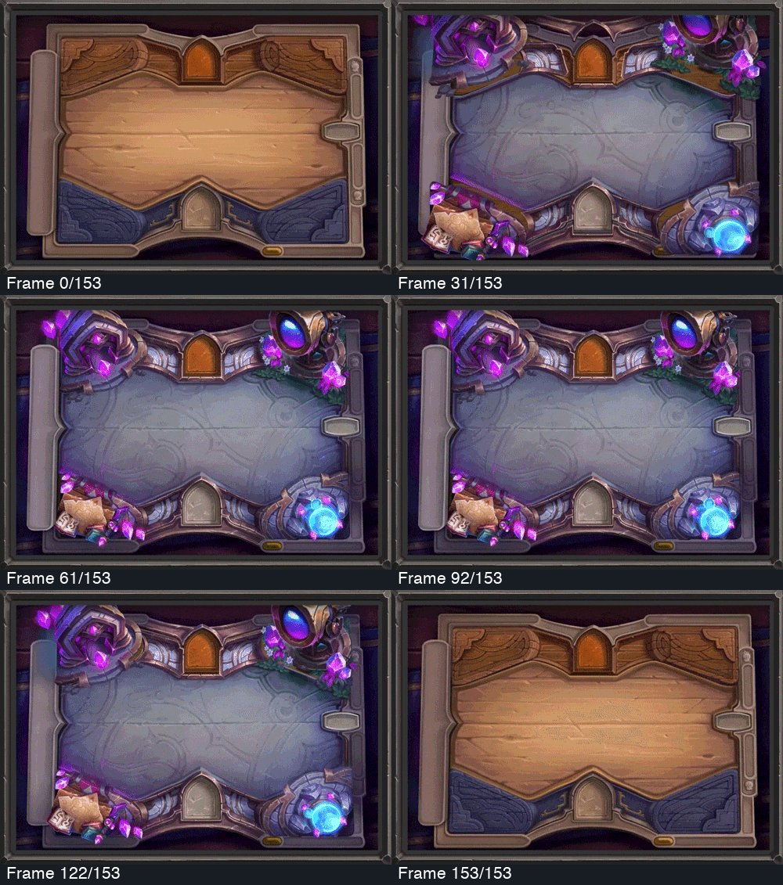
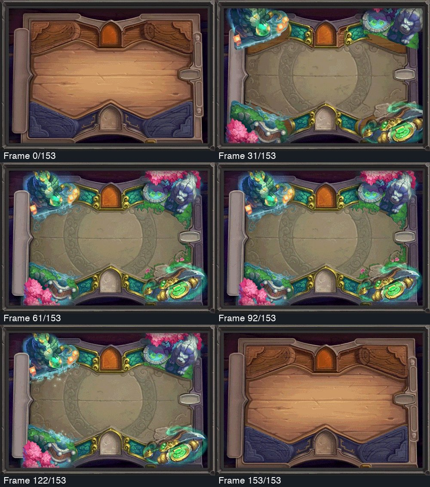
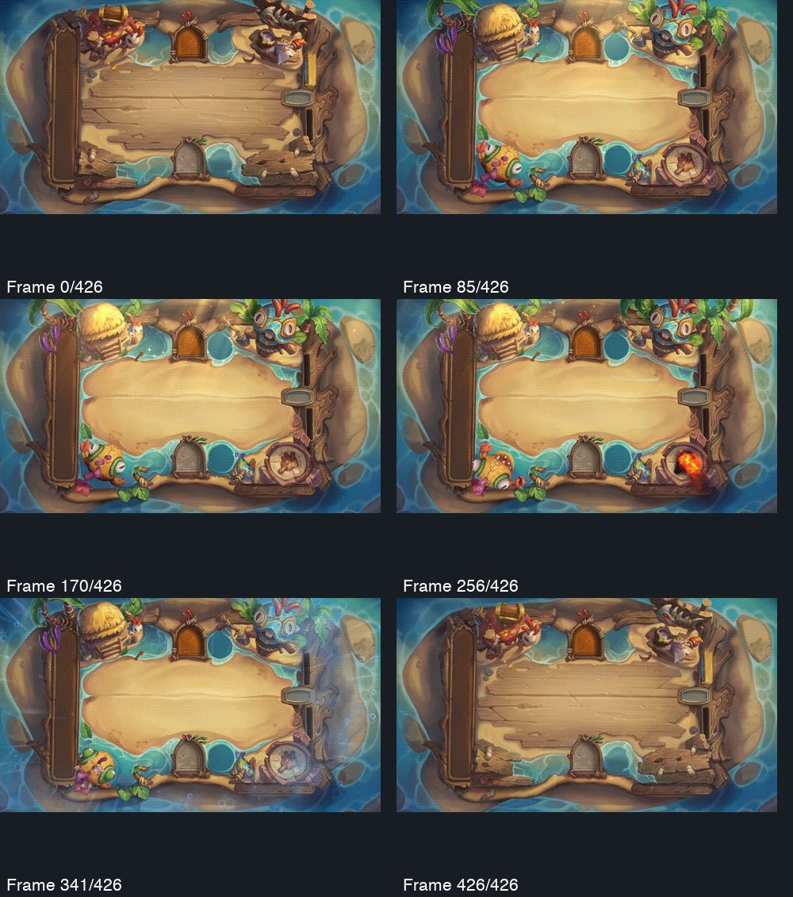

# Published board previews separate transitions from local life

**Evidence level:** Selected frames from Blizzard's published GIFs, inspected October 18, 2026. These are recorded-media observations, not live playtests. Contact sheets cannot establish smoothness, sound, interaction latency or device performance.

The Cosmic Study and Jade Gardens clips contain 154 frames each; Murloc Hideaway contains 427. The sheets sample six positions across each clip. Full original media remains available from the linked official sources.

## Cosmic Study

[Official preview](https://bnetcmsus-a.akamaihd.net/cms/content_entry_media/i4/I4VHDPKLM0A01643933494602.gif), published in [22.4 patch notes](https://hearthstone.blizzard.com/en-us/news/23761712/22-4-patch-notes).

**Observed:** The corner assemblies and their surrounding surface move through a staged change while the familiar control locations remain. In the established state, instruments and luminous accents occupy the perimeter. The preview presents a transformation of the play table, not a camera flight through a large world.

## Jade Gardens

[Official preview](https://bnetcmsus-a.akamaihd.net/cms/content_entry_media/tl/TL5NUC9O2G831643933472876.gif), same official patch notes.

**Observed:** The garden's water and foliage provide localized changes around a stable central field. A low-contrast ornament crosses the center, demonstrating that a quiet surface need not be completely featureless. This does not establish that a similar pattern would remain legible beneath Starfall's 49 smaller pieces.

## Murloc Hideaway

[Official preview](https://bnetcmsus-a.akamaihd.net/cms/content_entry_media/i2/I2U2PQ6CSUOO1663721726186.gif), published in [24.4 patch notes](https://hearthstone.blizzard.com/en-gb/news/23852687/244-patch-notes).

**Observed:** The preview changes both the surrounding objects and the central material, including a wooden recruitment surface and sandy combat surface. Local fire and water states change without requiring the whole scene to remain in constant motion. The official notes document several match-state presentations; the sampled frames alone do not identify every trigger.

## Application to Starfall

Keep ambient movement small and peripheral. Give deliberate prop taps a readable beginning, physical response and settled end. Reserve stronger environmental events for clear game moments, with the actual game outcome already committed independently of the animation. Preserve existing cancellation for settings, backgrounding, restart and scene replacement.

Do not infer that still artwork plus a generic glow reproduces this behavior. The next native pass must inspect real falling stars, prop articulation and interruption with ordinary motion enabled, then separately verify the same usable outcomes under Reduce Motion.
