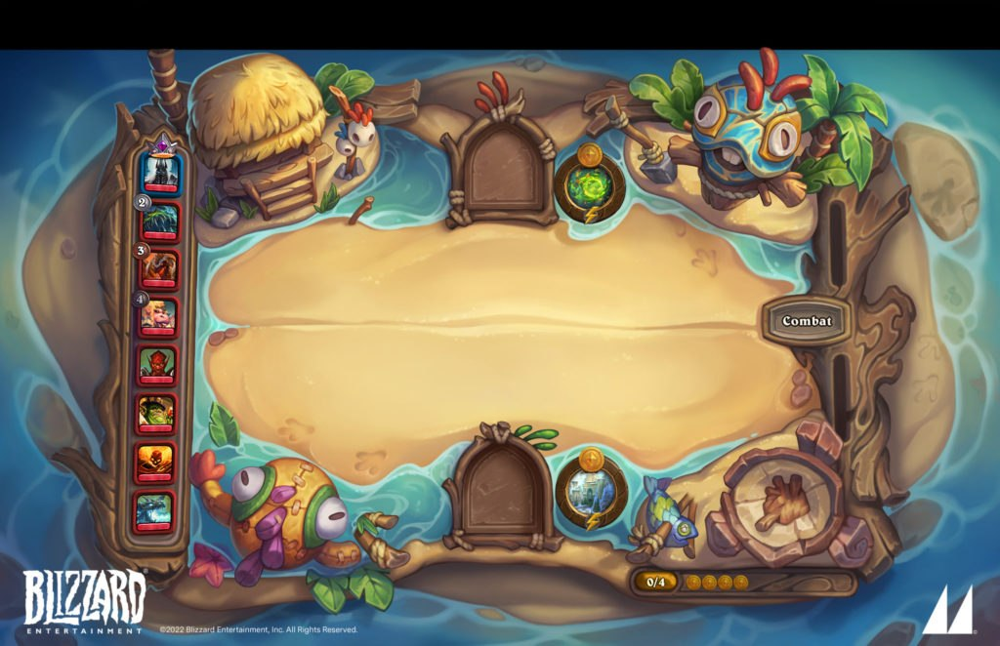
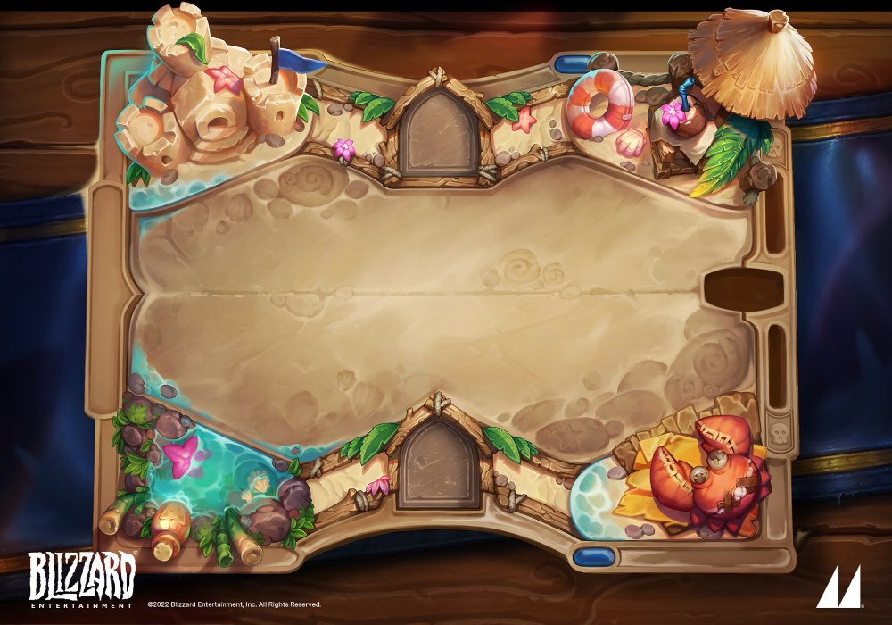
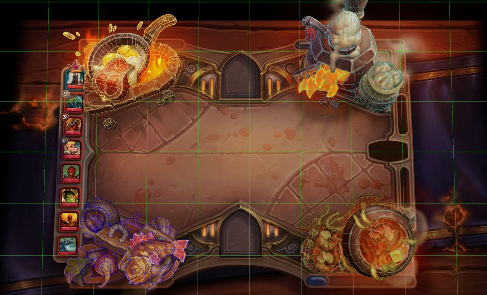
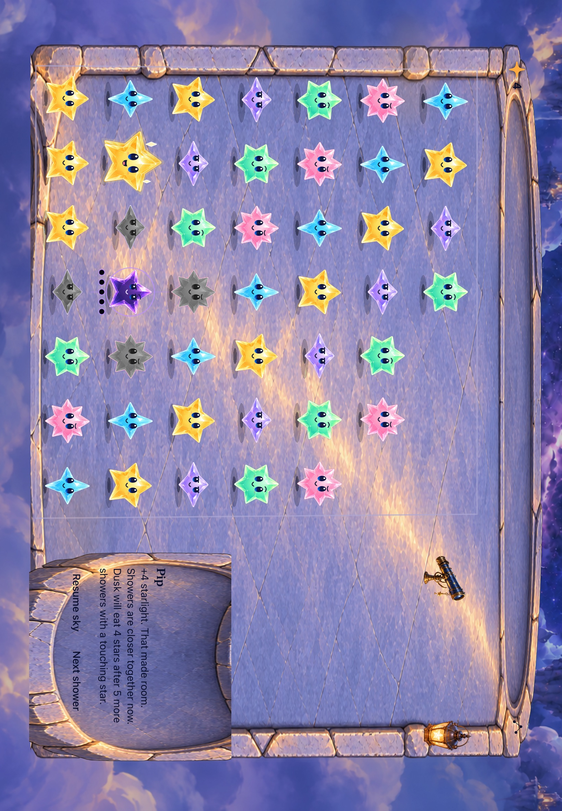

# Hearthstone makes the board feel like a place you can touch

**Status:** Research and revised design recommendation · **Owner:** current implementer · **Date:** October 18, 2026

Starfall should borrow Hearthstone's discipline: a quiet play surface, large sculpted objects at its edges, convincing physical connections, and controls built into the setting. The previous Starfall concepts overemphasized scenic vistas and ornate framing. Revise their composition before integration.

**Coverage:** Visually inspected 48 full-board images from the main battlefield catalog, the Karazhan chess variation, all 22 Battlegrounds catalog icons, and fuller references for six Battlegrounds settings, including the default. This is a broad visual study, not an exhaustive client or animation audit. Sixteen Battlegrounds entries remain limited to prop icons; see the [coverage ledger](CATALOG.md).

**Design follow-through:** The user subsequently requested a total board reimagining. The [five-world concepts and local composition review](../living-worlds-03/README.md) apply this study across every existing setting. Native composition, landscape and motion acceptance remain separate.

**External reference art, not Starfall implementation.** Blizzard artwork; main-board images via the [Hearthstone Wiki](https://hearthstone.wiki.gg/wiki/Battlefield), Cosmic Study from [Blizzard's 22.4 preview](https://hearthstone.blizzard.com/en-us/news/23761712/22-4-patch-notes), and Murloc Hideaway art by Mooncolony reproduced by [Esports.gg](https://esports.gg/news/hearthstone/hearthstone-winter-veil-60-free-packs-for-new-players-battle-bash/). Source URLs and inspection levels are retained in [sources.json](sources.json).

## What the comparisons actually show

### 1. Familiar geometry supports very different places

The constructed boards repeat an unusually strict structure: a broad central field, four scenic corners, top/bottom hero sockets, and narrow side channels. Stormwind, Karazhan, Sunken City and Cataclysm still read as the same game before any cards appear. Many even retain the same center seam and surrounding tablecloth. Their variation comes from silhouettes, materials, light and little stories in the corners.

This corrects an easy misunderstanding: variety does not require rebuilding the playfield for every theme. It does require more than recoloring a generic border. For Starfall, reuse the 49-cell mapping and control roles; give each setting its own physical construction outside that contract.

### 2. The center is deliberately less interesting than the edges

Even the volcanic, haunted and mechanical boards leave the central field broad and comparatively quiet. There is texture, but little sharp, high-contrast detail beneath the pieces. Bright windows, pools of magic, metal highlights and unusual silhouettes sit at the perimeter. The same logic remains visible when the central material changes in Sunken City and TITANS.

For Starfall, crystal faces, star silhouettes and matching groups must attract attention before masonry seams, caustics or flowers. A glass setting needs a restrained interior; a bright outline around every edge will compete with the stars. The floor can suggest depth without drawing a second puzzle grid.

### 3. Each corner is a small scene with a clear subject

Pandaria combines roofs, garden, instrument and camp. Karazhan combines stage, party furniture, magical objects and a pool. The corners have different silhouettes and functions while sharing a palette and material vocabulary. Small supporting details make the large object legible; they do not replace it with visual noise.

The observed pattern is one dominant object with a few subordinate objects in each cluster. Their scale is deliberately toy-like: a building, a drum and a treasure chest can all be large enough to recognize. Starfall needs similarly decisive forms—a telescope on a substantial mount, a lantern on a ledge, an instrument with a visible mechanism. More distant scenery will not solve a weak foreground.

### 4. Physical attachment does most of the work

Look at the stones under Stormwind's buildings, the plinth under Cosmic Study's telescope, or the timber housing Murloc Hideaway's controls. Objects overlap their support, cast a local shadow, and share the light and perspective of the surrounding surface. Thick rims have readable top and side faces. Dark contact seams explain how parts meet.

This is why the earlier Starfall telescope feels detached: its cutout has a foot, but the foot has no convincing place to stand. A generic drop shadow cannot establish the missing structure. The base, support surface, contact shadow and moving part need to be authored together, even if they are separate runtime layers.

### 5. The camera serves readability

The boards present a shallow overhead view with front-facing surfaces exposed enough to read their volume. They do not depend on a distant horizon or the strict consistency of an architectural isometric drawing. Important props show useful faces; the playfield remains easy to scan.

For Starfall, establish one camera and ground plane, then allow controlled illustration choices at the edges. Do not distort the actual stars or hit cells to make a painting fit. The portrait composition must preserve seven usable columns; landscape needs an authored arrangement of the same components, not a cropped portrait illustration with a pasted message wing.

### 6. Material is expressed through shape as well as color

Blackrock uses heavy dark masses and hot openings. Icecrown uses hard blue planes and translucent edges. Pandaria uses rounded wood, curved roofing and soft plants. Sandy Shores uses rounded sand forms and shallow water. Broad bevels, compressed detail and selective highlights make these materials readable at game scale.

Our stone and glass directions should differ in cross-section, thickness, edge treatment and light transmission. Stone can use compressed seams, chipped broad edges and matte planes. Glass can use visible thickness, a few refracted edges and dark transparent depth. Neither benefits from adding shine everywhere. These are art-direction observations, not claims about particular shaders in Blizzard's renderer.

### 7. The interface is part of the object

Hero portraits sit in sockets. Turn controls occupy a physical recess. Resource tracks run through narrow channels. These parts remain visually consistent enough to recognize across themes. In Murloc Hideaway, the opponent rail is timber and the bottom resource track is built into the shore's wooden edge.

For Starfall, the score/menu area and lower dialogue need to share the architecture's thickness, material and light. Keep their content native and readable. A giant smooth strip across the entire top creates an empty interface panel; a shaped instrument recess can feel purposeful. Long text still needs a flexible layout: the painting must accommodate the native content, including its largest supported sizes.

### 8. Interaction gives the object a believable verb

Ben Thompson identifies Goblins vs Gnomes as an expansion of the board's interactive possibilities, with discovery kept below the threshold of distracting play. He also describes close collaboration between board modeling and sound. This supports a design principle for Starfall: give each prop a specific response, such as a telescope pivoting on its joint or a shell opening around its pearl. A universal pulse or glow does not convey the same physical behavior. [Thompson interview](https://www.invenglobal.com/articles/1554/how-hearthstones-art-director-ben-thompson-breathed-life-into-hearthstone)

Blizzard's later Legendary Battlegrounds boards also respond to match state, with distinct presentations for recruitment, combat and several combat conditions. This is a useful reference for separating quiet ambient life, intentional taps and exceptional events. It is not a reason to add progression or new mechanics to Starfall. [24.4 patch notes](https://hearthstone.blizzard.com/en-gb/news/23852687/244-patch-notes)

## Where the broader scenic treatment works

**Published board art — Blizzard / Mooncolony, reproduced by Esports.gg; not a capture from this study.** [Artist attribution](https://mooncolony.artstation.com/projects/2qmmmJ). The shore softens the central boundary while the controls retain clear physical homes.

Murloc Hideaway is the most useful reference for the requested connected environment. The playfield is a sandy clearing within a small coastal world. Water flows around it; props rest on shore; wood contains the interface. The central field remains quiet and recognizable even though the surrounding structure has changed substantially.

Sandy Shores is a useful intermediate comparison: it retains a more explicit game-board rim but makes sand, foliage and water cross its visual boundaries. Cosmic Study supplies the stronger reference for the Observatory's mounted instruments. Together these examples show a range between a decorated physical board and an environment that itself forms the board.

**Published concept/board art — Daniele Santandrea / Mooncolony, Blizzard copyright.** Inspected image is a [Pinterest reproduction](https://www.pinterest.com/pin/hearthstone-board-art--98868154317654626/); [the artist studio confirms the board and credit](https://mooncolony.artstation.com/projects/NGkDXN). Treat this as an art reference, not proof of current client rendering.

## What is documented about production

Erica C. Lyons describes building Nomi's Kitchen's combat-board mesh from Mooncolony's painting to create its 2.5D appearance, then animating it in Unity. The published wireframes show geometry concentrated on the dimensional corner objects and separate mobile and wider views. This is direct evidence for that board's production, not proof that every Hearthstone board uses identical tooling. [Artist's breakdown](https://www.ericaclyons.com/projects/kQQQl0)

**Artist production breakdown — Erica C. Lyons; painting by Mooncolony, VFX credited to Valeria Yang.** This establishes how one shipped board was assembled. The green guides and wireframes are authoring overlays.

Mooncolony's Haunted Hallows credits separately identify board artists, tavern art, a strike icon and Blizzard's initial concept. The practical lesson is to design the whole composition and then assign explicit layer responsibilities. It is not necessary to turn Starfall into a general 3D environment renderer to apply that lesson. [Studio credits](https://mooncolony.artstation.com/projects/8wxOVq)

Ben Thompson's account of early collectible development also gives useful counterevidence: richly layered frames became too visually complex and distracted from essential information. The final design prioritized what players needed to read. Material richness must earn its place. [Blizzard art article](https://hearthstone.blizzard.com/en-gb/news/13023802)

**Proposed Starfall production order:** native layout mask → large scenic masses and control recesses → one coherent painted composition → separated moving parts and matching supports/shadows → native stars and controls → movement and touch verification. Preserve a single geometry owner. This is our proposed adaptation, not a quoted Blizzard pipeline.

## How this changes the current Starfall proposal

**Earlier native evidence — iPad Air 11-inch M3, iOS 27.0 Simulator, snapshot `88c790ab7a2f`.** Re-inspected for this study; not a new build or current-HEAD certification. [Original capture context](../../../evidence/environment-grooves-2026-10-18/README.md).

| Current weakness | Revised direction | Observable check |
| --- | --- | --- |
| Distant scenery and an oversized uniform slab dominate | Move the camera closer; use a few substantial local structures around the actual arena | At phone size, identify the setting and two props without zooming; stars remain the first playable focus |
| Telescope appears to float | Design its pedestal, ledge, joint and contact shadow as one assembly | In portrait and landscape, its foot visibly meets the support throughout its response |
| Landscape dialogue looks inserted into the painting | Design the lower/side alcove with shared ground, seams and lighting | No hard crop edge or disconnected overlap at either orientation |
| Bright floor seams and decorative borders compete | Reduce central contrast; reserve sharp highlights for stars and selected props | Sparse and dense native fixtures preserve star faces and matching-group recognition |
| Different locations inherit the same construction | Share input geometry while varying the surrounding terrain and material | Observatory reads as stone/brass; vessel reads as thick glass/water from silhouette and edge structure alone |
| Static art dictates text space | Establish native text and action envelopes before final art | Largest text and longest dialogue reflow/scroll without shrunken text, hidden actions or obscured cells |

The [connected-scene concepts](../connected-scenes-02/README.md) remain useful material exploration. They are **not ready for integration**: generated star counts are wrong, the camera is too scenic, fine decoration is excessive, and the empty production paintings do not match the exact native layout. Their useful ideas are connected supports and a distinct transparent vessel. Those ideas need to survive a much simpler composition first.

For the next Observatory, use a close astronomical worksite: dark, quiet collecting surface; a large supported brass telescope; a small domed or stone corner structure; and a lower instrument/message recess formed from the same masonry. For the contrasting vessel, use a continuous thick glass or mineral basin with a supported shell/pearl assembly and restrained water light around the perimeter. These are revised briefs, not approved artwork.

## Verification and remaining limits

| Area | What this study establishes |
| --- | --- |
| Main catalog | 48 full-board reference images inspected in comparison sheets; 38 named main families, additional seasonal/lighting/unused variants and Ragnaros. The count includes unpublished references and is not a count of selectable live boards. Karazhan chess was inspected separately. |
| Battlegrounds | All 22 catalog icons inspected; complete-board references for Classic, Cosmic Study, Jade Gardens, Sandy Shores, Nomi's Eatery and Murloc Hideaway. Full compositions of the other 16 are not verified. |
| Animation | Frame sequences inspected from Blizzard's Cosmic Study, Jade Gardens and Murloc Hideaway previews. They show staged changes and local motion; no live interaction, frame pacing, sound or performance was tested. |
| Production | Direct artist account and two Nomi wireframe views inspected. Historical John Zwicker comments were located through secondary citations, but their original Reddit pages did not load; they are not the basis for technical conclusions here. |
| Coverage gaps | The catalog may omit newer releases, special encounter variants or regional changes. No exhaustive audit of Mercenaries, every Tavern Brawl, every hero skin, or every animation state. Some artist pages exposed credits but not retrievable artwork. A fan-made Haunted Hallows 3D reconstruction was identified and excluded from production evidence. |
| Starfall runtime | No app source, rules, assets in the app target or save contracts changed in this research pass. Core/build/UI/VoiceOver/device checks are inapplicable to the document changes; runtime acceptance remains open. |

Read the [catalog and image coverage](CATALOG.md) for the full inspected set, [recorded preview sequences](MOTION.md) for animation limits, and [sources.json](sources.json) for retrieval URLs and hashes. Research images are documentation references only, not licensed or packaged Starfall assets.
