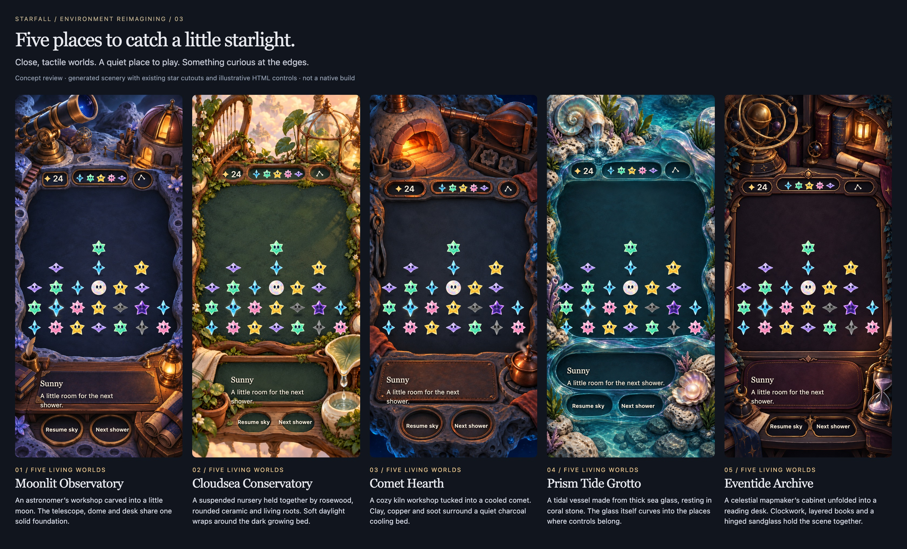

# Five living worlds for Starfall

**Status:** Structural template accepted; setting roster superseded; not adopted or packaged · **Owner:** current implementer · **Updated:** October 18, 2026

**Follow-through — October 18:** The user accepted this template and asked for new celestial/observatory settings compatible with the crystal cast. Continue with [five celestial homes](../celestial-worlds-04/README.md). This record retains the earlier setting exploration and source-bound captures. Its review engine and base styling also serve the new roster; the default view remains this original set.

Reimagine all five boards as close, tactile places that collect falling stars. Each has its own construction, large purposeful objects, a quiet play surface and controls recessed into the same material. This supersedes the two-scene composition brief: the user requested a total reimagining after the [Hearthstone study](../hearthstone-study/README.md).

**Decision:** Keep Starfall's cast and seven-column game. Replace the scenic-vista/large-slab approach with an astronomer's worksite, suspended nursery, comet workshop, glass tidal vessel and celestial reading cabinet. Native content must drive the production art layout.

**Next action:** Follow the celestial roster into the Crescent Observatory native proof and authored landscape arrangement. Retain this set as the structural reference; its flattened paintings are concept sources, not drop-in app backgrounds.

**Concept — not implementation evidence.** Built-in Imagegen scenery; existing packaged Starfall body cutouts; HTML reconstructions of idle faces and illustrative controls. The same fixed sample is placed in each world using the proposed portrait fit. The review also exposes the current app mapping. Generated art and text positions remain subject to native registration and accessibility checks.

Open [the interactive composition review](index.html) to select a world, compare all five, show empty/sparse/partly-filled/full samples, compare current versus proposed spacing, inspect the 49-cell overlay and expand the reading area. It works as a local file and makes no network requests. It is an art-review aid, not a game or native SwiftUI prototype.

## Each setting is built for a different purpose

| Setting | Physical construction | Material and light | Two responsive objects |
| --- | --- | --- | --- |
| **Moonlit Observatory** | A collecting well carved into a small lunar worksite; dome, telescope pedestal and foreground desk share a foundation | Worn blue moonstone, brushed brass, ink-dark collecting surface; local amber windows | Telescope pivots at its mount and opens its iris; lantern shutter opens and warms its corner |
| **Cloudsea Conservatory** | A suspended nursery within a wooden greenhouse workbench, with rooted supports and ceramic vessels | Rosewood, ivory ceramic, dark velvet moss; diffuse peach daylight | Harp string vibrates through its frame; dew catcher tips one drop into its bowl |
| **Comet Hearth** | A cooled comet hollow containing a kiln, connected bellows and cooling bed; foreground workbench shares the rock | Rounded terracotta, copper, charcoal basalt; contained ember warmth | Kiln vent opens onto a warm ember; kettle lid lifts once and releases a short curl of steam |
| **Prism Tide Grotto** | One thick glass tidal basin cradled by coral stone; its lower lip becomes a frosted reading shelf | Blue-green sea glass, shell, pearl; dark transparent depth and selective refraction | Fountain sends one ripple along its gutter; shell opens slightly around the pearl |
| **Eventide Archive** | A celestial mapmaker's cabinet unfolds into a charting desk; the orrery and sandglass have visible joints | Ebony, burgundy leather, layered paper, antique brass; local lamplight | Orrery makes one partial turn; sandglass pivots in its cradle and settles |

The props' responses are proposed choreography, not working animations in the review. Existing location identifiers and cosmetic preference can remain stable. No new locations, campaigns, unlocks, resources or rules are introduced.

## The design changes are structural

The board's center is the least elaborate surface. Big silhouettes and material transitions explain the setting at the edges. Each main object has a readable support and contact shadow. Quiet central shading leaves the stars' faces and non-color cues in front. A shared field and familiar control roles keep play understandable across all five worlds.

The score, five-star forecast and menu occupy small material recesses. The bottom conversation belongs to a desk, workbench or continuous basin lip. Native text and buttons will remain independently rendered and accessible. Decorative props never become required gameplay controls.

Three kinds of motion have different jobs:

- **Ambient:** at most two slow, bounded peripheral motifs, such as a lantern flicker or a moving dew highlight. No camera rocking or moving play surface.
- **Touch:** a short action with a physical cause and a visible return to rest. A joint pivots, a lid lifts, a shell opens. The whole prop must not simply rotate around an arbitrary cropped-image corner.
- **Gameplay:** committed arrivals, growth and clears retain their current scene ownership. Environment responses may acknowledge those events without changing score, rules, saves, input availability or shower timing.

Normal motion should be expressive. Reduce Motion and Calm effects retain a clear static/timed response without displacement; a quiet mode cannot hide an outcome or make an action incomprehensible. Restart, scene replacement, settings and backgrounding cancel pending responses under the existing generation contract.

## The real cast stays authoritative

**Existing native renderer export — source `6cc9efd`, iPhone 17e / iOS 27.0.** This is the cast reference, not evidence that the new worlds have run in the app. [Source and original validation](../../../evidence/crystal-glow-integration-2026-10-17/README.md).

The review loads existing Spark, Sunny, Pip, Twinkle, Nova, Dusk and Opal body PNGs directly from the asset catalog. Idle face shapes are reproduced in SVG from the current renderer for this static review. They are not a new production material owner. The illustrative sample includes a grown star, Dusk, Opal and gray drained pieces to expose contrast problems; it is not a Core-generated saved game, balancing sample or legal-move demonstration. Grown and drained cues are approximate in the HTML view and require the full native renderer for acceptance.

The reference portrait uses a 393 × 852 normalized canvas. **Current app mapping** freezes `LandingGeometry` at source `b7e9760`: the playfield spans 26–70.5% of the canvas height. **Proposed portrait fit**, the review default, spans 28.5–67%. Columns, row order and sprite sizes stay the same; vertical spacing becomes 46.9 points per row instead of 54.2 at this reference size. This gives the upper controls and foreground props more clearance. It is an explicit, unadopted geometry proposal, not current native behavior.

The proposed fit must retain at least 44-point native targets at every supported size, using reflow/scrolling where necessary. No change has been made to app hit testing. If adopted, rendering and native input must receive the same mapping from the existing single app owner, followed by real native taps at corners, boundaries and resized boards. The HTML copies are composition aids only; safe areas, animations and accessibility layouts are not certified by these screenshots.

## Phone and tablet need authored arrangements

| Situation | Proposed arrangement | Requirement before adoption |
| --- | --- | --- |
| Standard portrait | Large rear props, narrow side edges, dominant center, foreground reading bench | Every occupied position and growth silhouette stays visually clear; at least 44-point native targets remain reachable |
| Tablet landscape | Keep the board's useful size; extend the desk or basin into a connected side reading area, with the near prop at the outer edge | Author a wide composition with continuous ground and matching seams; no stretched portrait painting or pasted rectangular message wing |
| Small/short viewport | Preserve usable star size; use the app's vertical flow/scroll behavior when necessary | No shrink-to-fit text or cropped star/input boundaries |
| Large text or long dialogue | Let the reading bench extend below the arena; reflow actions and native content | Real Dynamic Type, scrolling, dismissal and restored play must be checked on Apple tooling |

The review's expanded reading-area switch demonstrates the direction of reflow only. Its plain extension is not final environment art, native Dynamic Type or accessibility evidence. This pass includes portrait concept art; a production landscape painting remains open.

## Build from a composition, then separate its responsibilities

1. Establish native board, HUD, dialogue and touch envelopes with current Core fixtures. Use empty, sparse, dense, grown, drained and Dusk states.
2. Register the broad quiet surface and fixed architecture against those envelopes. Keep joins stable through resizing; use authored corner/edge pieces and a quiet center rather than stretching one textured slab.
3. Separate the two moving props into base, moving part and matching occlusion/shadow layers. Put pivots at the real hinge or mounting point.
4. Add bounded peripheral effects and preserve native stars/text/buttons above the scenic layers. Reuse the current material factory and theme roles.
5. Validate the Observatory in normal motion and at interruption boundaries before extending the same rendering contract to the other four worlds. Reconcile against current main and its save contract before app integration.

This describes production work still to do. No new framework, 3D engine, SDK, runtime generator or network feature is needed for the proposed layer approach. Whether it performs well remains a measurement task.

## Acceptance and limits

- [x] Five materially and structurally distinct portrait concepts authored with exact prompts retained.
- [x] Shared HTML fixtures expose all 49 positions, sparse/empty scenes, controls and expanded reading content; local assets and review controls checked in Chromium.
- [ ] Native phone and tablet registration, all corners/rows, full touch targets and star aspect verified.
- [ ] Authored landscape composition, largest Dynamic Type, long dialogue and settings dismissal inspected.
- [ ] Actual layered prop motion, arrivals/clears, rapid taps, win/loss, restart and background/resume verified on Apple tooling.
- [ ] Core/save behavior, affected hosted/UI checks, Debug/Release builds and app resource membership verified after implementation.
- [ ] Physical-device feel and RC actual VoiceOver acceptance completed at their required stage.

The first painted compositions let rims and foreground props cross the low row and put some upper rails too near the high row. The full 49-position overlay exposed that shared failure. A mask-guided attempt cleared more floor but removed some control recesses and crowded the lower actions, so it was rejected. A smaller correction preserved the controls and moved foreground objects outward. The review then introduced the explicitly labeled proposed portrait fit above; current app spacing remains available for comparison and still exposes some edge/rail conflicts. Selected dense compositions were visually inspected. This does not establish native registration or guarantee exact generated pixels.

There are no app source, packaged resource, rule or save changes in this pass. Native builds and gameplay checks were not run because this batch is documentation and a local composition viewer. The successful browser checks are listed in [review-checks.json](review-checks.json); they do not establish native interaction or animation quality.

## Files and provenance

- `index.html`, `review.css`, `review.js`: offline review interface. It references existing body assets in the repository; open it from this folder, not as a lone copied file.
- `<place>-v2.png`: selected background-only concept painting. Generated with the built-in Imagegen tool; no Hearthstone art copied into these assets.
- `<place>-composition.jpg`, `five-worlds.jpg`: browser composition captures, clearly conceptual. They are not simulator captures.
- `prompts.json`: exact initial prompts, correction prompt, selected source paths and hashes. `layout-guide.svg` is the measured guide used in the rejected intermediate correction.
- [Hearthstone study](../hearthstone-study/README.md): the research behind this design. [Connected scenes 02](../connected-scenes-02/README.md) retains the superseded material exploration.

The structural direction is accepted. The replacement celestial roster, production asset separation and runtime adoption remain open. The current implementer owns the next native Observatory composition and landscape proof; do not promote these flattened paintings directly into the app target.
