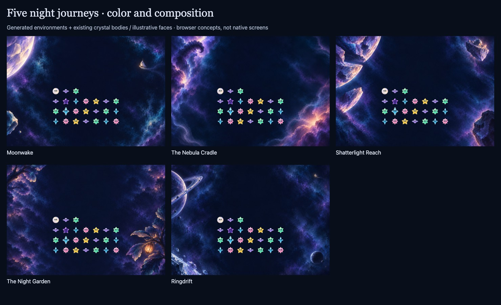

# Five night journeys: color and composition

**Status:** Ready for art review · **Owner:** current implementer · **Updated:** October 18, 2026

Ten selected paintings develop the user-approved [five scene kits](../scene-kits-07/README.md): one landscape and one deliberately rearranged phone composition for each destination. [Open the review](index.html) to compare them with the existing cast, a full field, grayscale and protected control regions. The review keeps the full seven-column field centered.

**Decision:** Use these as shared references for the five-plane asset kits. They are **flattened concept paintings**, not separated production layers or native screenshots. No app integration, installation or publication is included.

**Next action:** Produce coordinated transparent components from these references, beginning with one native assembly to verify crop, control clearance and motion before expanding the roster. The remaining material and prop refinements below travel with that handoff; a composition study does not establish animation or gameplay quality.

**Concept — not implementation evidence.** Built-in imagegen paintings with packaged crystal bodies and the existing illustrative browser faces. Local Chrome capture, October 18, 2026. The 24-star arrangement is a comparison fixture, not one saved round or a new rule.

## What each place contributes

| Destination | Selected identity | Handoff refinement |
| --- | --- | --- |
| [Moonwake](index.html?kit=moonwake) | A pearl lunar curve, delicate chart-sail and near ice | Keep the rim subordinate to the cast; remove residual streaming dust that could resemble a shower cue. |
| [The Nebula Cradle](index.html?kit=nebula) | Unequal gas banks, a dark curled fold and sheltered birth-light | Export independent banks and diffuse local glow; reduce residual tiny sky points. |
| [Shatterlight Reach](index.html?kit=shatterlight) | Curved pieces of one former world and a single surviving observatory lens | Simplify fragment edge grit and keep all pieces visibly disconnected. |
| [The Night Garden](index.html?kit=garden) | Open air above alien canopy, with one attached amber lantern pod | This is the densest setting. Simplify distant foliage and author the seed-moth as two tiny dark wings; its exact anatomy is not locked by the key. |
| [Ringdrift](index.html?kit=ringdrift) | Oblique orbital rings, a shepherd moon and the distant recurring sail | Preserve near/far ring occlusion and full crop-safe planet geometry. The phone key uses a small recognizable orbital silhouette. |

The kit’s proposed working choices were carried forward after the user’s approval: astronomical sail, diffuse birth-light without a face, one round observatory window, broad alien canopy fans and a readable ringed planet. No campaign, unlock sequence, gameplay props or scenery interactions were added.

## What changed during inspection

Initial phone outputs let landmarks descend into the HUD reservation; Shatterlight also gained a duplicate shelter. Targeted edits reduced and lifted the upper landmarks, lowered the bottom accents and removed the duplicate. The first Night Garden creature was too character-like; the correction reduces its role to background ecology, with the actual wing asset still to be authored.

Comparing the landscape paintings with all 49 cast positions exposed bright leaf, gas and ring edges approaching the left column and upper controls. A second clearance pass moved the major silhouettes outward. The selected captures show the corrected paintings. The remaining scenery is intentionally darker and less detailed through the middle. Some faint atmospheric texture still crosses reservation boundaries; these are visual targets rather than exact native exclusion masks.

The phone paintings demonstrate an alternate arrangement. They are **not** proof that a single flattened landscape crops well, and they are **not** a second collection of shipping backgrounds. The modular production kit should assemble both arrangements from shared complete objects, with glows and pivots separate as specified in the approved inventory. iPad portrait was planned in the prior kit but has no new painted composition in this round.

## Cast, controls and five-plane boundary

The existing shooting-star forecast, exact grouped score and Menu are retained in the prior [HUD study](../open-skies-05/README.md). This viewer only reserves their space; it does not redraw or independently validate those controls. There is no decorative cast row above play. The full field is fixed while the scenery changes.

The five depth planes and individual component inventories remain authoritative in [kit-data.js](../scene-kits-07/kit-data.js). They are displayed beside each painting in the review. A plane can contain several separately animated files; no claim is made that a flat painting has already supplied those files. All scenic planes remain behind cast and native controls, including near atmosphere.

Existing character reference

**Existing native renderer export, source `6cc9efd`; not produced by this round.** [Visual reference](../../VISUAL_REFERENCE.md) owns the cast and evidence context. The new review reuses packaged body art with illustrative faces from `../concept-cast.js`; it does not certify current native expression or animation parity.

## Verification and limits

`node check-review.cjs` passed in local Chrome: 40 scene/orientation/density combinations with centered fields; all ten selected paintings and cast images decoded; full-field, grayscale and protected-region views for each destination; keyboard selection; and no horizontal page overflow at 390 pixels. The viewer is static and creates no animation, including under emulated Reduce Motion. [Source hashes and results](review-checks.json) bind these claims to the inspected HTML, JS, CSS and artwork manifest.

Visually inspected all selected paintings, all landscape and phone compositions with the cast, dense protected-region pairs and grayscale samples. The revised landscape silhouettes leave more room for the HUD and outer stars; Ringdrift’s phone identity is readable. These are visual judgments for this art round, not measured native contrast or accessibility acceptance. Browser source and images changed during inspection; the final check record describes the selected versions.

Repository hygiene, diff whitespace and local documentation links passed. No app source, resources, target membership, rules, saves or build settings changed, so Swift tests and native builds were not run. Native safe areas, Dynamic Type, actual VoiceOver, hit mapping, full/reduced scenic motion, interruption handling and physical-device performance remain unverified. Markdown rendering was not inspected; the HTML review was.

## Files and provenance

Start at [index.html](index.html). `review.js` uses the approved kit’s geometry and shared cast helper; `review.css` styles this review only. The ten `*-key.png` files are the selected original imagegen outputs, unchanged after generation. `*-cast.jpg` and `overview.jpg` are browser composition captures. [manifest.json](manifest.json) records dimensions, source paths and SHA-256 hashes; [prompts.json](prompts.json) records the exact built-in prompts, input references, selected outputs and discarded iterations. There is no CLI fallback or externally vendored art in this round.

Unselected outputs remain at their original tool paths; they are not included as project assets. Generated paintings and review captures inherit this folder’s documentation boundary. The earlier mood paintings and research remain in their original folders with their original evidence.
