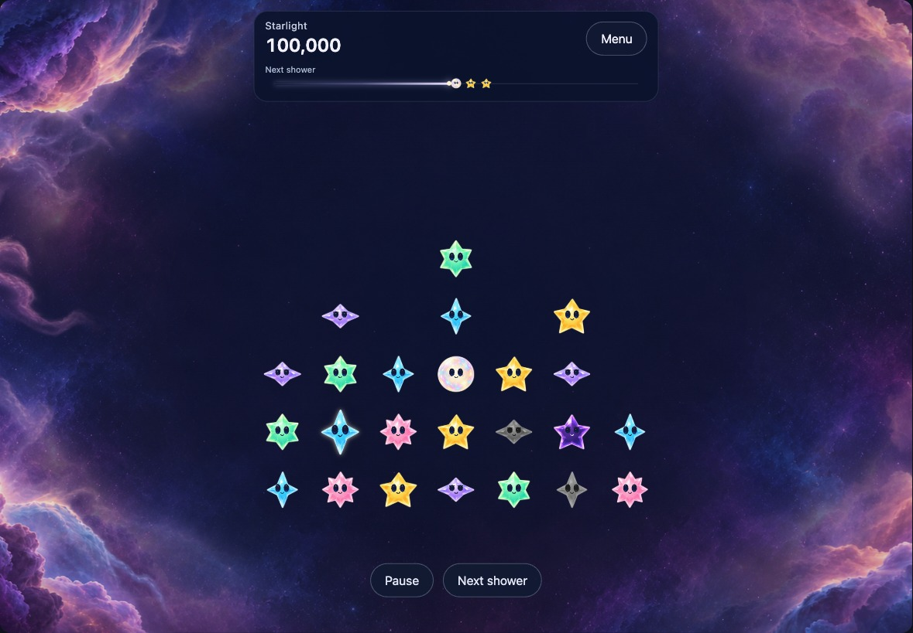
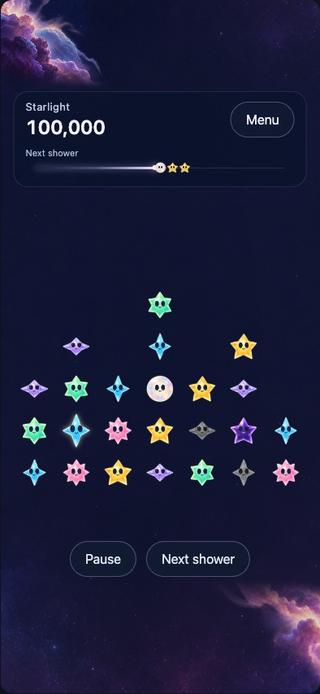
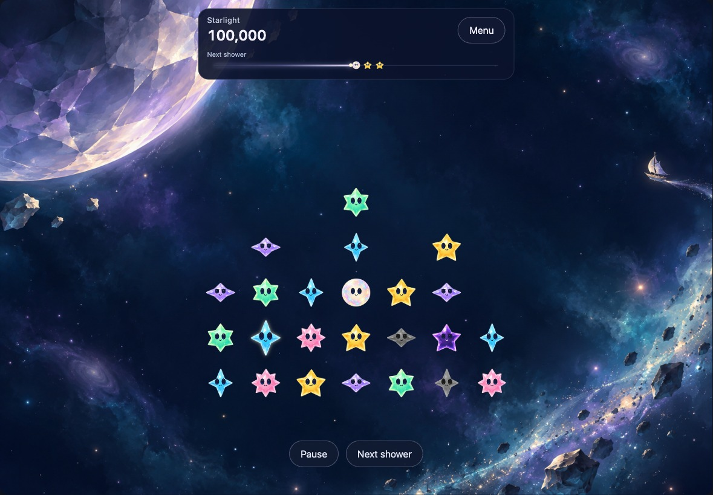

# Nightscapes around a centered game

**Status:** Revised browser concepts; native rollout held · **Owner:** current implementer · **Updated:** October 18, 2026

Keep the seven-column field centered and let the same cast travel through distinct nightscapes. **Nebula Cradle and Moonwake are the active starting points. Skysea Crossing is rejected for this direction** and retained only as historical material. The user’s journey idea provides world identity, not campaign or unlock progression. The [WoW study](../alien-nightscapes-06/README.md) develops that direction.

**This revision:** Five separate Nebula image planes, independent visibility and restrained motion; restored shooting-star forecast semantics; an exact large-score layout; a clearly named Menu; no decorative cast row or invented permanent Sunny message.

**Next action:** Review the layered composition and proposed destination identities, then prove one assembly with native centered geometry, real controls and hit mapping. No artwork or UI from this browser pass is packaged into the app.

[Open the interactive comparison](index.html). “Inspect layers, motion and HUD states” exposes the controls. The composition is illustrative, not a playable game.

**Concept — not native evidence.** Five generated scenic planes, existing packaged crystal bodies, shared illustrative HTML faces. The occupied rows sit in the lower part of a centered 49-position field; show guides to inspect the full field.

## What belongs in the HUD

| Element | Purpose and revised behavior | Remaining native work |
| --- | --- | --- |
| Starlight | Exact grouped score, default sample **100,000**. Tabular digits; give long values a full-width row rather than abbreviating, clipping or shrinking them. | The current app’s raw score layout has not been changed. Check its full range and Dynamic Type in native UI. |
| Shooting-star trail | Preserve the existing shower progress and incoming-star idea. The sample uses **Sunny, Sunny, Opal**, exported from `FallingSky.freshSurvival(seed: 23)` after five committed showers. A manual slider samples the native follower formula. Paused hides the trail. | Use the existing `SkyShowerTrail`, store deadline and committed forecast; this browser does not run a shower clock. |
| Menu | Clearly identifies the existing menu entry point. “Sky” was ambiguous and is removed. | Preserve native menu semantics and accessibility. |
| Pause / Resume and Next shower | Existing actions, named by the selected state. | Browser labels are illustrative; no game or menu is simulated. |
| Guidance | Active play has no fabricated permanent character sentence. Paused has a simple state label. | Existing character chat remains authoritative; inspect real event-driven dialogue and interruption states. |

The forecast fixture and the illustrative field/score are independent composition samples. They are not a screenshot of one reproducible game state. A quiet translucent backing gives the HUD consistent contrast, including over Moonwake’s bright moon edge. This is a readability proposal, not an approved replacement for every native HUD material.

## Assemble the surroundings, keep gameplay fixed

The [five-layer kit](nebula-layers/README.md) has an opaque deep-space plane and four alpha overlays: distant haze, left cloud, right cloud and near wisps. Each has a separate visibility control. Only scenery moves, with bounded translations over 23–41 seconds; disabling motion freezes it, Reduce Motion removes the animations, and hiding the page pauses them. No texture decoding or new asset creation occurs per animation frame.

Landscape anchors the two large cloud masses outside the field. Portrait composes them above the HUD and below the actions. An initial side-only portrait arrangement lost too much identity; the corner arrangement retains visible nebula forms. The images are independently generated approximations, not exact cutouts of the original painting. Inspect edge detail and lighting before considering production use.

| Nebula phone composition | Moonwake landscape reference |
| --- | --- |
|  |  |

**Browser concepts.** Moonwake remains a single painting: portrait cropping still loses its moon/sail identity. Its defining objects need separate layers before native adoption. The five-plane proof applies only to Nebula Cradle.

Native geometry should own one playfield center and a size derived from safe-area space. Rendering, tracing and accessibility must share its mapping. At ordinary text sizes, center the field in the usable play region. At accessibility sizes, reflow supporting content while retaining readable text and touch targets. Scenery never determines legal moves or cell positions. No projected contact shadows, platform, cell backgrounds or physical floor are proposed.

## Acceptance and checks

The revision’s acceptance criteria were: retain the centered field in all three profiles; support exact large scores without collisions; restore forecast meaning and paused visibility; name the menu; independently control five planes; keep gameplay fixed during scenic motion and stop that motion for Reduce Motion.

`check-review.cjs` passed in local Chrome for **two active settings × three profiles** (1180×820, 820×1180, 393×852): 49 cells, exact centering within 0.1 rendered pixels, at least 44 logical points per cell, decoded images and separated/contained controls. **42 score cases** cover zero through **9,223,372,036,854,775,807**, preserving exact digits. Playing/paused states, forecast identity, independent layer visibility, scene switching, sparse/empty states, guide/scenery controls and 390-pixel page width passed. The sampled CSS transform changed while field geometry stayed fixed; emulated Reduce Motion disabled animation. Earlier shared-cast viewers retained all 49 stars. [Source hashes and results](review-v2-checks.json).

Inspected Nebula landscape/phone and Moonwake landscape. The bright moon exposed insufficient score contrast; a common HUD backing corrects that composition problem. Browser checks establish the stated layout cases, not native touch, accessibility, texture memory, interruption behavior or perceived animation quality. Native app sources/resources, rules and saves are unchanged; core, simulator, actual VoiceOver and device checks are inapplicable to this documentation-only pass and were not rerun. Markdown rendering was not checked; the HTML review was.

Before adoption, verify centered safe-area geometry and real edge taps on iPad/phone; Dynamic Type; empty/dense/overflow comprehension; full/reduced motion; native background/settings/restart; texture budgets; and unchanged committed outcomes. Adopt one verified assembly or revise/remove it before expanding the native roster. Publication and installation remain held.

## Files and history

`index.html`, `review.css` and `review.js` own the offline viewer. `../concept-cast.js` is the existing shared illustrative helper; `forecast-snapshot.js` is a real core-exported forecast fixture with provenance. `nebula-layers/` owns generated planes and their prompts/hashes. Original painting provenance remains in `prompts.json`.

`*-v2-concept.jpg` and `review-v2-checks.json` belong to this revision. The earlier `*-concept.jpg` captures and `review-checks.json` retain the superseded fixed-cast/Sky HUD and three-world comparison at source `72929a9`; they are historical, not current UI evidence. Regenerate revision checks/captures with `node check-review.cjs` using the bundled Playwright/Chrome paths recorded there.

**Publication boundary, October 18:** the rejected Skysea tall composition is omitted from the published package. The active viewer already excludes it; historical manifest entries retain the original study record. The five approved nightscapes are owned by [production](../night-production-09/README.md).
