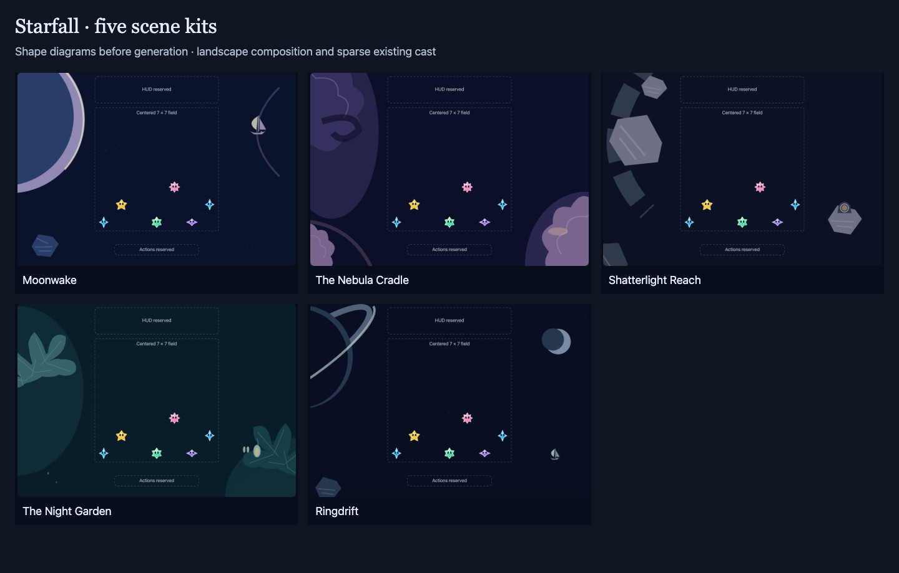

# Five night journeys: scene kits before artwork

**Status:** Approved for color/composition studies · **Owner:** current implementer · **Updated:** October 18, 2026

Plan each location before generating finished art. [Open the storyboard desk](index.html) to compare five destinations, their five depth planes, separately authored assets, signature props and three environmental beats. Switch device shape, layer visibility and cast density to inspect the composition. The drawings are shape diagrams, not proposed final artwork or native screenshots.

**Decision:** Keep the same expressive crystal cast traveling through a coherent universe. Give each stop a distinct silhouette and a small environmental story. Five depth planes do not mean five flattened paintings: independently animated objects remain separate assets within a plane.

**Next action:** Review the [painted color/composition round](../night-keys-08/README.md), produced after the user approved these kits. It carries forward each proposed working choice. This folder retains the planning diagrams and their source-bound check record; the new artwork has its own folder. Production component exports, native integration and publication remain separate work.

## Shared composition contract

- Center the complete seven-column field. Protect the existing score, shooting-star forecast, Menu and lower actions. Storyboard labels mark these reservations; they are not new in-game labels or a HUD redesign.
- Use five planes: distant sky; defining distant feature; middle-distance forms; signature objects; near edge atmosphere. All scenery remains behind the cast and controls, including the plane called “near.” The playable field never moves with scenery.
- Author landscape and portrait arrangements of the same objects. Phone has little side clearance: move landmarks above the HUD or below the actions, rather than shrinking the cast or cutting away the destination’s identity.
- Keep night values and soft painterly materials. Use broad, low-contrast shapes at distance and isolated warm lights outside the game. Decorative particles have no star faces, jewel silhouettes or incoming-shower trails.
- Retain Moonwake’s tiny celestial sail as a possible traveler motif in Moonwake and Ringdrift. Do not paste it into every scene. The cast supplies continuity; place-specific ecology, geology and light supply variety.

| Moonwake: existing mood reference | Nebula Cradle: existing mood reference |
| --- | --- |
|  |  |

**Previously generated concepts, not new artwork.** Preserve their sense of scale and warmth. The kit diagrams decide what to separate, move or simplify; they do not certify that every painted edge is production-ready. [Cast and native visual references](../../VISUAL_REFERENCE.md) remain authoritative for the characters.

## What the three storyboard frames mean

**Arrival** is a composition establishing the place; **settled play** is its normal quiet state; **small discovery** samples one optional ambient moment. The frames are review poses, not a three-step gameplay sequence or a blocking introduction. They do not introduce travel maps, tasks, points, collectibles, campaign progression or unlocks.

Only one local scenic accent should move at a time, over the optional slow baseline drift. A future scene presenter can own its bounded schedule and cancel it on scene replacement, restart, backgrounding or menu suspension; never queue missed effects. Reduce Motion and Calm effects use a still settled pose with the same landmark and full gameplay. No new scenery touch targets are proposed. If interaction is later requested, it needs an explicit purpose and native target/exclusion review.

## Art handoff

The viewer’s inventory is the source for per-kit asset IDs, depth, anchors and motion. Produce the defining silhouette and a small value/color key first. Approve their relationship with the cast before high-detail full assets.

For each kit, deliver one continuous opaque base and tightly bounded transparent object files at one consistent camera, scale and light direction. Separate bodies from glows, sails from hulls, and anything that needs its own pivot. Supply complete silhouettes beyond visible crops, soft alpha edges, a small overscan margin and no baked cast, HUD, floor, shadows under stars or cell grid. Do not generate all assets independently without a shared approved composition reference.

Record intended aspect ratio, local pivot, attachment points, safe crop edges and motion extent in the manifest. “Upper-left” and other anchors in these briefs describe semantic placements relative to the protected regions, not device-specific pixel coordinates. The diagrams use the previous browser field dimensions only as a comparison fixture; native safe areas and Dynamic Type remain authoritative at implementation.

## Acceptance for this planning pass

Before calling the desk ready for review, verify that every kit has five independently inspectable planes, an explicit asset inventory, two signature props/forms, three described beats, a portrait plan, a quiet-motion plan and a named unresolved design question. Check all five diagrams at three device shapes; field centering and cast counts; layer visibility; beat switching; readable narrow-page controls; and decoded existing assets. Inspect the rendered diagrams and keep diagram evidence distinct from native verification.

The later art decision requires recognizable silhouettes in grayscale and thumbnails, coherent lighting, no scenic competition with the stars and a landmark that survives portrait. The later native decision adds real tap mapping, Dynamic Type, texture budgets, full/reduced motion and interruption checks. These remain unverified at this stage.

## Files and boundaries

`kit-data.js` owns the five briefs, assets and beats. `diagrams.js` draws the deliberately simple shape studies; `review.js` assembles the desk. `index.html` and `review.css` own the review surface. This folder is planning-only and contains no new generated artwork or app resources; retained raster captures depict the schematic review only. The [WoW study](../alien-nightscapes-06/README.md) supplies reference analysis. The old [location brief](../LOCATION_BRIEF.md) informed this structure; its physical rim and required interactive-prop assumptions are superseded by the user’s open-space direction.

## Kit index

| Kit | Signature forms | Named asset entries |
| --- | --- | --- |
| [Moonwake](index.html?kit=moonwake) | Pearl moon, chart-sail and ice | 8 |
| [The Nebula Cradle](index.html?kit=nebula) | Unequal gas banks, birth-light and dust curl | 7 |
| [Shatterlight Reach](index.html?kit=shatterlight) | Broken planetary curve and surviving lens shelter | 8 |
| [The Night Garden](index.html?kit=garden) | Alien canopy, attached lantern pod and seed-moth | 9 |
| [Ringdrift](index.html?kit=ringdrift) | Orbital arcs, shepherd moon and distant recurring sail | 10, including 3 reused Moonwake parts |

These counts describe controllable parts, not separate generation calls. Glows, masks and related fragments can share an authored source and export separately. The asset inventory specifies where independent pivots or alpha are needed.

**Planning diagrams — not generated setting art or native evidence.** Local Chrome capture of this storyboard desk, October 18, 2026. The retained [check record](review-checks.json) binds the browser source files by SHA-256.

## Review checks and remaining uncertainty

`node check-review.cjs` passed in local Chrome: 15 kit/device combinations with centered cast fields, 49 dense cast positions, five planes, two signature props/forms and three storyboard frames per kit; 25 layer toggles; 15 frame selections; keyboard kit selection; decoded existing cast/reference images; and no page overflow at 390 pixels. Grayscale and reserved-region controls worked. The storyboard is static and creates no automatic animations, including under emulated Reduce Motion. Source hashes and limits are in the check record. Repository hygiene, local links and diff whitespace checks passed.

Inspected all five landscape and phone diagrams and the full Moonwake desk. Portrait inspection prompted a clearer Night Garden canopy and a more explicit Ringdrift planet/ring arrangement. **Ringdrift’s portrait identity remains the highest visual uncertainty:** its final art needs a readable orbital silhouette in a very shallow upper region. The third storyboard frame is a detail enlargement for art review, not a proposed camera zoom during play.

The browser drawings establish the planning structure and sampled composition only. Finished materials, perceived depth, actual animation quality, native safe-area geometry, hit behavior, Dynamic Type, VoiceOver and device performance remain unverified. App sources, rules, saves and resources are unchanged, so no Swift tests or native build were run for this planning-only change. Markdown rendering was not inspected; the HTML desk was.
